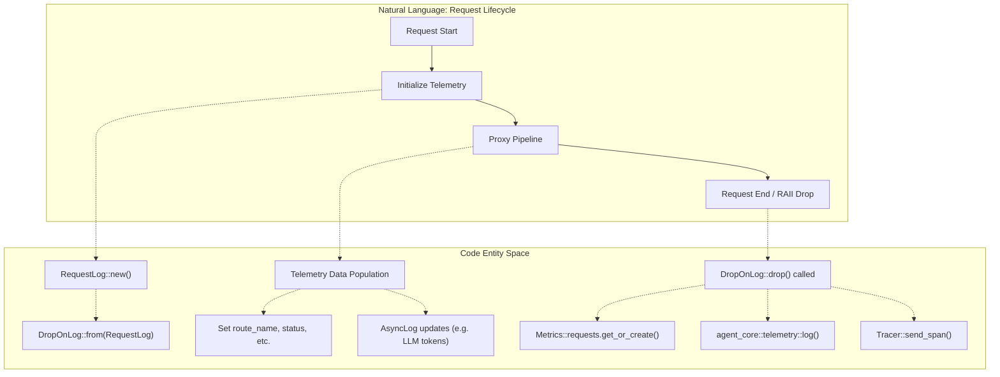
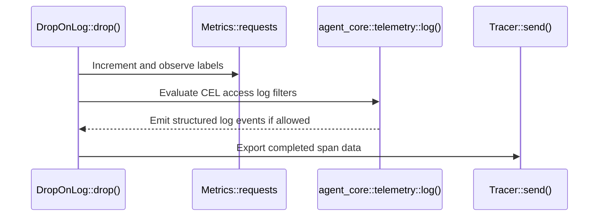
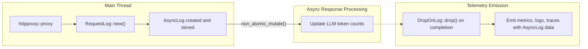
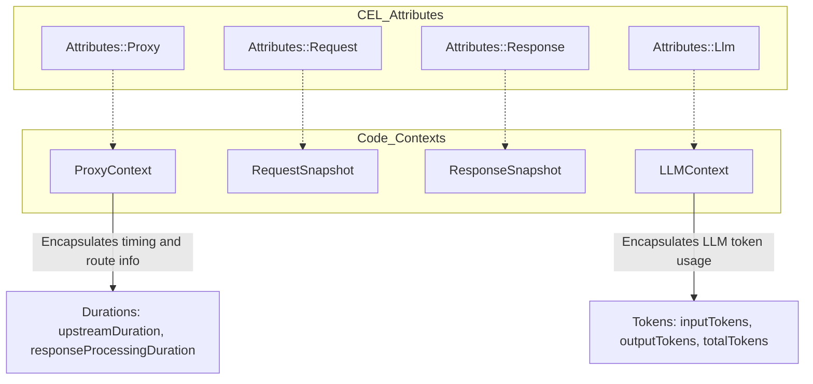

<!-- source: DeepWiki mcp.deepwiki.com · repo agentgateway/agentgateway · page 10.1 Telemetry Architecture · fetched 2026-10-21 -->

# Telemetry Architecture

<details>
<summary>Relevant source files</summary>

The following files were used as context for generating this wiki page:

- [crates/agentgateway/src/llm/mod.rs](crates/agentgateway/src/llm/mod.rs)
- [crates/agentgateway/src/llm/tests.rs](crates/agentgateway/src/llm/tests.rs)
- [crates/agentgateway/src/telemetry/log.rs](crates/agentgateway/src/telemetry/log.rs)
- [crates/agentgateway/src/telemetry/metrics.rs](crates/agentgateway/src/telemetry/metrics.rs)
- [crates/agentgateway/src/telemetry/trc.rs](crates/agentgateway/src/telemetry/trc.rs)
- [crates/agentgateway/tests/tests/llm.rs](crates/agentgateway/tests/tests/llm.rs)
- [crates/core/src/lib.rs](crates/core/src/lib.rs)
- [crates/core/src/metrics.rs](crates/core/src/metrics.rs)
- [crates/core/src/telemetry.rs](crates/core/src/telemetry.rs)
- [crates/core/src/tokio_metrics.rs](crates/core/src/tokio_metrics.rs)

</details>


## Purpose and Scope

The telemetry architecture provides comprehensive observability for AgentGateway through three integrated pillars: Prometheus metrics, OpenTelemetry distributed tracing, and structured logging with CEL-based filtering. The system is designed around a central `RequestLog` abstraction that collects telemetry data throughout the request lifecycle and emits all observability signals atomically when the request completes, utilizing a RAII (Resource Acquisition Is Initialization) pattern to ensure logs and metrics are always emitted even on early exit or error.

Sources: `[crates/agentgateway/src/telemetry/log.rs:1-54]`, `[crates/agentgateway/src/telemetry/trc.rs:22-40]`

---

## Architecture Overview

The telemetry system is composed of the following key components:

1.  **RequestLog**: A struct that gathers telemetry data for each request as it flows through the proxy pipeline. It captures timing, network info, protocol versions, response status, LLM usage, MCP operations, and more `[crates/agentgateway/src/telemetry/log.rs:1-205]()`.
2.  **DropOnLog**: An RAII wrapper around `RequestLog` that emits metrics, logs, and traces when it is dropped. This guarantees telemetry emission regardless of how the request pipeline terminates `[crates/agentgateway/src/telemetry/log.rs:1-54]()`.
3.  **Metrics**: Prometheus metric families for HTTP, GenAI/LLM, and MCP monitoring. Metrics are updated only upon `DropOnLog` drop, aggregating per-label counters and histograms `[crates/agentgateway/src/telemetry/log.rs:42-45]()`.
4.  **Tracer**: Wraps OpenTelemetry tracing provider and batch span processor, managing span creation, attribute injection, and export filtering based on CEL expressions `[crates/agentgateway/src/telemetry/trc.rs:22-163]()`.
5.  **AsyncLog**: Allows asynchronous mutation of certain telemetry data (notably LLM token usage) after the main `RequestLog` is moved forward in the pipeline. This supports late updates from streaming response tasks `[crates/agentgateway/src/telemetry/log.rs:1-54]()`.

### Request Lifecycle and Telemetry Flow

The diagram below maps the natural language phases of a request to the corresponding code entities for telemetry collection and emission.



Sources: `[crates/agentgateway/src/telemetry/log.rs:1-205]()`, `[crates/agentgateway/src/telemetry/trc.rs:22-163]()`, `[crates/core/src/telemetry.rs:172-220]()`

---

## RequestLog: Central Telemetry State

### Overview

The `RequestLog` struct is the primary data container accumulating observability state for each proxied request. It captures key attributes from start to end, making all telemetry available for metrics, logs, and traces.

### Important Fields

| Attribute | Type | Description |
|-----------|------|-------------|
| `start` | `Timestamp` | The start time of the request |
| `tcp_info` | `TCPConnectionInfo` | Network connection info: peer/source IP and port |
| `tls_info` | `Option<TLSConnectionInfo>` | TLS negotiation details such as SNI or ALPN |
| `scheme`, `host`, `path`, `version` | `Option<Strng>`, `Option<Strng>`, `Option<Strng>`, `Option<Strng>` | HTTP request metadata |
| `route_name`, `bind_name`, `listener_name` | `Option<Strng>` | Logical routing information |
| `status` | HTTP status code | Response status code to report |
| `llm_response` | `AsyncLog<LLMInfo>` | LLM/GenAI usage stats collected asynchronously |
| `mcp_status` | `AsyncLog<MCPInfo>` | MCP (Model Context Protocol) operation details |

This structure is initialized early in the pipeline and passed along as context, collecting incremental info such as applied policies, backend metadata, and AI provider details.

Sources: `[crates/agentgateway/src/telemetry/log.rs:1-54]()`

---

## DropOnLog: RAII Pattern for Telemetry Emission

### Concept

`DropOnLog` acts as a RAII guard around a `RequestLog`. When the guard goes out of scope and is dropped, telemetry emission (metrics, logs, and traces) happens automatically.

This pattern guarantees telemetry always gets emitted to the output sinks—critical for reliable visibility even if requests end abnormally.

### Drop Logic

At drop time, `DropOnLog`:

1.  Calculates total request duration based on recorded timestamps.
2.  Updates Prometheus metric families for HTTP requests, GenAI usage, and MCP calls, using label sets extracted from `RequestLog`.
3.  Determines whether to emit structured logs by evaluating CEL filter expressions (`should_export_span`) against the `RequestLog` context.
4.  Emits structured logs with rich key/value pairs.
5.  Sends traces to OpenTelemetry export pipeline, attaching custom resource attributes and request-specific tags.



Sources: `[crates/agentgateway/src/telemetry/log.rs:1-54]()`, `[crates/agentgateway/src/telemetry/trc.rs:34-90]()`, `[crates/core/src/telemetry.rs:172-220]()`

---

## AsyncLog: Late Mutation Pattern for Telemetry

### Motivation

Some telemetry data, such as AI/LLM token usage or MCP operation state, become fully known only after the main request processing moves forward (e.g., streaming responses are consumed asynchronously).

### Implementation

`AsyncLog<T>` uses atomic synchronization primitives (`AtomicCell` etc.) to enable non-atomic mutation from asynchronous tasks and eventual consumption on Drop.

This pattern avoids complex lock contention yet guarantees the latest available state is used when emitting telemetry on drop.



Sources: `[crates/agentgateway/src/telemetry/log.rs:1-54]()`, `[crates/agentgateway/src/telemetry/trc.rs:22-90]()`

---

## Metrics System

The telemetry system defines rigorous metrics for HTTP, GenAI, and MCP request observability:

-   **RouteIdentifier**: Labels capturing request routing context (`bind`, `gateway`, `listener`, `route`, `rule`) used broadly as a base label set `[crates/agentgateway/src/telemetry/metrics.rs:26-32]()`.
-   **HTTPLabels**: Enriches `RouteIdentifier` with HTTP method, status, protocol version, and optional failure reasons `[crates/agentgateway/src/telemetry/metrics.rs:94-107]()`.
-   **GenAILabels**: LLM-specific labels including model, provider, token counts, and AI service tier `[crates/agentgateway/src/telemetry/metrics.rs:110-121]()`.
-   **MCPCall**: Metrics for MCP protocol backend call durations, error types, and success counts `[crates/agentgateway/src/telemetry/metrics.rs:170-182]()`.

Metrics are updated exclusively in `DropOnLog::drop()`, ensuring they reflect complete request outcomes atomically.

Sources: `[crates/agentgateway/src/telemetry/log.rs:42-45]()`, `[crates/agentgateway/src/telemetry/metrics.rs:26-182]()`

---

## Distributed Tracing

### Tracer Struct and OpenTelemetry Integration

The `Tracer` struct encapsulates the OpenTelemetry `SdkTracerProvider` with batch span processing `[crates/agentgateway/src/telemetry/trc.rs:23-28]()`. It supports multiple OTLP export protocols (gRPC and HTTP) configured for the backend telemetry system.

-   Resource attributes (e.g., `service.name`, `service.version`) injected globally `[crates/agentgateway/src/telemetry/trc.rs:173-210]()`.
-   Spans cover start/end timestamps, parent context for span chaining, and rich attribute sets describing the request `[crates/agentgateway/src/telemetry/trc.rs:101-134]()`.
-   The exporter selection and batching are governed by configuration.

### Trace Sampling and Filter

Trace export is filtered by CEL expressions that have access to any request attribute context. This allows:

-   Sampling on error statuses (e.g., 100% of failures).
-   Random or client-based sampling for successful requests.

```rust
pub(crate) fn should_export_span(filter: Option<&cel::Expression>, exec: &cel::Executor) -> bool {
    match filter {
        Some(f) => exec.eval_bool(f),
        None => true,
    }
}
```

Sources: `[crates/agentgateway/src/telemetry/trc.rs:22-184]()`, `[crates/agentgateway/src/telemetry/trc.rs:34-39]()`

---

## Structured Logging with CEL Expressions

### Dynamic Log Generation

Logging uses CEL expressions to evaluate arbitrary fields dynamically at request completion for a fully structured, filterable log output.

-   Clients define CEL expressions for fields or filters.
-   The system evaluates expressions against a detailed `Executor` context containing request, response, proxy metadata, LLM usage, JWT claims, backend info, and more.
-   This yields rich, structured logs suitable for downstream observability tools.

### CEL Context Mapping and Attributes

The following diagram shows how different CEL attribute flags correspond to code context entities available for log evaluation.



Key fields available to CEL expressions for logging include:

| Category | Key | Description |
|----------|-----|-------------|
| Proxy | `proxy.requestProcessingDuration` | Time spent before sending upstream request |
| Proxy | `proxy.upstreamDuration` | Duration waiting for upstream response |
| Proxy | `proxy.responseProcessingDuration` | Time processing upstream response |
| Request | `request.method` | HTTP method of the request |
| Request | `request.path` | Request path |
| Response | `response.code` | HTTP status code |
| LLM | `llm.totalTokens` | Total AI tokens involved in the request |
| LLM | `llm.provider` | AI provider name (e.g., "openai") |

Sources: `[crates/agentgateway/src/cel/mod.rs:109-141]()`, `[crates/agentgateway/src/cel/types.rs:39-81]()`, `[crates/agentgateway/src/cel/types_test.rs:116-150]()`

---

# Summary

The AgentGateway telemetry system is an integrated observability framework that combines:

-   **Centralized telemetry state**: `RequestLog` collects metrics, logs, and distributed tracing info throughout request duration.
-   **Guaranteed emission**: via `DropOnLog` RAII pattern ensuring telemetry is emitted regardless of early exit.
-   **Late bound updates**: via `AsyncLog` for asynchronous enrichments such as streaming LLM usage.
-   **Rich metrics**: via standardized Prometheus label families for HTTP, AI, and MCP protocols.
-   **OpenTelemetry Tracing**: flexible, CEL-filtered tracing capture with global resource attributes.
-   **Dynamic structured logging**: enabled by runtime CEL expressions evaluated against rich contexts.

Together, these components enable detailed, consistent, and configurable telemetry outputs suitable for diagnostics, observability dashboards, and AI usage analytics.

Sources: All above sources collectively.

---

