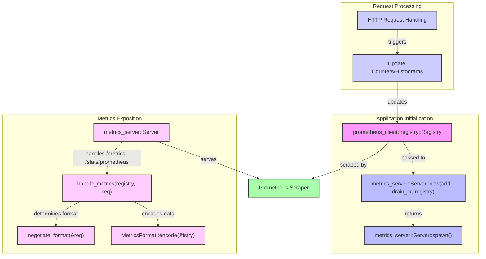
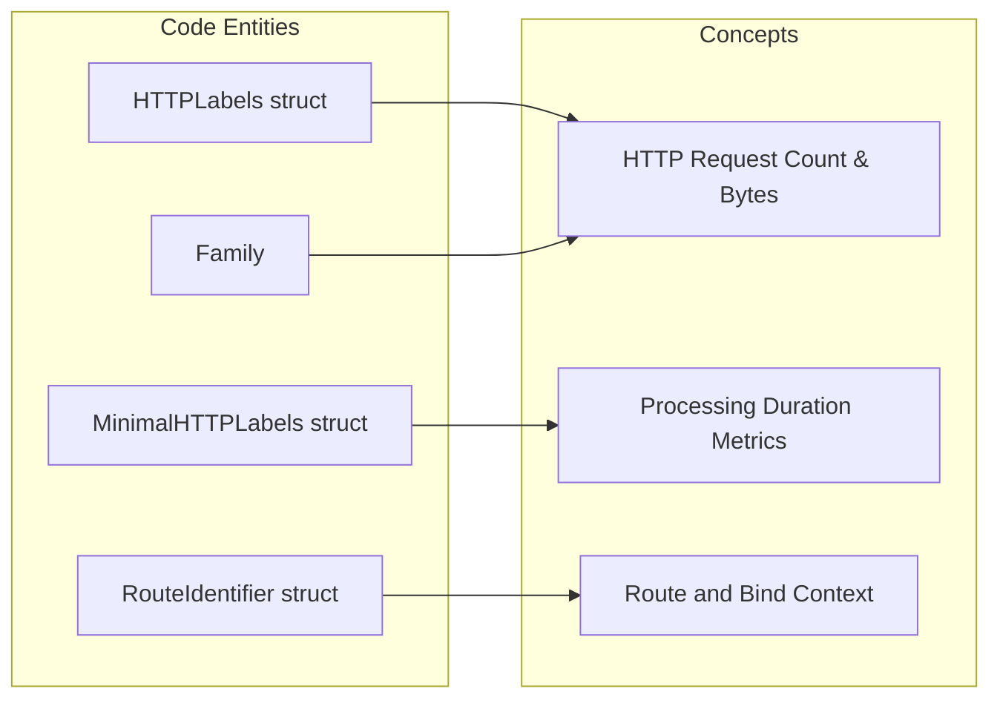
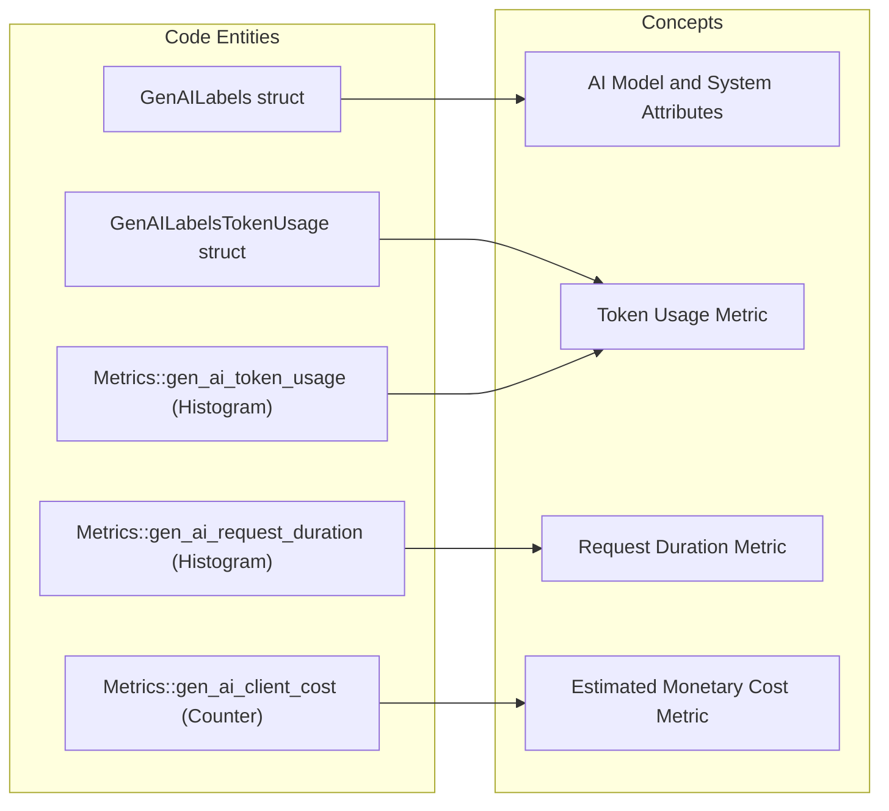
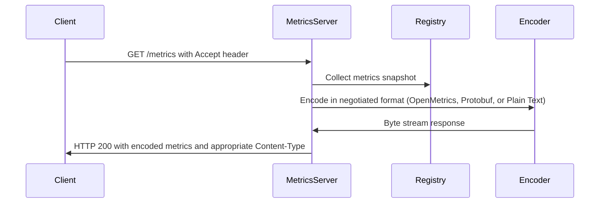
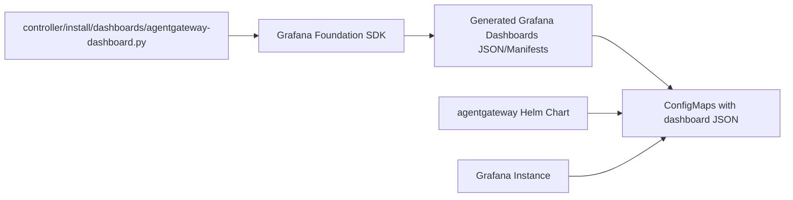

<!-- source: DeepWiki mcp.deepwiki.com · repo agentgateway/agentgateway · page 10.2 Metrics Collection · fetched 2026-10-21 -->

# Metrics Collection

Relevant source files

The following files were used as context for generating this wiki page:

- [controller/install/dashboards/README.md](controller/install/dashboards/README.md)
- [controller/install/dashboards/agentgateway-dashboard.py](controller/install/dashboards/agentgateway-dashboard.py)
- [controller/install/helm/agentgateway-standalone/files/agentgateway-dashboard.json](controller/install/helm/agentgateway-standalone/files/agentgateway-dashboard.json)
- [controller/install/helm/agentgateway/files/agentgateway-dashboard.json](controller/install/helm/agentgateway/files/agentgateway-dashboard.json)
- [controller/install/helm/agentgateway/templates/NOTES.txt](controller/install/helm/agentgateway/templates/NOTES.txt)
- [crates/agentgateway/src/management/hyper_helpers.rs](crates/agentgateway/src/management/hyper_helpers.rs)
- [crates/agentgateway/src/management/metrics_server.rs](crates/agentgateway/src/management/metrics_server.rs)
- [crates/agentgateway/src/management/readiness_server.rs](crates/agentgateway/src/management/readiness_server.rs)
- [examples/mcp-telemetry/README.md](examples/mcp-telemetry/README.md)

## Purpose and Scope

This page documents the Prometheus metrics collection subsystem of Agentgateway. It explains the implementation details of how metrics are defined, collected, labeled, and exposed for scraping. The page also covers important label families, the use of custom fields and optional labels, metrics emitted during HTTP, TCP, MCP, and Gen AI request processing, as well as the exposition formats supported by the metrics server. Lastly, it describes the Grafana dashboards generated for visualization and Kubernetes monitoring integration via `PodMonitor` and `ServiceMonitor`.

This page corresponds to section **10.2** of the Observability documentation. For related topics, see [10.3 Distributed Tracing](), [10.4 Structured Logging with CEL](), and [schema/metrics.md]() for metric definitions.

Sources:
[crates/agentgateway/src/management/metrics_server.rs:1-123]()
[examples/mcp-telemetry/README.md:1-65]()
[controller/install/dashboards/agentgateway-dashboard.py:1-249]()
[controller/install/helm/agentgateway/templates/NOTES.txt:1-28]()
[controller/install/helm/agentgateway-standalone/files/agentgateway-dashboard.json:1-273]()
[controller/install/helm/agentgateway/files/agentgateway-dashboard.json:1-258]()
[controller/install/dashboards/README.md:1-14]()
[crates/agentgateway/src/management/readiness_server.rs:1-99]()
[crates/agentgateway/src/management/hyper_helpers.rs:1-235]()

---

## Metrics System Architecture

Agentgateway integrates the `prometheus_client` Rust crate for metrics collection. Metrics are initialized at application startup and collected throughout the request lifetime. The collected metrics are exposed over HTTP to Prometheus scrapers.

### Initialization and Data Flow

Upon application startup, Agentgateway creates a root Prometheus registry and obtains a prefixed sub-registry named `"agentgateway"`. The core metrics are instantiated as an `Arc` shared pointer of a `Metrics` struct containing multiple metric families, each representing a different subgroup of telemetry.

During request processing, the collected metric counters, histograms, and gauges are updated through abstractions that include structured label sets. At server runtime, an internal metrics HTTP server listens at configured endpoints such as `/metrics` or `/stats/prometheus`. It exposes metrics in the format selected by content negotiation (e.g., OpenMetrics text, Prometheus protobuf, or plain text).

Sources:
[crates/agentgateway/src/management/metrics_server.rs:21-44]()
[crates/agentgateway/src/management/metrics_server.rs:46-60]()
[crates/agentgateway/src/management/metrics_server.rs:95-123]()

---

## Metric Types and Labels

Agentgateway defines strongly-typed label sets to organize dimensions of metrics. Labels are implemented using `EncodeLabelSet` and related traits from the Prometheus client library, enabling metrics to be grouped by meaningful metadata.

### Core Label Sets

| Label Set Name | Purpose | Key Labels & Description |
|---|---|---|
| `RouteIdentifier` | Contextualizes route topology | `bind`, `gateway`, `listener`, `route`, `route_rule` |
| `HTTPLabels` | HTTP request metrics | `backend`, `protocol`, `method`, `status`, `reason`, plus `RouteIdentifier` flattened |
| `MinimalHTTPLabels` | Minimal HTTP labels for processing | `backend`, `RouteIdentifier`, plus custom fields |
| `GenAILabels` | Generative AI request attributes | `gen_ai_operation_name`, `gen_ai_system`, `gen_ai_request_model`, `gen_ai_response_model`, `RouteIdentifier` |
| `GenAILabelsTokenUsage` | AI token usage metrics | `gen_ai_token_type`, plus embedded `GenAILabels` |
| `MCPCall` | MCP protocol call attributes | `method`, `resource_type`, `server`, `resource`, `RouteIdentifier` |
| `TCPLabels` | TCP and connection data | `bind`, `gateway`, `listener`, `protocol` |
| `ConnectLabels` | Outbound connection transport | `transport` |
| `GuardrailLabels` | Guardrail enforcement events | `phase` (Request/Response), `action` (Allow, FailOpen, Audit, Mask, Reject) |
| `CostCatalogLookupLabels` | Model cost catalog lookups | `status`, plus embedded `GenAILabels` |

Each label set uses wrappers like `DefaultedUnknown<T>` to encode missing or empty string labels as `"unknown"` for consistency, improving Prometheus querying.

### Custom Metric Fields and Optional Labels

Agentgateway supports injecting additional dynamic labels in metrics using **custom CEL fields**. These custom fields are handled via the `CustomField` type and flattened into Prometheus label sets. When label values are missing, an encoding mechanism converts them to `"unknown"`, ensuring no empty label values appear in metrics.

This design enables flexible, policy-driven metric labeling and fine-grained filtering during metric collection.

Sources:
[examples/mcp-telemetry/README.md:43-51]()

---

## HTTP Request Metrics

Agentgateway captures detailed metrics for incoming HTTP requests to track throughput, latency, success/failure, retries, and data volume.

### Key HTTP Metrics

| Metric Name | Metric Type | Description |
|---|---|---|
| `requests` | Counter | Total number of HTTP requests |
| `request_duration` | Histogram | Total duration of an HTTP request |
| `request_processing_duration` | Histogram | Time from receiving request to sending outbound call |
| `response_processing_duration` | Histogram | Time from outbound response to sending HTTP response |
| `response_bytes` | Counter | Total bytes sent in HTTP responses |
| `retries` | Counter | Total number of request retries |

### HTTP Metrics Labeling

The `HTTPLabels` struct aggregates essential HTTP metadata plus routing context, such as backend name, HTTP method, protocol, status code, and response reason, facilitating multidimensional metrics analysis.

The `RouteIdentifier` nested within these labels identifies the bind, gateway, listener, route, and route rule, preserving request topology context.

Sources:
[examples/mcp-telemetry/README.md:43-51]()

---

## Gen AI Metrics (Semantic Conventions)

Agentgateway tracks advanced metrics related to generative AI (LLM) requests, including token usage, durations, and costs, following observability best practices.

### Generative AI Metrics Collected

| Metric Name | Metric Type | Description |
|---|---|---|
| `gen_ai_token_usage` | Histogram | Distribution of token usage by type |
| `gen_ai_client_cost_usd` | Counter (f64) | Cumulative monetary cost of generative AI requests |
| `gen_ai_request_duration` | Histogram | Duration of Gen AI requests, including errors |
| `gen_ai_time_per_output_token` | Histogram | Time spent generating each output token |
| `gen_ai_time_to_first_token` | Histogram | Time to first token (TTFT) for streamed responses |
| `cost_catalog_lookups` | Counter | Number of model cost catalog lookups by status |

### Gen AI Metrics Labeling and Relation

The `GenAILabels` family contains detailed attributes like operation name, AI system, request model, and response model, embedded in token usage and cost lookups as well.

Sources:
[examples/mcp-telemetry/README.md:43-51]()

---

## MCP Protocol Metrics

Agentgateway monitors Model Context Protocol (MCP) interaction metrics to capture the usage of MCP RPC methods.

| Metric Name | Metric Type | Description |
|---|---|---|
| `mcp_requests` | Counter | Number of MCP protocol method calls |

The `MCPCall` labels cover method, resource type (operation), server target, resource name, and route context, allowing detailed call pattern analysis.

Sources:
[examples/mcp-telemetry/README.md:43-51]()

---

## Transport and Connection Metrics

Metrics at the TCP and transport level capture inbound client connections, bytes transferred, TLS handshake durations, upstream connections, and outbound call latency.

| Metric Name | Metric Type | Description |
|---|---|---|
| `downstream_connection` | Counter | Number of downstream client connections |
| `tcp_downstream_rx_bytes` | Counter | Total bytes received from client |
| `tcp_downstream_tx_bytes` | Counter | Total bytes sent to client |
| `tls_handshake_duration` | Histogram | Duration of inbound TLS handshake |
| `upstream_connect_duration` | Histogram | Duration to establish upstream connection |
| `upstream_call_duration` | Histogram | Time spent in outbound calls |

Outbound call labels allow distinguishing primary requests, policy-related calls, mirrors, and subtypes including HTTP, LLM, MCP, external authorization, guardrails, rate limiting, and OIDC.

Sources:
[examples/mcp-telemetry/README.md:43-51]()

---

## Metrics Exposition, Dashboards, and Kubernetes Monitoring

### Metrics Server and Content Negotiation

The management server hosts an HTTP endpoint (default `/metrics` or `/stats/prometheus`) that exposes all registered Prometheus metrics. This endpoint supports content negotiation via the `Accept` header:

| Content Type | Description |
|---|---|
| `text/plain;charset=utf-8` | Default plain text Prometheus metrics format |
| `application/openmetrics-text` | OpenMetrics text format (v1.0.0) |
| `application/vnd.google.protobuf` | Prometheus protobuf encoded format |

The server selects the preferred format based on the client's `Accept` header and uses efficient encoding for large scrapes.

Sources:
[crates/agentgateway/src/management/metrics_server.rs:37-123]()
[examples/mcp-telemetry/README.md:53-65]()

---

### Grafana Dashboards Generation

Agentgateway ships a programmatic Grafana dashboard definition constructed using the Grafana Foundation SDK (`controller/install/dashboards/agentgateway-dashboard.py`). This Python script generates rich interactive dashboards for:

- Request throughput and latencies by pod, gateway, route, status, and reason.
- Resource usage (memory and CPU).
- Token usage and cost metrics for generative AI.
- MCP call metrics and other subsystem telemetry.

Dashboard variables support filtering by Kubernetes namespace, gateway, and pod. The dashboards refresh every 15 seconds by default.

These dashboards integrate seamlessly with Helm-based Kubernetes deployments, which automatically mount dashboard ConfigMaps and enable Prometheus scraping.

Sources:
[controller/install/dashboards/agentgateway-dashboard.py:1-249]()
[controller/install/dashboards/README.md:1-14]()
[controller/install/helm/agentgateway/files/agentgateway-dashboard.json:1-258]()
[controller/install/helm/agentgateway-standalone/files/agentgateway-dashboard.json:1-273]()

---

### Kubernetes Monitoring Integration (`PodMonitor` and `ServiceMonitor`)

When deployed in Kubernetes with Prometheus Operator support, Agentgateway's Helm charts create `PodMonitor` and `ServiceMonitor` resources:

- These resources configure Prometheus to automatically scrape Agentgateway proxy and controller metrics endpoints.
- Scraping occurs at a default interval (typically 15s).
- Metrics endpoints are secured and optionally configured by Helm values.

This ensures out-of-the-box observability with no manual Prometheus configuration, enabling robust metrics collection in Kubernetes environments.

Sources:
[controller/install/helm/agentgateway/templates/NOTES.txt:20-27]()

---

# Summary

Agentgateway’s metrics collection is a critical observability component implemented using `prometheus_client`, enabling detailed metrics with rich label schemas across HTTP, TCP, MCP, and AI request domains. Metrics are carefully labeled with route and context identifiers, have optional and custom fields handled gracefully, and are exposed using content negotiation-compatible HTTP endpoints.

Generated Grafana dashboards provide a comprehensive visual overview of system operations, while Helm charts support complete Kubernetes monitoring integration, including Prometheus scraping automation with `PodMonitor`/`ServiceMonitor`. This architecture supports scalable and flexible telemetry for production-grade AI connectivity services.

---

# References

- [`crates/agentgateway/src/management/metrics_server.rs`](crates/agentgateway/src/management/metrics_server.rs)
- [`controller/install/dashboards/agentgateway-dashboard.py`](controller/install/dashboards/agentgateway-dashboard.py)
- [`examples/mcp-telemetry/README.md`](examples/mcp-telemetry/README.md)
- [`controller/install/helm/agentgateway/templates/NOTES.txt`](controller/install/helm/agentgateway/templates/NOTES.txt)
- [`controller/install/helm/agentgateway-standalone/files/agentgateway-dashboard.json`](controller/install/helm/agentgateway-standalone/files/agentgateway-dashboard.json)
- [`controller/install/helm/agentgateway/files/agentgateway-dashboard.json`](controller/install/helm/agentgateway/files/agentgateway-dashboard.json)
- [`controller/install/dashboards/README.md`](controller/install/dashboards/README.md)
- [`crates/agentgateway/src/management/readiness_server.rs`](crates/agentgateway/src/management/readiness_server.rs)
- [`crates/agentgateway/src/management/hyper_helpers.rs`](crates/agentgateway/src/management/hyper_helpers.rs)

---

