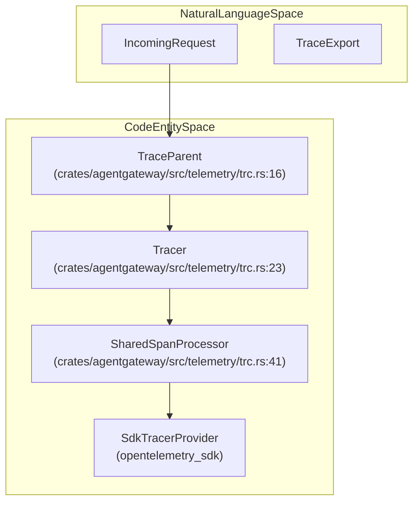
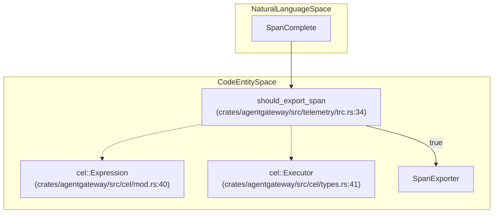
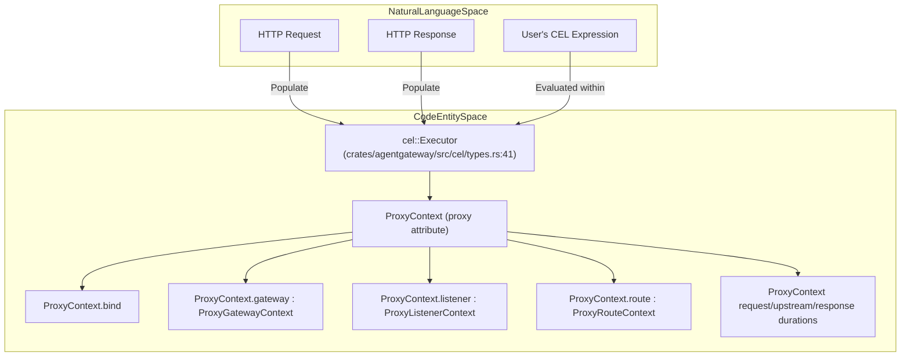
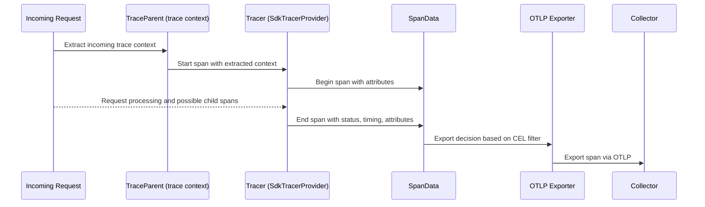

<!-- source: DeepWiki mcp.deepwiki.com · repo agentgateway/agentgateway · page 10.3 Distributed Tracing · fetched 2026-10-21 -->

# Distributed Tracing

Relevant source files

The following files were used as context for generating this wiki page:

- [crates/agentgateway/src/llm/mod.rs](crates/agentgateway/src/llm/mod.rs)
- [crates/agentgateway/src/llm/tests.rs](crates/agentgateway/src/llm/tests.rs)
- [crates/agentgateway/src/telemetry/log.rs](crates/agentgateway/src/telemetry/log.rs)
- [crates/agentgateway/src/telemetry/metrics.rs](crates/agentgateway/src/telemetry/metrics.rs)
- [crates/agentgateway/src/telemetry/trc.rs](crates/agentgateway/src/telemetry/trc.rs)
- [crates/agentgateway/tests/tests/llm.rs](crates/agentgateway/tests/tests/llm.rs)
- [crates/core/src/lib.rs](crates/core/src/lib.rs)
- [crates/core/src/metrics.rs](crates/core/src/metrics.rs)
- [crates/core/src/tokio_metrics.rs](crates/core/src/tokio_metrics.rs)

This page details the distributed tracing subsystem in `agentgateway`, which provides OpenTelemetry-based telemetry, span creation, W3C trace context propagation, and flexible OTLP export across ingress and upstream boundaries. For metrics collection, see [Metrics Collection](10.2). For structured logging, see [Structured Logging with CEL](10.4).

---

## Tracing Architecture and Initialization

The distributed tracing subsystem in `agentgateway` is implemented around the OpenTelemetry SDK integration, primarily represented by the `Tracer` struct and the support type `SharedSpanProcessor`. These facilities are defined in [crates/agentgateway/src/telemetry/trc.rs:22-62]().

The `Tracer` struct (defined at lines 23-28) wraps the underlying `SdkTracerProvider` from OpenTelemetry and manages trace span export and filtering logic, including support for CEL-based span filtering expressions. The `SharedSpanProcessor` (lines 41-62) wraps an OpenTelemetry span processor, typically a batch span processor, and ensures thread-safe sharing and delegation of span processing calls.

Initialization happens in `Tracer::new` [crates/agentgateway/src/telemetry/trc.rs:158-212]() which:

- Accepts a `TracingConfig`, specifying exporter endpoint, headers, protocol (gRPC or HTTP), and resource attributes as CEL expressions.
- Uses a CEL `Executor` to evaluate resource attributes dynamically at startup.
- Builds an OpenTelemetry `Resource` with attributes like `service.name` and `service.version`.
- Creates a batch span processor using an OTLP exporter configured with the selected protocol and endpoint.
- Runs exporter tasks on the admin runtime handle (preferred) or falls back to the current tokio runtime.

### Tracing Data Flow Architecture

Sources: `[crates/agentgateway/src/telemetry/trc.rs:16-62]`, `[crates/agentgateway/src/telemetry/trc.rs:158-212]`

---

## Trace Context Propagation

`agentgateway` fully supports W3C Trace Context propagation via the `TraceParent` datatype defined in [crates/agentgateway/src/telemetry/trc.rs:16](). This enables distributed tracing continuity over network boundaries and process hops.

### Key Code Entities

| Component               | Code Entity             | Purpose                                                                                              |
|-------------------------|-------------------------|----------------------------------------------------------------------------------------------------|
| Trace Context Header     | `TraceParent`           | Encodes and parses the W3C `traceparent` HTTP header containing `trace-id`, `span-id`, and flags.  |
| Span Lifecycle & Export | `Tracer`                | Manages span lifecycles, exporter configuration, and filtering expressions (CEL).                   |
| Export Protocol         | `Protocol` enum          | Specifies OTLP export protocol variant: `Grpc` or `Http`.                                         |
| Span Processing         | `SharedSpanProcessor`   | Wraps batch span processing with shared ownership and delegates span start/end events.             |

The gateway extracts inbound trace context via HTTP header injection, creates or continues spans, and injects trace context headers on outbound/upstream requests to maintain trace chain across all flows.

Sources: `[crates/agentgateway/src/telemetry/trc.rs:16-62]`, `[crates/agentgateway/src/telemetry/trc.rs:137-145]`

---

## Sampling and Filtering with CEL Expressions

Span export decisions and trace sampling leverage CEL (Common Expression Language) to provide flexible, dynamic control.

### CEL-Based Sampling and Filtering Flow

- The function `should_export_span` decides whether to export a completed span by evaluating a CEL expression filter. When no filter exists, spans are always exported.
- CEL expressions can access rich attributes within the request, response, proxy state, and LLM context to make nuanced keep/drop decisions.
- Sampling policies (`random_sampling`, `client_sampling` in the `TracingConfig`) also use CEL evaluation to influence which traces to keep.

This dynamic filtering mechanism enables granular control over telemetry cost and relevance.

Sources: `[crates/agentgateway/src/telemetry/trc.rs:34-40]`, `[crates/agentgateway/src/cel/mod.rs:40-83]`, `[crates/agentgateway/src/cel/types.rs:41-81]`

---

## OTLP Export and Configuration

### Resource and Attribute Evaluation

Tracing export configuration relies on the `TracingConfig` resource input, supporting OTLP exporters over gRPC or HTTP/JSON protocols.

- Attributes for the OpenTelemetry `Resource` are derived by evaluating CEL expressions on startup.
- The resource attributes include standard semantic keys like `service.name` (used as the tracer scope name) and `service.version` (derived from the binary version info).
- This approach enables tagging with dynamic and environment-specific attributes beyond static config.

### Span Semantic Conventions

Spans are enriched with semantic attributes derived from HTTP and connection information for observability tooling compatibility.

`HttpSemconvAttributes` (defined in [crates/agentgateway/src/telemetry/log.rs:69-141]()) extracts these conventions from a request log including:

| Attribute                 | Source Entity                | Description                                                                    |
|---------------------------|-----------------------------|--------------------------------------------------------------------------------|
| `client.address`           | `HttpSemconvAttributes`      | Client peer IP address from connection info                                   |
| `server.address`           | `HttpSemconvAttributes`      | Host header or server IP                                                      |
| `server.port`              | `HttpSemconvAttributes`      | Listening server port                                                         |
| `url.scheme`               | `HttpSemconvAttributes`      | HTTP URL scheme, e.g., `"http"` or `"https"`                                 |
| `url.path`                 | `HttpSemconvAttributes`      | URL path component                                                           |
| `url.query`                | `HttpSemconvAttributes`      | URL raw query string                                                         |
| `network.protocol.version` | `HttpSemconvAttributes`      | HTTP protocol version such as "HTTP/1.1" or "HTTP/2"                         |
| `service.version`          | `BuildInfo` (version info)  | Application binary version string                                            |

These conventions conform to OpenTelemetry semantic standards, permitting vendor-neutral correlation of traces.

Sources: `[crates/agentgateway/src/telemetry/log.rs:69-141]`, `[crates/agentgateway/src/telemetry/trc.rs:158-212]`

---

## CEL Context: Capturing Tracing-related Attributes

The Common Expression Language (CEL) executor provides a rich dynamic context containing tracing-relevant data for expression evaluation. The `cel::Executor` type (defined starting at [crates/agentgateway/src/cel/types.rs:41]()) encapsulates all evaluation context for tracing and logging, including nested proxy attributes with routing info and performance timings.

This design allows CEL expressions used for filtering or annotations to access structured metadata about the routing, bind, gateway, listener, and route details, as well as duration measurements, enabling precise trace filtering and contextual span attributes.

Sources: `[crates/agentgateway/src/cel/types.rs:41-152]`

---

## Span Creation and Recording Lifecycle

Within `agentgateway`, spans are created and recorded based on the extracted or generated trace context and the configured tracing policies.

- Upon an incoming request, `TraceParent` is parsed from inbound headers to establish the trace context.
- The tracer creates a new root or child span accordingly via OpenTelemetry SDK.
- As request processing and routing progress, additional attributes related to HTTP method, status, backend, and LLM model usage are attached.
- The span is finished on response completion, with start/end timestamps and all gathered attributes.
- Before export, the span passes through the CEL-based filter for sampling decisions.
- Filtered spans are asynchronously delivered to the OTLP exporter in batches.

### Span Lifecycle Diagram

Sources: `[crates/agentgateway/src/telemetry/trc.rs:101-135]`, `[crates/agentgateway/src/telemetry/trc.rs:158-212]`

---

## Summary

- `agentgateway` integrates tightly with OpenTelemetry to provide distributed tracing.
- The system fully supports W3C trace context propagation via the `TraceParent` datatype.
- Span export decisions are dynamically configured and driven by CEL expressions evaluated in a rich evaluation context covering request, proxy, and LLM metadata.
- Standard semantic conventions for HTTP and network attributes are added to spans for observability tooling compatibility.
- The exporter configuration supports both gRPC and HTTP OTLP exporting protocols.
- The tracing infrastructure uses asynchronous batch processors wrapped in a shared span processor to efficiently pipeline span export without blocking request processing.

This architecture enables comprehensive and flexible tracing coverage, facilitating deep observability into the Agentgateway data plane processing and AI connectivity flows.

---

Sources:

- `[crates/agentgateway/src/telemetry/trc.rs:16-62]`
- `[crates/agentgateway/src/telemetry/trc.rs:91-135]`
- `[crates/agentgateway/src/telemetry/trc.rs:137-210]`
- `[crates/agentgateway/src/cel/mod.rs:40-83]`
- `[crates/agentgateway/src/cel/types.rs:41-152]`
- `[crates/agentgateway/src/telemetry/log.rs:69-141]`

---

