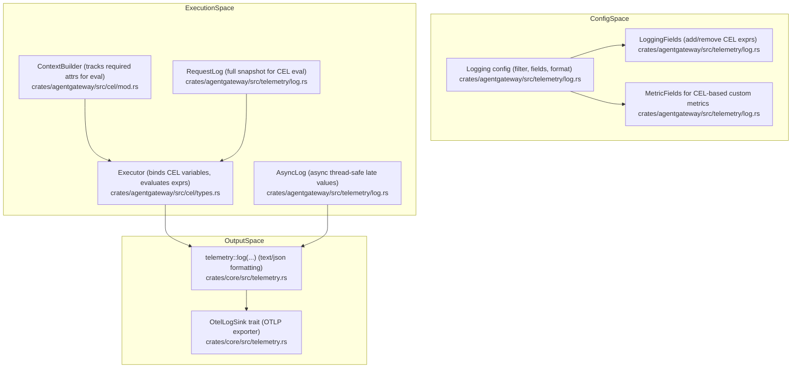
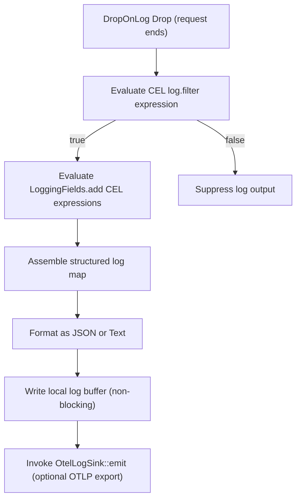
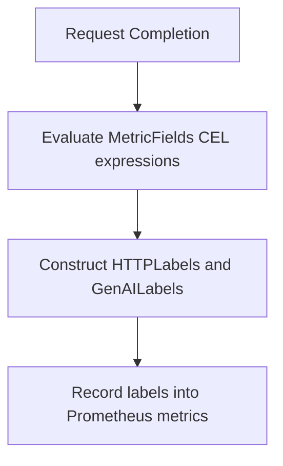

<!-- source: DeepWiki mcp.deepwiki.com · repo agentgateway/agentgateway · page 10.4 Structured Logging with CEL · fetched 2026-10-21 -->

# Structured Logging with CEL

<details>
<summary>Relevant source files</summary>

The following files were used as context for generating this wiki page:

- [crates/agentgateway/src/cel/mod.rs](crates/agentgateway/src/cel/mod.rs)
- [crates/agentgateway/src/cel/tests.rs](crates/agentgateway/src/cel/tests.rs)
- [crates/agentgateway/src/cel/types.rs](crates/agentgateway/src/cel/types.rs)
- [crates/agentgateway/src/cel/types_test.rs](crates/agentgateway/src/cel/types_test.rs)
- [crates/agentgateway/src/http/transformation_cel.rs](crates/agentgateway/src/http/transformation_cel.rs)
- [crates/agentgateway/src/http/transformation_cel_tests.rs](crates/agentgateway/src/http/transformation_cel_tests.rs)
- [crates/core/src/telemetry.rs](crates/core/src/telemetry.rs)
- [schema/README.md](schema/README.md)
- [schema/cel.json](schema/cel.json)
- [schema/cel.md](schema/cel.md)

</details>


This page details `agentgateway`’s structured logging approach using CEL (Common Expression Language). It explores how CEL expressions enable sophisticated log filtering, enrich logs with custom fields, and drive flexible log output formats. The key technical components, data flow, and CEL integration are explained in depth.

For foundational CEL concepts, see [CEL Expression Engine](4.2) and [CEL Context and Functions](4.3). For tracing integration, see [Distributed Tracing](10.3) and for metrics, see [Metrics Collection](10.2).

---

## 1. Overview & Drop-Triggered Logging

Structured logging in `agentgateway` leverages CEL expressions evaluated at request completion to emit per-request access logs enriched with contextual attributes. The logging lifecycle follows a **drop-triggered** design, where logging and metric recording are deferred until the response processing finishes, ensuring minimal impact on request latency.

The logging mechanism builds a `RequestLog` context during request handling. Upon completion (e.g., when `DropOnLog` RAII guard drops), expressions are evaluated against snapshots of request, response, and proxy metadata. The resulting key-value map is serialized for local logs and optionally exported to external sinks like OTLP.

The main emission infrastructure is implemented primarily in `crates/agentgateway/src/telemetry/log.rs`(), with evaluation contexts and expression compilation encapsulated in the `cel` crate stack.

Sources: [crates/agentgateway/src/cel/mod.rs:140-225]()

---

## 2. Component Map



Sources: [crates/agentgateway/src/cel/mod.rs:140-225](), [crates/agentgateway/src/cel/types.rs:40-85](), [crates/core/src/telemetry.rs:96-105]()

---

## 3. Key Data Structures and Classes

### Logging Configuration

- **Filter Expression (`Option<Arc<cel::Expression>>`)**: An optional CEL expression which acts as a predicate filter to determine if a log entry should be emitted or suppressed. If the expression evaluates to `false`, the log is suppressed.

- **Fields (`LoggingFields`)**: Customizations for log entries controlling field removal and addition with CEL expressions.

- **Format**: Selects output log format (JSON or human-readable text).

Defined and used mainly in `crates/agentgateway/src/telemetry/log.rs`().

### `LoggingFields`

- **remove:** An `Arc<FzHashSet<String>>` containing field names to exclude from the final log.

- **add:** An `Arc<IndexMap<String, Arc<cel::Expression>>>` mapping custom log field names to CEL expressions that will be evaluated at log time and appended to the log record.

This struct facilitates flexible log enrichment and suppression by CEL expressions.

### `ContextBuilder`

Tracks which CEL attributes (request, response, body, JWT claims, LLM info, etc.) are required for evaluation, optimizing body buffering and snapshotting.

Supports:

- `register_expression(&Expression)`: Marks attributes required to evaluate a given CEL expression.
  [crates/agentgateway/src/cel/mod.rs:167-170]()

- `register_log_expression(&Expression)`: Specifically marks attributes required for expressions evaluated after request completion, enabling lazy body buffering.
  [crates/agentgateway/src/cel/mod.rs:178-180]()

- Conditional buffering of request and response bodies depending on CEL attribute requirements to avoid unnecessary resource use.
  [crates/agentgateway/src/cel/mod.rs:205-232]()

Located in `crates/agentgateway/src/cel/mod.rs` [crates/agentgateway/src/cel/mod.rs:143-232]().

### `Executor`

A CEL executor context binding structured request/response data into top-level CEL variables such as `request`, `response`, `proxy`, `jwt`, `llm`, and others.

- This executor drives the evaluation of arbitrary CEL expressions against these data structures at log time.

- Provides typed dynamic types for the various contexts and claims.

Defined in `crates/agentgateway/src/cel/types.rs` [crates/agentgateway/src/cel/types.rs:40-81]().

### `AsyncLog<T>`

A concurrency-safe wrapper to hold values that become available only asynchronously or after main request processing phases, such as final LLM cost details.

Sources: [crates/agentgateway/src/cel/mod.rs:143-232](), [crates/agentgateway/src/cel/types.rs:40-81]()

---

## 4. CEL Context at Log Time

The core of structured logging with CEL is the `Executor` which provides variable bindings from the full per-request context.

| CEL Variable | Type | Description |
|---|---|---|
| `request` | `Option<RequestRef<'a>>` | Incoming HTTP request attributes including method, path, headers, body (if buffered), start/end |
| `response` | `Option<ResponseRef<'a>>` | HTTP response attributes including status code, headers, body (if buffered) |
| `proxy` | `ExtensionOrDirect<ProxyContext>` | Proxy metadata: bind, gateway, listener, route info, timings, and error info |
| `env` | `EnvContext` | Environment metadata such as pod name, namespace, gateway name (Kubernetes context) |
| `source` | `ExtensionOrDirect<SourceContext>` | Downstream peer IP, port, TLS info |
| `jwt` | `ExtensionOrDirect<jwt::Claims>` | JWT claims of validated bearer token |
| `apiKey` | `ExtensionOrDirect<apikey::Claims>` | API key claims and flattened metadata |
| `basicAuth` | `ExtensionOrDirect<basicauth::Claims>` | Basic auth user credentials |
| `llm` | `ExtensionOrDirect<LLMContext>`| Generative AI request/response info: token counts, latency, provider |
| `mcp` | `Option<&MCPInfo>` | Model Context Protocol metadata |
| `backend` | `ExtensionOrDirect<BackendContext>` | Backend endpoint and protocol details |
| Others | `ExtensionOrDirect` or `Option` types | Extension metadata such as external authorization, external processing, guardrails, etc. |

These types collectively expose a rich snapshot of all facets of a request and response, enabling detailed and precise logging via CEL expressions.

See the JSON schema of the CEL context for a detailed field list: [schema/cel.md]() and [schema/cel.json]().

Sources: [crates/agentgateway/src/cel/types.rs:40-81](), [schema/cel.md:1-74]()

---

## 5. Log Emission and Output Format Support

### Emission Flow

1. On request completion, the `DropOnLog` RAII guard triggers evaluation of configured CEL expressions for filtering and field enrichment.

2. The `Executor` evaluates the filter expression; if false or error, logging is suppressed.

3. Custom fields configured in `LoggingFields.add` are evaluated and merged into the final log map.

4. The log map is output using a specified format:

   - **JSON format**: Fully structured JSON log, suitable for log indexing systems.
     [crates/core/src/telemetry.rs:222-243]()

   - **Text format**: Human-readable log line with key=value pairs.
     [crates/core/src/telemetry.rs:196-208]()

5. Logs are synchronously written to a local async buffer and dispatched asynchronously to external sinks.
   [crates/core/src/telemetry.rs:211-212]()

6. OTLP export is supported via the `OtelLogSink` trait, allowing logs to be sent to OpenTelemetry collectors.
   [crates/core/src/telemetry.rs:96-105]()

### Output Structure

The log payload includes standard HTTP attributes, proxy metadata (bind, route, listener), security claims, LLM token/cost info, and any configured custom fields.



Sources: [crates/core/src/telemetry.rs:96-105](), [crates/core/src/telemetry.rs:196-243]()

---

## 6. LLM and Cost Data in Logs

`agentgateway` enriches logs for LLM backend requests with prompt completions, token counts, and cost information.

- The `ContextBuilder` has a helper `register_log_llm_payload` which flags the required LLM attributes (`llm`, `llmCompletion`, `llmToolCalls`) for lazy buffering and capture only when an LLM payload log is needed.
  [crates/agentgateway/src/cel/mod.rs:187-190]()

- The LLM context in CEL provides token counts (input, output, cached), reasoning tokens, provider identifiers, and latency timings.
  [crates/agentgateway/src/cel/types_test.rs:117-151]()

- Cost-related metadata (from the Model Cost Catalog) can be emitted as additional fields for observability of AI usage costs.

This design facilitates detailed observability of generative AI traffic without incurring overhead unless requested.

Sources: [crates/agentgateway/src/cel/mod.rs:187-190](), [crates/agentgateway/src/cel/types_test.rs:117-151]()

---

## 7. Custom Metrics Label Evaluation

Besides logging, CEL expressions also drive dynamic evaluation of custom metric labels by `MetricFields`.

- Metric label CEL expressions run at request end to compute labels applied to Prometheus metric vectors, enabling fine-grained, request-specific metric dimensions.

- This allows correlation of metrics with enriched request context, e.g., user IDs, traffic policy names, backend info, or AI workload tags.



Sources: [crates/agentgateway/src/cel/types.rs:40-81](), [crates/agentgateway/src/cel/tests.rs:130-170]()

---

# Summary

`agentgateway`’s structured logging tightly integrates CEL expression evaluation at request lifecycle end, enabling complex log filtering, customizable enrichment with contextual data, flexible output, and integration with OTLP and metrics subsystems. The design balances runtime efficiency and rich observability by carefully tracking required context attributes, conditional body buffering, and lazily evaluated async data.

---

# Diagram: From Natural Language to Code Entities for Structured Logging with CEL

```mermaid
graph TD
    NL["Natural Language Concepts"] --> CodeEntities

    NL -->|Log filter expression| FilterExpr[cel::Expression (log filter)]
    NL -->|Request attributes| ReqAttrs[request (Executor variable)]
    NL -->|Response attributes| RespAttrs[response (Executor variable)]
    NL -->|Proxy info (bind, route)| ProxyMeta[proxy (ProxyContext)]
    NL -->|Security claims| JwtClaims[jwt, apiKey, basicAuth]
    NL -->|AI telemetry| LlmTelemetry[llm (LLMContext)]
    NL -->|Metric labels| MetricLabels[MetricFields (CEL exprs)]

    FilterExpr -->|Parse & store| ExprType[Expression struct (crates/agentgateway/src/cel/mod.rs)]
    ExprType --> ContextBuilder[ContextBuilder (crates/agentgateway/src/cel/mod.rs)]

    ReqAttrs --> Executor[Executor (crates/agentgateway/src/cel/types.rs)]
    RespAttrs --> Executor
    ProxyMeta --> Executor
    JwtClaims --> Executor
    LlmTelemetry --> Executor

    ContextBuilder --> Executor
    MetricLabels --> Executor

    Executor --> LogEval[Evaluate expressions on Executor context]

    LogEval --> LogOutput[Format and output structured logs]
    LogEval --> MetricOutput[Emit metrics]
```

Sources: [crates/agentgateway/src/cel/mod.rs:140-232](), [crates/agentgateway/src/cel/types.rs:40-85]()

---

# Diagram: CEL Context Variables and Related Source Files

```mermaid
graph TD
    Executor["Executor<'a> struct (crates/agentgateway/src/cel/types.rs:40-81)"] --> Request["request: Option<RequestRef<'a>>"]
    Executor --> Response["response: Option<ResponseRef<'a>>"]
    Executor --> Proxy["proxy: ExtensionOrDirect<ProxyContext>"]
    Executor --> Env["env: EnvContext"]
    Executor --> Source["source: ExtensionOrDirect<SourceContext>"]
    Executor --> Jwt["jwt: ExtensionOrDirect<jwt::Claims>"]
    Executor --> ApiKey["apiKey: ExtensionOrDirect<apikey::Claims>"]
    Executor --> BasicAuth["basicAuth: ExtensionOrDirect<basicauth::Claims>"]
    Executor --> Llm["llm: ExtensionOrDirect<LLMContext>"]
    Executor --> Backend["backend: ExtensionOrDirect<BackendContext>"]
    Executor --> Mcp["mcp: Option<&MCPInfo>"]

    Request -.-> RequestSnapshot["RequestSnapshot struct\n(crates/agentgateway/src/cel/mod.rs)"]
    Response -.-> ResponseSnapshot["ResponseSnapshot struct\n(crates/agentgateway/src/cel/mod.rs)"]
    Proxy -.-> ProxyContext["ProxyContext struct\n(crates/agentgateway/src/cel/types.rs:94-124)"]
    Jwt -.-> JwtClaims["jwt::Claims\n(crates/agentgateway/src/http/jwt.rs)"]
    Llm -.-> LLMContext["LLMContext struct\n(crates/agentgateway/src/cel/types.rs)"]
```



Sources: [crates/agentgateway/src/cel/types.rs:40-81](), [crates/agentgateway/src/cel/types.rs:94-124]()

---

# References

- [crates/agentgateway/src/cel/mod.rs:140-232]()
- [crates/agentgateway/src/cel/types.rs:40-85]()
- [schema/cel.md]()
- [schema/cel.json]()
- [crates/core/src/telemetry.rs:96-105]()
- [crates/core/src/telemetry.rs:196-243]()
- [crates/agentgateway/src/cel/tests.rs:130-170]()

---

