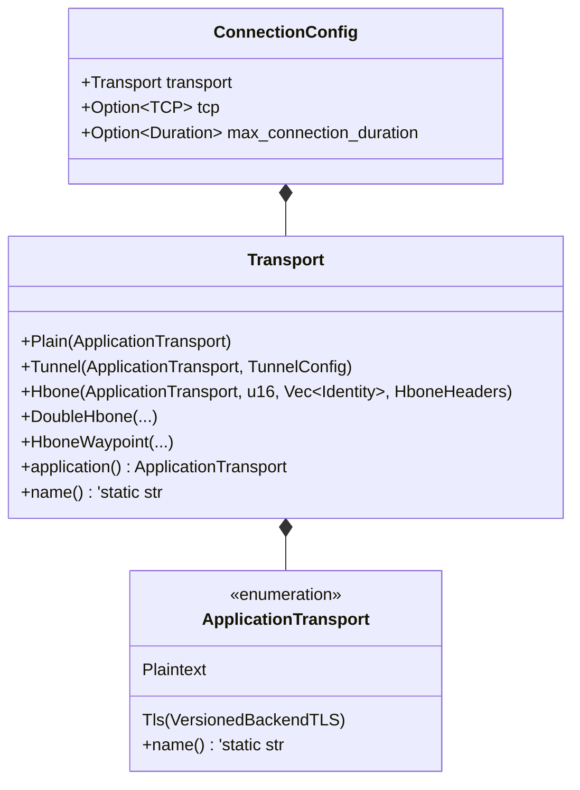
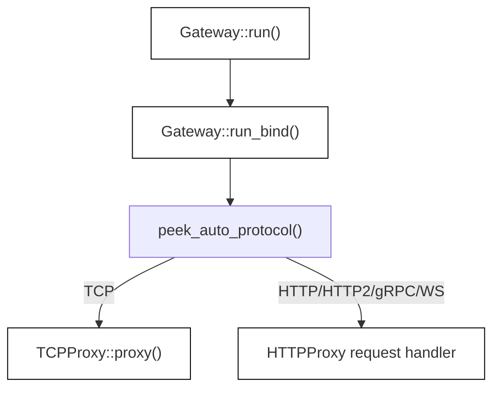
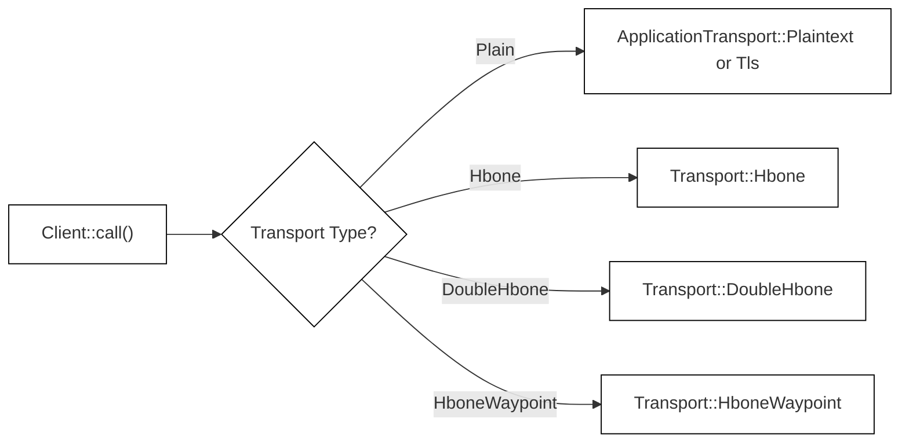
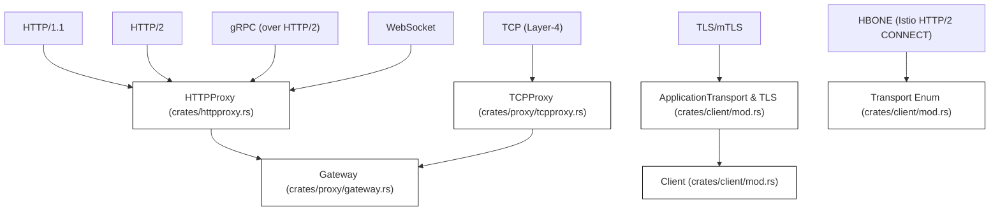
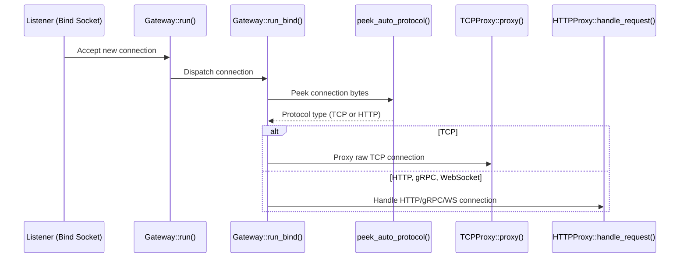

<!-- source: DeepWiki mcp.deepwiki.com · repo agentgateway/agentgateway · page 11.1 Protocol Support Overview · fetched 2026-10-21 -->

# Protocol Support Overview

Relevant source files

The following files were used as context for generating this wiki page:

- [crates/agentgateway-app/Cargo.toml](crates/agentgateway-app/Cargo.toml)
- [crates/agentgateway-app/src/commands/mod.rs](crates/agentgateway-app/src/commands/mod.rs)
- [crates/agentgateway-app/src/commands/oneshot.rs](crates/agentgateway-app/src/commands/oneshot.rs)
- [crates/agentgateway-app/src/commands/run.rs](crates/agentgateway-app/src/commands/run.rs)
- [crates/agentgateway-app/src/lib.rs](crates/agentgateway-app/src/lib.rs)
- [crates/agentgateway/src/client/mod.rs](crates/agentgateway/src/client/mod.rs)
- [crates/agentgateway/src/proxy/gateway.rs](crates/agentgateway/src/proxy/gateway.rs)
- [crates/agentgateway/src/proxy/gateway_test.rs](crates/agentgateway/src/proxy/gateway_test.rs)
- [crates/agentgateway/src/proxy/tcpproxy.rs](crates/agentgateway/src/proxy/tcpproxy.rs)
- [crates/agentgateway/src/test_helpers/proxymock.rs](crates/agentgateway/src/test_helpers/proxymock.rs)
- [crates/agentgateway/tests/common/gateway.rs](crates/agentgateway/tests/common/gateway.rs)
- [crates/agentgateway/tests/common/mod.rs](crates/agentgateway/tests/common/mod.rs)
- [crates/agentgateway/tests/integration.rs](crates/agentgateway/tests/integration.rs)
- [crates/agentgateway/tests/tests/auto_protocol.rs](crates/agentgateway/tests/tests/auto_protocol.rs)
- [crates/agentgateway/tests/tests/connect.rs](crates/agentgateway/tests/tests/connect.rs)
- [crates/agentgateway/tests/tests/dfp.rs](crates/agentgateway/tests/tests/dfp.rs)
- [crates/core/src/readiness.rs](crates/core/src/readiness.rs)

## Purpose and Scope

This document provides a detailed technical overview of the network protocols supported by AgentGateway for both ingress (client-facing) and egress (backend-facing) connectivity. AgentGateway functions as a high-performance data plane facilitating connectivity for Agentic AI and integrates multiple protocols including HTTP/1.1, HTTP/2, TCP, TLS, gRPC, WebSocket, and Istio-compatible HBONE.

Central to this support is a unified transport and connection infrastructure combining protocol detection, multiplexing, transport abstraction, and protocol-specific proxying implementations. This design ensures seamless request routing, protocol negotiation, and transparent handling for a variety of frontend and backend protocols.

Sources: [crates/agentgateway/src/client/mod.rs:124-143](), [crates/agentgateway/src/proxy/gateway.rs:165-236]()

---

## Supported Protocol Matrix

AgentGateway supports an extensive set of protocols with both ingress and egress capabilities. The table below summarizes the protocol support:

| Protocol | Ingress Support | Egress Support | Implementation Highlights |
|---|---|---|---|
| **HTTP/1.1** | ✓ | ✓ | Uses `ApplicationTransport::Plaintext` or `Tls` for transport. Fully supported in HTTPProxy. |
| **HTTP/2** | ✓ | ✓ | Supports HTTP/2 framing (including ALPN detection). Utilized for gRPC, HBONE tunnels. |
| **gRPC** | ✓ | ✓ | Runs natively over HTTP/2 streams leveraging multiplexed HTTP proxy pipelines. |
| **WebSocket** | ✓ | ✓ | Supports upgrade handling and streaming via HTTPProxy. |
| **TCP** | ✓ | ✓ | Layer 4 proxy via `TCPProxy` with optional TLS sniffing and waypoint integration. |
| **TLS/mTLS** | ✓ | ✓ | Transport layer security is handled via `ApplicationTransport::Tls`, with identity extraction during TLS handshake. |
| **HBONE** | ✓ | ✓ | Istio-compatible HTTP/2 CONNECT-based tunneling via `Transport::Hbone` and `DoubleHbone`. |

Sources: [crates/agentgateway/src/client/mod.rs:50-143](), [crates/agentgateway/src/proxy/tcpproxy.rs:24-30](), [crates/agentgateway/src/transport/stream.rs:38-54]()

---

## The Transport Abstraction

AgentGateway uses a comprehensive transport abstraction combining the following key enums and structs to represent connection types and protocols on both ingress and egress sides:

### Transport

The top-level enum encapsulating the transport method and protocol stack:

- `Plain(ApplicationTransport)` — Plain TCP or TLS transport with no tunneling.
- `Tunnel(ApplicationTransport, TunnelConfig)` — Standard proxy tunnel transport.
- `Hbone(ApplicationTransport, u16, Vec<Identity>, HboneHeaders)` — HBONE tunnel using HTTP/2 CONNECT with identities and headers.
- `DoubleHbone` — Nested HBONE tunnels for gateway-to-gateway forwarding.
- `HboneWaypoint` — HBONE tunnel to waypoint proxies.

### ApplicationTransport

Represents the application-level transport security:

- `Plaintext` for unencrypted TCP.
- `Tls(VersionedBackendTLS)` for TLS-secured transport.

### ConnectionConfig

Holds the full connection configuration including transport and optional TCP settings:

- `transport: Transport` — The transport variant.
- `tcp: Option<TCP>` — TCP connection parameters.
- `max_connection_duration: Option<Duration>` — Connection lifetime control.

#### Diagram: Transport Entity Relationship

Sources: [crates/agentgateway/src/client/mod.rs:25-222]()

---

## Protocol Detection and Data Flow

### Connection Acceptance and Dispatching

At ingress, AgentGateway accepts incoming network connections primarily through `Gateway::run()` [crates/agentgateway/src/proxy/gateway.rs:170-171]() which manages multiple binds and listener sets. Each bind represents a front-facing network endpoint, typically a TCP socket.

For each accepted connection, the protocol is determined to dispatch the traffic to the appropriate proxy pipeline:

- If the protocol is identified as raw TCP, it is dispatched to the `TCPProxy`.
- If the traffic is HTTP/1.1, HTTP/2, gRPC, or WebSocket, it is dispatched to the HTTP proxy pipeline.
- Protocol detection uses automatic byte peeking on accepts to avoid latency associated with waiting for full protocol handshakes.

### Protocol Peeking

The function `peek_auto_protocol()` [crates/agentgateway/src/proxy/gateway_test.rs:48-48]() allows an early peek at received bytes to determine if the traffic is HTTP-like or raw TCP, enabling immediate dispatch without delay [crates/agentgateway/src/proxy/gateway_test.rs:38-55]().

### TLS SNI Sniffing

TCP proxy supports optional TLS SNI (Server Name Indication) sniffing to identify the TLS server name dynamically for routing decisions, particularly useful in waypoint proxy scenarios [crates/agentgateway/src/proxy/tcpproxy.rs:88-101]().

#### Diagram: Ingress Protocol Dispatch (Natural Language to Code Entity)

Sources: [crates/agentgateway/src/proxy/gateway.rs:165-236](), [crates/agentgateway/src/proxy/gateway_test.rs:38-55](), [crates/agentgateway/src/proxy/tcpproxy.rs:33-101]()

---

## Protocol-Specific Implementations

### HTTP/1.1, HTTP/2, gRPC, and WebSocket

- These protocols are handled by the HTTPProxy pipeline, which supports pipelined HTTP/1.1, multiplexed HTTP/2 streams, and gRPC requests as native HTTP/2 traffic.
- WebSocket connections are upgraded and proxied using buffered streaming.
- The HTTP pipeline supports comprehensive request/response transformations, header and pseudo-header management, compression/decompression, and CEL policy enforcement.

### Compression and Decompression Support

- AgentGateway supports multiple compression algorithms at the HTTP layer including gzip, deflate, brotli, and zstd.
- The compression module supports streaming decompression enabling chunk-by-chunk decoding without buffering entire bodies [crates/agentgateway/src/http/compression/mod.rs:1-154]().

### TCP and Waypoint Routing

- The `TCPProxy` struct [crates/agentgateway/src/proxy/tcpproxy.rs:24-30]() manages TCP layer-4 forwarding with support for network authorization and external authorization.
- TLS sniffing for SNI is optionally enabled for traffic passing through waypoint services.
- Detailed connection logging, metrics collection, and policy enforcement integrate tightly with various TCP proxy hooks [crates/agentgateway/src/proxy/tcpproxy.rs:24-204]().

Sources: [crates/agentgateway/src/http/compression/mod.rs:1-154](), [crates/agentgateway/src/proxy/tcpproxy.rs:24-204]()

---

## Egress Protocol Selection and Client

When AgentGateway initiates outbound connections to backends, it determines the appropriate transport and tunneling mechanism based on backend configuration.

### Transport Variants

- **Plaintext/TLS:** Direct TCP or TLS transport to the backend.
- **HBONE:** Istio-compatible HTTP/2 CONNECT tunnels to backends in mesh environments.
- **Double HBONE:** Nested HBONE forwarding involving both gateway and waypoint proxies.
- **HBONE Waypoint:** HBONE tunnel to a waypoint proxy with special routing considerations.

### Transport Selection Workflow

During client calls (`Client` and `Call` structs), transport is selected and constructed:

1. Inspect backend configuration to determine transport type.
2. Construct `Transport` enum instance accordingly.
3. Handle any required HBONE header injection, TLS identity propagation, and DNS resolution skipping for tunnel types.

### HBONE Role Identification

- HBONE CONNECT requests include headers specifying the source role (`Waypoint` or `Gateway`) to allow downstream network components to identify originators.
- These headers influence routing and security policies in the Istio mesh.

#### Diagram: Egress Connection Establishment (Natural Language to Code Entity)

Sources: [crates/agentgateway/src/client/mod.rs:124-176]()

---

## Protocol Detection Utilities and Helpers

### HboneAddress

- Represents an HBONE target address which can be either a raw socket address or a service hostname plus port.
- Implements conversions from `http::Uri` to parse either IP:port or hostname:port formats [crates/agentgateway/src/proxy/gateway.rs:115-132]().
- Provides utility methods to extract ports, IPs, and hostnames from addresses for routing logic [crates/agentgateway/src/proxy/gateway.rs:58-91]().

### Accept Error Classification

- Classifies errors on accept sockets into permanent errors, per-connection errors, or resource pressure errors to control accepting backoff logic robustly [crates/agentgateway/src/proxy/gateway_test.rs:120-171]().

Sources: [crates/agentgateway/src/proxy/gateway.rs:50-132](), [crates/agentgateway/src/proxy/gateway_test.rs:120-171]()

---

# Summary

AgentGateway supports a rich suite of transport and application protocols essential for Agentic AI connectivity and service mesh integration. Its layered abstractions enable flexible protocol detection, multiprotocol proxying, secure TLS and mTLS transport, and native support for HTTP/1.1, HTTP/2, gRPC, WebSocket, TCP, and HBONE tunneling. The protocol detection logic is optimized for low latency using early peeking, with extension points for waypoint TLS sniffing.

Key internals such as `Gateway::run`, `TCPProxy`, `ApplicationTransport`, and `Transport` orchestrate the comprehensive protocol support. This architecture enables AgentGateway to serve as a performant, extensible ingress-egress data plane for a modern AI-connected network.

---

# Additional Diagrams for Bridging Concept to Code Entities

### Diagram: Protocols Supported and Key Code Modules

### Diagram: Flow of Connection Acceptance and Routing to Proxy

Sources: Aggregated from prior citations.

---

# References

- Transport enums & client connection config: [crates/agentgateway/src/client/mod.rs:1-222]()
- Gateway connection acceptance and bind lifecycle: [crates/agentgateway/src/proxy/gateway.rs:165-236]()
- TCP proxy implementation: [crates/agentgateway/src/proxy/tcpproxy.rs:24-204]()
- Protocol detection test & logic: [crates/agentgateway/src/proxy/gateway_test.rs:38-55]()
- TLS and transport stream info: [crates/agentgateway/src/transport/stream.rs:38-54]()
- Compression and HTTP processing: [crates/agentgateway/src/http/compression/mod.rs:1-154]()

---

