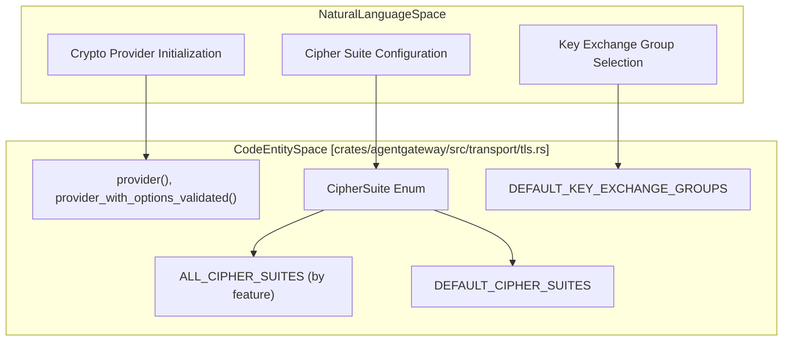
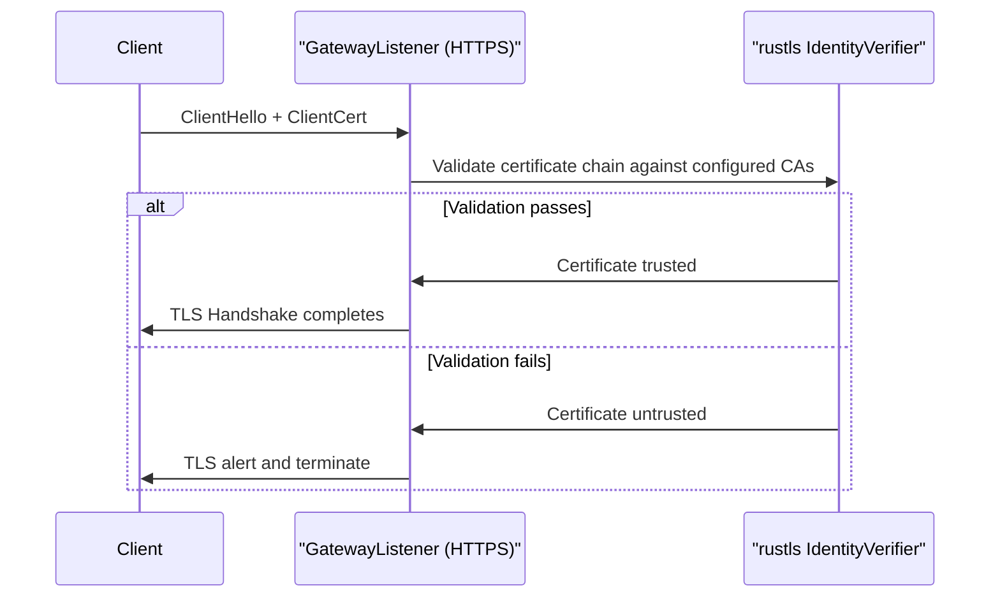
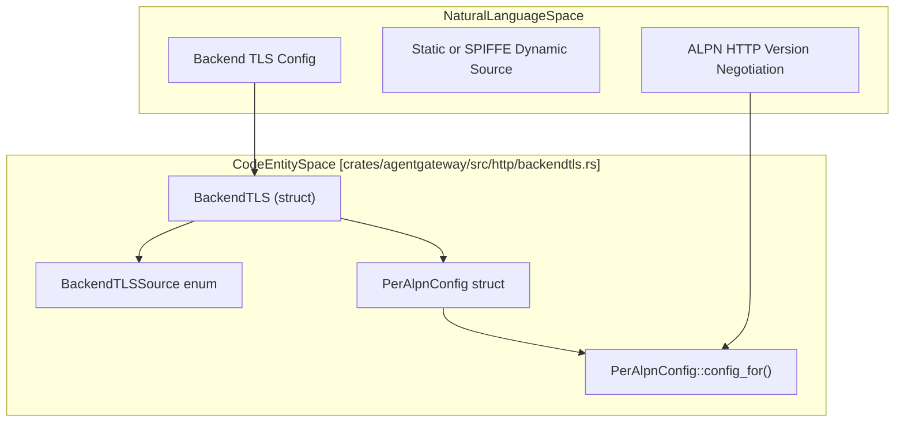
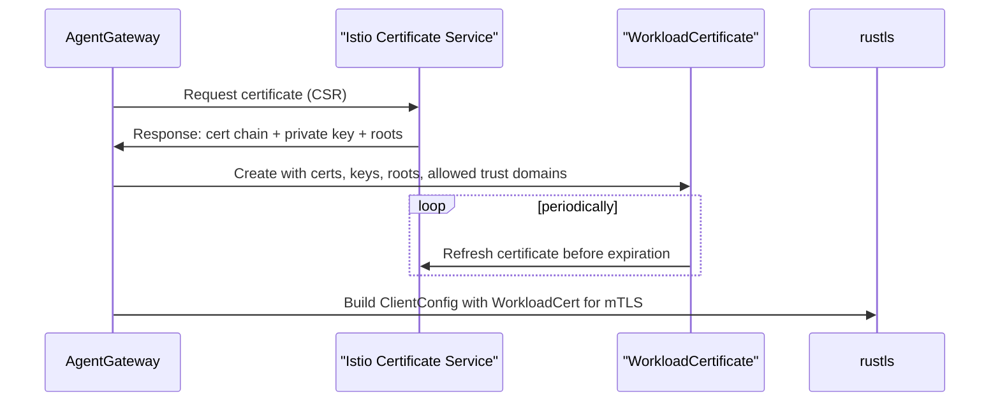

<!-- source: DeepWiki mcp.deepwiki.com · repo agentgateway/agentgateway · page 11.2 TLS and mTLS Configuration · fetched 2026-10-21 -->

# TLS and mTLS Configuration

Relevant source files

The following files were used as context for generating this wiki page:

- [crates/agentgateway/src/control/caclient.rs](crates/agentgateway/src/control/caclient.rs)
- [crates/agentgateway/src/control/mod.rs](crates/agentgateway/src/control/mod.rs)
- [crates/agentgateway/src/http/backendtls.rs](crates/agentgateway/src/http/backendtls.rs)
- [crates/agentgateway/src/transport/tls.rs](crates/agentgateway/src/transport/tls.rs)

This page provides full technical documentation for Transport Layer Security (TLS) and mutual TLS (mTLS) configuration within AgentGateway. It covers frontend TLS termination, client certificate validation, backend upstream TLS encryption, crypto provider initialization, control plane authentication, and Kubernetes-side xDS TLS serving certificate synchronization.

---

## 1. TLS Architecture and Crypto Providers

AgentGateway leverages `rustls` as its core TLS implementation, supporting both `TLS 1.2` and `TLS 1.3` protocols [crates/agentgateway/src/transport/tls.rs:25-26](). Cryptographic primitives, cipher suites, and key exchange groups are managed centrally depending on the active feature flags (`crypto-aws-lc`, `crypto-symcrypt`, or `fips`).

### Supported Cipher Suites and Key Exchange Groups

- The `ALL_CIPHER_SUITES` array defines the full set of supported cipher suites, which vary by enabled crypto provider:
  - With the `crypto-aws-lc` feature, suites like `TLS13_AES_256_GCM_SHA384`, `TLS_ECDHE_RSA_WITH_AES_128_GCM_SHA256` and post-quantum hybrid groups (`X25519_MLKEM768`) are included [crates/agentgateway/src/transport/tls.rs:30-41]().
  - With the `crypto-symcrypt` provider, classical suites like `TLS13_AES_256_GCM_SHA384` and curve25519 (`X25519`) without PQC groups are used [crates/agentgateway/src/transport/tls.rs:46-57]().

- Key exchange groups are chosen to balance modern cryptography with compliance requirements:
  - AWS-LC FIPS builds exclude pure X25519 but permit NIST curves plus the hybrid PQC `X25519_MLKEM768` [crates/agentgateway/src/transport/tls.rs:90-96]().
  - SymCrypt uses classical groups only (`X25519`, `SECP256R1`, `SECP384R1`) [crates/agentgateway/src/transport/tls.rs:100-103]().

### Code Entity Mapping: TLS Transport Layer

The diagram below maps these cryptographic concepts and configurations to their Rust entities in the codebase.

Sources: [crates/agentgateway/src/transport/tls.rs:20-104]()

---

## 2. Frontend TLS Termination and Client Validation

AgentGateway terminates TLS at the gateway listener's network boundary. TLS termination is configured per listener (in line with Gateway API semantics), often enabling HTTPS protocol with options for mTLS enforcement.

### TLS Termination and mTLS Validation

- When TLS termination is enabled (`mode: Terminate`), AgentGateway requires the listener to supply server certificates for encrypting inbound connections.
- Mutual TLS support means clients must present certificates validated against configured CAs.
- Client certificate validation is performed using `rustls` verifiers integrated with CA bundles loaded from Kubernetes Secrets or mounted files.
- The validation process involves:
  1. Parsing the client certificate chain sent in the TLS handshake.
  2. Validating chain against the configured trusted root certificates or CA bundles.
  3. Verifying that the client identity matches allowed Subject Alternative Names (SANs) or other policy rules.
  4. Rejecting handshake if validation fails, terminating the connection [crates/agentgateway/src/transport/tls.rs:11-15](), [crates/agentgateway/src/http/backendtls.rs:12-36]().

### Cipher Suites and Key Exchange Groups in Frontend TLS

Defaults restrict to secure AEAD cipher suites and approved key exchange groups that balance modern cryptography and compliance requirements.

### Client Certificate Validation Flow

Sources: [crates/agentgateway/src/transport/tls.rs:11-15](), [crates/agentgateway/src/http/backendtls.rs:18-35]()

---

## 3. Backend TLS Configuration

Outgoing network calls from AgentGateway to upstream services use backend TLS configuration to secure those connections. `BackendTLS` struct encapsulates this client-side TLS config.

### BackendTLS Struct and Sources

- `BackendTLS` contains:
  - `hostname_override`: Optional SNI override.
  - `source`: Indicates the TLS config source, either static or dynamic SPIFFE-based mTLS [crates/agentgateway/src/http/backendtls.rs:80-94]().

- `BackendTLSSource` Enum defines:
  - `Static`: A static TLS config built from cert/key/roots [crates/agentgateway/src/http/backendtls.rs:90]().
  - `Spiffe`: Dynamically sourced TLS config using SPIFFE Workload API, which updates identities at connection time [crates/agentgateway/src/http/backendtls.rs:92-94]().

### ALPN Protocol Negotiation Support (`PerAlpnConfig`)

- `PerAlpnConfig` wraps a Rustls `ClientConfig` and manages ALPN protocol selection:
  - Caches separate client configs with `http/1.1` and `h2` ALPN protocols [crates/agentgateway/src/http/backendtls.rs:58-72]().
  - Provides `config_for(version)` method returning appropriate config for HTTP/1.1 or HTTP/2 to support backend negotiation [crates/agentgateway/src/http/backendtls.rs:56-77]().

### Code Entity Mapping: Backend TLS Configuration

Sources: [crates/agentgateway/src/http/backendtls.rs:38-94](), [crates/agentgateway/src/http/backendtls.rs:56-77]()

---

## 4. Mutual TLS (mTLS) and CA Client Integration

### Istio CA Client and Workload Certificates

For integrations with service meshes such as Istio, AgentGateway has a Certificate Authority client implemented in `caclient.rs` that interacts with Istio's Citadel gRPC API.

- The Istio CA client uses gRPC to request and refresh workload certificates (`WorkloadCertificate`) [crates/agentgateway/src/control/caclient.rs:26-27]().
- `WorkloadCertificate` holds:
  - The private key.
  - The identity certificate chain.
  - Trusted root certificates.
  - Expiration and validity timeframes.
  - Allowed trust domains and validation policies [crates/agentgateway/src/control/caclient.rs:81-91]().

- Certificates refresh lifecycle:
  - The `refresh_at()` method computes the mid-point of the certificate validity period, indicating when to refresh from the CA [crates/agentgateway/src/control/caclient.rs:148-154]().

### mTLS ClientConfig Builders

- `legacy_mtls()` constructs a `rustls::ClientConfig` configured for mutual TLS with:
  - Custom certificate verifier enforcing identity roots.
  - Client authentication certificates.
  - `istio` ALPN protocol [crates/agentgateway/src/control/caclient.rs:156-178]().

- `hbone_mtls()` builds a similar client config optimized for HBONE tunnels with:
  - `h2` ALPN.
  - SNI disabled (required for HBONE).
  - Client auth cert configured [crates/agentgateway/src/control/caclient.rs:179-201]().

- `hbone_termination()` provides a server-side TLS config for terminating mTLS with client cert requirements on HBONE connection ingress [crates/agentgateway/src/control/caclient.rs:202-204]().

### mTLS Validation Workflow

Sources: [crates/agentgateway/src/control/caclient.rs:26-27](), [crates/agentgateway/src/control/caclient.rs:81-201]()

---

## 5. Control Plane TLS, Authentication Sources, and xDS TLS Material Synchronization

### Control Plane Root Certificates and Token Renewal

- Control plane clients require TLS root certificates for verifying server identity.
- The `RootCert` enum manages different root cert sources:
  - Local file [crates/agentgateway/src/control/mod.rs:42-49]().
  - Static byte slice [crates/agentgateway/src/control/mod.rs:50-55]().
  - System default trust roots (`SYSTEM_TRUST`) [crates/agentgateway/src/control/mod.rs:56-58]().

- The `AuthSourceLoader` asynchronously reloads JWT tokens from disk at 60-second intervals, refreshing authorization headers used in gRPC calls to control plane services [crates/agentgateway/src/control/mod.rs:115-204]().

### Kubernetes xDS TLS Material Syncer

- In Kubernetes deployments, serving certificates and CA bundles for xDS are sourced from Secrets and ConfigMaps.
- The `xdsTLSMaterialSyncer` watches these secrets and configmaps, validating TLS materials according to:
  - FIPS compliance flags.
  - Expiration thresholds to trigger reloads.
  - Certificate formats (PEM).
- It atomically updates serving TLS materials to avoid downtime.
- Certificate validation errors and renewal scheduling are logged and exposed through gateway status conditions.

---

# Summary

AgentGateway’s TLS and mTLS configuration system is built on the `rustls` library with flexible crypto provider support, careful cipher suite and key exchange group selection, and in-depth integration with both frontend and backend TLS termination use cases. It supports:

- Frontend TLS termination with strong mutual TLS client authentication.
- Backend TLS client configs with static and dynamic SPIFFE identity sources.
- Istio CA integration for workload certificate acquisition and refresh.
- Secure control plane communication with token reloading and root cert management.
- Kubernetes-native synchronization of serving certificates for the control plane.

This layered and extensible approach ensures AgentGateway can securely handle ingress TLS connectivity, enforce client identity validation, establish encrypted upstream connections, and seamlessly integrate with infrastructure certificate authorities and service mesh identity providers.

---

Sources:  
- [crates/agentgateway/src/transport/tls.rs:1-104]()  
- [crates/agentgateway/src/http/backendtls.rs:18-94]()  
- [crates/agentgateway/src/control/caclient.rs:26-204]()  
- [crates/agentgateway/src/control/mod.rs:29-70, 115-204]()

---

