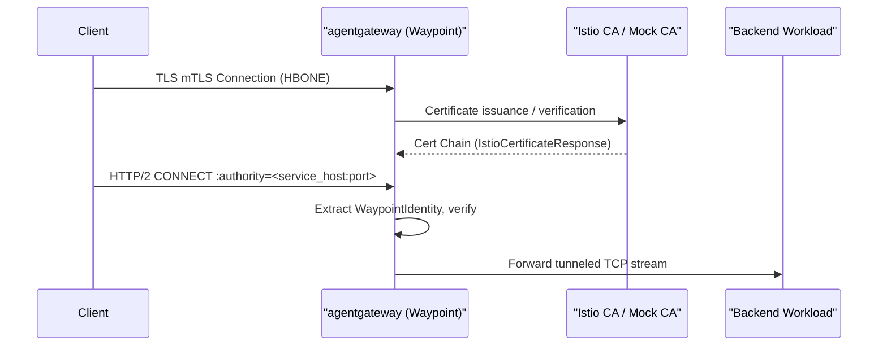

<!-- source: DeepWiki mcp.deepwiki.com · repo agentgateway/agentgateway · page 11.3 HBONE Protocol (Istio Integration) · fetched 2026-10-21 -->

# HBONE Protocol (Istio Integration)

<details>
<summary>Relevant source files</summary>

The following files were used as context for generating this wiki page:

- [crates/agentgateway/src/client/hbone_tunnel.rs](crates/agentgateway/src/client/hbone_tunnel.rs)
- [crates/agentgateway/src/types/discovery.rs](crates/agentgateway/src/types/discovery.rs)
- [crates/agentgateway/tests/common/hbone_server.rs](crates/agentgateway/tests/common/hbone_server.rs)
- [crates/agentgateway/tests/common/mock_ca_server.rs](crates/agentgateway/tests/common/mock_ca_server.rs)
- [crates/agentgateway/tests/common/shared_ca.rs](crates/agentgateway/tests/common/shared_ca.rs)
- [crates/agentgateway/tests/common/testdata/README.md](crates/agentgateway/tests/common/testdata/README.md)
- [crates/agentgateway/tests/common/testdata/gen_certs.sh](crates/agentgateway/tests/common/testdata/gen_certs.sh)
- [crates/agentgateway/tests/tests/hbone.rs](crates/agentgateway/tests/tests/hbone.rs)
- [crates/hbone/src/lib.rs](crates/hbone/src/lib.rs)
- [crates/hbone/src/pool.rs](crates/hbone/src/pool.rs)
- [crates/protos/proto/workload.proto](crates/protos/proto/workload.proto)

</details>


## Purpose and Scope

This document details the **HBONE** (HTTP-Based Overlay Network Environment) protocol support within **agentgateway**. It covers the integration with Istio's ambient service mesh architecture by implementing HBONE tunneling, waypoint proxy termination, network gateway roles, and the "double-HBONE" multi-hop tunnel scenario.

Key features include mTLS tunnel establishment over HTTP/2 `CONNECT`, waypoint identity verification, connection pooling, and multi-network routing via HBONE double tunnels.

Sources: [crates/agentgateway/src/client/hbone_tunnel.rs:1-150](), [crates/hbone/src/lib.rs:1-66]()

---

## HBONE Protocol Overview

HBONE is Istio's overlay tunneling protocol encapsulating TCP streams inside HTTP/2 `CONNECT` tunnels, facilitating identity propagation, mTLS encryption, and flexible in-mesh traffic routing.

Agentgateway supports these HBONE modes:

- **Waypoint Mode**: Acts as a service waypoint, terminating inbound HBONE tunnels and forwarding traffic to local workloads.
- **Gateway Mode**: Functions as a network gateway, proxying HBONE tunnels across networks.
- **Double-HBONE**: Multi-hop tunneling through a gateway followed by a waypoint.

The physical connections use TLS over TCP, upgraded with HTTP/2 to carry multiple multiplexed tunnels. The authority in the `CONNECT` request identifies the service or target.

### HBONE Address Representation & Handshake

Agentgateway maps the `CONNECT` authority header and physical socket addresses via its internal types. The `Target` enum abstracts destination targets by hostname, IP addresses, or Unix domain sockets. Identities are represented by `Identity` structs that encode mTLS credentials.

The handshake functions create and manage these HBONE tunnels:

- `handshake` — creates a direct HBONE tunnel to a workload.
- `handshake_waypoint` — connects to a waypoint address, encoding the target service in the authority.
- `handshake_double` — performs an outer HBONE tunnel to a network gateway, then an inner tunnel to the endpoint workload.

#### Authority and Identities Mapping

```mermaid
graph TD
    subgraph "NaturalLanguageSpace"
        "CONNECT Authority (service or address)"
        "Physical Destination (SocketAddr)"
        "mTLS Identity (cert-based)"
    end

    subgraph "CodeEntitySpace"
        Target["Target (enum)"]
        SocketAddr["SocketAddr"]
        Identity["Identity"]
        HSWaypoint["handshake_waypoint()"]
        HSDouble["handshake_double()"]
        HBP["WorkloadHBONEPool"]
    end

    "CONNECT Authority (service or address)" --> Target
    "Physical Destination (SocketAddr)" --> SocketAddr
    "mTLS Identity (cert-based)" --> Identity
    Target --> HSWaypoint
    SocketAddr --> HSWaypoint
    Identity --> HSWaypoint
    Target --> HSDouble
    SocketAddr --> HSDouble
    HSDouble --> HBP
```

Sources: [crates/agentgateway/src/client/hbone_tunnel.rs:43-49](), [crates/agentgateway/src/client/hbone_tunnel.rs:85-139](), [crates/agentgateway/src/client/hbone_tunnel.rs:141-216](), [crates/agentgateway/src/types/discovery.rs:178-181]()

---

## Outbound Transport Types in Agentgateway

Agentgateway's transport abstraction supports several HBONE-related variants chosen based on destination and network topology:

| Transport Variant | Description | Usage Scenario |
|-------------------|-------------|----------------|
| `Transport::Plain` | Raw TCP/HTTP connection without tunneling. | Direct, non-mesh backend calls. |
| `Transport::Hbone` | Single HBONE tunnel with mTLS, connecting directly to workload. | Standard pod-to-pod tunneling in mesh. |
| `Transport::DoubleHbone` | Two-layer HBONE: outer tunnel to gateway, inner tunnel to workload/waypoint. | E/W gateway use cases crossing mesh boundaries. |
| `Transport::HboneWaypoint` | HBONE tunnel terminating at waypoint proxies. | Sending traffic via waypoint proxies enforcing policies. |

Sources: [crates/agentgateway/src/client/hbone_tunnel.rs:141-216]()

---

## Waypoint HBONE Termination

Agentgateway can be deployed as a **waypoint proxy** that terminates HBONE tunnels. This involves:

- Accepting mTLS connections (usually on port 15008).
- Completing TLS handshake using certificates issued by Istio CA or test CAs.
- Accepting HTTP/2 `CONNECT` requests representing individual proxied TCP streams.
- Verifying peer identity using `WaypointIdentity` logic.
- Upgrading HTTP/2 streams into asynchronous socket-like objects (`RWStream`).
- Forwarding the proxied traffic to local backend services.

### Waypoint Verification and Identity

`WaypointIdentity` struct holds identifying information such as gateway name and namespace, with methods:

- `hostname()` returns the canonical FQDN of the waypoint. [crates/agentgateway/src/types/discovery.rs:123-126]()
- `matches_hostname()` verifies a `NamespacedHostname` matches the waypoint identity. [crates/agentgateway/src/types/discovery.rs:131-139]()
- `matches_address()` verifies a resolved service at an address matches the waypoint identity. [crates/agentgateway/src/types/discovery.rs:141-159]()
- `fronts_service()` confirms if this waypoint is a front for a given service, including for weighted waypoints. [crates/agentgateway/src/types/discovery.rs:161-175]()

### Waypoint Connection Flow



Sources: [crates/agentgateway/tests/tests/hbone.rs:13-18](), [crates/agentgateway/src/client/hbone_tunnel.rs:85-139](), [crates/agentgateway/tests/common/hbone_server.rs:33-151](), [crates/agentgateway/src/types/discovery.rs:113-175](), [crates/agentgateway/tests/common/mock_ca_server.rs:19-41]()

---

## Outbound HBONE Handshake and Connection Pooling

To establish outbound HBONE tunnels, agentgateway uses a multiplexed HTTP/2 connection pool:

### WorkloadHBONEPool

- The `WorkloadHBONEPool` manages pooled HTTP/2 HBONE tunnels keyed by destination identity and address (`WorkloadKey`). [crates/hbone/src/pool.rs:37-62]()
- It multiplexes streams over fewer HTTP/2 connections to optimize resource usage.
- Uses a `CertificateFetcher` asynchronous trait to dynamically acquire TLS client configurations for workloads. [crates/hbone/src/pool.rs:24-26]()
- Internally, it guards against multiple concurrent connection attempts per key (`established_conn_writelock`). [crates/hbone/src/pool.rs:56]()
- Supports connection recycling with idle timeouts. [crates/hbone/src/pool.rs:113-161]()

### Single HBONE Tunnel Handshake

Function `handshake` performs:

- Constructs an HTTP/2 `CONNECT` request to the target workload's HBONE mTLS port. [crates/agentgateway/src/client/hbone_tunnel.rs:50-62]()
- Adds Istio ambient networking headers (`x-istio-source`, `x-forwarded-network`, and inner `baggage`). [crates/agentgateway/src/client/hbone_tunnel.rs:63]()
- Sends the request through the `WorkloadHBONEPool` and upgrades the connection. [crates/agentgateway/src/client/hbone_tunnel.rs:70-72]()
- Wraps the HTTP/2 stream in a `RWStream` adapter exposing async read/write traits. [crates/agentgateway/src/client/hbone_tunnel.rs:73-82]()

### Double HBONE Tunnel Handshake

Function `handshake_double` establishes a two-hop tunnel:

- Creates an outer HBONE tunnel to the network gateway with `CONNECT` authority as the service target. [crates/agentgateway/src/client/hbone_tunnel.rs:159-178]()
- Upgrades the outer tunnel to raw streams. [crates/agentgateway/src/client/hbone_tunnel.rs:187-196]()
- Establishes an inner TLS connection using the pool's certificate fetcher on this tunnel. [crates/agentgateway/src/client/hbone_tunnel.rs:207-216]()
- Performs a client handshake with the inner workload's identities.
- Initiates an inner HBONE `CONNECT` tunnel to the final workload.
- Aggregates the streams for full double-tunneling functionality with drain signaling on stream drop.

### HBONE Istio Headers

Function `apply_hbone_headers` adds ambient mesh headers: [crates/agentgateway/src/client/hbone_tunnel.rs:22-40]()

| Header Name | Purpose | Applied on |
|---|---|---|
| `x-istio-source` | Encodes workload source role identity | Outer and inner tunnels |
| `x-forwarded-network`| Indicates client's network for ambient routing | Outer and inner tunnels |
| `baggage` | Workload metadata (namespace, cluster, etc.) | Only inner (terminating) |

Sources: [crates/agentgateway/src/client/hbone_tunnel.rs:22-82](), [crates/agentgateway/src/client/hbone_tunnel.rs:141-216](), [crates/hbone/src/pool.rs:24-26](), [crates/hbone/src/pool.rs:37-62]()

---

## Metrics and Observability

Agentgateway includes integration tests verifying HBONE functionality and connectivity. These tests:

- Use `HboneTestServer`, which echoes traffic with a prefixed message demonstrating waypoint processing [crates/agentgateway/tests/common/hbone_server.rs:33-151]().
- Utilize a mock Istio CA server (`MockCaService`) that signs certificates for mTLS handshake simulation [crates/agentgateway/tests/common/mock_ca_server.rs:13-65]().
- Confirm that ambient network headers and identity propagation are correctly applied and honored.
- Validate single and double HBONE handshake behavior using real TCP connections and tunnel upgrades [crates/agentgateway/tests/tests/hbone.rs:7-110](), [crates/agentgateway/tests/tests/hbone.rs:113-221]().

### HBONE Waypoint Identity Components

```mermaid
graph LR
    subgraph "NaturalLanguageSpace"
        "Waypoint Identity (gateway, namespace)"
        "Mesh Identity Types"
        "Source Role (Waypoint or Gateway)"
        "HBONE Headers"
    end

    subgraph "CodeEntitySpace"
        WI["WaypointIdentity (struct)"]
        ID["Identity (enum/struct)"]
        SR["HboneSourceRole (enum)"]
        HH["HboneHeaders (struct)"]
    end

    "Waypoint Identity (gateway, namespace)" --> WI
    "Mesh Identity Types" --> ID
    "Source Role (Waypoint or Gateway)" --> SR
    "HBONE Headers" --> HH
    HH --> SR
    WI --> ID
```

Sources: [crates/agentgateway/tests/tests/hbone.rs:10-100](), [crates/agentgateway/tests/common/hbone_server.rs:67-69](), [crates/agentgateway/src/types/discovery.rs:115-121](), [crates/agentgateway/src/client/mod.rs:85-88]()

---

## Technical Implementation Components

Key implementation artifacts for HBONE in agentgateway and hbone crates:

| Component | Description | File Location |
|---|---|---|
| `RWStream` | Adapter making an HTTP/2 stream implement async read/write | [crates/hbone/src/lib.rs:109-166]() |
| `WorkloadHBONEPool` | Connection pool managing HTTP/2 multiplexed HBONE tunnels | [crates/hbone/src/pool.rs:37-62]() |
| `H2Config` | HTTP/2 protocol settings (window sizes, frame size, streams)| [crates/hbone/src/lib.rs:32-49]() |
| `handshake_*` funcs | Outbound HBONE tunnel establishment functions | [crates/agentgateway/src/client/hbone_tunnel.rs:43-150]() |

Sources: [crates/hbone/src/lib.rs:108-166](), [crates/hbone/src/pool.rs:37-62](), [crates/agentgateway/src/client/hbone_tunnel.rs:22-150]()

---

# Summary

Agentgateway's HBONE support offers seamless Istio mesh integration including waypoint proxying and multi-network gateway traversal via double-HBONE tunnels. It leverages secure, multiplexed HTTP/2 CONNECT streams with ambient identity headers and supports complex routing scenarios essential for service mesh architectures.

This implementation is tested with mock CA servers and HBONE echo servers and integrated tightly with agentgateway's connection pooling and transport abstractions to enable scalable, secure tunneling in advanced deployments.

---

# References

- [crates/agentgateway/src/client/hbone_tunnel.rs:1-150]()
- [crates/hbone/src/lib.rs:1-66]()
- [crates/agentgateway/src/types/discovery.rs:113-175]()
- [crates/hbone/src/pool.rs:24-62]()
- [crates/agentgateway/tests/common/hbone_server.rs:33-151]()
- [crates/agentgateway/tests/common/mock_ca_server.rs:13-65]()
- [crates/agentgateway/tests/tests/hbone.rs:7-110]()
- [crates/agentgateway/tests/tests/hbone.rs:113-221]()

---

