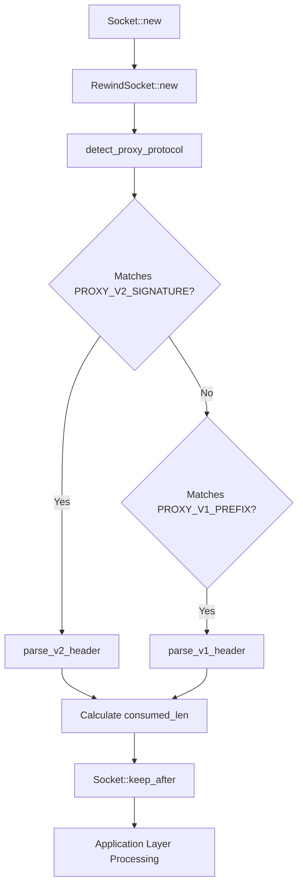
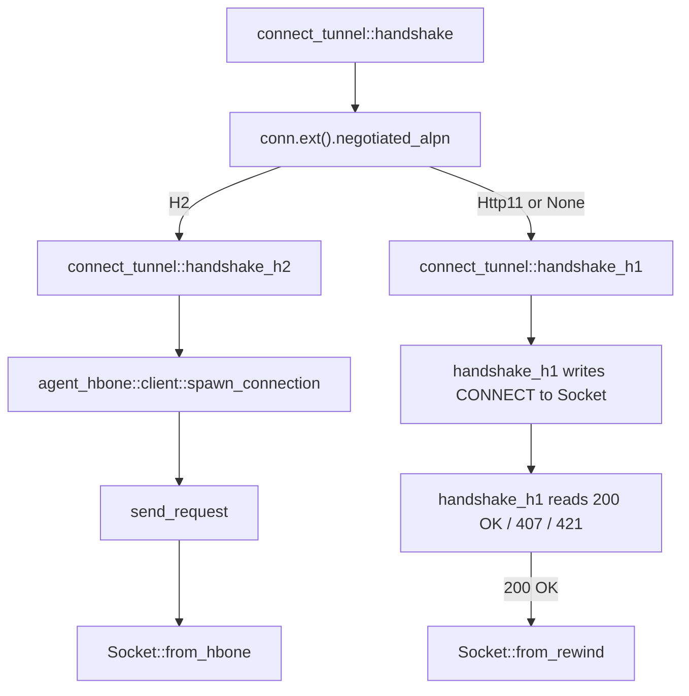
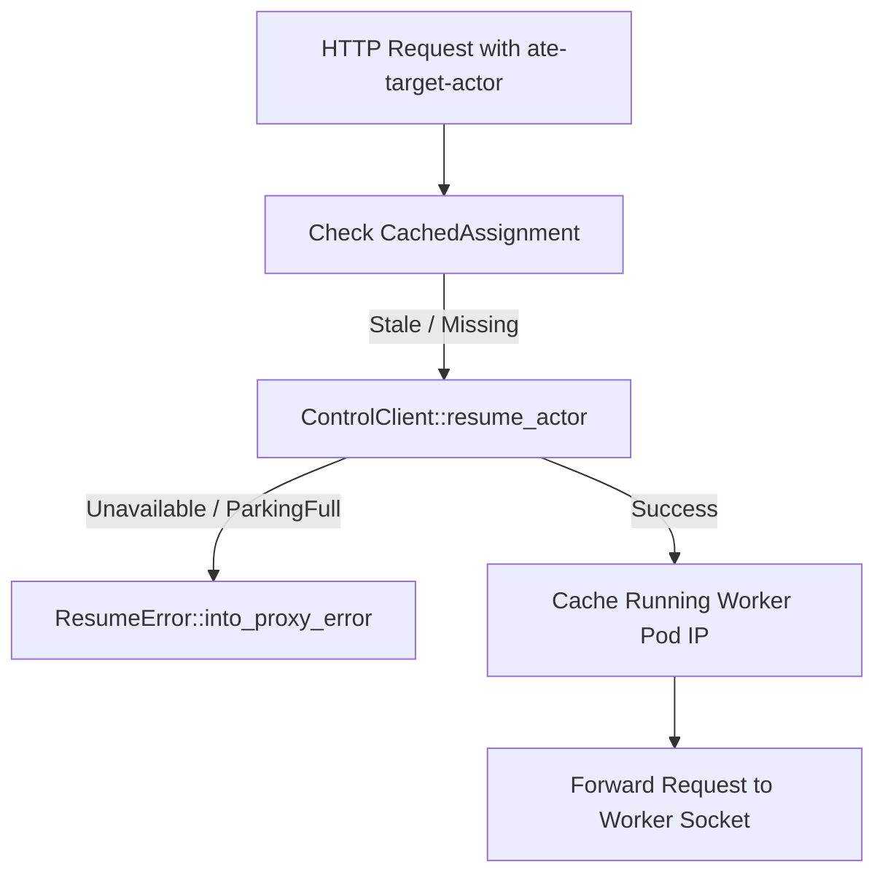
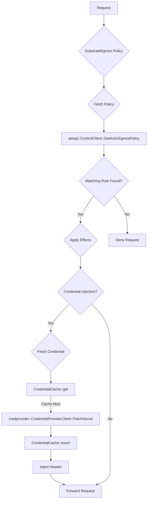

<!-- source: DeepWiki mcp.deepwiki.com · repo agentgateway/agentgateway · page 11.4 PROXY Protocol and Tunnels · fetched 2026-10-21 -->

# PROXY Protocol and Tunnels

Relevant source files

The following files were used as context for generating this wiki page:

- [crates/agentgateway/src/client/connect_tunnel.rs](crates/agentgateway/src/client/connect_tunnel.rs)
- [crates/agentgateway/src/http/retry/body.rs](crates/agentgateway/src/http/retry/body.rs)
- [crates/agentgateway/src/http/retry/body_tests.rs](crates/agentgateway/src/http/retry/body_tests.rs)
- [crates/agentgateway/src/http/substrate/README.md](crates/agentgateway/src/http/substrate/README.md)
- [crates/agentgateway/src/http/substrate/egress.rs](crates/agentgateway/src/http/substrate/egress.rs)
- [crates/agentgateway/src/http/substrate/ingress.rs](crates/agentgateway/src/http/substrate/ingress.rs)
- [crates/agentgateway/src/http/substrate/mod.rs](crates/agentgateway/src/http/substrate/mod.rs)
- [crates/agentgateway/src/test_helpers/ateapimock.rs](crates/agentgateway/src/test_helpers/ateapimock.rs)
- [crates/agentgateway/src/test_helpers/credprovidermock.rs](crates/agentgateway/src/test_helpers/credprovidermock.rs)
- [crates/agentgateway/src/transport/stream.rs](crates/agentgateway/src/transport/stream.rs)
- [crates/agentgateway/tests/tests/basic.rs](crates/agentgateway/tests/tests/basic.rs)
- [crates/agentgateway/tests/tests/substrate.rs](crates/agentgateway/tests/tests/substrate.rs)
- [crates/protos/build.rs](crates/protos/build.rs)
- [crates/protos/proto/ateapi.proto](crates/protos/proto/ateapi.proto)
- [crates/protos/proto/credprovider.proto](crates/protos/proto/credprovider.proto)
- [crates/protos/src/lib.rs](crates/protos/src/lib.rs)

This page covers agentgateway's support for the PROXY protocol (v1 and v2), TLV-based peer identity extraction, HTTP CONNECT tunneling, and egress proxy support [crates/agentgateway/src/client/connect_tunnel.rs:46-197](). These tunnel-layer capabilities allow the gateway to handle complex proxy hops, establish outbound tunneling connections, and enforce identity-aware access controls.

---

## 1. Overview

Network architectures frequently interpose load balancers, sidecars, or mesh waypoints between clients and the gateway. agentgateway handles these deployment topologies using two main mechanisms:
1. **PROXY Protocol Inbound Termination**: Reading PROXY v1/v2 headers prepended to raw streams to extract original client addressing and metadata.
2. **HTTP CONNECT Tunnels**: Establishing outbound or inbound CONNECT tunnels (`handshake_h1` and `handshake_h2` in `connect_tunnel.rs`) for routing traffic through proxies or secure agent networks [crates/agentgateway/src/client/connect_tunnel.rs:46-152]().

Sources: [crates/agentgateway/src/client/connect_tunnel.rs:46-152]()

---

## 2. PROXY Protocol Implementation and TLV Identity Extraction

The PROXY protocol implementation parses human-readable text format (v1) and binary format (v2).

### Protocol Detection and Rewind

The gateway determines if a PROXY header is present by inspecting v1 (`PROXY `) or v2 binary signatures. The detection utilizes a rewind mechanism to buffer bytes during inspection and replay unconsumed stream data to subsequent protocol handlers.

Title: PROXY Protocol Detection and Rewind Flow

Sources: [crates/agentgateway/src/client/connect_tunnel.rs:46-112]()

### TLV Identity Extraction

In PROXY v2 mode, the parser inspects Type-Length-Value (TLV) vectors. For Istio ambient mesh waypoints, custom TLVs convey peer identities, which are extracted into `ProxyProtocolInfo` and forwarded into the gateway context for CEL-based authorization.

Sources: [crates/agentgateway/src/client/connect_tunnel.rs:46-112]()

---

## 3. HTTP CONNECT Tunneling (`connect_tunnel.rs`)

agentgateway implements client-side and upstream HTTP CONNECT tunneling in `crates/agentgateway/src/client/connect_tunnel.rs` via functions like `handshake`, `handshake_h1`, and `handshake_h2` [crates/agentgateway/src/client/connect_tunnel.rs:46-197](). This enables routing connections through intermediate HTTP proxies or secure mesh endpoints using either HTTP/1.1 or HTTP/2 ALPN negotiation [crates/agentgateway/src/client/connect_tunnel.rs:130-152]().

### Tunnel Handshake Lifecycle

The `handshake` function inspects the negotiated ALPN protocol on the socket connection to select either `handshake_h1` or `handshake_h2` [crates/agentgateway/src/client/connect_tunnel.rs:130-152]().

Title: CONNECT Tunnel Handshake Flow

Sources: [crates/agentgateway/src/client/connect_tunnel.rs:46-112](), [crates/agentgateway/src/client/connect_tunnel.rs:130-197]()

- **HTTP/1.1 Fallback (`handshake_h1`)**: Constructs a raw `CONNECT {dest} HTTP/1.1` byte stream, appends `Proxy-Authorization` headers if present, writes to the socket, and parses the `200 OK` response before returning a rewindable socket [crates/agentgateway/src/client/connect_tunnel.rs:46-112]().
- **HTTP/2 Tunneling (`handshake_h2`)**: Integrates with `agent_hbone` to spawn an H2 client connection, dispatch a `CONNECT` request pseudo-header set, and wrap the resulting stream in an HBONE-compatible reader/writer interface [crates/agentgateway/src/client/connect_tunnel.rs:154-197]().

Sources: [crates/agentgateway/src/client/connect_tunnel.rs:46-112](), [crates/agentgateway/src/client/connect_tunnel.rs:154-197]()

---

## 4. Egress Proxy Support and Substrate Tunnels (`egress.rs`, `ingress.rs`)

For specialized multi-tenant or agentic substrate networks (`SubstrateEgress` and `SubstrateIngress`), incoming CONNECT tunnels and egress connections coordinate actor identities, request parking, and credential injection [crates/agentgateway/src/http/substrate/ingress.rs:149-220](), [crates/agentgateway/src/http/substrate/egress.rs:23-36]().

### Substrate Ingress and Request Parking

When incoming requests target actors that are suspended or initializing, `SubstrateIngress` manages request parking and resumption through the Substrate control plane gRPC service (`ControlClient`) [crates/agentgateway/src/http/substrate/ingress.rs:202-218]().

Title: Substrate Ingress Request Flow

Sources: [crates/agentgateway/src/http/substrate/ingress.rs:149-220]()

### Substrate Egress and Credential Providers

`SubstrateEgress` fetches actor egress policies from the control plane and injects dynamic credentials via credential providers (`CredentialProviderClient`) [crates/agentgateway/src/http/substrate/egress.rs:23-36](), [crates/agentgateway/src/http/substrate/egress.rs:122-184](). Secrets are fetched using `ate-secret://` URIs and cached locally via `CredentialCache` with a TTL [crates/agentgateway/src/http/substrate/egress.rs:50-95](), [crates/agentgateway/src/http/substrate/egress.rs:186-217]().

Title: Substrate Egress Policy and Credential Flow

Sources: [crates/agentgateway/src/http/substrate/egress.rs:23-36](), [crates/agentgateway/src/http/substrate/egress.rs:50-95](), [crates/agentgateway/src/http/substrate/egress.rs:122-217](), [crates/protos/proto/ateapi.proto:10-11](), [crates/protos/proto/credprovider.proto:1-20]()

---

## 5. Summary and Verification

The combination of PROXY protocol header parsing, HTTP CONNECT tunneling (`handshake`, `handshake_h1`, `handshake_h2`), and Substrate actor routing ensures secure, identity-aware traversal across complex network topologies [crates/agentgateway/src/client/connect_tunnel.rs:130-197](), [crates/agentgateway/src/http/substrate/ingress.rs:149-220]().

Sources: [crates/agentgateway/src/client/connect_tunnel.rs:130-197](), [crates/agentgateway/src/http/substrate/ingress.rs:149-220]()

---

