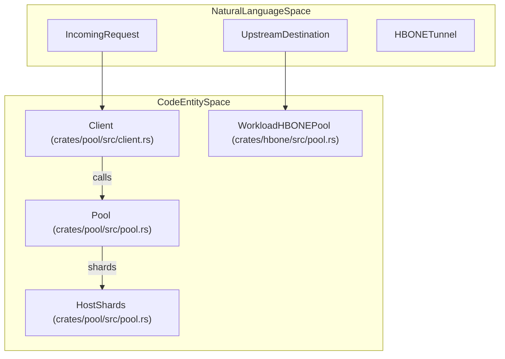
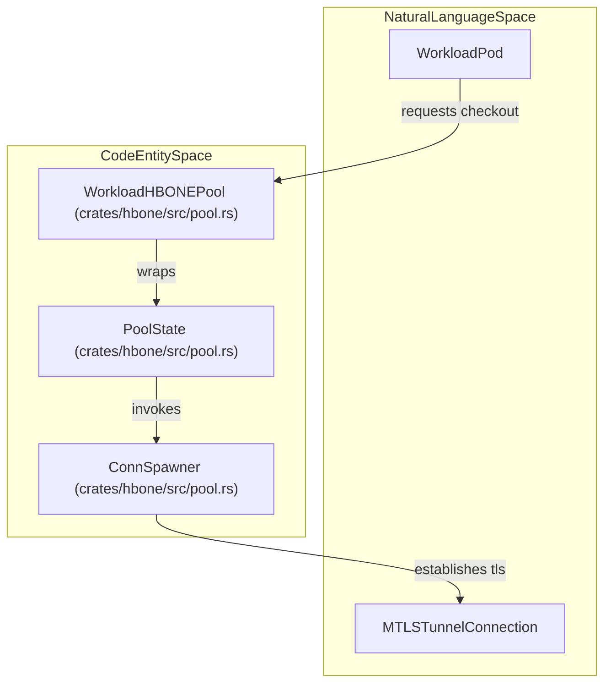

<!-- source: DeepWiki mcp.deepwiki.com · repo agentgateway/agentgateway · page 11.5 Connection Pooling and Management · fetched 2026-10-21 -->

# Connection Pooling and Management

Relevant source files

The following files were used as context for generating this wiki page:

- [crates/agentgateway/src/client/azure.rs](crates/agentgateway/src/client/azure.rs)
- [crates/agentgateway/src/http/localratelimit.rs](crates/agentgateway/src/http/localratelimit.rs)
- [crates/agentgateway/src/proxy/locality_test.rs](crates/agentgateway/src/proxy/locality_test.rs)
- [crates/agentgateway/tests/common/hbone_server.rs](crates/agentgateway/tests/common/hbone_server.rs)
- [crates/agentgateway/tests/common/mock_ca_server.rs](crates/agentgateway/tests/common/mock_ca_server.rs)
- [crates/agentgateway/tests/common/shared_ca.rs](crates/agentgateway/tests/common/shared_ca.rs)
- [crates/agentgateway/tests/common/testdata/README.md](crates/agentgateway/tests/common/testdata/README.md)
- [crates/agentgateway/tests/common/testdata/gen_certs.sh](crates/agentgateway/tests/common/testdata/gen_certs.sh)
- [crates/hbone/src/pool.rs](crates/hbone/src/pool.rs)
- [crates/pool/src/blackbox_tests.rs](crates/pool/src/blackbox_tests.rs)
- [crates/pool/src/client.rs](crates/pool/src/client.rs)
- [crates/pool/src/pool.rs](crates/pool/src/pool.rs)

## Purpose and Scope

This document describes the connection pooling and management system in `agentgateway`, which enables efficient reuse of upstream connections to reduce latency and resource consumption. The pooling layer sits between the HTTP/TCP proxy logic and the network transport, managing connection lifecycle, keying, and resource cleanup.

The system relies on specialized pooling implementations to provide robust reuse capabilities for diverse transport types (TLS, HBONE, Tunnel, and MCP). This includes the legacy HTTP client based on `hyper-util` for standard traffic (`[crates/pool/src/client.rs:40-48]()`), custom pool sharding (`[crates/pool/src/pool.rs:37-47]()`), and workload-specific HBONE pooling (`[crates/hbone/src/pool.rs:36-40]()`).

Sources: [crates/pool/src/client.rs:40-48](), [crates/pool/src/pool.rs:37-47](), [crates/hbone/src/pool.rs:36-40]()

---

## Connection Pool Architecture

The connection pooling system is built on specialized pooling infrastructure with custom pool key logic to support agentgateway's multi-transport architecture. The `Pool` struct coordinates requests across sharded host pools (`[crates/pool/src/pool.rs:85-89]()`).

### Diagram: Natural Language Space to Code Entity Space for Request Pooling

Sources: [crates/pool/src/client.rs:40-48](), [crates/pool/src/pool.rs:85-89](), [crates/pool/src/pool.rs:44-47](), [crates/hbone/src/pool.rs:36-40]()

---

## Pool Key and Reservation Design

Connections are keyed to ensure that a request only reuses a connection that is compatible with its destination, protocol version, and security requirements.

### Standard Pool Keying
For standard HTTP/TLS traffic, the gateway uses a `Key` trait which acts as the unique identifier for a connection in the pool (`[crates/pool/src/pool.rs:152-164]()`). It consists of:
*   `expected_capacity`: Determines if the connection should be managed as `Http1` (single request) or `Http2` (multiplexed) (`[crates/pool/src/pool.rs:142-154]()`).
*   `connect_timeout`: Specific timeout for establishing the connection (`[crates/pool/src/pool.rs:155-157]()`).
*   `shard`: Determines which `HostShards` mutex bucket the connection resides in (`[crates/pool/src/pool.rs:159-163]()`).

Sources: [crates/pool/src/pool.rs:142-164]()

---

## Transport Implementation and Handshakes

The gateway supports multiple transport abstractions, utilizing `Connected` metadata and extension attributes to negotiate capabilities such as ALPN, proxy status, and connection deadlines (`[crates/pool/src/connect/mod.rs:77-118]()`).

### Diagram: Natural Language Space to Code Entity Space for HBONE Tunnel Pooling

Sources: [crates/pool/src/client.rs:40-48](), [crates/pool/src/pool.rs:85-89](), [crates/hbone/src/pool.rs:36-69]()

---

## HBONE Workload Connection Pooling

For Istio ambient mode integration and waypoint routing, `agentgateway` implements `WorkloadHBONEPool` (`[crates/hbone/src/pool.rs:36-40]()`). 

### Invariants and Architecture
- Every workload gets its own connection pool (`[crates/hbone/src/pool.rs:31-33]()`).
- Every unique source/destination key gets dedicated connections managed inside `PoolState` (`[crates/hbone/src/pool.rs:49-62]()`).
- The `ConnectionPool` uses pingora's pooling primitives combined with custom writelocks (`established_conn_writelock`) to prevent global bottlenecks during concurrent connection establishment (`[crates/hbone/src/pool.rs:54-56]()`).
- The `ConnSpawner` handles fetching certificates, opening TCP streams to destination port 15008, handshaking TLS, and spawning the HTTP/2 connection (`[crates/hbone/src/pool.rs:71-95]()`).
- The `CertificateFetcher` trait (`[crates/hbone/src/pool.rs:23-25]()`) is used by `ConnSpawner` to obtain `rustls::client::ClientConfig` for mTLS connections. This allows for dynamic certificate fetching, for example, from a mock CA server in tests (`[crates/agentgateway/tests/common/mock_ca_server.rs:13-16]()`). Test certificates are pre-generated and stored in `crates/agentgateway/tests/common/testdata` (`[crates/agentgateway/tests/common/testdata/README.md:1-10]()`, `[crates/agentgateway/tests/common/testdata/gen_certs.sh:1-10]()`).

Sources: [crates/hbone/src/pool.rs:31-95](), [crates/hbone/src/pool.rs:23-25](), [crates/agentgateway/tests/common/mock_ca_server.rs:13-16](), [crates/agentgateway/tests/common/testdata/README.md:1-10](), [crates/agentgateway/tests/common/testdata/gen_certs.sh:1-10]()

---

## Connection Lifecycle and Resource Cleanup

### Pool Management and Eviction
The `Pool` implementation handles connection sharding and idle eviction to maintain optimal memory and descriptor utilization.
- **Sharding**: The `HostShards` struct uses 16 shards (`SHARD_COUNT = 16`) to reduce mutex contention under high concurrency (`[crates/pool/src/pool.rs:36-47]()`).
- **Eviction**: The `clear_expired` function iterates through shards and removes connections that are closed, have exceeded the idle timeout, or are past their deadline (`[crates/pool/src/pool.rs:103-133]()`).
- **Check-in and Idle Timeouts**: Checked-out connections returned via `maybe_checkin_conn` trigger an idle timeout tracker task that evicts or unrefs the connection if unused past `release_timeout` (`[crates/hbone/src/pool.rs:134-161]()`).

Sources: [crates/pool/src/pool.rs:36-47](), [crates/pool/src/pool.rs:103-133](), [crates/hbone/src/pool.rs:134-161]()

---

