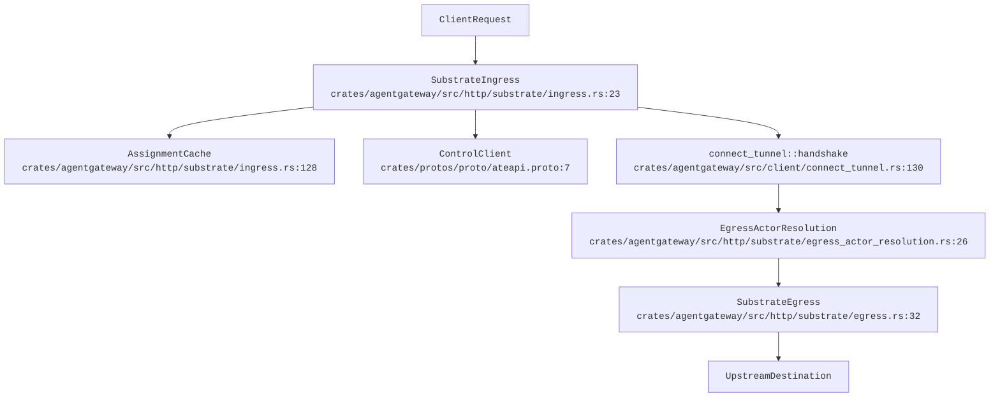
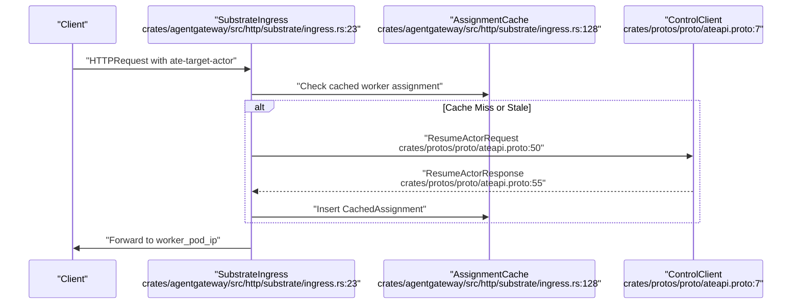
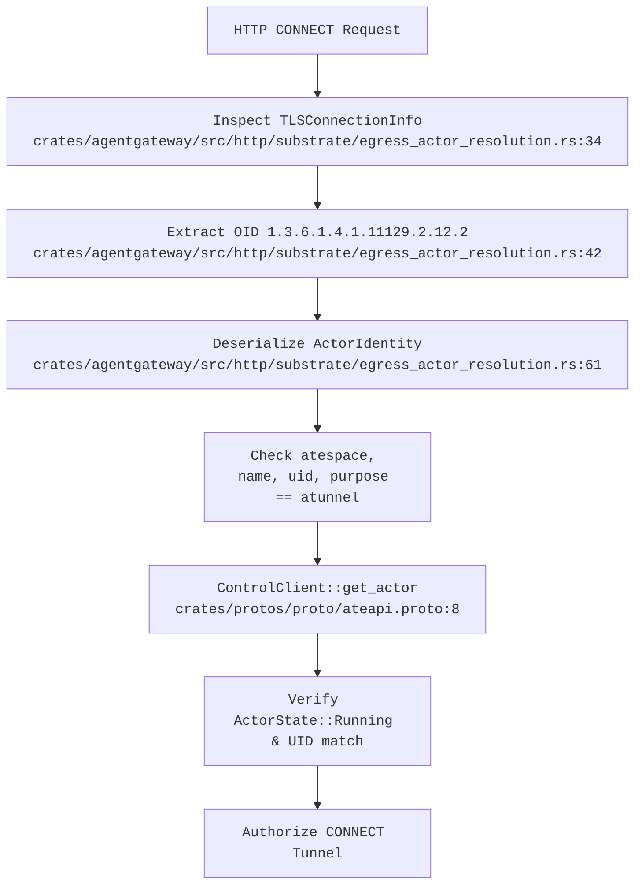

<!-- source: DeepWiki mcp.deepwiki.com · repo agentgateway/agentgateway · page 11.6 Substrate Ingress and Egress · fetched 2026-10-21 -->

# Substrate Ingress and Egress

<details>
<summary>Relevant source files</summary>

The following files were used as context for generating this wiki page:

- [crates/agentgateway/src/client/connect_tunnel.rs](crates/agentgateway/src/client/connect_tunnel.rs)
- [crates/agentgateway/src/http/retry/body.rs](crates/agentgateway/src/http/retry/body.rs)
- [crates/agentgateway/src/http/retry/body_tests.rs](crates/agentgateway/src/http/retry/body_tests.rs)
- [crates/agentgateway/src/http/substrate/README.md](crates/agentgateway/src/http/substrate/README.md)
- [crates/agentgateway/src/http/substrate/egress.rs](crates/agentgateway/src/http/substrate/egress.rs)
- [crates/agentgateway/src/http/substrate/ingress.rs](crates/agentgateway/src/http/substrate/ingress.rs)
- [crates/agentgateway/src/http/substrate/mod.rs](crates/agentgateway/src/http/substrate/mod.rs)
- [crates/agentgateway/src/test_helpers/ateapimock.rs](crates/agentgateway/src/test_helpers/ateapimock.rs)
- [crates/agentgateway/src/test_helpers/credprovidermock.rs](crates/agentgateway/src/test_helpers/credprovidermock.rs)
- [crates/agentgateway/tests/tests/basic.rs](crates/agentgateway/tests/tests/basic.rs)
- [crates/agentgateway/tests/tests/substrate.rs](crates/agentgateway/tests/tests/substrate.rs)
- [crates/protos/build.rs](crates/protos/build.rs)
- [crates/protos/proto/ateapi.proto](crates/protos/proto/ateapi.proto)
- [crates/protos/proto/credprovider.proto](crates/protos/proto/credprovider.proto)
- [crates/protos/src/lib.rs](crates/protos/src/lib.rs)

</details>


This page details the Substrate agent-network integration within `agentgateway`, covering ingress/egress request handling, the ATE gRPC control API (`ateapi.proto`), request parking, connection tunneling, actor identity validation, egress actor resolution, and upstream telemetry attribute conventions. All implementation details reside in the `crates/agentgateway/src/http/substrate/` module [crates/agentgateway/src/http/substrate/mod.rs:1-12]().

---

## 1. Substrate Integration Architecture

The Substrate subsystem bridges agent-to-agent communication (ATE) with traditional data plane routing. It manages actor life-cycle states, assigns worker pods dynamically via gRPC calls to the Substrate control plane, handles request parking during cold boots, and enforces actor-owned egress security policies.

### Diagram: Substrate Component Integration (Code Entity Space)

Sources: [crates/agentgateway/src/http/substrate/mod.rs:1-12](), [crates/agentgateway/src/http/substrate/ingress.rs:23-23](), [crates/agentgateway/src/http/substrate/ingress.rs:128-131](), [crates/protos/proto/ateapi.proto:7-13](), [crates/agentgateway/src/http/substrate/egress.rs:32-36](), [crates/agentgateway/src/client/connect_tunnel.rs:130-152]()

---

## 2. Substrate Ingress Handling and Request Parking

`SubstrateIngress` intercepts incoming requests targeted at specific actors, resolves their dynamic worker assignments, caches the destination IP/port bindings, and manages request parking when an actor is undergoing cold boot or recovering worker capacity [crates/agentgateway/src/http/substrate/ingress.rs:23-23]().

### Dynamic Backend Resolution and Caching
Incoming requests specify target actors via headers such as `ate-target-actor` [crates/agentgateway/tests/tests/substrate.rs:25-32](). The subsystem maintains an `AssignmentCache` backed by `quick_cache::sync::Cache` with a configured capacity to prevent excessive gRPC roundtrips to the control plane [crates/agentgateway/src/http/substrate/ingress.rs:9-9](), [crates/agentgateway/src/http/substrate/ingress.rs:128-131](), [crates/agentgateway/src/http/substrate/mod.rs:15-15]().

### Request Parking
When worker capacity is exhausted or an actor is scaling up, requests can be "parked" rather than immediately failed. This behavior is configured via `RequestParking` [crates/agentgateway/src/http/substrate/ingress.rs:202-218]():
- **`budget`**: Maximum time to wait for the actor to become routable (default: `5s`) [crates/agentgateway/src/http/substrate/ingress.rs:27-27](), [crates/agentgateway/src/http/substrate/ingress.rs:204-207]().
- **`max`**: Maximum concurrent requests that may wait for actor resumption (default: `1024`) [crates/agentgateway/src/http/substrate/ingress.rs:28-28](), [crates/agentgateway/src/http/substrate/ingress.rs:208-210]().
- **`retry_interval` & `retry_factor`**: Exponential backoff intervals applied during `ResumeActor` retries [crates/agentgateway/src/http/substrate/ingress.rs:211-217]().

If parking capacity is exhausted, requests return `StatusCode::SERVICE_UNAVAILABLE` via `ResumeError::ParkingFull` [crates/agentgateway/src/http/substrate/ingress.rs:42-43](), [crates/agentgateway/src/http/substrate/ingress.rs:49-52]().

### Diagram: Ingress Resolution and Parking Flow

Sources: [crates/agentgateway/src/http/substrate/ingress.rs:23-23](), [crates/agentgateway/src/http/substrate/ingress.rs:128-158](), [crates/protos/proto/ateapi.proto:50-60]()

---

## 3. ATE API and Protocol Definitions

The Substrate control plane interface is defined in `crates/protos/proto/ateapi.proto` [crates/protos/proto/ateapi.proto:1-118](). It defines the gRPC `Control` service used by both ingress and egress policies [crates/protos/proto/ateapi.proto:7-11]().

### Service Methods
- **`GetActor`**: Retrieves metadata, current state (`ActorState`), and worker assignments for an actor [crates/protos/proto/ateapi.proto:8-8](), [crates/protos/proto/ateapi.proto:18-21]().
- **`ResumeActor`**: Triggers actor boot or resumption workflow, returning a `WorkerAssignment` containing `worker_pod_ip` [crates/protos/proto/ateapi.proto:9-9](), [crates/protos/proto/ateapi.proto:36-38](), [crates/protos/proto/ateapi.proto:50-60]().
- **`GetActorEgressPolicy`**: Fetches the security egress rules associated with an actor [crates/protos/proto/ateapi.proto:10-10](), [crates/protos/proto/ateapi.proto:66-70]().

```protobuf
service Control {
  rpc GetActor(GetActorRequest) returns (Actor) {}
  rpc ResumeActor(ResumeActorRequest) returns (ResumeActorResponse) {}
  rpc GetActorEgressPolicy(GetActorEgressPolicyRequest) returns (EgressPolicy) {}
}
```
Sources: [crates/protos/proto/ateapi.proto:7-11]()

---

## 4. Egress Actor Resolution and CONNECT Tunnel Authorization

When an actor initiates outbound connections through the data plane via an HTTP CONNECT tunnel, `EgressActorResolution` validates the actor's cryptographic identity before establishing the tunnel [crates/agentgateway/src/http/substrate/egress_actor_resolution.rs:26-30]().

### Certificate Parsing and `ActorIdentity`
1. The incoming request is inspected for mutual TLS metadata containing an actor certificate (`TLSConnectionInfo`) [crates/agentgateway/src/http/substrate/egress_actor_resolution.rs:34-41]().
2. The certificate is parsed for a custom X.509 extension matching OID `1.3.6.1.4.1.11129.2.12.2` (`ACTOR_IDENTITY_OID`) [crates/agentgateway/src/http/substrate/egress_actor_resolution.rs:13-13](), [crates/agentgateway/src/http/substrate/egress_actor_resolution.rs:42-52]().
3. The extension value is deserialized into an `ActorIdentity` struct containing `atespace`, `actor_name`, `actor_uid`, and `purpose` (which must equal `"atunnel"`) [crates/agentgateway/src/http/substrate/egress_actor_resolution.rs:15-22](), [crates/agentgateway/src/http/substrate/egress_actor_resolution.rs:61-67]().

```rust
pub(crate) struct ActorIdentity {
	pub(crate) atespace: String,
	pub(crate) actor_name: String,
	pub(crate) actor_uid: String,
	purpose: String,
}
```
Sources: [crates/agentgateway/src/http/substrate/egress_actor_resolution.rs:15-22]()

### Control Plane Validation
`EgressActorResolution::authorize` queries the control plane via `ControlClient::get_actor` to verify that the actor UID matches and that the actor state is `ActorState::Running` [crates/agentgateway/src/http/substrate/egress_actor_resolution.rs:97-151]().

### Diagram: Egress Authorization Flow (Code Entity Space)

Sources: [crates/agentgateway/src/http/substrate/egress_actor_resolution.rs:33-151](), [crates/protos/proto/ateapi.proto:8-8]()

---

## 5. Substrate Egress Policy Enforcement

`SubstrateEgress` retrieves and enforces the egress rules owned by the authenticated actor for every outbound request [crates/agentgateway/src/http/substrate/egress.rs:32-36]().

### Policy Evaluation Flow
1. Extracts the `ActorIdentity` from request extensions (populated by `EgressActorResolution`) [crates/agentgateway/src/http/substrate/egress.rs:108-114]().
2. Invokes `ControlClient::get_actor_egress_policy` via gRPC to fetch the `EgressPolicy` for the actor [crates/agentgateway/src/http/substrate/egress.rs:122-135]().
3. Evaluates the request destination against the policy's rules (`matching_rule`) [crates/agentgateway/src/http/substrate/egress.rs:152-152]().

### Credential Providers and Secret Injections
`SubstrateEgress` supports secret-backed egress effects through `CredentialProvider` mappings, fetching secrets via the `credprovider.proto` gRPC service and caching them in `CredentialCache` [crates/agentgateway/src/http/substrate/egress.rs:38-55](), [crates/agentgateway/src/http/substrate/egress.rs:57-106](), [crates/protos/proto/credprovider.proto:7-9]().

The `CredentialProvider` trait defines the interface for fetching secrets [crates/agentgateway/src/test_helpers/credprovidermock.rs:11-20](). The `CredentialProviderMock` is used for testing purposes [crates/agentgateway/src/test_helpers/credprovidermock.rs:24-49]().

Sources: [crates/agentgateway/src/http/substrate/egress.rs:32-158](), [crates/protos/proto/credprovider.proto:7-9](), [crates/agentgateway/src/test_helpers/credprovidermock.rs:11-20](), [crates/agentgateway/src/test_helpers/credprovidermock.rs:24-49]()

---

## 6. Telemetry Conventions and ATE Attributes

Telemetry metrics and request logs generated by the Substrate subsystem follow conventions defined in `crates/agentgateway/src/http/substrate/ateattr.rs` [crates/agentgateway/src/http/substrate/ateattr.rs:1-6](). These are separate from general OpenTelemetry semantic conventions [crates/agentgateway/src/telemetry/semconv.rs:1-3]().

### Key Attribute Constants
- `ATE_ACTOR_NAME` (`ate.actor.name`) [crates/agentgateway/src/http/substrate/ateattr.rs:11-11]()
- `ATE_ACTOR_UID` (`ate.actor.uid`) [crates/agentgateway/src/http/substrate/ateattr.rs:12-12]()
- `ATE_ATESPACE` (`ate.atespace`) [crates/agentgateway/src/http/substrate/ateattr.rs:13-13]()
- `ATE_ROUTER_RESUME` (`ate.router.resume`) [crates/agentgateway/src/http/substrate/ateattr.rs:14-14]()
- `ATE_ROUTER_ROUTE_DURATION` (`ate.router.route.duration`) [crates/agentgateway/src/http/substrate/ateattr.rs:15-15]()

### Resume Dispositions
`ResumeDisposition` classifies whether a request experienced a cold actor activation [crates/agentgateway/src/http/substrate/ateattr.rs:21-27]():
- **`None`**: No cold start / actor already running (`resumed = false`) [crates/agentgateway/src/http/substrate/ateattr.rs:23-24](), [crates/agentgateway/src/http/substrate/ateattr.rs:38-44]().
- **`Joined`**: Waited on an ongoing resume workflow (`resumed = true, joined = true`) [crates/agentgateway/src/http/substrate/ateattr.rs:25-25](), [crates/agentgateway/src/http/substrate/ateattr.rs:38-44]().
- **`Triggered`**: Executed the resume workflow directly (`resumed = true, joined = false`) [crates/agentgateway/src/http/substrate/ateattr.rs:26-26](), [crates/agentgateway/src/http/substrate/ateattr.rs:38-44]().

Ordered weakest to strongest (`None < Joined < Triggered`), aggregation keeps the strongest disposition observed across stale-assignment retries [crates/agentgateway/src/http/substrate/ateattr.rs:21-27]().

Sources: [crates/agentgateway/src/http/substrate/ateattr.rs:1-73]()

---

