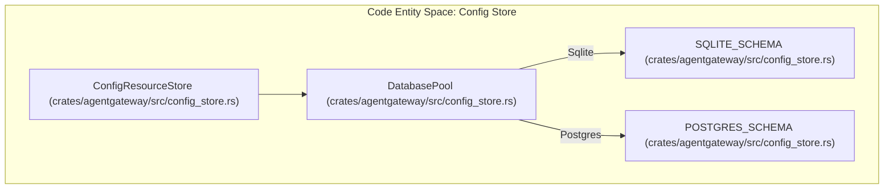

<!-- source: DeepWiki mcp.deepwiki.com · repo agentgateway/agentgateway · page 12 Web UI and Management · fetched 2026-10-21 -->

# Web UI and Management

Relevant source files

The following files were used as context for generating this wiki page:

- [.dockerignore](.dockerignore)
- [Dockerfile.windows](Dockerfile.windows)
- [ui/package.json](ui/package.json)
- [ui/pnpm-lock.yaml](ui/pnpm-lock.yaml)
- [ui/pnpm-workspace.yaml](ui/pnpm-workspace.yaml)
- [ui/src/components/RawConfigEditor.tsx](ui/src/components/RawConfigEditor.tsx)
- [ui/src/components/SchemaYamlEditor.tsx](ui/src/components/SchemaYamlEditor.tsx)
- [ui/src/monacoWorkers.ts](ui/src/monacoWorkers.ts)
- [ui/tsconfig.app.json](ui/tsconfig.app.json)
- [ui/tsconfig.node.json](ui/tsconfig.node.json)
- [ui/vite.config.ts](ui/vite.config.ts)

This page provides a high-level overview of the web interface and management subsystems in Agentgateway, which supply a unified dashboard for testing AI gateway features, managing Model Context Protocol (MCP) servers, configuring traffic routing, and exposing admin APIs [ui/package.json:6-18](), [ui/src/components/RawConfigEditor.tsx:1-21]().

As a PARENT page, this document outlines core capabilities and system architecture, linking to child pages for in-depth technical details.

---

## Overview and Capabilities

The `agentgateway` web UI and management system enable operators and developers to:
- **Manage LLM Models and Providers**: Configure provider-backed models and routing parameters.
- **Traffic Configuration**: Manage L7 listeners, gateways, and HTTP/TCP routes.
- **Hybrid Configuration Storage**: Persist and update configuration resources via database-backed APIs.
- **Interactive Playgrounds**: Test LLM prompts and MCP capabilities directly within the browser.

Sources: [ui/package.json:6-18]()

---

## Technology Stack

| Layer | Technologies | Role in Codebase |
|-------|--------------|------------------|
| **Frontend Framework** | React, TypeScript, TanStack Router, TanStack Query | Powers single-page navigation and state synchronization (`ui/src/`) [ui/package.json:20-34]() |
| **Styling & Editors** | CSS Variables, Monaco Editor | Provides utility styling and schema-aware code editing [ui/package.json:28-29](), [ui/src/components/SchemaYamlEditor.tsx:1-101]() |
| **Build Tooling** | Vite | Bundles the frontend application [ui/vite.config.ts:1-29]() |

Sources: [ui/package.json:20-34](), [ui/package.json:28-29](), [ui/src/components/SchemaYamlEditor.tsx:1-101](), [ui/vite.config.ts:1-29]()

---

## Architecture and Data Flow

The architecture bridges the React frontend interface to the backend handlers, which interact with configuration stores and model catalogs.

### Diagram: Natural Language to Code Entities (UI Routing & Endpoints)

```mermaid
graph TB
    subgraph "Natural Language: Frontend UI"
        UIOverview["Gateway Overview Page"]
        UILogs["Logs Explorer Page"]
        UIConfig["Config Editor"]
        UIPageHome["ui/src/pages/Home.tsx"]
        UIPageLogs["ui/src/pages/Logs.tsx"]
        UIPageModels["ui/src/pages/Models.tsx"]
        UIPageKeys["ui/src/pages/Keys.tsx"]
        UIPagePlayground["ui/src/pages/Playground.tsx"]
        UIPageCel["ui/src/pages/Cel.tsx"]
        UIPageCosts["ui/src/pages/Costs.tsx"]
        UIPageGetStarted["ui/src/pages/GetStarted.tsx"]
        UIPageMcpPlayground["ui/src/pages/McpPlayground.tsx"]
        UIPageTrafficDump["ui/src/pages/traffic/TrafficConfigDumpPanel.tsx"]
        UIPageAnalytics["ui/src/pages/analytics/AnalyticsCharts.tsx"]
        UIPageDumpModels["ui/src/pages/models/DumpModelsView.tsx"]
    end

    subgraph "Code Entity Space: Rust Handlers & API Routes"
        ConfigResourceStore["ConfigResourceStore (crates/agentgateway/src/config_store.rs)"]
        ListResources["list_resources (crates/agentgateway/src/config_store.rs)"]
        UpsertRequest["upsert_config_resource (crates/agentgateway/src/config_store.rs)"]
        SearchLogs["searchLogs (api/logsApi.ts)"]
        EvaluateCel["evaluateCel (api/celApi.ts)"]
        SendChatCompletion["sendChatCompletion (api/playgroundApi.ts)"]
        SendMcpJsonRpc["sendMcpJsonRpc (api/playgroundApi.ts)"]
        RefreshBaseCosts["refreshBaseCostsAndConfigure (costs.ts)"]
    end

    UIPageHome --> UIOverview
    UIPageLogs --> UILogs
    UIPageModels --> UIConfig
    UIPageKeys --> UIConfig
    UIPagePlayground --> SendChatCompletion
    UIPagePlayground --> SendMcpJsonRpc
    UIPageCel --> EvaluateCel
    UIPageCosts --> RefreshBaseCosts
    UIPageGetStarted --> UIOverview
    UIPageMcpPlayground --> SendMcpJsonRpc
    UIPageTrafficDump --> UIOverview
    UIPageAnalytics --> UILogs
    UIPageDumpModels --> UIOverview

    UIOverview -->|"GET /api/runtime"| ConfigResourceStore
    UIConfig -->|"GET /api/config"| ConfigResourceStore
    UIConfig -->|"POST /api/config"| UpsertRequest
    UIConfig -->|"GET /api/config/resources"| ListResources
    UILogs -->|"GET /api/logs/search"| SearchLogs
    UIPageCel -->|"POST /api/cel/evaluate"| EvaluateCel
    UIPagePlayground -->|"POST /llm/v1/chat/completions"| SendChatCompletion
    UIPageMcpPlayground -->|"POST /mcp/v1/jsonrpc"| SendMcpJsonRpc
    UIPageCosts -->|"POST /api/admin/model-catalog/refresh"| RefreshBaseCosts
    
    ConfigResourceStore --> ListResources
    ConfigResourceStore --> UpsertRequest
```

Sources: [ui/src/components/RawConfigEditor.tsx:1-21]()

### Diagram: Configuration Storage and Database Flow

Sources: 

---

## Child Pages

For comprehensive technical details, refer to the following child pages:

- **12.1 [UI Architecture](#12.1)** — Frontend architecture (Vite + React + TypeScript), component organization, routing, styling, and asset embedding [ui/package.json:20-34](), [ui/vite.config.ts:1-29]().
- **12.2 [Configuration Management UI](#12.2)** — Configuration editing, YAML/JSON schema validation, diffing, and live preview. Covers configuration management hooks and UI components [ui/src/components/SchemaYamlEditor.tsx:1-101](), [ui/src/components/RawConfigEditor.tsx:1-21]().
- **12.3 [Playground and Client Setup](#12.3)** — MCP/LLM playground, capabilities explorer, client setup instructions, logs, and CEL explorer pages.
- **12.4 [Admin and Debug APIs](#12.4)** — Admin endpoints, config dump, logging control, profiling, and metrics exposition.

Sources: [ui/package.json:20-34](), [ui/vite.config.ts:1-29](), [ui/src/components/SchemaYamlEditor.tsx:1-101](), [ui/src/components/RawConfigEditor.tsx:1-21]()

---

## Development and Build

The UI is bundled using Vite and embedded directly into the Rust application runtime, allowing standalone binary deployments to serve the full web application without external file dependencies [ui/vite.config.ts:1-29](), [ui/package.json:6-18]().

- **Development Server**: Run `pnpm dev` in the `ui/` workspace to start the Vite dev server [ui/package.json:10-10]().
- **E2E Testing**: Playwright tests validate UI rendering against mocked gateway data (`ui/tests/e2e/ui.spec.ts`) [ui/package.json:17-17]().

Sources: [ui/vite.config.ts:1-29](), [ui/package.json:6-18](), [ui/package.json:10-10](), [ui/package.json:17-17]()

---

