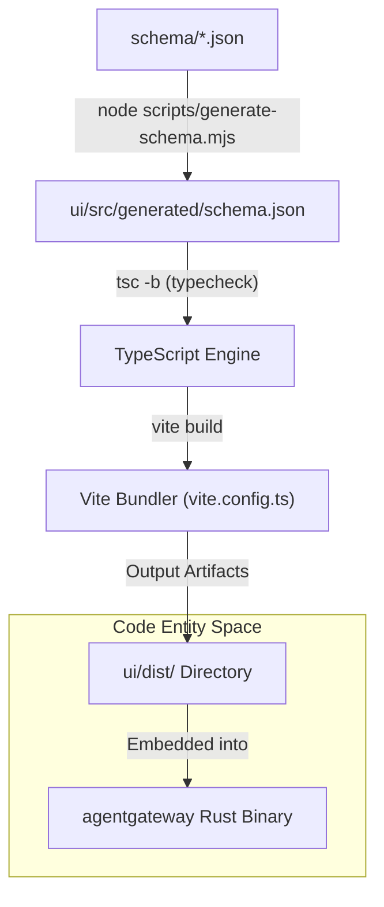
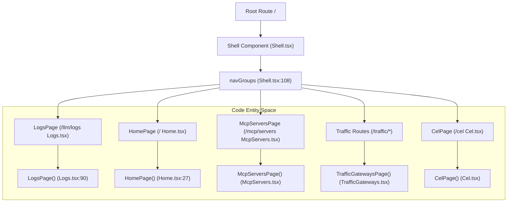
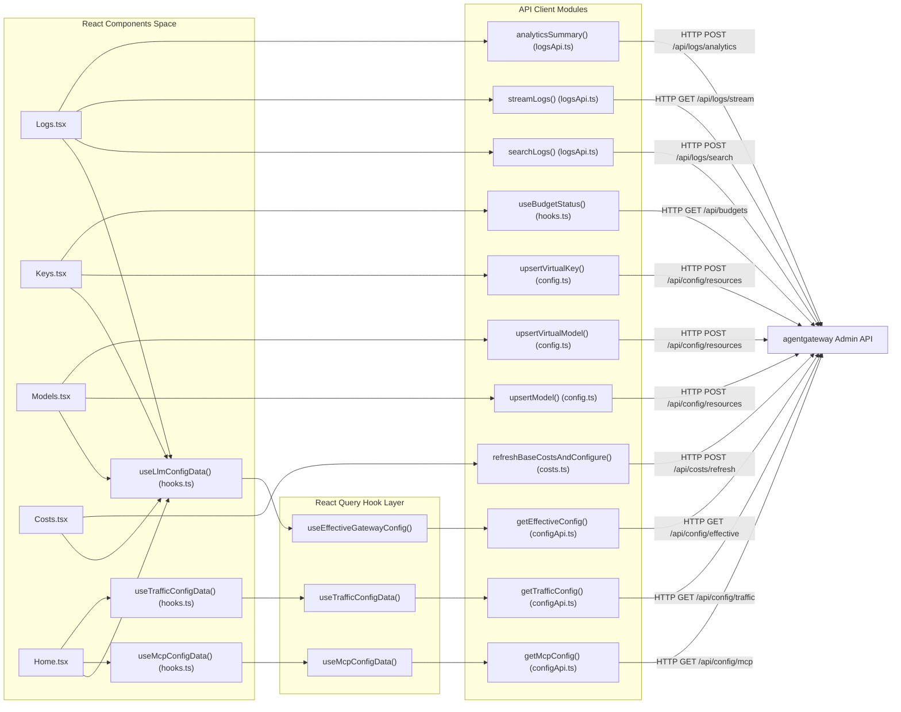
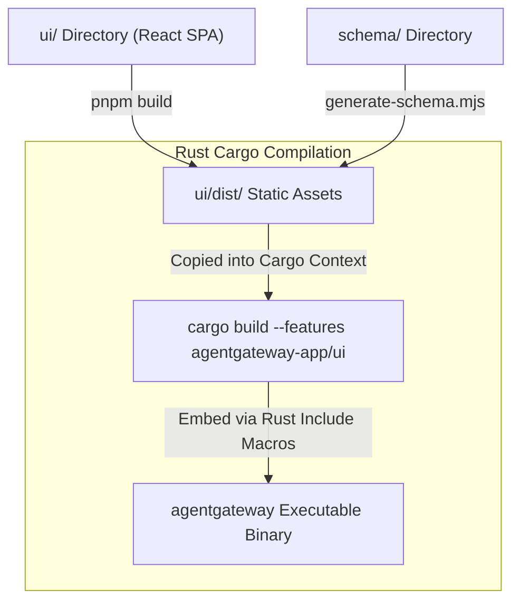

<!-- source: DeepWiki mcp.deepwiki.com · repo agentgateway/agentgateway · page 12.1 UI Architecture · fetched 2026-10-21 -->

# UI Architecture

<details>
<summary>Relevant source files</summary>

The following files were used as context for generating this wiki page:

- [.dockerignore](.dockerignore)
- [Dockerfile.windows](Dockerfile.windows)
- [ui/package.json](ui/package.json)
- [ui/pnpm-lock.yaml](ui/pnpm-lock.yaml)
- [ui/pnpm-workspace.yaml](ui/pnpm-workspace.yaml)
- [ui/src/components/RawConfigEditor.tsx](ui/src/components/RawConfigEditor.tsx)
- [ui/src/components/SchemaYamlEditor.tsx](ui/src/components/SchemaYamlEditor.tsx)
- [ui/src/components/Shell.tsx](ui/src/components/Shell.tsx)
- [ui/src/main.tsx](ui/src/main.tsx)
- [ui/src/monacoWorkers.ts](ui/src/monacoWorkers.ts)
- [ui/src/pages/Cel.tsx](ui/src/pages/Cel.tsx)
- [ui/src/pages/Costs.tsx](ui/src/pages/Costs.tsx)
- [ui/src/pages/GetStarted.tsx](ui/src/pages/GetStarted.tsx)
- [ui/src/pages/Home.tsx](ui/src/pages/Home.tsx)
- [ui/src/pages/Keys.tsx](ui/src/pages/Keys.tsx)
- [ui/src/pages/Logs.tsx](ui/src/pages/Logs.tsx)
- [ui/src/pages/McpPlayground.tsx](ui/src/pages/McpPlayground.tsx)
- [ui/src/pages/Models.tsx](ui/src/pages/Models.tsx)
- [ui/src/pages/Playground.tsx](ui/src/pages/Playground.tsx)
- [ui/src/pages/analytics/AnalyticsCharts.tsx](ui/src/pages/analytics/AnalyticsCharts.tsx)
- [ui/src/pages/models/DumpModelsView.tsx](ui/src/pages/models/DumpModelsView.tsx)
- [ui/src/pages/traffic/TrafficConfigDumpPanel.tsx](ui/src/pages/traffic/TrafficConfigDumpPanel.tsx)
- [ui/src/styles.css](ui/src/styles.css)
- [ui/src/styles/analytics.css](ui/src/styles/analytics.css)
- [ui/tests/e2e/fixtures.ts](ui/tests/e2e/fixtures.ts)
- [ui/tests/e2e/ui.spec.ts](ui/tests/e2e/ui.spec.ts)
- [ui/tsconfig.app.json](ui/tsconfig.app.json)
- [ui/tsconfig.node.json](ui/tsconfig.node.json)
- [ui/vite.config.ts](ui/vite.config.ts)

</details>


## Purpose and Scope
This page details the architecture, build tooling, state management, component organization, routing, styling systems, and binary embedding mechanisms of the `agentgateway` web management interface located in the `ui/` directory [ui/package.json:1-51]().

---

## 1. Technology Stack and Build Tooling

The user interface is implemented as a Single Page Application (SPA) built using **Vite**, **React 19**, and **TypeScript** [ui/package.json:1-51](). It leverages TanStack libraries for type-safe routing and server state management, Monaco Editor for schema-validated configuration editing, and custom CSS variables for styling.

| Category | Package / Tool | Version / Reference | Role |
|---|---|---|---|
| Framework & Build | `vite`, `react`, `react-dom` | `v8.2.0`, `v19.2.8` | Frontend compilation, bundling, and rendering [ui/package.json:31-45]() |
| Type Safety & Routing | `@tanstack/react-router`, `typescript` | `v1.170.18`, `v7.0.2` | Type-safe client-side routing and static analysis [ui/package.json:24,44]() |
| State & Data Fetching | `@tanstack/react-query` | `v5.101.4` | Server state caching, background refetching, and mutations [ui/package.json:23]() |
| Editor & Parsing | `monaco-editor`, `monaco-yaml`, `js-yaml` | `v0.56.0`, `v5.5.1`, `v5.4.2` | In-browser YAML/JSON configuration editing and validation [ui/package.json:26,29,30]() |
| Styling & Icons | `@fontsource/geist-sans`, `lucide-react` | `v5.3.0`, `v1.28.0` | Typography and SVG icon set [ui/package.json:21,27]() |

The build script orchestrates JSON schema generation from backend definitions, type checking, and Vite bundling (`ui/package.json:7`):

```json
{
	"scripts": {
		"build": "node scripts/generate-schema.mjs && tsc -b && vite build",
		"dev": "pnpm build && VITE_AGENTGATEWAY_API=http://localhost:15000 vite",
		"typecheck": "pnpm generate-schema && tsc -b"
	}
}
```

Vite handles path aliasing (`@` mapped to `src/`), worker script resolution for Monaco Editor, and output directory management.

Title: "UI Build Pipeline to Code Entity Space"


Sources: [ui/package.json:1-51](), [ui/tests/e2e/ui.spec.ts:11-30]()

---

## 2. Component Organization and Routing Architecture

Client-side routing is handled via TanStack Router (`@tanstack/react-router`) [ui/package.json:24](). The router registers core pages spanning gateway overviews, LLM management, MCP servers, and traffic rules, as verified in end-to-end testing definitions [ui/tests/e2e/ui.spec.ts:11-30]():

- `HomePage` (`/`): Gateway overview and onboarding wizard [ui/tests/e2e/ui.spec.ts:14]()
- `LogsPage` (`/llm/logs`): Conversation telemetry, trajectory steps, and structured logging search [ui/tests/e2e/ui.spec.ts:19]()
- `McpServersPage` (`/mcp/servers`): Model Context Protocol server configuration [ui/tests/e2e/ui.spec.ts:24]()
- `TrafficGatewaysPage` (`/traffic/gateways`): Gateway listeners and routes [ui/tests/e2e/ui.spec.ts:27-29]()

The layout shell (`Shell` component in `ui/src/components/Shell.tsx`) orchestrates navigation groups, dynamic feature flags (`hasLlm`, `hasMcp`, `hasTraffic`), mobile navigation drawers, and theme controls [ui/src/components/Shell.tsx:74-122]().

Title: "Component Routing Hierarchy and Code Entities"


Sources: [ui/tests/e2e/ui.spec.ts:11-30](), [ui/src/components/Shell.tsx:74-122](), [ui/src/pages/Logs.tsx:90](), [ui/src/pages/Home.tsx:27]()

---

## 3. Data Flow, API Integration, and State Management

The frontend relies on TanStack React Query (`@tanstack/react-query`) for asynchronous state synchronization with the agentgateway admin REST API. Centralized custom hooks encapsulate data retrieval logic for raw configs, effective configs, and hybrid resource stores [ui/src/components/Shell.tsx:79-87]().

Complex views like `LogsPage` manage advanced client-side state including debounced search queries, pagination, abort controllers for streaming logs (`streamLogs`), and analytics metric summaries [ui/src/pages/Logs.tsx:110-145](). The `LogsPage` specifically uses `searchLogs` and `streamLogs` from `api/logsApi` to fetch log entries and `analyticsSummary` for aggregated data [ui/src/pages/Logs.tsx:24-25]().

Title: "Data Fetching Hook and API Client Flow"


Sources: [ui/src/components/Shell.tsx:79-87](), [ui/src/pages/Logs.tsx:24-25](), [ui/src/pages/Logs.tsx:110-166](), [ui/src/pages/Keys.tsx:40-44](), [ui/src/pages/Models.tsx:143-145](), [ui/src/pages/Costs.tsx:38-42]()

---

## 4. Styling, Theme System, and Monaco Integration

The user interface uses CSS custom properties defined in `ui/src/styles.css` to manage theme switches (`light` and `dark` modes) through a `data-theme` attribute on the root HTML element [ui/src/styles.css:1-80]().

- **Theme State**: Handled via local storage persistence, setting `document.documentElement.dataset.theme` [ui/src/components/Shell.tsx:88-92,123-125]().
- **Typography**: Uses `@fontsource/geist-sans` (`ui/package.json:21`) as the primary font family [ui/src/styles.css:27-34]().
- **Code Block Formatting**: Disables font ligatures (`font-variant-ligatures: none`) inside code elements, preformatted blocks, and Monaco editor windows for precise column alignment [ui/src/styles.css:36-52]().

Sources: [ui/package.json:21](), [ui/src/styles.css:1-80](), [ui/src/components/Shell.tsx:88-125]()

---

## 5. Binary Asset Embedding and Multi-Stage Build

To deliver a zero-dependency standalone binary, the compiled UI static assets (`ui/dist/`) are embedded into the Rust binary during the container and Cargo build processes. The `Dockerfile.windows` and other Dockerfiles demonstrate this multi-stage build pattern [Dockerfile.windows:1-2]().

Title: "Multi-Stage Docker and Asset Embedding Flow"


During container builds (such as `Dockerfile.windows`), node compilation stages generate `ui/dist`, which is subsequently injected into the Rust builder stage [Dockerfile.windows:1-2]().

Sources: [Dockerfile.windows:1-2]()

---

