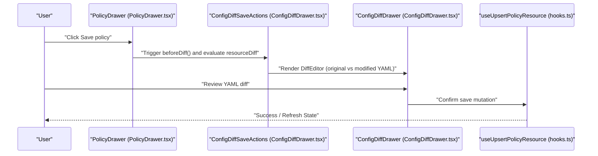

<!-- source: DeepWiki mcp.deepwiki.com · repo agentgateway/agentgateway · page 12.2 Configuration Management UI · fetched 2026-10-21 -->

# Configuration Management UI

Relevant source files

The following files were used as context for generating this wiki page:

- [crates/agentgateway/tests/tests/config_store.rs](crates/agentgateway/tests/tests/config_store.rs)
- [ui/src/components/ConfigDiffDrawer.tsx](ui/src/components/ConfigDiffDrawer.tsx)
- [ui/src/components/Primitives.tsx](ui/src/components/Primitives.tsx)
- [ui/src/credentialDisplay.ts](ui/src/credentialDisplay.ts)
- [ui/src/pages/Guardrails.tsx](ui/src/pages/Guardrails.tsx)
- [ui/src/pages/McpServers.tsx](ui/src/pages/McpServers.tsx)
- [ui/src/pages/Policies.tsx](ui/src/pages/Policies.tsx)
- [ui/src/pages/Providers.tsx](ui/src/pages/Providers.tsx)
- [ui/src/pages/RawSettings.tsx](ui/src/pages/RawSettings.tsx)
- [ui/src/pages/TrafficListeners.tsx](ui/src/pages/TrafficListeners.tsx)
- [ui/src/pages/TrafficRoutes.tsx](ui/src/pages/TrafficRoutes.tsx)
- [ui/src/pages/models/LlmSettingsDrawer.tsx](ui/src/pages/models/LlmSettingsDrawer.tsx)
- [ui/src/policies/PolicyDrawer.tsx](ui/src/policies/PolicyDrawer.tsx)

## Purpose and Scope

The Configuration Management UI provides a web-based interface for managing the Agentgateway lifecycle, including editing listeners, backends, routes, policies, and LLM guardrails. It features a specialized YAML/JSON editor backed by Monaco, live validation, schema-aware IntelliSense, policy drawers, and a robust diffing system for safe configuration updates (`[ui/src/components/ConfigDiffDrawer.tsx:76-146]()`, `[ui/src/policies/PolicyDrawer.tsx:52-175]()`).

The UI is built as a **Vite + React + TypeScript** application located in the `ui/` directory (`[ui/package.json:1-51]()`, `[ui/vite.config.ts:1-29]()`) and is embedded into the Rust binary via the `ui` cargo feature.

Sources: [ui/src/components/ConfigDiffDrawer.tsx:76-146](), [ui/src/policies/PolicyDrawer.tsx:52-175](), [ui/package.json:1-51](), [ui/vite.config.ts:1-29]()

---

## UI Architecture and Data Flow

The UI operates as a client to the Gateway's admin and management REST APIs. It coordinates configuration state through hooks like `useLlmConfigData`, `useRawGatewayConfig`, and `useUpsertPolicyResource` (`[ui/src/hooks.ts:92-140]()`, `[ui/src/hooks.ts:57-63]()`, `[ui/src/hooks.ts:220-229]()`).

### Configuration Code Entity Mapping

This diagram illustrates the relationship between UI pages, mutation hooks, and backend configuration storage.

Title: "UI to Backend Configuration Flow (Code Entity Bridge)"

```mermaid
graph TD
    subgraph "NaturalLanguageSpace"
        GuardrailsUI["GuardrailsPage (Guardrails.tsx)"]
        McpServersUI["McpServersPage (McpServers.tsx)"]
        PolicyDrawerUI["PolicyDrawer (PolicyDrawer.tsx)"]
        ProvidersUI["ProvidersPage (Providers.tsx)"]
        TrafficRoutesUI["TrafficRoutesEditorPage (TrafficRoutes.tsx)"]
        LlmSettingsUI["LlmSettingsDrawer (LlmSettingsDrawer.tsx)"]
        RawSettingsUI["RawSettingsPage (RawSettings.tsx)"]
    end

    subgraph "CodeEntitySpace"
        UseLlmConfigData["useLlmConfigData (hooks.ts)"]
        UseMcpConfigData["useMcpConfigData (hooks.ts)"]
        UseUpsertPolicyResource["useUpsertPolicyResource (hooks.ts)"]
        UseUpsertConfigResource["useUpsertConfigResource (hooks.ts)"]
        UseDeleteConfigResource["useDeleteConfigResource (hooks.ts)"]
        UseUpdateConfig["useUpdateConfig (hooks.ts)"]
        AdminAPI["Admin REST API"]
        ConfigResourceStore["ConfigResourceStore (crates/agentgateway/src/config_store.rs)"]
    end

    GuardrailsUI -->|"Reads LLM config"| UseLlmConfigData
    McpServersUI -->|"Reads MCP config"| UseMcpConfigData
    ProvidersUI -->|"Reads LLM config"| UseLlmConfigData
    TrafficRoutesUI -->|"Reads traffic config"| UseTrafficConfigData
    LlmSettingsUI -->|"Reads LLM config"| UseLlmConfigData
    RawSettingsUI -->|"Reads effective config"| UseEffectiveGatewayConfig

    PolicyDrawerUI -->|"Submits policy mutations"| UseUpsertPolicyResource
    McpServersUI -->|"Submits resource mutations"| UseUpsertConfigResource
    McpServersUI -->|"Deletes resource"| UseDeleteConfigResource
    ProvidersUI -->|"Submits resource mutations"| UseUpsertConfigResource
    ProvidersUI -->|"Deletes resource"| UseDeleteConfigResource
    TrafficRoutesUI -->|"Updates config"| UseUpdateConfig
    TrafficRoutesUI -->|"Deletes resource"| UseDeleteConfigResource
    LlmSettingsUI -->|"Updates config"| UseUpdateConfig
    RawSettingsUI -->|"Updates config"| UseUpdateConfig

    UseUpsertPolicyResource -->|"PUT /api/config/resources"| AdminAPI
    UseUpsertConfigResource -->|"PUT /api/config/resources"| AdminAPI
    UseDeleteConfigResource -->|"DELETE /api/config/resources"| AdminAPI
    UseUpdateConfig -->|"PUT /api/config"| AdminAPI
    AdminAPI -->|"Persists"| ConfigResourceStore
```

Sources: [ui/src/hooks.ts:92-140](), [ui/src/hooks.ts:57-63](), [ui/src/hooks.ts:220-229](), [ui/src/pages/Guardrails.tsx:183-202](), [ui/src/pages/McpServers.tsx:50-55](), [ui/src/pages/Providers.tsx:35-36](), [ui/src/pages/TrafficRoutes.tsx:100-107](), [ui/src/pages/models/LlmSettingsDrawer.tsx:18-19](), [ui/src/pages/RawSettings.tsx:60-61]()

---

## Configuration Editing, Schema Validation, and Policy Drawers

The UI relies heavily on policy drawers and modular editors to simplify complex resource authoring without requiring manual YAML syntax creation.

### Policy Drawers and Custom Editors
The `PolicyDrawer` component (`[ui/src/policies/PolicyDrawer.tsx:52-175]()`) wraps policy editing across multiple subsystems:
*   `AuthorizationPolicyEditor`: Custom rule builder for allow/deny/require rules (`[ui/src/policies/PolicyDrawer.tsx:208-214]()`).
*   `JwtPolicyEditor`: Configuration UI for JWT validation modes, JWKS sources, and required claims (`[ui/src/policies/JwtPolicyEditor.tsx:77-128]()`).
*   `GenericPolicyEditor`: Fallback schema-driven editor used when a specialized custom editor is absent (`[ui/src/policies/PolicyDrawer.tsx:187-200]()`).

Validation occurs client-side using JSON schemas before submission. For example, `JwtPolicyEditor` validates issuer presence and inline JWKS syntax (`[ui/src/policies/JwtPolicyEditor.tsx:164-181]()`) prior to triggering mutation hooks.

Sources: [ui/src/policies/PolicyDrawer.tsx:52-215](), [ui/src/policies/JwtPolicyEditor.tsx:77-181]()

---

## Configuration Diffing and Hybrid Mode

The UI incorporates a sophisticated diffing engine (`ConfigDiffDrawer` and `ConfigDiffSaveActions`) powered by the Monaco `DiffEditor` (`[ui/src/components/ConfigDiffDrawer.tsx:76-146]()`). This allows administrators to inspect exact YAML differences between existing and modified configurations prior to saving.

### The Save and Diff Sequence

Title: "Configuration Diff and Save Sequence (Code Entity Bridge)"

### Hybrid Mode Constraints
In hybrid storage mode (`configStoreMode: "hybrid"`), configuration files act alongside a SQLite or Postgres database. The UI enforces restrictions on file-owned vs. database-backed resources:
*   **Hybrid Write Protection**: `ConfigSaveButton` inspects runtime info (`[ui/src/components/ConfigDiffDrawer.tsx:25-42]()`) to prevent accidental writes to file-backed resources.
*   **Keyboard Overrides**: Administrators can hold modifier keys (`useHybridFileWriteOverrideKeys`) to force-write configuration updates when permitted (`[ui/src/components/ConfigDiffDrawer.tsx:35-40]()`).

Sources: [ui/src/components/ConfigDiffDrawer.tsx:18-146](), [ui/src/policies/PolicyDrawer.tsx:52-134]()

---

## Component Reference

| Component | Purpose | Key Files |
| :--- | :--- | :--- |
| `PolicyDrawer` | Slide-over drawer managing policy editing, deletion confirmation, and diff actions. | `ui/src/policies/PolicyDrawer.tsx` |
| `ConfigDiffDrawer` | Monaco-powered side-by-side YAML diff inspector for pre-save reviews. | `ui/src/components/ConfigDiffDrawer.tsx` |
| `ConfigSaveButton` | Button wrapper enforcing hybrid mode write protections and overrides. | `ui/src/components/ConfigDiffDrawer.tsx` |
| `Dropdown` | Reusable dropdown component for selecting options, with search and keyboard navigation. | `ui/src/components/Primitives.tsx` |
| `PageHeader` | Standard page header with title, description, and optional actions. | `ui/src/components/Primitives.tsx` |
| `Panel` | Generic container for content sections. | `ui/src/components/Primitives.tsx` |
| `JwtPolicyEditor` | Specialized form editor for JWT validation, JWKS sources, and issuer claims. | `ui/src/policies/JwtPolicyEditor.tsx` |
| `PolicyCatalogPage` | Catalog view organizing policies into logical groups (Access, Safety, Traffic Shaping). | `ui/src/pages/Policies.tsx` |
| `GuardrailsPage` | Dedicated page for managing LLM Guardrails, including built-in detectors, regex, and external services. | `ui/src/pages/Guardrails.tsx` |
| `McpServersPage` | Page for configuring MCP targets, including their type, endpoint, and state. | `ui/src/pages/McpServers.tsx` |
| `ProvidersPage` | Page for managing LLM providers, including credentials and connection settings. | `ui/src/pages/Providers.tsx` |
| `RawSettingsPage` | Page for configuring UI access policies and exposing the UI on a traffic gateway. | `ui/src/pages/RawSettings.tsx` |
| `TrafficRoutesPage` | Page for managing traffic routes, including HTTP and TCP routes. | `ui/src/pages/TrafficRoutes.tsx` |
| `LlmSettingsDrawer` | Drawer for configuring LLM gateway binding settings. | `ui/src/pages/models/LlmSettingsDrawer.tsx` |

Sources: [ui/src/policies/PolicyDrawer.tsx:52-175](), [ui/src/components/ConfigDiffDrawer.tsx:18-146](), [ui/src/components/Primitives.tsx:64-80](), [ui/src/components/Primitives.tsx:22-31](), [ui/src/components/Primitives.tsx:35-40](), [ui/src/policies/JwtPolicyEditor.tsx:77-128](), [ui/src/pages/Policies.tsx:115-142](), [ui/src/pages/Guardrails.tsx:183-211](), [ui/src/pages/McpServers.tsx:102-115](), [ui/src/pages/Providers.tsx:108-119](), [ui/src/pages/RawSettings.tsx:29-55](), [ui/src/pages/TrafficRoutes.tsx:202-221](), [ui/src/pages/models/LlmSettingsDrawer.tsx:17-25]()

---

