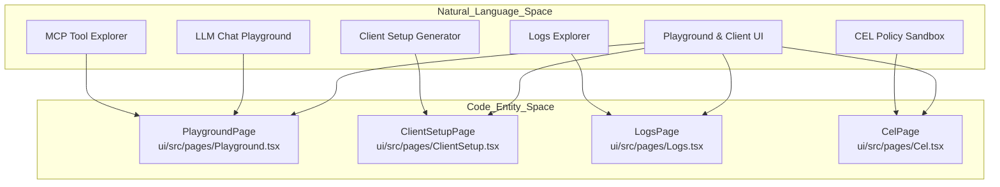
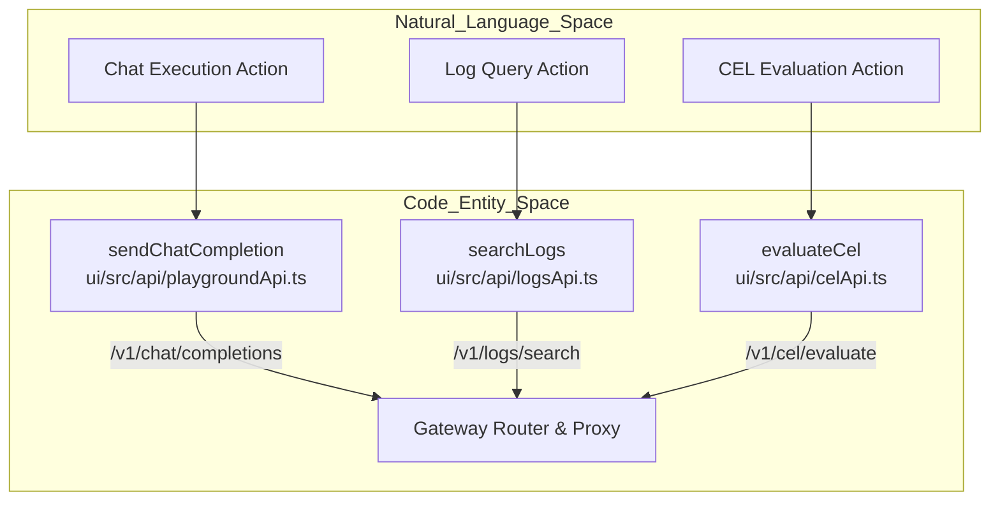

<!-- source: DeepWiki mcp.deepwiki.com · repo agentgateway/agentgateway · page 12.3 Playground and Client Setup · fetched 2026-10-21 -->

# Playground and Client Setup

Relevant source files

The following files were used as context for generating this wiki page:

- [ui/src/assets/goose.svg](ui/src/assets/goose.svg)
- [ui/src/assets/pi.svg](ui/src/assets/pi.svg)
- [ui/src/claudeSubscription.ts](ui/src/claudeSubscription.ts)
- [ui/src/components/Shell.tsx](ui/src/components/Shell.tsx)
- [ui/src/main.tsx](ui/src/main.tsx)
- [ui/src/pages/Cel.tsx](ui/src/pages/Cel.tsx)
- [ui/src/pages/ClientSetup.tsx](ui/src/pages/ClientSetup.tsx)
- [ui/src/pages/Costs.tsx](ui/src/pages/Costs.tsx)
- [ui/src/pages/GetStarted.tsx](ui/src/pages/GetStarted.tsx)
- [ui/src/pages/Home.tsx](ui/src/pages/Home.tsx)
- [ui/src/pages/Keys.tsx](ui/src/pages/Keys.tsx)
- [ui/src/pages/Logs.tsx](ui/src/pages/Logs.tsx)
- [ui/src/pages/McpPlayground.tsx](ui/src/pages/McpPlayground.tsx)
- [ui/src/pages/Models.tsx](ui/src/pages/Models.tsx)
- [ui/src/pages/Playground.tsx](ui/src/pages/Playground.tsx)
- [ui/src/pages/analytics/AnalyticsCharts.tsx](ui/src/pages/analytics/AnalyticsCharts.tsx)
- [ui/src/pages/models/DumpModelsView.tsx](ui/src/pages/models/DumpModelsView.tsx)
- [ui/src/pages/traffic/TrafficConfigDumpPanel.tsx](ui/src/pages/traffic/TrafficConfigDumpPanel.tsx)
- [ui/src/styles.css](ui/src/styles.css)
- [ui/src/styles/analytics.css](ui/src/styles/analytics.css)
- [ui/tests/e2e/fixtures.ts](ui/tests/e2e/fixtures.ts)
- [ui/tests/e2e/ui.spec.ts](ui/tests/e2e/ui.spec.ts)

## Purpose and Scope

The Playground and Client Setup subsystem (anchored in the web UI under `/llm/playground`, `/client-setup`, `/llm/logs`, and `/cel`) provides comprehensive interactive testing, tool exploration, SDK code generation, log inspection, and CEL policy validation for the `agentgateway` data plane [ui/tests/e2e/ui.spec.ts:22-30]().

It serves four core operational roles:
1. **LLM & MCP Playground**: Interactive chat completions testing, model/virtual model resolution, and dynamic discovery/invocation of Model Context Protocol (MCP) tools [ui/src/pages/Playground.tsx:113-169]().
2. **Client Setup & Code Generation**: Automated generation of configuration snippets, base URLs, and integration recipes for popular AI coding assistants (Cursor, Windsurf, Goose, Claude, GitHub Copilot) and standard HTTP/SDK clients [ui/src/pages/ClientSetup.tsx:37-46]().
3. **Logs Explorer**: Real-time log streaming, advanced filtering across analytics dimensions, token usage analysis, and detailed request tracing [ui/src/pages/Logs.tsx:87-142]().
4. **CEL Explorer**: Interactive Common Expression Language (CEL) evaluation sandbox against realistic or custom request/response contexts [ui/tests/e2e/ui.spec.ts:30-30]().

Sources: `[ui/tests/e2e/ui.spec.ts:22-30]()`, `[ui/src/pages/Playground.tsx:113-169]()`, `[ui/src/pages/ClientSetup.tsx:37-46]()`, `[ui/src/pages/Logs.tsx:87-142]()`

---

## Component Architecture and Data Flow

The playground and management interface bridges user actions in the React single-page application to the gateway's underlying REST/gRPC configuration and telemetry APIs.

**Diagram: Playground and Client Setup Code Entity Map**

Sources: `[ui/src/pages/Playground.tsx:1-211]()`, `[ui/src/pages/ClientSetup.tsx:1-201]()`, `[ui/src/pages/Logs.tsx:1-216]()`, `[ui/src/pages/Cel.tsx]()`

**Diagram: API Call Mapping and Data Flow**

Sources: `[ui/src/pages/Playground.tsx:17-17]()`, `[ui/src/pages/Logs.tsx:21-21]()`, `[ui/src/pages/Cel.tsx]()`

---

## LLM and MCP Playground

The LLM and MCP playground (`PlaygroundPage`) manages chat message state, tool execution loops, and session initialization [ui/src/pages/Playground.tsx:113-169]().

### Model Resolution & Wildcards
When configured models use wildcard prefixes (e.g., `openai/*`), the playground resolves concrete model identifiers before dispatching requests to `/v1/chat/completions` [ui/src/pages/Playground.tsx:148-184]().

| Function | Code Role | Source File Location |
| :--- | :--- | :--- |
| `resolveModelName` | Combines base model configuration with specific user input. | `[ui/src/pages/Playground.tsx:44-46]()` |
| `isWildcardModelName` | Detects wildcard character `*` in model definitions. | `[ui/src/pages/Playground.tsx:44-46]()` |
| `wildcardModelPrefix` | Extracts static routing prefix before wildcards. | `[ui/src/pages/Playground.tsx:44-46]()` |
| `sendChatCompletion` | Dispatches completion payload via API client. | `[ui/src/api/playgroundApi.ts]()` |

### MCP Session Lifecycle & Tool Discovery
When MCP mode is enabled, the playground initializes a persistent session through `initializeMcpSession` and extracts available tools via `extractMcpTools` [ui/src/pages/Playground.tsx:40-42](). Tool invocations flow through JSON-RPC over the gateway's MCP endpoint using `sendMcpJsonRpc` [ui/src/api/playgroundApi.ts]() (integrated in `Playground.tsx`) [ui/src/pages/Playground.tsx:163-169]().

Sources: `[ui/src/pages/Playground.tsx:113-195]()`, `[ui/src/pages/Playground.tsx:40-42]()`, `[ui/src/api/playgroundApi.ts]()`

---

## Client Setup and SDK Code Generation

The `ClientSetupPage` translates gateway configuration state into ready-to-run integration snippets and SDK initialization instructions [ui/src/pages/ClientSetup.tsx:37-46]().

- **Supported Targets**: `curl`, OpenAI Python/Node SDKs, Anthropic SDK, Cursor, Windsurf, Goose, and GitHub Copilot [ui/src/pages/ClientSetup.tsx:1-12]().
- **Base URL Derivation**: Automatically computes the correct gateway origin using `llmGatewayOrigin(config.data)` [ui/src/pages/ClientSetup.tsx:97-97]() and `derivedBaseUrl` [ui/src/pages/ClientSetup.tsx:97-97]().
- **Credential Masking & Selection**: Integrates virtual API keys (`apiKeys` filtered via `hasKeyValue`) or raw keys for testing [ui/src/pages/ClientSetup.tsx:96-104]().
- **Subscription Warnings**: Detects proprietary Claude subscription keys (`sk-ant-oat...`) and displays warnings via `claudeSubscriptionWarning` [ui/src/claudeSubscription.ts:8-10](), [ui/src/pages/ClientSetup.tsx:158-162]().

Sources: `[ui/src/pages/ClientSetup.tsx:1-201]()`, `[ui/src/claudeSubscription.ts:8-10]()`

---

## Logs Explorer

The `LogsPage` component provides a rich telemetry viewer for inspecting request histories, metrics, and LLM completions [ui/src/pages/Logs.tsx:87-142]().

### Features and Implementation
- **Search & Filtering**: Communicates with `searchLogs` using structured dimensions (`model`, `provider`, `httpStatus`, etc.) [ui/src/api/logsApi.ts]() [ui/src/pages/Logs.tsx:149-153]().
- **Real-Time Streaming**: Establishes an SSE event stream using `streamLogs` to append incoming log entries live [ui/src/api/logsApi.ts]() [ui/src/pages/Logs.tsx:203-220]().
- **Analytics Breakdown**: Integrates chart components (`AnalyticsTimelineChart`, `AnalyticsBreakdownChart`) driven by `analyticsSummary` to evaluate latency, cost, and token consumption trends [ui/src/api/logsApi.ts]() [ui/src/pages/Logs.tsx:61-77](), [ui/src/pages/Logs.tsx:173-177]().

Sources: `[ui/src/pages/Logs.tsx:21-177]()`, `[ui/src/pages/Logs.tsx:203-220]()`, `[ui/src/api/logsApi.ts]()`

---

## CEL Expression Explorer

The `CelPage` component provides an interactive workspace for testing Common Expression Language (CEL) expressions against realistic request and response contexts [ui/tests/e2e/ui.spec.ts:30-30]().

### Evaluation Workflow
1. **Expression Input**: Uses a specialized Monaco Editor instance configured with `celLanguage` and `configureCelMonaco`.
2. **Context YAML**: Allows editing a comprehensive sample context containing `request`, `response`, `proxy`, `env`, `source`, `jwt`, `apiKey`, `basicAuth`, `llm`, `mcp`, and `backend` attributes.
3. **Execution**: Invokes `evaluateCel(expression, data)` against the backend gRPC/REST CEL evaluation service, displaying structured JSON/YAML results or descriptive error states.

Sources: `[ui/src/pages/Cel.tsx]()`

---

