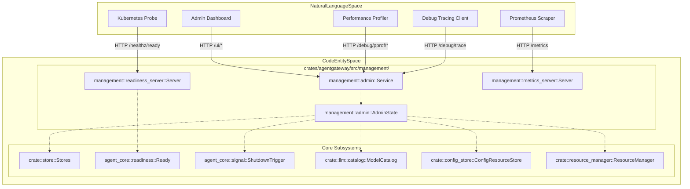
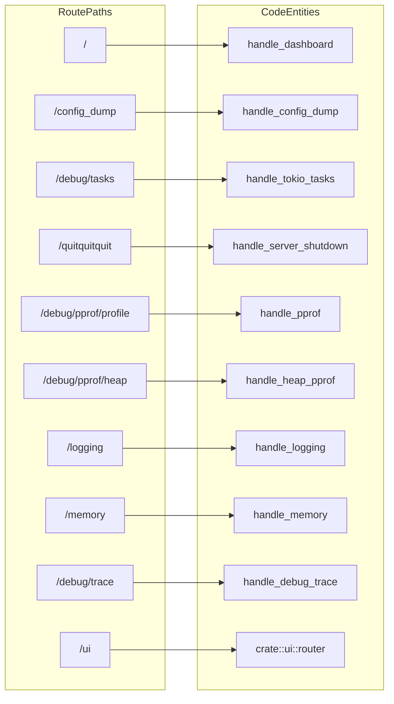

<!-- source: DeepWiki mcp.deepwiki.com · repo agentgateway/agentgateway · page 12.4 Admin and Debug APIs · fetched 2026-10-21 -->

# Admin and Debug APIs

Relevant source files

The following files were used as context for generating this wiki page:

- [catalog/model-catalog-overrides.yaml](catalog/model-catalog-overrides.yaml)
- [controller/pkg/cli/catalog/cmd.go](controller/pkg/cli/catalog/cmd.go)
- [controller/pkg/cli/catalog/model_catalog.go](controller/pkg/cli/catalog/model_catalog.go)
- [crates/agentgateway/src/app.rs](crates/agentgateway/src/app.rs)
- [crates/agentgateway/src/config.rs](crates/agentgateway/src/config.rs)
- [crates/agentgateway/src/config_store.rs](crates/agentgateway/src/config_store.rs)
- [crates/agentgateway/src/lib.rs](crates/agentgateway/src/lib.rs)
- [crates/agentgateway/src/llm/catalog/model.rs](crates/agentgateway/src/llm/catalog/model.rs)
- [crates/agentgateway/src/llm/catalog/refresh.rs](crates/agentgateway/src/llm/catalog/refresh.rs)
- [crates/agentgateway/src/management/admin.rs](crates/agentgateway/src/management/admin.rs)
- [crates/agentgateway/src/management/admin_tests.rs](crates/agentgateway/src/management/admin_tests.rs)
- [crates/agentgateway/src/management/hyper_helpers.rs](crates/agentgateway/src/management/hyper_helpers.rs)
- [crates/agentgateway/src/management/metrics_server.rs](crates/agentgateway/src/management/metrics_server.rs)
- [crates/agentgateway/src/management/readiness_server.rs](crates/agentgateway/src/management/readiness_server.rs)
- [crates/agentgateway/src/state_manager.rs](crates/agentgateway/src/state_manager.rs)
- [crates/agentgateway/src/ui.rs](crates/agentgateway/src/ui.rs)
- [examples/mcp-telemetry/README.md](examples/mcp-telemetry/README.md)

## Purpose and Scope

This document details the administrative, debugging, and operational APIs exposed by `agentgateway`. These endpoints provide runtime introspection, performance profiling (`pprof`), live configuration dumps, metrics exposition, logging level adjustments, readiness tracking, and management UI integration.

The management capabilities are divided across three separate HTTP/HTTPS servers bound to configurable ports during application bootstrap [crates/agentgateway/src/app.rs:44-202]().

---

## Management Servers Architecture and Initialization

The gateway initializes its management infrastructure inside `app::run_with_ui_assets` [crates/agentgateway/src/app.rs:21-209](), setting up an admin server, a metrics exposition server, and a Kubernetes readiness/liveness probe server. Each server utilizes `hyper_helpers::Server` to handle connection draining via `drain::DrainWatcher` [crates/agentgateway/src/management/admin.rs:132-163](), [crates/agentgateway/src/management/metrics_server.rs:26-30]().

### Diagram: Management Server Entity Mapping

Sources: [crates/agentgateway/src/app.rs:44-202](), [crates/agentgateway/src/management/admin.rs:80-163](), [crates/agentgateway/src/management/metrics_server.rs:21-30]()

---

## Admin Server Implementation

The Admin server is constructed via `management::admin::Service::new` and serves requests using an Axum `Router` configured in `management::admin::admin_router` [crates/agentgateway/src/management/admin.rs:132-225](). The server state is encapsulated by `AdminState`, which holds references to active configuration stores, the model catalog, configuration resource stores, resource managers, and shutdown triggers [crates/agentgateway/src/management/admin.rs:80-90]().

### Diagram: Admin Route Dispatch

Sources: [crates/agentgateway/src/management/admin.rs:198-225]()

### Key Admin Endpoints

- **`GET /config_dump`**: Returns a JSON serialization (`ConfigDump`) containing active `Stores`, build version information (`BuildInfo`), and active `Config` structs [crates/agentgateway/src/management/admin.rs:102-110](). This endpoint redacts sensitive information, such as authorization headers, from the configuration dump [crates/agentgateway/src/management/admin_tests.rs:36-61]().
- **`GET /debug/pprof/profile` (Linux Only)**: Captures a CPU profile using Linux performance counters. Supports query parameters for duration (`seconds`, bounded between `1` and `300`) and sampling frequency (`frequency`, bounded between `1` and `1000`) [crates/agentgateway/src/management/admin.rs:43-61]().
- **`GET /debug/pprof/heap`**: Dumps a heap profile.
- **`GET /memory`**: Provides memory usage statistics.
- **`POST /quitquitquit`**: Triggers immediate server shutdown by calling the `shutdown_trigger` handle [crates/agentgateway/src/management/admin.rs:148](), [crates/agentgateway/src/management/admin.rs:205]().
- **`GET /debug/tasks`**: Dumps active Tokio runtime task diagnostics.
- **`POST /debug/trace`**: Enables runtime per-request debug tracing, allowing for CEL-selected expressions to be evaluated and traced [crates/agentgateway/src/management/admin.rs:207]().
- **`POST /logging`**: Adjusts global or targeted logging levels dynamically at runtime [crates/agentgateway/src/management/admin.rs:209]().

Sources: [crates/agentgateway/src/management/admin.rs:43-110](), [crates/agentgateway/src/management/admin.rs:198-225](), [crates/agentgateway/src/management/admin_tests.rs:36-61]()

---

## Metrics and Readiness Exposition

### Metrics Server
The metrics server is implemented in `management::metrics_server::Server` [crates/agentgateway/src/management/metrics_server.rs:21-23](). It listens on `stats_addr` and exposes Prometheus and OpenMetrics scrapers via `/metrics` and `/stats/prometheus` [crates/agentgateway/src/management/metrics_server.rs:37-43]().

The server implements content negotiation (`negotiate_format`) over the `Accept` HTTP header to support multiple serialization formats [crates/agentgateway/src/management/metrics_server.rs:46-123]():
- `MetricsFormat::PlainText` / `MetricsFormat::OpenMetricsText`: Encoded via `prometheus_client::encoding::text::encode` [crates/agentgateway/src/management/metrics_server.rs:83-89]().
- `MetricsFormat::PrometheusProtobuf`: Encoded via `prometheus_protobuf::encode_to_vec` using delimited protobuf descriptors [crates/agentgateway/src/management/metrics_server.rs:77-78](), [crates/agentgateway/src/management/metrics_server.rs:90]().
An example of metrics output can be found in the `examples/mcp-telemetry/README.md` [examples/mcp-telemetry/README.md:43-51](). The metrics formats are also detailed there [examples/mcp-telemetry/README.md:53-65]().

### Readiness Server
The readiness server tracks internal component initialization state using `agent_core::readiness::Ready` [crates/agentgateway/src/app.rs:40-50](). It responds to health check requests at `/healthz/ready`, returning status `200 OK` when all registered tasks have completed initialization, or `500 Internal Server Error` with pending task identifiers otherwise [crates/agentgateway/src/management/readiness_server.rs:30-96]().

Sources: [crates/agentgateway/src/management/metrics_server.rs:21-123](), [crates/agentgateway/src/management/readiness_server.rs:30-96](), [examples/mcp-telemetry/README.md:43-65]()

---

## Configuration Management and UI Integration APIs

When built with the `ui` feature, the admin server mounts management endpoints from `crate::ui::router` [crates/agentgateway/src/management/admin.rs:212-219](), [crates/agentgateway/src/ui.rs:76-122](). These APIs power the integrated Web UI and control plane operations:

- **`GET /api/runtime`**: Exposes runtime build info, user authentication context, and UI capabilities (`RuntimeInfo`) [crates/agentgateway/src/ui.rs:187-213]().
- **`GET /api/config` & `POST /api/config`**: Reads and writes static local configuration files, subject to write-protection checks (`ensure_writable`) and read-only storage modes [crates/agentgateway/src/ui.rs:50-58](), [crates/agentgateway/src/ui.rs:94]().
- **`GET /api/config/effective`**: Returns the effective configuration, which includes merged configurations from various sources.
- **`GET /api/config/resources`**: Lists dynamic configuration resources managed through hybrid storage modes (`ConfigResourceStore`) [crates/agentgateway/src/config_store.rs:17-38](), [crates/agentgateway/src/ui.rs:60-71]().
- **`GET /api/config/resources/{kind}` & `PUT /api/config/resources/{kind}`**: Lists and upserts configuration resources of a specific kind [crates/agentgateway/src/ui.rs:98-99]().
- **`PUT /api/config/resources/{kind}/{id}` & `DELETE /api/config/resources/{kind}/{id}`**: Updates and deletes a specific configuration resource by kind and ID [crates/agentgateway/src/ui.rs:102-103]().
- **`POST /api/cel`**: Evaluates CEL expressions.
- **`POST /api/logs/search`**: Searches request logs.
- **`POST /api/logs/get`**: Retrieves a specific log entry.
- **`POST /api/logs/tail`**: Tails log entries in real-time.
- **`POST /api/logs/analytics/summary`**: Provides a summary of log analytics.
- **`GET /api/costs/models`**: Retrieves the model cost catalog.
- **`POST /api/costs/refresh-base`**: Fetches and reloads the remote base model pricing catalog (`refresh_base_catalog`) from `https://agentgateway.dev/model-catalog`, persisting it locally and updating the live `ModelCatalog` instance [crates/agentgateway/src/llm/catalog/refresh.rs:8-33]().
- **`GET /api/budgets/status`**: Retrieves the status of configured budgets.

Sources: [crates/agentgateway/src/ui.rs:50-122](), [crates/agentgateway/src/config_store.rs:17-38](), [crates/agentgateway/src/llm/catalog/refresh.rs:8-33]()

---

