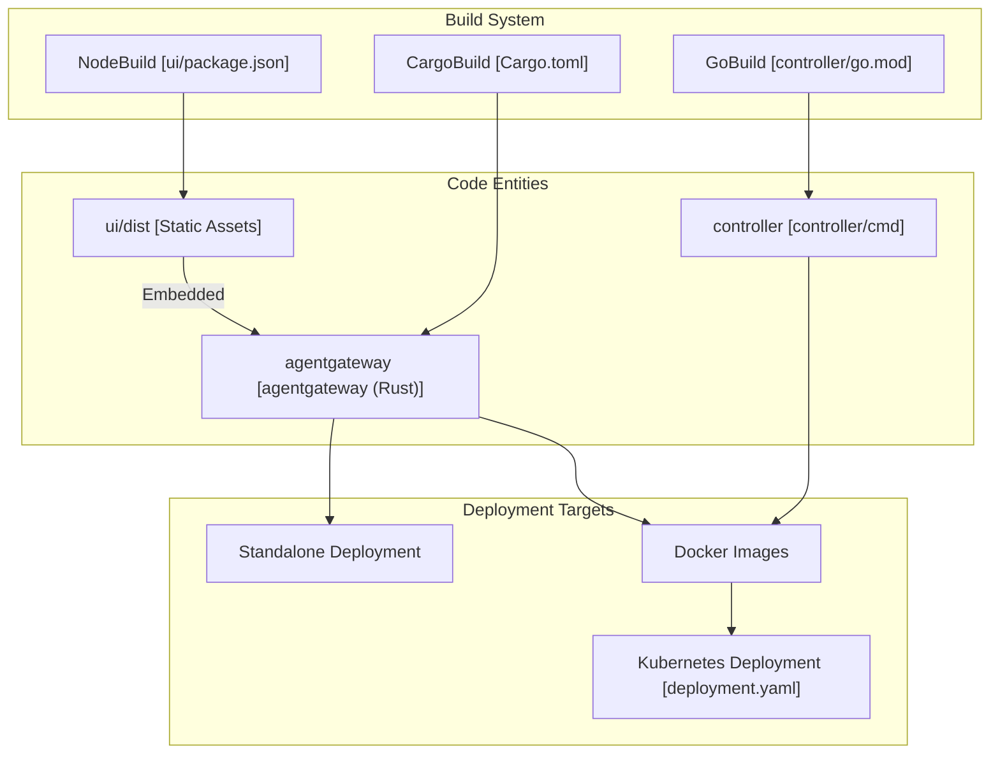
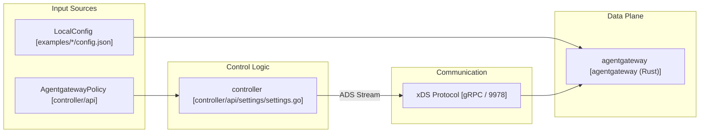

<!-- source: DeepWiki mcp.deepwiki.com · repo agentgateway/agentgateway · page 13 Deployment · fetched 2026-10-21 -->

# Deployment

Relevant source files

The following files were used as context for generating this wiki page:

- [controller/api/settings/settings.go](controller/api/settings/settings.go)
- [controller/api/settings/settings_test.go](controller/api/settings/settings_test.go)
- [controller/install/helm/agentgateway/templates/deployment.yaml](controller/install/helm/agentgateway/templates/deployment.yaml)
- [controller/install/helm/agentgateway/values.yaml](controller/install/helm/agentgateway/values.yaml)
- [controller/test/helm/testdata/agentgateway/gateway-class-name.golden](controller/test/helm/testdata/agentgateway/gateway-class-name.golden)
- [controller/test/helm/testdata/agentgateway/topology-spread-constraints.golden](controller/test/helm/testdata/agentgateway/topology-spread-constraints.golden)

## Purpose and Scope

This page covers deployment options, installation methods, and operational considerations for running Agentgateway. It serves as a high-level guide for technical audiences to understand how the system is packaged and deployed across different environments, ranging from local development to production Kubernetes clusters.

For platform-specific details and step-by-step guides, see the child pages: [Installation Methods](#13.1), [Standalone Deployment](#13.2), [Docker Deployment](#13.3), [Kubernetes Deployment](#13.4), [Production Best Practices](#13.5), and [Example Gallery](#13.6).

Sources: [controller/install/helm/agentgateway/values.yaml:1-50]()

---

## Deployment Architecture Overview

Agentgateway is architected as a high-performance Rust data plane (`agentgateway`) managed either via static configuration files or dynamically through an xDS control plane (`controller`) implemented in Go [controller/install/helm/agentgateway/templates/deployment.yaml:48-62]().

### Build and Distribution Flow

Title: "Build and Distribution Flow"

Sources: [controller/install/helm/agentgateway/templates/deployment.yaml:48-62]()

### Configuration Architecture

Title: "Configuration Architecture"

Sources: [controller/api/settings/settings.go:153-177](), [controller/install/helm/agentgateway/values.yaml:93-95]()

---

## Installation Methods

Agentgateway provides multiple installation paths to support local development and large-scale production. Binaries are compiled for multiple OS targets. The project supports standalone binaries, container images, and Kubernetes installations via Helm charts located under `controller/install/helm/agentgateway/` [controller/install/helm/agentgateway/values.yaml:1-50]().

For details, see [Installation Methods](#13.1).

Sources: [controller/install/helm/agentgateway/values.yaml:1-50]()

---

## Standalone Deployment

In standalone mode, Agentgateway runs as a single process using local configuration files or development setups. The build system manages standalone targets via Makefile commands, and configuration validation scripts ensure correct schemas. The Web UI can be embedded into the binary using cargo features.

For details, see [Standalone Deployment](#13.2).

Sources: [controller/install/helm/agentgateway/values.yaml:65-90]()

---

## Docker Deployment

The project provides optimized Docker images published to container registries. It supports standard builds and static configurations for minimal footprints. Images are built for multiple architectures with proper page size handling and cryptographic signatures. The controller deployment template configures image references dynamically using environment variables such as `AGW_PROXY_IMAGE_REGISTRY` and `AGW_PROXY_IMAGE_REPOSITORY` [controller/install/helm/agentgateway/templates/deployment.yaml:99-108]().

For details, see [Docker Deployment](#13.3).

Sources: [controller/install/helm/agentgateway/templates/deployment.yaml:62-63](), [controller/install/helm/agentgateway/templates/deployment.yaml:99-108]()

---

## Kubernetes Deployment

For Kubernetes environments, Agentgateway operates as a native Gateway API implementation using the Go-based `controller` to manage the data plane xDS configuration [controller/install/helm/agentgateway/templates/deployment.yaml:48-62](). Deployments are managed via Helm templates [controller/install/helm/agentgateway/values.yaml:1-128]() supporting topology constraints [controller/test/helm/testdata/agentgateway/topology-spread-constraints.golden:107-113]() and robust health probes [controller/install/helm/agentgateway/templates/deployment.yaml:74-87](). Configuration options are parsed and validated via the `Settings` struct and associated environment variable decoders [controller/api/settings/settings.go:153-177](). The controller's behavior can be customized through various environment variables, such as `AGW_AGENTGATEWAY_CLASS_NAME` to specify the GatewayClass name [controller/test/helm/testdata/agentgateway/gateway-class-name.golden:97-98]() and `AGW_CONTROLLER_NAME` to define the controller's identifier [controller/test/helm/testdata/agentgateway/gateway-class-name.golden:99-100]().

For details, see [Kubernetes Deployment](#13.4).

Sources: [controller/install/helm/agentgateway/values.yaml:1-128](), [controller/install/helm/agentgateway/templates/deployment.yaml:74-87](), [controller/api/settings/settings.go:153-177](), [controller/test/helm/testdata/agentgateway/topology-spread-constraints.golden:107-113](), [controller/test/helm/testdata/agentgateway/gateway-class-name.golden:97-98](), [controller/test/helm/testdata/agentgateway/gateway-class-name.golden:99-100]()

---

## Production Best Practices

Running Agentgateway in production requires careful tuning of resource limits, health checks, monitoring dashboards, and security controls [controller/install/helm/agentgateway/values.yaml:44-95](). The controller maps Kubernetes resource limits directly to runtime parameters like `GOMEMLIMIT` and `GOMAXPROCS` inside the container spec [controller/install/helm/agentgateway/templates/deployment.yaml:89-98](), ensuring predictable garbage collection and CPU scheduling in containerized environments.

For details, see [Production Best Practices](#13.5).

Sources: [controller/install/helm/agentgateway/values.yaml:44-95](), [controller/install/helm/agentgateway/templates/deployment.yaml:89-98]()

---

## Example Gallery

The project maintains a rich gallery of configuration examples in the `examples/` directory covering LLM integration, Model Context Protocol (MCP), traffic routing, telemetry, and security policies. These examples are validated continuously to ensure schema correctness and runtime validity.

For details, see [Example Gallery](#13.6).

Sources: [controller/install/helm/agentgateway/values.yaml:1-50]()

---

