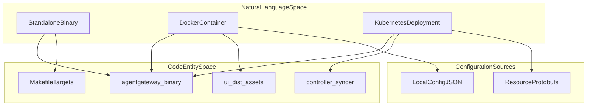
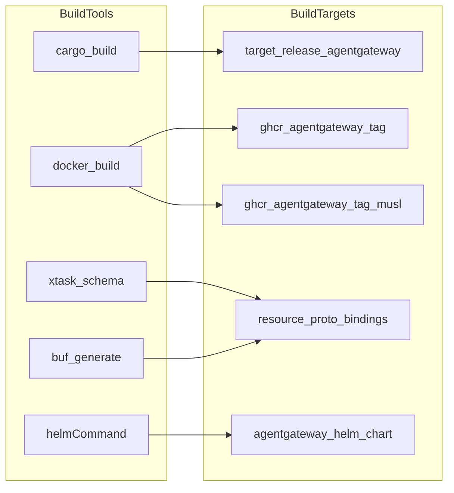

<!-- source: DeepWiki mcp.deepwiki.com · repo agentgateway/agentgateway · page 13.1 Installation Methods · fetched 2026-10-21 -->

# Installation Methods

Relevant source files

The following files were used as context for generating this wiki page:

- [CODE_OF_CONDUCT.md](CODE_OF_CONDUCT.md)
- [README.md](README.md)
- [controller/cmd/dependencies_test.go](controller/cmd/dependencies_test.go)
- [controller/install/helm/agentgateway/templates/role.yaml](controller/install/helm/agentgateway/templates/role.yaml)
- [controller/install/helm/agentgateway/templates/serviceaccount.yaml](controller/install/helm/agentgateway/templates/serviceaccount.yaml)
- [controller/pkg/apiclient/types.go](controller/pkg/apiclient/types.go)
- [controller/pkg/deployer/charts.go](controller/pkg/deployer/charts.go)
- [controller/pkg/syncer/service.go](controller/pkg/syncer/service.go)
- [controller/test/helm/chart_test.go](controller/test/helm/chart_test.go)
- [controller/test/helm/helm_command_test.go](controller/test/helm/helm_command_test.go)
- [img/UI-homepage.png](img/UI-homepage.png)
- [img/architecture.svg](img/architecture.svg)
- [img/blacksmith-light.svg](img/blacksmith-light.svg)
- [img/blacksmith.svg](img/blacksmith.svg)
- [img/lf-stacked-color.png](img/lf-stacked-color.png)
- [tools/exec-go-tool](tools/exec-go-tool)

## Purpose and Scope

This document provides a technical overview of the available installation methods for Agentgateway. It details the implementation of build artifacts, containerization strategies, and deployment orchestration across different environments. Agentgateway is designed as a high-performance data plane for Agentic AI, supporting multiple delivery formats from standalone binaries to Kubernetes-native controllers.

Sources: `[README.md:32-33]()`

---

## Installation Architecture and Code Mapping

The following diagram bridges natural language deployment options to concrete codebase entities, build targets, and source files within the repository.

### Diagram: Natural Language to Code Entity Mapping

Sources: `[README.md:71-82](), [controller/test/helm/chart_test.go:209-210]()`

---

## Build Orchestration and Compilation Pipeline

The project utilizes a `Makefile` and multi-stage `Dockerfile` configurations to orchestrate builds for local development, containerization, and release pipelines.

### Diagram: Build Tooling and Targets Pipeline

Sources: `[controller/test/helm/chart_test.go:209-210](), [controller/test/helm/helm_command_test.go:25-31]()`

---

## Installation Method Comparison

| Feature | Standalone | Docker | Kubernetes |
|---------|-----------|--------|------------|
| **Binary Source** | `make build` | `docker build` | Helm Chart |
| **Deployment Tool** | Direct Execution | Docker / Compose | Helm / Kind `[README.md:74]()` |
| **Platform** | Host OS | Linux / Windows / s390x | Kubernetes (Gateway API) `[README.md:74]()` |
| **Control Plane** | Static/File Config | Static/File Config | Go Controller Deployment |

Sources: `[README.md:71-75](), [controller/test/helm/chart_test.go:209-210]()`

---

## Implementation Details by Environment

### Standalone Binary
Building from source requires a Rust environment and a Node.js environment for compiling the Web UI assets.
- **UI Build**: Executed via package manager commands inside the `ui/` directory, generating static assets embedded via Rust feature flags.
- **Binary Compilation**: Triggered via `cargo build --release` with the UI feature enabled.
- **Validation**: Executed through validation scripts to ensure schema and config correctness.

Sources: `[README.md:71-73]()`

### Containerized Docker Deployments
Docker builds are handled via multi-stage `Dockerfile` configurations supporting multiple architectures and linking variants.
- **Multi-stage Build**: The builder stage compiles static musl-based binaries or standard glibc images depending on build arguments.
- **Variants**: Supports static musl-based binaries and standard glibc images via Chainguard base runners. The `Dockerfile.s390x` also indicates support for s390x architecture.
- **Environment Marker**: Container builds trigger container-specific defaults such as container runtime environment flags.

Sources: `[README.md:73-80]()`

### Kubernetes Deployments
Kubernetes deployments leverage Helm charts, Gateway API custom resource definitions (CRDs), and a Go-based control plane.
- **Controller Integration**: The controller manages XDS translation and translates backend and policy CRDs into data plane wire resources. The controller is written in Go `[controller/pkg/apiclient/types.go:1-16]()` and its build process is managed by a separate Makefile. It registers various custom resource types like `AgentgatewayModel`, `AgentgatewayPolicy`, `AgentgatewayBackend`, and `AgentgatewayParameters` for dynamic configuration `[controller/pkg/apiclient/types.go:20-71]()`. It also watches standard Gateway API resources like `TCPRoute` `[controller/pkg/apiclient/types.go:74-84]()`.
- **Helm Chart**: The `agentgateway` Helm chart `[controller/test/helm/chart_test.go:28-29]()` is used for deploying the controller and related Kubernetes resources. It includes configurations for RBAC roles and bindings `[controller/install/helm/agentgateway/templates/role.yaml:1-213](), [controller/install/helm/agentgateway/templates/serviceaccount.yaml:1-74]()`. The chart ensures image tags always have a 'v' prefix `[controller/test/helm/chart_test.go:14-74]()`.
- **RBAC Configuration**: The Helm chart defines `ClusterRole` and `Role` resources to grant necessary permissions for the controller to watch and manage Kubernetes resources, including service discovery, Agentgateway custom resources, Gateway API resources, and deployer-managed objects `[controller/install/helm/agentgateway/templates/role.yaml:1-213]()`.
- **InferencePool Integration**: The controller also supports integration with the Kubernetes Inference Gateway extension, watching `InferencePool` resources and translating them into internal service models `[controller/install/helm/agentgateway/templates/role.yaml:154-163](), [controller/pkg/syncer/service.go:47-84]()`.
- **Workflow Automation**: Release pipelines coordinate multi-platform image builds, manifest generation, and chart publishing.

Sources: `[README.md:74-82](), [controller/pkg/apiclient/types.go:1-86](), [controller/install/helm/agentgateway/templates/role.yaml:1-213](), [controller/install/helm/agentgateway/templates/serviceaccount.yaml:1-74](), [controller/test/helm/chart_test.go:14-74](), [controller/pkg/syncer/service.go:47-84]()`

---

## Next Steps

- For local development setup and workspace layout, see **14. Development Guide**.
- To configure the Kubernetes controller and Gateway API resources, see **15. Kubernetes Controller**.
- For production operational parameters, see **13.5 Production Best Practices**.

Sources: `[README.md:71-82]()`

---

