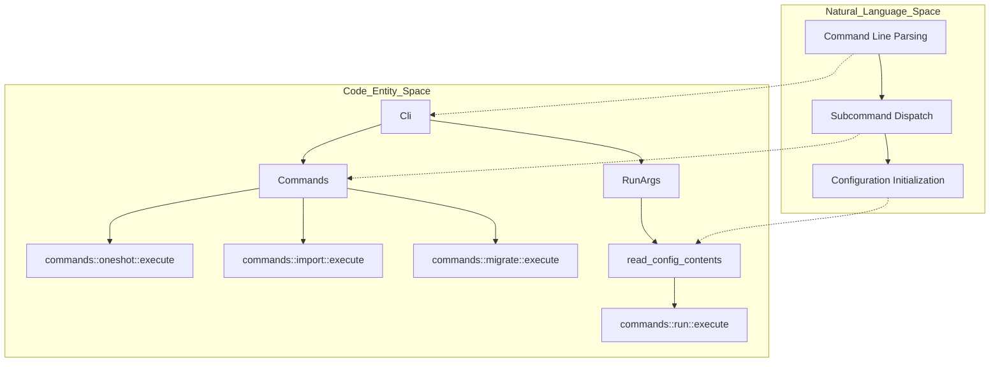
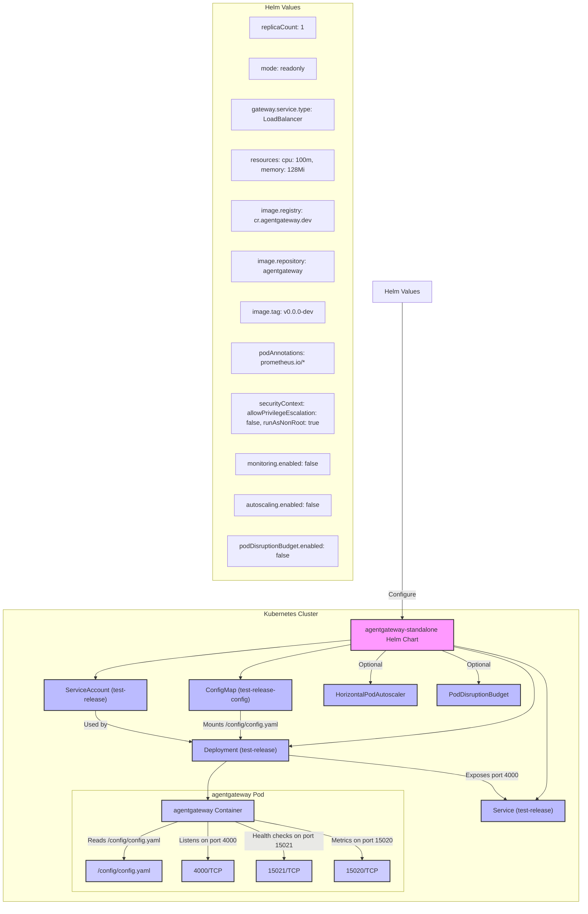

<!-- source: DeepWiki mcp.deepwiki.com · repo agentgateway/agentgateway · page 13.2 Standalone Deployment · fetched 2026-10-21 -->

# Standalone Deployment

Relevant source files

The following files were used as context for generating this wiki page:

- [controller/install/helm/agentgateway-standalone/templates/_helpers.tpl](controller/install/helm/agentgateway-standalone/templates/_helpers.tpl)
- [controller/install/helm/agentgateway-standalone/templates/configmap.yaml](controller/install/helm/agentgateway-standalone/templates/configmap.yaml)
- [controller/install/helm/agentgateway-standalone/templates/deployment.yaml](controller/install/helm/agentgateway-standalone/templates/deployment.yaml)
- [controller/install/helm/agentgateway-standalone/templates/hpa.yaml](controller/install/helm/agentgateway-standalone/templates/hpa.yaml)
- [controller/install/helm/agentgateway-standalone/templates/poddisruptionbudget.yaml](controller/install/helm/agentgateway-standalone/templates/poddisruptionbudget.yaml)
- [controller/install/helm/agentgateway-standalone/templates/service-gateway.yaml](controller/install/helm/agentgateway-standalone/templates/service-gateway.yaml)
- [controller/install/helm/agentgateway-standalone/values.yaml](controller/install/helm/agentgateway-standalone/values.yaml)
- [controller/test/helm/standalone_chart_e2e_test.go](controller/test/helm/standalone_chart_e2e_test.go)
- [controller/test/helm/standalone_chart_test.go](controller/test/helm/standalone_chart_test.go)
- [controller/test/helm/testdata/agentgateway-standalone/default.golden](controller/test/helm/testdata/agentgateway-standalone/default.golden)
- [controller/test/helm/testdata/agentgateway-standalone/monitoring-full-config.golden](controller/test/helm/testdata/agentgateway-standalone/monitoring-full-config.golden)
- [controller/test/helm/testdata/agentgateway-standalone/service-full-config.golden](controller/test/helm/testdata/agentgateway-standalone/service-full-config.golden)
- [controller/test/helm/testdata/agentgateway-standalone/workload-overrides.golden](controller/test/helm/testdata/agentgateway-standalone/workload-overrides.golden)

This page covers running Agentgateway as a standalone binary, container, or Helm-managed deployment using local configuration files or database-backed storage. This deployment mode is suitable for development, testing, local environments, or on-premise installations where a full Kubernetes control plane with dynamic XDS generation is not required.

For other deployment methods, see [Installation Methods](#13.1). For Docker-based deployment, see [Docker Deployment](#13.3). For Kubernetes deployment with dynamic configuration, see [Kubernetes Deployment](#13.4). For details on the local configuration file format, see [Local Configuration Format](#3.3).

---

## Overview and CLI Architecture

Standalone deployment runs Agentgateway as a single binary process that reads configuration from local YAML or JSON files or a lightweight database backend. The entry point for the standalone application is defined in the `agentgateway-app` crate [crates/agentgateway-app/src/lib.rs:130-163]().

Key capabilities in standalone mode include:
- **CLI Commands**: The binary supports multiple subcommands via `Cli` and `Commands`, including `run` (default), `oneshot` (executes a command once the gateway is ready), `import` (imports config from other gateways), and `migrate` (updates deprecated fields) [crates/agentgateway-app/src/lib.rs:118-138]().
- **Flexible Config Sources**: Configuration parsing is handled by `read_config_contents`, accepting `--config` (raw string), `--file` (path to YAML/JSON), or defaulting to platform config directories [crates/agentgateway-app/src/lib.rs:165-205]().

**CLI Parsing and Command Routing Bridge**

Sources: [crates/agentgateway-app/src/lib.rs:118-205](), [crates/agentgateway-app/src/commands/run.rs:12-31]()

---

## Configuration Loading and Storage Modes

The standalone binary resolves its configuration through `read_config_contents` [crates/agentgateway-app/src/lib.rs:165-205](). 

### Storage Modes
The gateway supports two primary storage modes for its configuration resources, initialized in `commands::run::execute`:
1. **Static/ReadOnly (`file` mode)**: Resources are loaded once from the provided configuration file (`ConfigStoreMode::File`) [crates/agentgateway-app/src/commands/run.rs:70-81]().
2. **Hybrid (`database` mode)**: Configured when `config.storage.mode == ConfigStoreMode::Hybrid`, requiring a PostgreSQL connection via `DatabasePool` and initializing a `ConfigResourceStore` [crates/agentgateway-app/src/commands/run.rs:57-81]().

Sources: [crates/agentgateway-app/src/lib.rs:165-205](), [crates/agentgateway-app/src/commands/run.rs:32-109]()

---

## Helm Standalone Chart (`agentgateway-standalone`)

When deploying standalone on Kubernetes, the `agentgateway-standalone` chart manages the `ConfigMap`, `Deployment`, and `Service` resources. The deployment specification configures startup and readiness probes targeting `/healthz/ready` on port `15021`, resource requests/limits, and environment variables [controller/install/helm/agentgateway-standalone/templates/deployment.yaml:44-97]().

The Helm chart provides various configurable values to customize the deployment. The `values.yaml` file [controller/install/helm/agentgateway-standalone/values.yaml]() defines the default settings.

| Helm Value | Description | Default |
| :--- | :--- | :--- |
| `replicaCount` | Number of agentgateway proxy pods | `1` [controller/install/helm/agentgateway-standalone/values.yaml:17]() |
| `mode` | Storage mode: `readonly` (file) or `database` (Postgres) | `readonly` [controller/install/helm/agentgateway-standalone/values.yaml:22-23]() |
| `gateway.service.type` | Kubernetes service type for ingress | `LoadBalancer` [controller/install/helm/agentgateway-standalone/values.yaml:93]() |
| `resources` | CPU/Memory requests and limits | `100m / 128Mi` [controller/install/helm/agentgateway-standalone/values.yaml:70-73]() |
| `image.registry` | Registry to pull the agentgateway proxy image from | `cr.agentgateway.dev` [controller/install/helm/agentgateway-standalone/values.yaml:31]() |
| `image.repository` | Repository of the agentgateway proxy image | `agentgateway` [controller/install/helm/agentgateway-standalone/values.yaml:33]() |
| `image.tag` | Tag of the agentgateway proxy image | Chart's app version [controller/install/helm/agentgateway-standalone/values.yaml:35]() |
| `podAnnotations` | Annotations to add to the agentgateway proxy pod | `prometheus.io/path: "/metrics"`, `prometheus.io/port: "15020"`, `prometheus.io/scrape: "true"` [controller/install/helm/agentgateway-standalone/values.yaml:49-52]() |
| `securityContext` | Container-level security context | `allowPrivilegeEscalation: false`, `readOnlyRootFilesystem: true`, `runAsNonRoot: true`, `capabilities: drop: ALL` [controller/install/helm/agentgateway-standalone/values.yaml:61-68]() |
| `monitoring.enabled` | Enable Prometheus Operator integration | `false` [controller/install/helm/agentgateway-standalone/values.yaml:144]() |
| `autoscaling.enabled` | Enable Horizontal Pod Autoscaler | `false` [controller/install/helm/agentgateway-standalone/templates/hpa.yaml:1]() |
| `podDisruptionBudget.enabled` | Enable Pod Disruption Budget | `false` [controller/install/helm/agentgateway-standalone/templates/poddisruptionbudget.yaml:2]() |

The `agentgateway-standalone` Helm chart creates several Kubernetes resources:
- **ServiceAccount**: Manages the identity for the agentgateway pod [controller/install/helm/agentgateway-standalone/templates/serviceaccount.yaml]().
- **ConfigMap**: Stores the static configuration for the agentgateway instance [controller/install/helm/agentgateway-standalone/templates/configmap.yaml](). The `config.yaml` content is generated from the Helm values, including the `gateways`, `llm`, `mcp`, and `ui` sections [controller/install/helm/agentgateway-standalone/templates/_helpers.tpl:142-149]().
- **Service**: Exposes the agentgateway to external traffic. By default, it creates a `LoadBalancer` service on port 80, targeting port 4000 of the agentgateway container [controller/install/helm/agentgateway-standalone/templates/service-gateway.yaml:31]().
- **Deployment**: Manages the agentgateway pods. It includes the container image, pull policy, security contexts, readiness/startup probes, and volume mounts for configuration [controller/install/helm/agentgateway-standalone/templates/deployment.yaml:44-105]().
- **HorizontalPodAutoscaler (HPA)**: Optionally enabled for automatic scaling based on CPU/memory utilization [controller/install/helm/agentgateway-standalone/templates/hpa.yaml]().
- **PodDisruptionBudget (PDB)**: Optionally enabled to maintain high availability during voluntary disruptions [controller/install/helm/agentgateway-standalone/templates/poddisruptionbudget.yaml]().

The `TestStandaloneChartGoldenTemplate` function [controller/test/helm/standalone_chart_test.go:46-195]() and `TestStandaloneChartDefaultRender` function [controller/test/helm/standalone_chart_test.go:197-222]() are used to test the Helm chart rendering against golden files, ensuring consistent output for various configurations.

**Helm Kubernetes Standalone Architecture Bridge**

Sources:
- [controller/install/helm/agentgateway-standalone/templates/deployment.yaml:44-105]()
- [controller/install/helm/agentgateway-standalone/templates/service-gateway.yaml:31]()
- [controller/install/helm/agentgateway-standalone/templates/configmap.yaml]()
- [controller/install/helm/agentgateway-standalone/templates/serviceaccount.yaml]()
- [controller/install/helm/agentgateway-standalone/templates/hpa.yaml]()
- [controller/install/helm/agentgateway-standalone/templates/poddisruptionbudget.yaml]()
- [controller/install/helm/agentgateway-standalone/values.yaml:17-146]()
- [controller/install/helm/agentgateway-standalone/templates/_helpers.tpl:142-149]()
- [controller/test/helm/standalone_chart_test.go:46-195]()
- [controller/test/helm/standalone_chart_test.go:197-222]()

---

## Render and Container Deployments

For platform-as-a-service (PaaS) targets such as Render, Agentgateway provides a specialized container packaging pattern under `examples/render-deploy/`. 
- Published images run as an unprivileged user (`USER 65532`).
- Mounted platform disks require permission adjustment at startup via an entrypoint wrapper that claims and `chown`s the `/config` persistent disk, writes an initial `.htpasswd` file, and drops privileges via `setpriv` before executing `/app/agentgateway` [examples/render-deploy/Dockerfile:12-32]().

Sources: [examples/render-deploy/Dockerfile:1-32](), [examples/render-deploy/render.yaml:1-54]()

---

## Operational Integration and Lifecycle Management

### Systemd and Readiness Probes
For standalone deployments on Linux, the application supports the `READY_FD` environment variable in `spawn_readiness` [crates/agentgateway-app/src/commands/run.rs:169-196](). When set, the gateway closes this file descriptor once all startup tasks complete, signaling process managers like systemd that the service is ready. In Kubernetes, readiness is governed by explicit HTTP probes [controller/install/helm/agentgateway-standalone/templates/deployment.yaml:52-64]().

### Graceful Shutdown and Drain
The proxy runtime executes `proxy(config, config_resource_store)` which delegates to `agentgateway::app::run` [crates/agentgateway-app/src/commands/run.rs:198-209](). Upon receiving termination signals, the application initiates connection draining, ensuring active background tasks and request pipelines complete before shutting down [crates/agentgateway-app/src/commands/run.rs:99-108]().

Sources: [crates/agentgateway-app/src/commands/run.rs:32-209](), [controller/install/helm/agentgateway-standalone/templates/deployment.yaml:52-64]()

---

