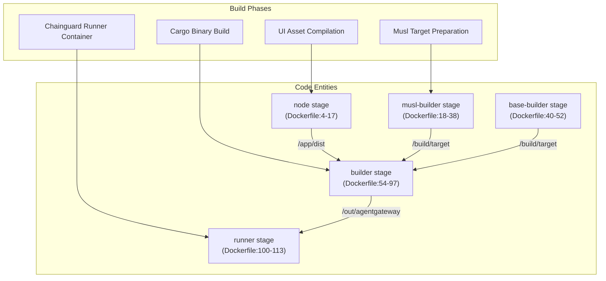
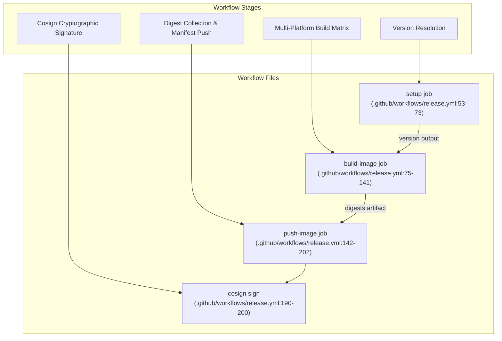

<!-- source: DeepWiki mcp.deepwiki.com · repo agentgateway/agentgateway · page 13.3 Docker Deployment · fetched 2026-10-21 -->

# Docker Deployment

<details>
<summary>Relevant source files</summary>

The following files were used as context for generating this wiki page:

- [.github/workflows/pull_request.yml](.github/workflows/pull_request.yml)
- [.github/workflows/release.yml](.github/workflows/release.yml)
- [Dockerfile](Dockerfile)
- [Dockerfile.s390x](Dockerfile.s390x)
- [Makefile](Makefile)
- [controller/Makefile](controller/Makefile)
- [controller/hack/utils/oss_compliance/osa_provided.md](controller/hack/utils/oss_compliance/osa_provided.md)
- [controller/pkg/client/clientset/versioned/fake/clientset_generated.go](controller/pkg/client/clientset/versioned/fake/clientset_generated.go)
- [crates/agentgateway/src/proxy/admission.rs](crates/agentgateway/src/proxy/admission.rs)
- [go.mod](go.mod)
- [go.sum](go.sum)
- [rust-toolchain.toml](rust-toolchain.toml)
- [tools/go.mod](tools/go.mod)
- [tools/go.sum](tools/go.sum)

</details>


This page covers the Docker image variants available for `agentgateway`, the multi-stage `Dockerfile` structure, the build arguments that control compilation behavior, and the GitHub Actions workflows used for automated multi-platform image distribution. For running `agentgateway` as a standalone binary without Docker, see [13.2 Standalone Deployment](). For Kubernetes deployment using Helm, see [13.4 Kubernetes Deployment]().

---

## Image Variants and Runtime C Runtimes

`agentgateway` ships two primary image variants that differ in the C runtime library they link against. This choice affects binary portability and base OS compatibility.

| Variant | Tag Suffix | C Runtime | Base Image (`runner` stage) | Build Argument |
|---|---|---|---|---|
| glibc (default) | *(none)* | GNU libc | `cgr.dev/chainguard/glibc-dynamic` [Dockerfile:100]() | `BUILDER=base` [Dockerfile:2]() |
| musl | `-musl` | musl libc | `cgr.dev/chainguard/glibc-dynamic` [Dockerfile:100]() | `BUILDER=musl` [Makefile:33]() |

The glibc variant utilizes the standard GNU C library and is the default for standard Linux environments. The musl variant links with musl libc, making it ideal for minimal or distroless topologies. Both variants are compiled for `linux/amd64` and `linux/arm64` via [.github/workflows/release.yml:86-89]().

On Linux, the binary defaults to `jemalloc` for memory allocation. For `arm64` container builds, `JEMALLOC_SYS_WITH_LG_PAGE` is explicitly configured to `16` to ensure compatibility with 64KB page sizes [Dockerfile:83-85]().

Published container tags follow this naming convention:
```
ghcr.io/agentgateway/agentgateway:<VERSION>          # glibc
ghcr.io/agentgateway/agentgateway:<VERSION>-musl     # musl
```

Alternative architectures such as `s390x` are supported via `Dockerfile.s390x`, using `debian:bookworm-slim` as the runner stage since Chainguard's `glibc-dynamic` lacks an s390x variant [Dockerfile.s390x:19-22](), [Dockerfile.s390x:145](). Windows container builds are handled via `Dockerfile.windows` [Makefile:18]().

Sources: [.github/workflows/release.yml:86-89](), [Dockerfile:2](), [Dockerfile:83-85](), [Dockerfile:100](), [Dockerfile.s390x:19-22](), [Dockerfile.s390x:145](), [Makefile:18](), [Makefile:33]()

---

## Multi-Stage Build Architecture

The `Dockerfile` isolates build-time toolchains (Node.js, Rust compilers, musl tooling) from the final production runtime environment.

### Docker Build Stages

The following diagram associates the logical build subsystems with their code entities in `Dockerfile`.



Sources: [Dockerfile:1-113]()

### Stage Breakdown

*   `node`: Compiles the Web UI assets using Node.js `24.17.0-bookworm` [Dockerfile:4-17](). It utilizes a Docker cache mount targeting `/pnpm/store` [Dockerfile:13-14](). Static output in `/app/dist` is copied into the Rust build context [Dockerfile:69]().
*   `musl-builder` and `base-builder`: Configure cross-compilation targets (`x86_64-unknown-linux-musl`, `aarch64-unknown-linux-musl`, or GNU counterparts) via `rustup` [Dockerfile:18-52]().
*   `builder`: Fetches locked dependencies using cargo cache mounts [Dockerfile:71-74]() and runs `cargo build` for the selected `PROFILE` and features [Dockerfile:75-90](). It executes `/out/agentgateway --version` to ensure version stamping succeeds and fails if version is reported as `unknown` [Dockerfile:93-97]().
*   `runner`: The final production image based on `cgr.dev/chainguard/glibc-dynamic` [Dockerfile:100](). It sets `AGENTGATEWAY_ENV=container` [Dockerfile:104]() and exposes `/app/agentgateway` as the entrypoint [Dockerfile:113]().

Sources: [Dockerfile:1-113]()

---

## Build Arguments and Configuration

Container builds are parameterized through `ARG` directives defined in `Dockerfile`:

| Argument | Default | Description |
|---|---|---|
| `BUILDER` | `base` | Selects between `base-builder` (glibc) and `musl-builder` (musl) [Dockerfile:2](), [Dockerfile:54](). |
| `PROFILE` | `release` | Cargo build profile (e.g., `release`) [Dockerfile:56](). |
| `VERSION` | *(none)* | Embedded application version string [Dockerfile:57](). |
| `GIT_REVISION` | *(none)* | Embedded Git revision SHA [Dockerfile:58](). |
| `TARGETARCH` | *(auto)* | Target architecture passed by Docker Buildx (`amd64`, `arm64`) [Dockerfile:20](), [Dockerfile:42](), [Dockerfile:55](). |
| `CARGO_FEATURES` | `agentgateway-app/ui` | Cargo features enabled during compilation [Dockerfile:59](). |
| `CARGO_NO_DEFAULT_FEATURES` | `false` | Whether to disable default Cargo features [Dockerfile:60](). |

Sources: [Dockerfile:1-60]()

---

## Multi-Platform Images and CI Release Pipeline

Automated multi-architecture image publication is orchestrated through GitHub Actions workflows [.github/workflows/release.yml:75-141]().

### CI Promotion Flow



Sources: [.github/workflows/release.yml:53-202]()

### Polyglot Toolchain Consistency
To maintain determinism across the repository, toolchains are strictly pinned in CI:
*   **Rust**: Version `1.99.0` [rust-toolchain.toml:2]().
*   **Go**: Version `1.27.1` [.github/workflows/pull_request.yml:25](), [.github/workflows/release.yml:45]().
*   **Node**: Version `24.17.0` [Dockerfile:4]().

Build digests are consolidated using `docker buildx imagetools create` [.github/workflows/release.yml:184-189](), and images are signed using `cosign` [.github/workflows/release.yml:190-200]().

Sources: [.github/workflows/pull_request.yml:18-26](), [.github/workflows/release.yml:38-48](), [.github/workflows/release.yml:184-200](), [Dockerfile:4](), [rust-toolchain.toml:2]()

---

## Container Configuration and Runtime Environment

When deployed as a container, configuration is injected via volume mounts or environment variables, with `/app/agentgateway` as the entrypoint [Dockerfile:113]().

### Example Execution Command
```bash
docker run -d \
  --name agentgateway \
  -p 8080:8080 \
  -v $(pwd)/config.yaml:/etc/agentgateway/config.yaml \
  ghcr.io/agentgateway/agentgateway:latest \
  run --file /etc/agentgateway/config.yaml
```

### Runtime Environment Variables
*   `AGENTGATEWAY_ENV`: Set to `container` inside the image [Dockerfile:104](). This automatically adjusts defaults, such as binding the admin server appropriately.
*   `RUST_LOG`: Controls logging verbosity (e.g., `info`, `debug`).
*   `VERSION` and `GIT_REVISION`: Injected at build time [Dockerfile:79-80]() and queryable via the binary CLI (`--version`).

Sources: [Dockerfile:79-80](), [Dockerfile:104](), [Dockerfile:113]()

---

