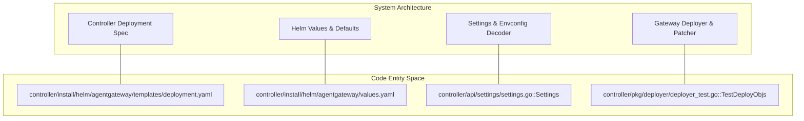
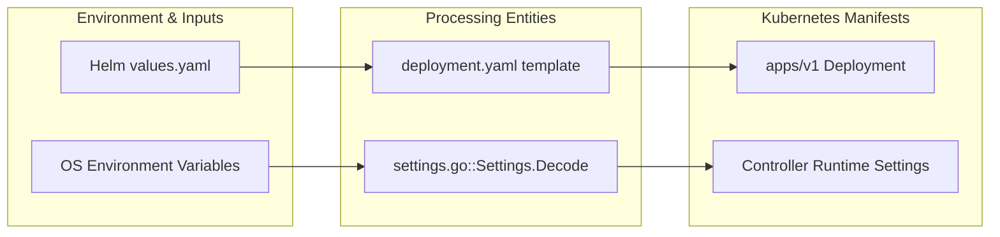

<!-- source: DeepWiki mcp.deepwiki.com · repo agentgateway/agentgateway · page 13.4 Kubernetes Deployment · fetched 2026-10-21 -->

# Kubernetes Deployment

Relevant source files

The following files were used as context for generating this wiki page:

- [controller/api/settings/settings.go](controller/api/settings/settings.go)
- [controller/api/settings/settings_test.go](controller/api/settings/settings_test.go)
- [controller/install/helm/agentgateway/templates/deployment.yaml](controller/install/helm/agentgateway/templates/deployment.yaml)
- [controller/install/helm/agentgateway/values.yaml](controller/install/helm/agentgateway/values.yaml)
- [controller/pkg/deployer/deployer.go](controller/pkg/deployer/deployer.go)
- [controller/pkg/deployer/deployer_test.go](controller/pkg/deployer/deployer_test.go)
- [controller/pkg/deployer/strategicpatch/strategicpatch.go](controller/pkg/deployer/strategicpatch/strategicpatch.go)
- [controller/pkg/deployer/strategicpatch/strategicpatch_test.go](controller/pkg/deployer/strategicpatch/strategicpatch_test.go)
- [controller/test/deployer/testdata/agentgateway-strategic-merge-patch-out.yaml](controller/test/deployer/testdata/agentgateway-strategic-merge-patch-out.yaml)
- [controller/test/helm/testdata/agentgateway/additional-labels.golden](controller/test/helm/testdata/agentgateway/additional-labels.golden)
- [controller/test/helm/testdata/agentgateway/default.golden](controller/test/helm/testdata/agentgateway/default.golden)
- [controller/test/helm/testdata/agentgateway/extra-env.golden](controller/test/helm/testdata/agentgateway/extra-env.golden)
- [controller/test/helm/testdata/agentgateway/extra-volumes.golden](controller/test/helm/testdata/agentgateway/extra-volumes.golden)
- [controller/test/helm/testdata/agentgateway/gateway-class-name.golden](controller/test/helm/testdata/agentgateway/gateway-class-name.golden)
- [controller/test/helm/testdata/agentgateway/hpa-and-vpa.golden](controller/test/helm/testdata/agentgateway/hpa-and-vpa.golden)
- [controller/test/helm/testdata/agentgateway/pdb-max-unavailable.golden](controller/test/helm/testdata/agentgateway/pdb-max-unavailable.golden)
- [controller/test/helm/testdata/agentgateway/pdb-min-available.golden](controller/test/helm/testdata/agentgateway/pdb-min-available.golden)
- [controller/test/helm/testdata/agentgateway/priority-class-name.golden](controller/test/helm/testdata/agentgateway/priority-class-name.golden)
- [controller/test/helm/testdata/agentgateway/service-full-config.golden](controller/test/helm/testdata/agentgateway/service-full-config.golden)
- [controller/test/helm/testdata/agentgateway/topology-spread-constraints.golden](controller/test/helm/testdata/agentgateway/topology-spread-constraints.golden)
- [controller/test/helm/testdata/agentgateway/xds-tls-enabled.golden](controller/test/helm/testdata/agentgateway/xds-tls-enabled.golden)

## Purpose and Scope

This page details Helm-based Kubernetes deployment, Gateway API integration, Custom Resource Definition (CRD) installation, and the deployer flow for `agentgateway`. It explains how control plane components and data plane workloads are provisioned, configured via `Settings` and environment variables, and reconciled using the controller-runtime and deployer architecture.

Sources: [controller/install/helm/agentgateway/values.yaml:1-50](), [controller/api/settings/settings.go:153-177]()

---

## Installation Prerequisites and Helm Configuration

Deploying `agentgateway` onto a Kubernetes cluster requires appropriate RBAC privileges, Gateway API CRDs, and a configured Helm release. The Helm values structure [controller/install/helm/agentgateway/values.yaml:1-174]() controls image repositories, resource requests/limits, security contexts, and controller settings.

Control-plane behavior and defaults are governed by the `Settings` structure defined in `controller/api/settings/settings.go`, which parses environment variables such as `AGW_DNS_LOOKUP_FAMILY`, `AGW_XDS_MODE`, and `AGW_ISTIO_NAMESPACE` [controller/api/settings/settings.go:153-177]().

Sources: [controller/install/helm/agentgateway/values.yaml:1-174](), [controller/api/settings/settings.go:153-177]()

---

## Helm Chart Structure and Templates

The Helm chart in `controller/install/helm/agentgateway/` generates core control plane resources including `Deployment`, `Service`, `ServiceAccount`, and RBAC `ClusterRole` and `ClusterRoleBinding` configurations [controller/install/helm/agentgateway/templates/deployment.yaml:1-49](), [controller/test/helm/testdata/agentgateway/default.golden:1-211]().

The controller deployment template mounts standard probes (`readinessProbe` and `startupProbe` on `/readyz`), propagates memory/CPU limits into `GOMEMLIMIT` and `GOMAXPROCS`, and configures environment variables for xDS communication and discovery namespace selectors [controller/install/helm/agentgateway/templates/deployment.yaml:64-146]().

The `controller.extraEnv` field in `values.yaml` allows injecting additional environment variables into the controller container, supporting both direct scalar values and Kubernetes `valueFrom` sources like `secretKeyRef` [controller/install/helm/agentgateway/values.yaml:136-146](). This is reflected in the deployment template's `env` section, which includes logic to handle `valueFrom` configurations [controller/install/helm/agentgateway/templates/deployment.yaml:147-165]().

Sources: [controller/install/helm/agentgateway/templates/deployment.yaml:1-167](), [controller/test/helm/testdata/agentgateway/default.golden:1-211](), [controller/install/helm/agentgateway/values.yaml:136-146](), [controller/test/helm/testdata/agentgateway/extra-env.golden:93-106]()

---

## Custom Resource Definitions and Deployer Flow

The controller manages dynamic data plane generation through gateway reconciliation and deployer flows. The deployer tests and implementation (`deployer_test.go`, `deployer.go`) ensure that data plane proxy resources (deployments, services, PDBs, autoscalers) are correctly patched, created, or rejected if ownership collisions occur [controller/pkg/deployer/deployer_test.go:84-185]().

Objects are compared against existing cluster state using strategic merge patching or field manager checks to prevent redundant updates while respecting object ownership. The `DeployObjs` function in the deployer is responsible for applying these changes, skipping patches if objects are unchanged or only status fields differ [controller/pkg/deployer/deployer_test.go:108-145](). It also enforces ownership, rejecting existing resources not controlled by the Gateway [controller/pkg/deployer/deployer_test.go:167-185]().

Sources: [controller/pkg/deployer/deployer_test.go:84-185](), [controller/pkg/deployer/deployer.go]()

---

## Control Plane Configuration and Settings

The `Settings` struct parses and validates runtime options via `envconfig` [controller/api/settings/settings.go:8-10](), supporting default overrides and structured types like `DnsLookupFamily`, `XdsMode`, and `BackendRefGrantMode` [controller/api/settings/settings.go:17-46](). Tests verify that all environment variables correctly populate the settings structure [controller/api/settings/settings_test.go:17-101]().

The `XdsMode` setting, for instance, determines whether xDS transport uses plaintext, TLS, or either, with `tls` being the default when enabled via Helm values [controller/api/settings/settings.go:39-41](), [controller/install/helm/agentgateway/values.yaml:155-156](). The `Decode` method for `XdsMode` handles string values like "plaintext", "tls", "either", and also boolean strings "true"/"false" for backward compatibility [controller/api/settings/settings.go:61-76]().

Sources: [controller/api/settings/settings.go:1-177](), [controller/api/settings/settings_test.go:17-101](), [controller/install/helm/agentgateway/values.yaml:155-156]()

---

## Code Entity & Data Plane Mapping

### Diagram: Deployment Component to Code Entities

Sources: [controller/install/helm/agentgateway/templates/deployment.yaml:1-49](), [controller/install/helm/agentgateway/values.yaml:1-50](), [controller/api/settings/settings.go:153-177](), [controller/pkg/deployer/deployer_test.go:84-185]()

### Diagram: Configuration and Settings Data Flow

Sources: [controller/install/helm/agentgateway/values.yaml:1-174](), [controller/install/helm/agentgateway/templates/deployment.yaml:88-146](), [controller/api/settings/settings.go:48-88]()

---

