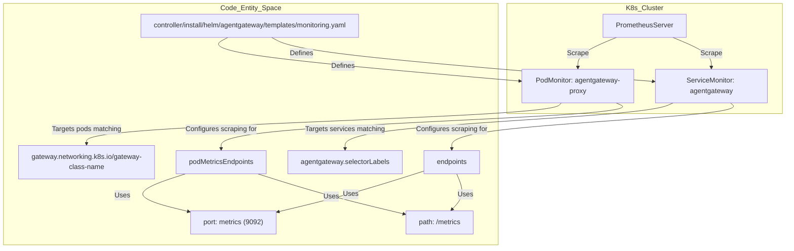
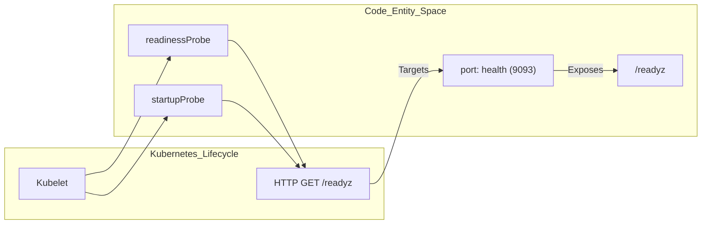

<!-- source: DeepWiki mcp.deepwiki.com · repo agentgateway/agentgateway · page 13.5 Production Best Practices · fetched 2026-10-21 -->

# Production Best Practices

<details>
<summary>Relevant source files</summary>

The following files were used as context for generating this wiki page:

- [controller/install/dashboards/README.md](controller/install/dashboards/README.md)
- [controller/install/dashboards/agentgateway-dashboard.py](controller/install/dashboards/agentgateway-dashboard.py)
- [controller/install/helm/agentgateway-standalone/files/agentgateway-dashboard.json](controller/install/helm/agentgateway-standalone/files/agentgateway-dashboard.json)
- [controller/install/helm/agentgateway/files/agentgateway-dashboard.json](controller/install/helm/agentgateway/files/agentgateway-dashboard.json)
- [controller/install/helm/agentgateway/templates/NOTES.txt](controller/install/helm/agentgateway/templates/NOTES.txt)
- [controller/install/helm/agentgateway/templates/monitoring.yaml](controller/install/helm/agentgateway/templates/monitoring.yaml)
- [controller/test/helm/testdata/agentgateway/monitoring-custom-gateway-class-names.golden](controller/test/helm/testdata/agentgateway/monitoring-custom-gateway-class-names.golden)
- [controller/test/helm/testdata/agentgateway/monitoring-custom-proxy-namespace-selector.golden](controller/test/helm/testdata/agentgateway/monitoring-custom-proxy-namespace-selector.golden)
- [controller/test/helm/testdata/agentgateway/monitoring-enabled-no-dashboard.golden](controller/test/helm/testdata/agentgateway/monitoring-enabled-no-dashboard.golden)
- [controller/test/helm/testdata/agentgateway/monitoring-enabled-no-service-monitor.golden](controller/test/helm/testdata/agentgateway/monitoring-enabled-no-service-monitor.golden)
- [controller/test/helm/testdata/agentgateway/monitoring-enabled.golden](controller/test/helm/testdata/agentgateway/monitoring-enabled.golden)
- [controller/test/helm/testdata/agentgateway/monitoring-no-pod-monitor.golden](controller/test/helm/testdata/agentgateway/monitoring-no-pod-monitor.golden)
- [controller/test/helm/testdata/agentgateway/restricted-write-namespaces.golden](controller/test/helm/testdata/agentgateway/restricted-write-namespaces.golden)

</details>


This page details operational guidance and production deployment considerations for Agentgateway, covering resource limits, health checks, monitoring dashboards, horizontal and vertical autoscaling, pod disruption budgets, and container security. It incorporates Helm golden-test-backed deployment configurations and operational architecture.

---

## Deployment Architecture and Resource Management

### Resource Limits and Go Runtime Tuning

When deploying Agentgateway in production Kubernetes environments, resource requests and limits must be explicitly specified to ensure predictable performance and prevent out-of-memory (OOM) kills. 

*   **Resource Constraints**: Helm chart deployments configure container resources and runtime bindings for controllers and proxy components [controller/test/helm/testdata/agentgateway/restricted-write-namespaces.golden:34-63]().
*   **Go Runtime Integration**: Deployment templates configure `GOMEMLIMIT` and `GOMAXPROCS` using `resourceFieldRef` against container limits to ensure that Go's garbage collector and scheduler respect container cgroup boundaries [controller/test/helm/testdata/agentgateway/restricted-write-namespaces.golden:63]().

Sources: [controller/test/helm/testdata/agentgateway/restricted-write-namespaces.golden:34-63]()

### Autoscaling and Availability

Production deployments should leverage autoscaling and high-availability constructs:
*   **Horizontal Pod Autoscaling (HPA)**: The Helm chart supports HPA configuration (e.g., scaling targets based on resource utilization).
*   **Vertical Pod Autoscaling (VPA) (Not explicitly shown in provided files)**: VPA integration automatically adjusts resource requests and limits dynamically based on historical usage.
*   **Pod Disruption Budgets (PDB) (Not explicitly shown in provided files)**: PDBs can be configured with either `maxUnavailable` or `minAvailable` rules to guarantee availability during cluster maintenance or node upgrades.
*   **Revision History Limits**: Deployment revisions can be bounded to manage rollout history and resource footprints [controller/test/helm/testdata/agentgateway/restricted-write-namespaces.golden:17]().

Sources: [controller/test/helm/testdata/agentgateway/restricted-write-namespaces.golden:17]()

---

## Security and Container Hardening

### Container Security Contexts

Production container images and deployment templates enforce strict security-first parameters:
*   **Non-Root Execution**: `runAsNonRoot: true` is enforced across deployments [controller/test/helm/testdata/agentgateway/restricted-write-namespaces.golden:39]().
*   **Read-Only Root Filesystem**: Containers run with `readOnlyRootFilesystem: true` to prevent container tampering [controller/test/helm/testdata/agentgateway/restricted-write-namespaces.golden:38]().
*   **Privilege Escalation**: `allowPrivilegeEscalation` is explicitly set to `false` [controller/test/helm/testdata/agentgateway/restricted-write-namespaces.golden:37]().
*   **Capabilities Dropping**: All Linux kernel capabilities are dropped (`drop: [ALL]`) [controller/test/helm/testdata/agentgateway/restricted-write-namespaces.golden:41-42]().
*   **Control Plane Security Mode**: The control-to-data plane xDS channel is secured via TLS mode (`AGW_XDS_MODE: tls`) [controller/test/helm/testdata/agentgateway/restricted-write-namespaces.golden:63]().

Sources: [controller/test/helm/testdata/agentgateway/restricted-write-namespaces.golden:36-43]()

---

## Observability and Monitoring Dashboards

### Metrics Scraping and Exporters

Agentgateway exposes Prometheus-compatible metrics for monitoring request rates, latencies, and resource consumption via dedicated `ServiceMonitor` and `PodMonitor` resources defined in Helm templates [controller/install/helm/agentgateway/templates/monitoring.yaml:1-80](). The `PodMonitor` targets pods based on the `gateway.networking.k8s.io/gateway-class-name` label [controller/install/helm/agentgateway/templates/monitoring.yaml:16-22](), allowing Prometheus to discover and scrape metrics from Agentgateway proxy instances. The `ServiceMonitor` targets the controller service [controller/install/helm/agentgateway/templates/monitoring.yaml:49-52](). Both use the `/metrics` path and `metrics` port [controller/install/helm/agentgateway/templates/monitoring.yaml:29-30](), [controller/install/helm/agentgateway/templates/monitoring.yaml:57-58]().

Title: "Kubernetes Metrics Scraping Configuration"

Sources: [controller/install/helm/agentgateway/templates/monitoring.yaml:1-80](), [controller/test/helm/testdata/agentgateway/monitoring-enabled.golden:1-60](), [controller/test/helm/testdata/agentgateway/monitoring-custom-gateway-class-names.golden:16-23]()

### Grafana Dashboards Integration

Grafana monitoring dashboards are embedded via ConfigMaps generated through Helm templates when enabled (`monitoring.grafanaDashboard.enabled`) [controller/install/helm/agentgateway/templates/monitoring.yaml:60-79](). These dashboards track container memory, CPU utilization, requests by pod/gateway, status codes, and error telemetry. The dashboard definition is generated by the `agentgateway-dashboard.py` script [controller/install/dashboards/agentgateway-dashboard.py:1-249]() and stored in `files/agentgateway-dashboard.json` [controller/install/helm/agentgateway/files/agentgateway-dashboard.json:1-258](). A separate dashboard is available for standalone deployments [controller/install/helm/agentgateway-standalone/files/agentgateway-dashboard.json:1-273]().

Title: "Grafana Dashboard Generation and Deployment"
```mermaid
graph TD
    subgraph "Development_Workflow"
        PythonScript["controller/install/dashboards/agentgateway-dashboard.py"]
        GrafanaFoundationSDK["grafana-foundation-sdk"]
    end

    subgraph "Helm_Deployment"
        HelmChart["controller/install/helm/agentgateway/"]
        DashboardJSON["files/agentgateway-dashboard.json"]
        StandaloneDashboardJSON["files/agentgateway-standalone/files/agentgateway-dashboard.json"]
        MonitoringYAML["controller/install/helm/agentgateway/templates/monitoring.yaml"]
        ConfigMap["ConfigMap: agentgateway-dashboard"]
    end

    PythonScript -->|Generates| DashboardJSON
    PythonScript -->|Generates (with --standalone)| StandaloneDashboardJSON
    PythonScript -- uses --> GrafanaFoundationSDK
    MonitoringYAML -->|Includes| DashboardJSON
    MonitoringYAML -->|Creates| ConfigMap
    ConfigMap -->|Discovered by| Grafana["Grafana"]

    style PythonScript fill:#f9f,stroke:#333,stroke-width:2px
    style GrafanaFoundationSDK fill:#ccf,stroke:#333,stroke-width:2px
    style HelmChart fill:#fcf,stroke:#333,stroke-width:2px
    style DashboardJSON fill:#afa,stroke:#333,stroke-width:2px
    style StandaloneDashboardJSON fill:#afa,stroke:#333,stroke-width:2px
    style MonitoringYAML fill:#fcf,stroke:#333,stroke-width:2px
    style ConfigMap fill:#add8e6,stroke:#333,stroke-width:2px
    style Grafana fill:#ffc,stroke:#333,stroke-width:2px
```
Sources: [controller/install/helm/agentgateway/templates/monitoring.yaml:60-79](), [controller/install/dashboards/agentgateway-dashboard.py:1-249](), [controller/install/helm/agentgateway/files/agentgateway-dashboard.json:1-258](), [controller/install/helm/agentgateway-standalone/files/agentgateway-dashboard.json:1-273](), [controller/install/dashboards/README.md:1-14]()

---

## Health Checks and Lifecycle Management

### Probes and Readiness

Reliable rollouts depend on accurate health checks querying the health port (`9093`) [controller/test/helm/testdata/agentgateway/restricted-write-namespaces.golden:49-51](). Kubernetes `startupProbe` and `readinessProbe` are configured to use an HTTP GET request to the `/readyz` endpoint on this port [controller/test/helm/testdata/agentgateway/restricted-write-namespaces.golden:55-63]().

Title: "Application Health Probe Flow"

Sources: [controller/test/helm/testdata/agentgateway/restricted-write-namespaces.golden:50-63]()

---

## Production Checklist

| Category | Item | Reference |
|----------|------|-----------|
| **Resource Limits** | Set container CPU/Memory requests & limits | [controller/test/helm/testdata/agentgateway/restricted-write-namespaces.golden:63]() |
| **Runtime Tuning** | Enable `GOMEMLIMIT` & `GOMAXPROCS` injection | [controller/test/helm/testdata/agentgateway/restricted-write-namespaces.golden:63]() |
| **Security Hardening**| Enforce `runAsNonRoot`, `readOnlyRootFilesystem`, and drop `ALL` capabilities | [controller/test/helm/testdata/agentgateway/restricted-write-namespaces.golden:36-43]() |
| **High Availability** | Configure revision history limits and PodDisruptionBudgets | [controller/test/helm/testdata/agentgateway/restricted-write-namespaces.golden:17]() |
| **Observability** | Enable PodMonitor, ServiceMonitor, and Grafana dashboard ConfigMaps | [controller/install/helm/agentgateway/templates/monitoring.yaml:1-80]() |
| **Probes** | Configure `startupProbe` and `readinessProbe` on port `9093` (`/readyz`) | [controller/test/helm/testdata/agentgateway/restricted-write-namespaces.golden:55-63]() |

Sources: [controller/install/helm/agentgateway/templates/monitoring.yaml:1-80](), [controller/test/helm/testdata/agentgateway/restricted-write-namespaces.golden:36-63]()

---

