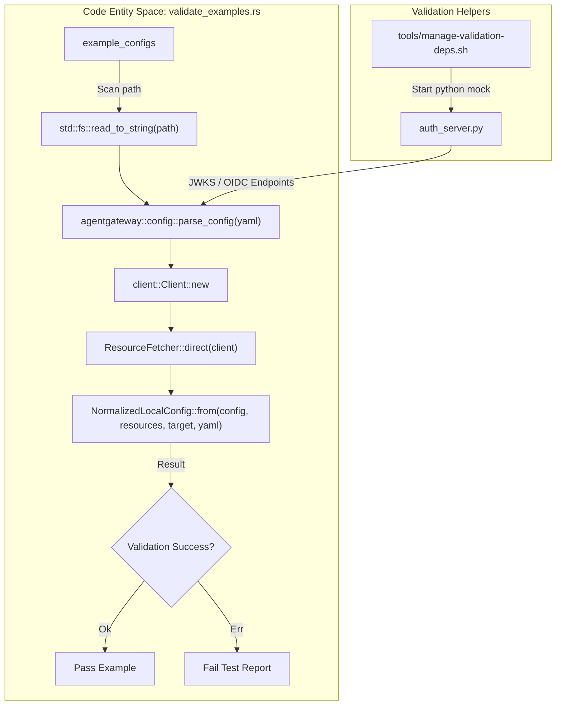
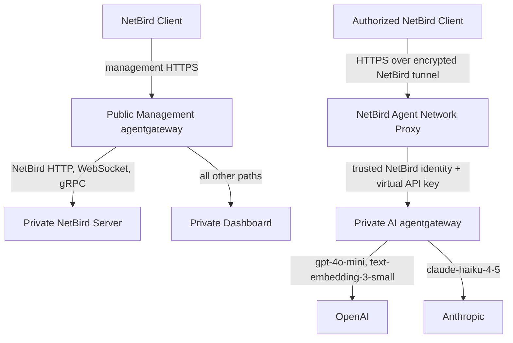
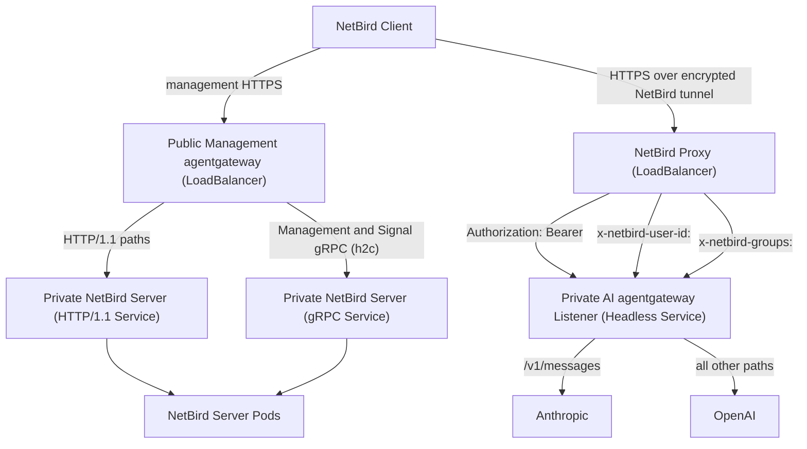
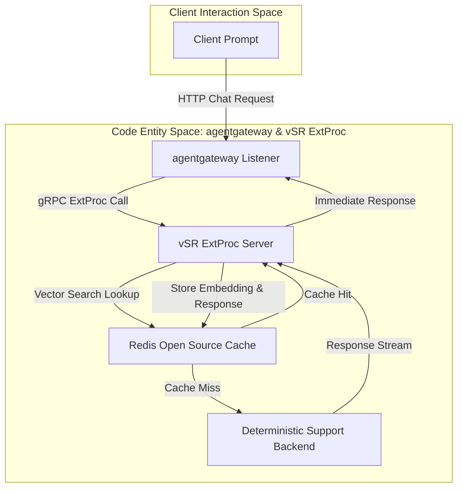
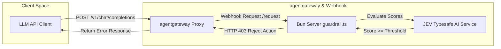

<!-- source: DeepWiki mcp.deepwiki.com · repo agentgateway/agentgateway · page 13.6 Example Gallery · fetched 2026-10-21 -->

# Example Gallery

Relevant source files

The following files were used as context for generating this wiki page:

- [controller/pkg/syncer/README.md](controller/pkg/syncer/README.md)
- [crates/agentgateway/tests/validate_examples.rs](crates/agentgateway/tests/validate_examples.rs)
- [examples/README.md](examples/README.md)
- [examples/llm-guardrail-jev/README.md](examples/llm-guardrail-jev/README.md)
- [examples/llm-guardrail-jev/config.yaml](examples/llm-guardrail-jev/config.yaml)
- [examples/llm-guardrail-jev/guardrail.ts](examples/llm-guardrail-jev/guardrail.ts)
- [examples/llm-semantic-routing/README.md](examples/llm-semantic-routing/README.md)
- [examples/llm-semantic-routing/k8s/cost-based/README.md](examples/llm-semantic-routing/k8s/cost-based/README.md)
- [examples/llm-semantic-routing/k8s/semantic-cache/README.md](examples/llm-semantic-routing/k8s/semantic-cache/README.md)
- [examples/llm-semantic-routing/k8s/tier-aware/README.md](examples/llm-semantic-routing/k8s/tier-aware/README.md)
- [examples/mcp-authentication/auth_server.py](examples/mcp-authentication/auth_server.py)
- [examples/microsoft-intune/compliance/claude-desktop/compliance.json](examples/microsoft-intune/compliance/claude-desktop/compliance.json)
- [examples/microsoft-intune/compliance/codex/compliance.json](examples/microsoft-intune/compliance/codex/compliance.json)
- [examples/netbird-agent-network/kubernetes/README.md](examples/netbird-agent-network/kubernetes/README.md)
- [examples/netbird-agent-network/standalone/README.md](examples/netbird-agent-network/standalone/README.md)
- [tools/manage-validation-deps.sh](tools/manage-validation-deps.sh)
- [tools/validate-configs.sh](tools/validate-configs.sh)
- [ui/src/pages/models/CustomFormats.tsx](ui/src/pages/models/CustomFormats.tsx)

## Purpose and Scope

The `examples/` directory provides a reference catalog demonstrating how to configure, deploy, and extend `agentgateway` across various operational domains. These examples serve as integration blueprints for Large Language Models (LLMs), Model Context Protocol (MCP) servers, advanced traffic management, telemetry export, and network security overlay patterns. This page details the architectural taxonomy of the examples gallery, the programmatic validation mechanisms that ensure example correctness (`validate_examples`), and deep-dives into representative deployment and caching setups.

Sources: [examples/README.md:1-63](), [crates/agentgateway/tests/validate_examples.rs:1-187]()

---

## Directory Taxonomy and Architecture

Examples in the repository follow a strict naming convention (`<type>-<name>` or dedicated integration names), grouping configurations into functional domains:

| Category | Sub-Directory Pattern | Key Examples | Core Capabilities |
| :--- | :--- | :--- | :--- |
| **MCP** | `examples/mcp-*` | `mcp-basic`, `mcp-multiplex`, `mcp-authorization`, `mcp-openapi` | Stdio/HTTP MCP transports, multi-upstream fan-out, OpenAPI-to-MCP bridge, session management [examples/README.md:19-28]() |
| **LLM** | `examples/llm-*` | `llm-basic`, `llm-cost-routing`, `llm-prompt-guard`, `llm-semantic-routing`, `llm-guardrail-jev` | OpenAI/Anthropic/Bedrock proxying, CEL classification & cost routing, PII detection, JEV guardrails, semantic caching [examples/README.md:30-42]() |
| **Traffic** | `examples/traffic-*` | `traffic-http`, `traffic-a2a`, `traffic-token-exchange`, `traffic-oidc` | HTTP proxying, Agent-to-Agent (A2A) protocol, RFC 8693 token exchange, OIDC PKCE browser auth [examples/README.md:43-60]() |
| **Integrations**| `examples/<name>` | `netbird-agent-network`, `render-deploy` | NetBird Zero Trust network identity injection, Render standalone cloud deployment [examples/README.md:9-18]() |
| **Client Mgmt** | `examples/microsoft-intune` | `microsoft-intune` | Intune-managed Codex & Claude Desktop configuration compliance verification [examples/README.md:61-65]() |

Sources: [examples/README.md:1-65]()

---

## Example Validation Pipeline (`validate_examples` and CLI scripts)

To prevent configuration drift, broken paths, or invalid YAML schemas in documentation and templates, the codebase includes a rigorous automated test suite defined in `crates/agentgateway/tests/validate_examples.rs`, alongside shell validation utilities like `tools/validate-configs.sh` and `tools/manage-validation-deps.sh`.

### Validation Data Flow

The test suite recursively discovers all `config.yaml` files under `examples/`, parses them via `agentgateway::config::parse_config`, instantiates a test client, and runs `NormalizedLocalConfig::from` against a root listener target.

Sources: [crates/agentgateway/tests/validate_examples.rs:82-102](), [tools/manage-validation-deps.sh:48-63]()

### Key Functions and Test Infrastructure

* `example_configs()`: Recursively walks the `examples/` directory to locate every `config.yaml` file, sorting paths deterministically [crates/agentgateway/tests/validate_examples.rs:112-146]().
* `test_config(yaml: &str)`: Invokes `agentgateway::config::parse_config` and injects a deterministic 32-byte OIDC cookie encoder (`TEST_OIDC_COOKIE_SECRET`) to satisfy validation requirements for browser-auth configs like `traffic-oidc` [crates/agentgateway/tests/validate_examples.rs:65-76]().
* `validate_example(path: &str)`: Asynchronously exercises `NormalizedLocalConfig::from` using a direct `ResourceFetcher` to verify schema validity, reference resolution, and policy bindings [crates/agentgateway/tests/validate_examples.rs:82-102]().
* `keycloak_available()`: Checks the `KEYCLOAK_AVAILABLE` environment variable or active endpoints managed by `tools/manage-validation-deps.sh` (`auth_server.py`) before executing OIDC/JWKS-dependent tests [crates/agentgateway/tests/validate_examples.rs:104-110](), [tools/manage-validation-deps.sh:48-63]().
* `tools/validate-configs.sh`: Bash wrapper that starts mock dependencies via `manage-validation-deps.sh start` and executes `cargo run -- -f config_file --validate-only` for each example configuration [tools/validate-configs.sh:1-54]().

Sources: [crates/agentgateway/tests/validate_examples.rs:10-187](), [tools/manage-validation-deps.sh:1-63](), [tools/validate-configs.sh:1-54]()

---

## Deployment and Integration Deep-Dives

### 1. NetBird Agent Network Integration (`examples/netbird-agent-network`)

The `netbird-agent-network` example demonstrates integrating `agentgateway` with NetBird for secure, authenticated, and authorized access to AI services. It showcases both standalone Docker Compose and Kubernetes deployments. The core idea is to route OpenAI and Anthropic traffic through a private `agentgateway` listener, with NetBird handling authentication and authorization.

#### Standalone Deployment

In the standalone Docker Compose setup, two `agentgateway` instances are used for separate trust boundaries: a public management gateway and a private AI gateway.

Sources: [examples/netbird-agent-network/standalone/README.md:9-33]()

The `NetBird Agent Network proxy` is a NetBird peer that replaces caller-supplied identity headers with trusted `x-netbird-user-id` and `x-netbird-groups` before forwarding to the private AI `agentgateway`. The private AI `agentgateway` validates NetBird's virtual API key and uses the identity for attribution [examples/netbird-agent-network/standalone/README.md:34-41]().

#### Kubernetes Deployment

The Kubernetes example places `agentgateway` behind a NetBird Agent Network endpoint. NetBird authenticates the caller, applies Agent Network policy, replaces identity headers with trusted values, and forwards the request to a private `agentgateway` listener.

Sources: [examples/netbird-agent-network/kubernetes/README.md:12-29](), [examples/netbird-agent-network/kubernetes/README.md:44-56]()

The management `agentgateway` has a public LoadBalancer and terminates HTTPS for NetBird clients, routing HTTP/1.1 and gRPC traffic to the NetBird server [examples/netbird-agent-network/kubernetes/README.md:17-29](). The NetBird Agent Network proxy also has a public LoadBalancer, but authorized clients reach it via NetBird's encrypted WireGuard overlay. The proxy injects trusted NetBird identity headers and a virtual API key before forwarding to a private AI `agentgateway` listener [examples/netbird-agent-network/kubernetes/README.md:44-56]().

Sources: [examples/netbird-agent-network/standalone/README.md:1-257](), [examples/netbird-agent-network/kubernetes/README.md:1-550]()

### 2. Semantic Routing and Semantic Caching (`examples/llm-semantic-routing`)
The semantic routing examples combine `agentgateway` with the vLLM Semantic Router (vSR) via ExtProc to perform semantic classification, cost-based routing, tier-aware access control, and semantic caching using Redis Open Source [examples/llm-semantic-routing/README.md:1-25]().

Sources: [examples/llm-semantic-routing/README.md:1-83](), [examples/llm-semantic-routing/k8s/semantic-cache/README.md:33-65]()

On a cache hit, vSR returns an immediate ExtProc response, avoiding invocation of the downstream backend [examples/llm-semantic-routing/k8s/semantic-cache/README.md:33-65](). On a cache miss, the request falls back to the configured `AgentgatewayBackend` and the resulting response is embedded and stored in Redis by vSR [examples/llm-semantic-routing/k8s/semantic-cache/README.md:33-65]().

Sources: [examples/llm-semantic-routing/README.md:1-83](), [examples/llm-semantic-routing/k8s/semantic-cache/README.md:1-105]()

### 3. LLM Guardrails with JEV (`examples/llm-guardrail-jev`)
The `llm-guardrail-jev` example demonstrates how to integrate custom webhooks for runtime guardrails [examples/llm-guardrail-jev/README.md:1-10](). A Bun-based webhook script (`guardrail.ts`) leverages the AI SDK and JEV (Typesafe AI) to score prompts and responses for jailbreaks, harmful content, and secret disclosure [examples/llm-guardrail-jev/guardrail.ts:1-127]().

Sources: [examples/llm-guardrail-jev/README.md:1-49](), [examples/llm-guardrail-jev/guardrail.ts:39-123]()

The webhook inspects inbound messages and response choices, returning a `GuardrailsResponse` JSON structure with an action status code (e.g., HTTP `403` if scores exceed the threshold) [examples/llm-guardrail-jev/guardrail.ts:112-123]().

Sources: [examples/llm-guardrail-jev/README.md:1-49](), [examples/llm-guardrail-jev/guardrail.ts:1-129]()

---

