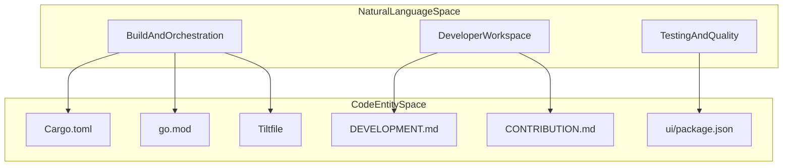
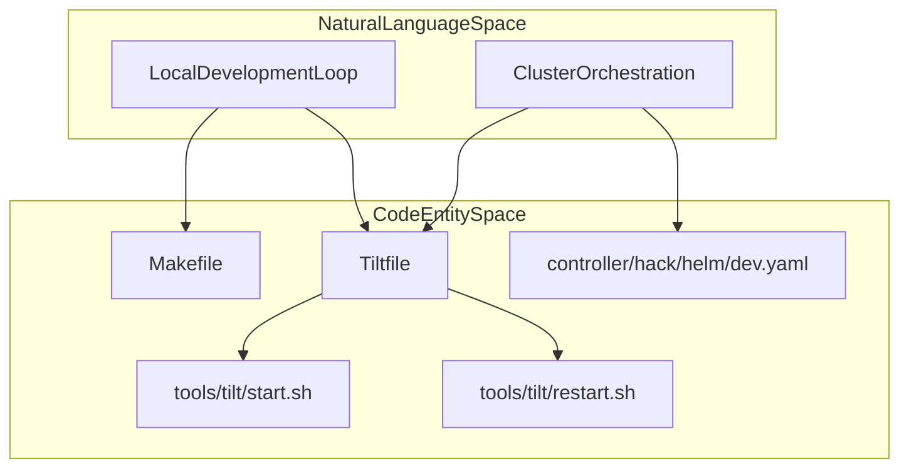

<!-- source: DeepWiki mcp.deepwiki.com · repo agentgateway/agentgateway · page 14 Development Guide · fetched 2026-10-21 -->

# Development Guide

Relevant source files

The following files were used as context for generating this wiki page:

- [CONTRIBUTION.md](CONTRIBUTION.md)
- [DEVELOPMENT.md](DEVELOPMENT.md)
- [Tiltfile](Tiltfile)
- [controller/hack/helm/dev.yaml](controller/hack/helm/dev.yaml)
- [tools/tilt/.gitignore](tools/tilt/.gitignore)
- [tools/tilt/restart.sh](tools/tilt/restart.sh)
- [tools/tilt/start.sh](tools/tilt/start.sh)

This page serves as the parent guide for the AgentGateway development ecosystem. It outlines the overall development setup, build orchestration, testing frameworks, contribution workflows, configuration migration systems, and CI/CD pipelines. 

For detailed information on specific development topics, refer to the following child sections:
- **Workspace Structure**: Cargo layout, Go modules, and polyglot architecture. See [Workspace Structure](#14.1).
- **Build System and Tools**: `Makefile` targets, build features, code generation, and developer tools. See [Build System and Tools](#14.2).
- **CI/CD Pipeline**: GitHub Actions workflows, multi-platform container builds, and code signing. See [CI/CD Pipeline](#14.3).
- **Testing Framework**: Unit, integration, E2E, fuzz, and conformance test suites. See [Testing Framework](#14.4).
- **Contributing Guidelines**: Contribution workflows, coding standards, linting, and design specs. See [Contributing Guidelines](#14.5).
- **Config Import and Migration**: External configuration importers (`import.rs`) and migration handlers. See [Config Import and Migration](#14.6).

---

## High-Level Development Architecture

The development architecture spans multiple runtimes, including a Rust-based data plane workspace [Cargo.toml:7-24](), a Go-based Kubernetes controller workspace [go.mod:1-66](), a Node/pnpm web UI dashboard [Makefile:64](), and live-reloading orchestration environments powered by `Tiltfile` [Tiltfile:1-36]().

### Development Architecture to Code Entities

Sources: [DEVELOPMENT.md:1-30](), [Tiltfile:1-36](), [CONTRIBUTION.md:1-30]()

---

## 14.1 Workspace Structure

The AgentGateway codebase utilizes a multi-crate Cargo workspace in Rust and a Go module structure for the Kubernetes controller and tools. The Rust side is divided into focused crates under the `crates/` directory (such as `crates/agentgateway`, `crates/core`, `crates/http`, `crates/llm`, `crates/xds`, and `crates/protos`), while Go modules manage controller logic, CRD generation, and integration tests [Cargo.toml:7-24](), [go.mod:1-66]().

For detailed crate boundaries, module organization, and polyglot architecture patterns, see [Workspace Structure](#14.1).

Sources: [Cargo.toml:7-24](), [go.mod:1-66]()

---

## 14.2 Build System and Tools

Build tasks, code generation, compilation workflows, and live development loops are managed via the top-level `Makefile`, `Cargo.toml` feature flags, and `Tiltfile` orchestration [Makefile:1-158](), [Tiltfile:1-36](), [DEVELOPMENT.md:14-60](). Key targets handle embedding the web UI (`ui`), compiling cross-platform binaries using `cross`, managing container image builds, and coordinating Kind clusters [Tiltfile:12-35](), [DEVELOPMENT.md:60-96]().

For details on Makefile targets, cross-compilation parameters, and the Tilt local development loop, see [Build System and Tools](#14.2).

### Build and Local Deployment Flow

Sources: [Tiltfile:1-157](), [tools/tilt/start.sh:1-44](), [tools/tilt/restart.sh:1-25](), [controller/hack/helm/dev.yaml:1-18]()

Sources: [Makefile:1-158](), [Tiltfile:1-36](), [DEVELOPMENT.md:14-96]()

---

## 14.3 CI/CD Pipeline

Automated validation, packaging, multi-architecture container builds, and releases are driven by GitHub Actions workflows. These workflows govern pull request checks (`pull_request.yml`), release artifact publishing (`release.yml`), nightly schedules (`nightly.yml`), and artifact provenance signatures via `cosign`.

For details on workflow configuration, caching strategies, and release signing, see [CI/CD Pipeline](#14.3).

Sources: [.github/workflows/pull_request.yml:1-193](), [Makefile:1-30]()

---

## 14.4 Testing Framework

Testing spans unit verification, integration test suites, fuzz targets, snapshot/golden test comparisons (using `insta`), and Kubernetes-based end-to-end and conformance test frameworks [Cargo.lock:146](), [controller/test/conformance/conformance_test.go:35-86](). The project validates Kubernetes Gateway API and custom policy behaviors using standard test suites.

For deep dives into test harness layout, mock servers, controller test helpers, and conformance suites, see [Testing Framework](#14.4).

Sources: [Cargo.lock:146](), [controller/test/conformance/conformance_test.go:35-86]()

---

## 14.5 Contributing Guidelines

Contributing to AgentGateway requires adhering to established code style guidelines, conventional commits, formatting requirements (`cargo fmt`), strict linting checks (`cargo clippy`, `pnpm lint`), and proper submission protocols via pull requests [CONTRIBUTION.md:30-85](). Architectural changes and new subsystem proposals must follow design documentation procedures within the `design/` directory.

For contribution prerequisites, lint configurations, and PR requirements, see [Contributing Guidelines](#14.5).

Sources: [CONTRIBUTION.md:1-117](), [DEVELOPMENT.md:1-13]()

---

## 14.6 Config Import and Migration

To support smooth user adoption and configuration evolution, AgentGateway includes built-in migration handlers and import utilities. These facilities handle parsing external control plane configurations (such as LiteLLM formats) and upgrading legacy local configuration schemas via dedicated CLI commands and snapshot test suites [Makefile:134-137]().

For implementation details on importer logic, migration CLI commands, and test verification, see [Config Import and Migration](#14.6).

Sources: [Makefile:134-137]()

---

