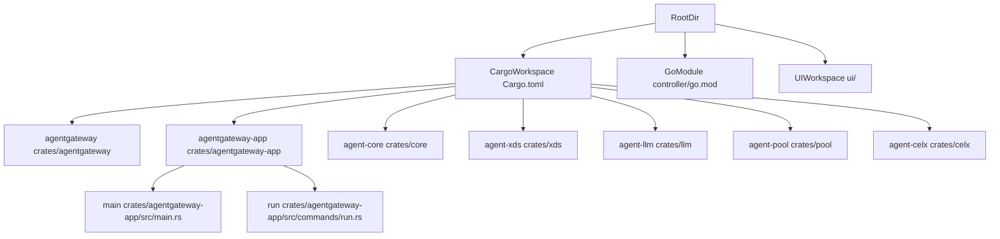
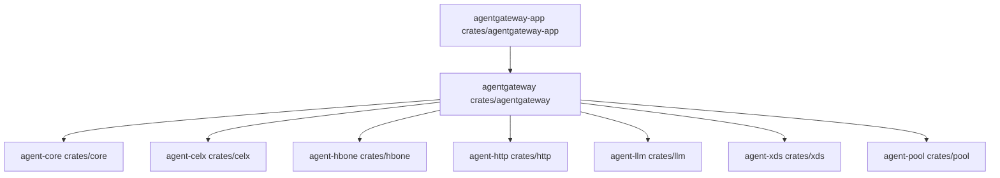

<!-- source: DeepWiki mcp.deepwiki.com · repo agentgateway/agentgateway · page 14.1 Workspace Structure · fetched 2026-10-21 -->

# Workspace Structure

Relevant source files

The following files were used as context for generating this wiki page:

- [Cargo.lock](Cargo.lock)
- [Cargo.toml](Cargo.toml)
- [crates/agentgateway-app/Cargo.toml](crates/agentgateway-app/Cargo.toml)
- [crates/agentgateway-app/src/commands/mod.rs](crates/agentgateway-app/src/commands/mod.rs)
- [crates/agentgateway-app/src/commands/oneshot.rs](crates/agentgateway-app/src/commands/oneshot.rs)
- [crates/agentgateway-app/src/commands/run.rs](crates/agentgateway-app/src/commands/run.rs)
- [crates/agentgateway-app/src/lib.rs](crates/agentgateway-app/src/lib.rs)
- [crates/agentgateway/Cargo.toml](crates/agentgateway/Cargo.toml)
- [crates/agentgateway/tests/common/gateway.rs](crates/agentgateway/tests/common/gateway.rs)
- [crates/agentgateway/tests/common/mod.rs](crates/agentgateway/tests/common/mod.rs)
- [crates/agentgateway/tests/integration.rs](crates/agentgateway/tests/integration.rs)
- [crates/agentgateway/tests/tests/auto_protocol.rs](crates/agentgateway/tests/tests/auto_protocol.rs)
- [crates/agentgateway/tests/tests/connect.rs](crates/agentgateway/tests/tests/connect.rs)
- [crates/agentgateway/tests/tests/dfp.rs](crates/agentgateway/tests/tests/dfp.rs)
- [crates/core/src/readiness.rs](crates/core/src/readiness.rs)

This page provides full technical detail on the Cargo workspace layout, crate organization, module boundaries, Go module structure, and polyglot architecture of the AgentGateway repository.

## Overview and Scope

The AgentGateway repository is structured as a polyglot monorepo combining a high-performance Rust data plane, a Go-based Kubernetes control plane, and a web UI. This architecture cleanly separates low-level packet processing and AI transformation from Kubernetes resource reconciliation.
Sources: [Cargo.toml:7-39](), [crates/agentgateway/Cargo.toml:1-10]()

---

## Polyglot Monorepo Layout

The repository layout establishes clear boundaries between the Rust data plane crates (`crates/`), the Go Kubernetes controller (`controller/`), the frontend asset workspace (`ui/`), and deployment definitions (`install/helm/`).

Title: Repository Polyglot Architecture to Code Entities

Sources: [Cargo.toml:7-39](), [crates/agentgateway/Cargo.toml:1-10]()

---

## Rust Workspace and Crate Boundaries

The Rust data plane is governed by a root Cargo workspace defined in `Cargo.toml`, utilizing resolver version "2" [Cargo.toml:7-8]().

### Workspace Members

The workspace comprises several functional crates defined in `Cargo.toml` [Cargo.toml:9-26]():
* `crates/agentgateway`: The primary data plane library crate containing proxy logic, routing, LLM handling, and MCP integration [Cargo.toml:12]().
* `crates/agentgateway-app`: The binary executable wrapper providing CLI arguments and application startup orchestration [Cargo.toml:13]().
* `crates/core`: Shared low-level primitives, filesystem helpers, readiness signaling, and duration utilities [Cargo.toml:20]().
* `crates/cel-fork/cel`: The forked CEL expression engine [Cargo.toml:14]().
* `crates/cel-fork/cel-derive`: Procedural macros for CEL [Cargo.toml:15]().
* `crates/celx`: Common Expression Language (CEL) execution engine and attribute extensions [Cargo.toml:16]().
* `crates/hbone`: HTTP-Based Overlay Network (HBONE) tunneling protocol implementation [Cargo.toml:22]().
* `crates/xds`: xDS control plane client utilizing gRPC via `tonic` and `prost` [Cargo.toml:25]().
* `crates/llm`: AI/LLM request processing, prompt translation, and token counting [Cargo.toml:17]().
* `crates/pool`: Connection pooling and management abstractions [Cargo.toml:18]().
* `crates/protos`: Generated protobuf definitions and gRPC bindings [Cargo.toml:24]().
* `crates/http`: HTTP utilities and abstractions [Cargo.toml:21]().
* `crates/htpasswd-verify-fork`: Forked `htpasswd-verify` crate [Cargo.toml:23]().
* `crates/xtask`: Custom Cargo commands [Cargo.toml:26]().
Sources: [Cargo.toml:9-26](), [crates/agentgateway/Cargo.toml:1-10]()

---

## Dependency Flow and Initialization Architecture

The `agentgateway` library crate aggregates all modular subsystems, configuring features such as memory allocators (`jemalloc`, `mimalloc`) and cryptographic backends (`crypto-aws-lc`, `fips`, `crypto-symcrypt`) [crates/agentgateway/Cargo.toml:11-31]().

Title: Component Wiring and Crate Dependency Flow

Sources: [crates/agentgateway/Cargo.toml:32-39](), [Cargo.toml:48-59]()

---

## Go Module Structure and Control Plane

The Go control plane resides in the `controller/` directory and manages Kubernetes custom resources, integrating with the Gateway API (`sigs.k8s.io/gateway-api`), Istio (`istio.io/istio`), and embedding the Google CEL engine (`github.com/google/cel-go`). The `go.mod` file [go.mod:1-66]() defines the Go module for the main project, while `tools/go.mod` [tools/go.mod:1-24]() defines a separate module for development tools.
Sources: [go.mod:1-66](), [tools/go.mod:1-24]()

---

## Build System, UI Embedding, and Code Generation

The root build system orchestrates builds, test suites, schema generation, and gRPC protobuf compilation across workspace members.

### UI Asset Embedding

The web UI located in `ui/` is compiled using Node/pnpm and embedded into the Rust binary at build time when the `ui` cargo feature is active [crates/agentgateway/Cargo.toml:27](). The `Dockerfile` [Dockerfile:4-17]() shows the steps for building the UI assets and copying them into the Rust build context.
Sources: [crates/agentgateway/Cargo.toml:27](), [Dockerfile:4-17]()

---

