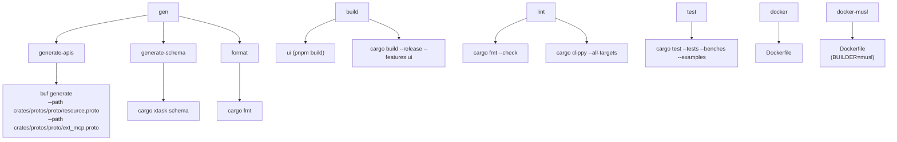
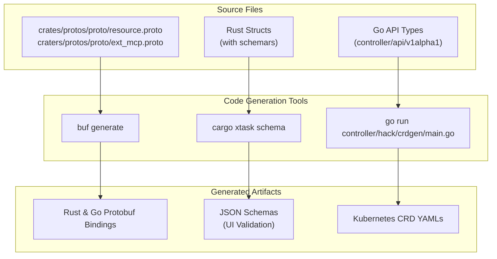
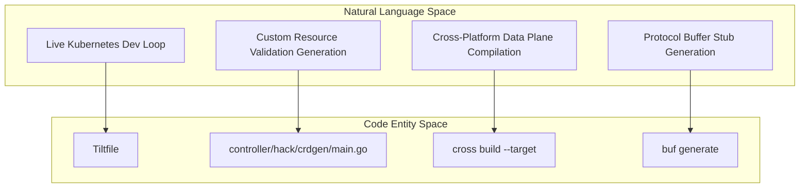

<!-- source: DeepWiki mcp.deepwiki.com · repo agentgateway/agentgateway · page 14.2 Build System and Tools · fetched 2026-10-21 -->

# Build System and Tools

Relevant source files

The following files were used as context for generating this wiki page:

- [.github/workflows/pull_request.yml](.github/workflows/pull_request.yml)
- [.github/workflows/release.yml](.github/workflows/release.yml)
- [CONTRIBUTION.md](CONTRIBUTION.md)
- [DEVELOPMENT.md](DEVELOPMENT.md)
- [Dockerfile](Dockerfile)
- [Dockerfile.s390x](Dockerfile.s390x)
- [Makefile](Makefile)
- [Tiltfile](Tiltfile)
- [controller/Makefile](controller/Makefile)
- [controller/api/v1alpha1/agentgateway/shared_types.go](controller/api/v1alpha1/agentgateway/shared_types.go)
- [controller/hack/crdgen/main.go](controller/hack/crdgen/main.go)
- [controller/hack/crdgen/main_test.go](controller/hack/crdgen/main_test.go)
- [controller/hack/crdgen/testdata/embedded/types.go](controller/hack/crdgen/testdata/embedded/types.go)
- [controller/hack/crdgen/testdata/overrideembedded/api/v1/doc.go](controller/hack/crdgen/testdata/overrideembedded/api/v1/doc.go)
- [controller/hack/crdgen/testdata/overrideembedded/api/v1/types.go](controller/hack/crdgen/testdata/overrideembedded/api/v1/types.go)
- [controller/hack/crdgen/testdata/overrideembedded/upstream/types.go](controller/hack/crdgen/testdata/overrideembedded/upstream/types.go)
- [controller/hack/crdgen/testdata/root/types.go](controller/hack/crdgen/testdata/root/types.go)
- [controller/hack/helm/dev.yaml](controller/hack/helm/dev.yaml)
- [controller/hack/utils/oss_compliance/osa_provided.md](controller/hack/utils/oss_compliance/osa_provided.md)
- [controller/pkg/client/clientset/versioned/fake/clientset_generated.go](controller/pkg/client/clientset/versioned/fake/clientset_generated.go)
- [crates/agentgateway/src/proxy/admission.rs](crates/agentgateway/src/proxy/admission.rs)
- [go.mod](go.mod)
- [go.sum](go.sum)
- [rust-toolchain.toml](rust-toolchain.toml)
- [tools/go.mod](tools/go.mod)
- [tools/go.sum](tools/go.sum)
- [tools/tilt/.gitignore](tools/tilt/.gitignore)
- [tools/tilt/restart.sh](tools/tilt/restart.sh)
- [tools/tilt/start.sh](tools/tilt/start.sh)

## Purpose and Scope
This page documents the build tooling and infrastructure for the `agentgateway` monorepo. It details the root `Makefile` targets, Rust Cargo workspace features and build profiles, Go module configurations, code generation pipelines (including protocol buffers, JSON schemas, and Kubernetes CRDs), and the local development loop driven by `Tilt` and the `tools/` directory. For CI/CD workflows, see [14.3](). For workspace layout and crate organization, see [14.1]().

Sources: [Makefile:1-158](), [DEVELOPMENT.md:1-96]()

---

## Top-Level Build Orchestration and Makefile

The root `Makefile` serves as the primary entry point for compiling binaries, executing tests, running linters, generating code, and building container images. It prepends `./tools` to `PATH` to ensure locally pinned tools take precedence [Makefile:12]().

### Makefile Variables

| Variable | Default | Description |
|---|---|---|
| `DOCKER_REGISTRY` | `ghcr.io` | Container registry host [Makefile:2]() |
| `DOCKER_REPO` | `agentgateway` | Repository within the registry [Makefile:3]() |
| `IMAGE_NAME` | `agentgateway` | Image name [Makefile:4]() |
| `VERSION` | `git describe...` | Derived from git tags or `jj` commit IDs [Makefile:5]() |
| `GIT_REVISION` | `git rev-parse...` | Current commit SHA or `jj` commit ID [Makefile:6]() |
| `IMAGE_TAG` | `$(VERSION)` | Tag applied to built images [Makefile:7]() |
| `DOCKER_BUILDER` | `docker` | Builder container engine [Makefile:9]() |
| `UI` | `1` | Enables (`1`) or disables (`0`) embedding the Web UI [Makefile:52]() |
| `CARGO_BUILD_ARGS` | _(empty)_ | Extra arguments forwarded to `cargo build` [Makefile:42]() |

Sources: [Makefile:1-60]()

### Makefile Target Reference

| Target | Command | Description |
|---|---|---|
| `build` | `cargo build --release $(UI_FEATURE)` | Compiles the release binary with optional embedded UI [Makefile:67-69]() |
| `build-symcrypt` | `cargo build --release --no-default-features --features jemalloc,mimalloc,crypto-symcrypt ...` | Builds using the SymCrypt crypto provider [Makefile:76-78]() |
| `build-fips` | `cargo build --release --no-default-features --features jemalloc,mimalloc,crypto-aws-lc,fips ...` | Builds with AWS-LC in FIPS mode [Makefile:81-83]() |
| `ui` | `cd ui && corepack pnpm install ... && corepack pnpm build` | Builds frontend distribution assets via `pnpm` [Makefile:62-64]() |
| `lint` | `cargo fmt --check ... && cargo clippy --all-targets` | Validates formatting and runs clippy lints [Makefile:86-89]() |
| `test` | `cargo test --tests --benches --examples` | Executes unit tests, benchmarks, and examples [Makefile:105-110]() |
| `gen` | `generate-apis generate-schema format` | Executes the complete code generation pipeline [Makefile:130-132]() |
| `generate-apis` | `buf generate ...` | Generates protobuf bindings via `buf` [Makefile:144-147]() |
| `generate-schema` | `cargo xtask schema && cargo xtask metrics` | Generates JSON schemas and metrics definitions [Makefile:138-142]() |
| `docker` | `$(DOCKER_BUILDER) build ...` | Builds the standard glibc container image [Makefile:15-21]() |
| `docker-musl` | `$(DOCKER_BUILDER) build ... --build-arg=BUILDER=musl` | Builds statically linked musl container image [Makefile:31-33]() |
| `refresh-model-catalog` | `go run ./controller/cmd/agctl catalog import ...` | Refreshes the AI model cost catalog [Makefile:134-137]() |
| `validate` | `tools/validate-configs.sh` | Runs test suite validations against configuration files [Makefile:156-158]() |

Sources: [Makefile:15-158]()

Title: "Makefile Target Dependency Graph"

Sources: [Makefile:15-147]()

---

## Rust Build System and Cargo Workspace

The Cargo workspace configuration defines workspace members, shared resolver versions, and global dependency versions. The `rust-toolchain.toml` file specifies the exact Rust toolchain version (`1.99.0`) and components (`rustc`, `rust-std`, `cargo`, `clippy`, `rustfmt`, `rust-docs`) to ensure consistent builds across environments [rust-toolchain.toml:1-3](). Build optimization features and target profiles are managed across crates and Dockerfiles [Dockerfile:1-113](). Multi-platform image builds and container runners leverage `cgr.dev/chainguard/glibc-dynamic` for dynamic linking or `musl-builder` stages for static compilation [Dockerfile:100-101]().

Sources: [Dockerfile:1-113](), [.github/workflows/pull_request.yml:18-80](), [rust-toolchain.toml:1-3]()

---

## Go Build System and Module Management

The Go build system is primarily managed through `go.mod` and `go.sum` files, defining module dependencies and their cryptographic hashes [go.mod:1-66](), [go.sum:1-77](). The `controller/Makefile` includes targets for managing Go modules:
- `mod-download`: Downloads all Go module dependencies for the main module and the `tools` module [controller/Makefile:113-115]().
- `mod-tidy-nested`: Tidies `go.mod` files in nested modules, specifically `tools/` [controller/Makefile:117-119]().
- `mod-tidy`: Combines `mod-download` and `mod-tidy-nested` to ensure all `go.mod` files are consistent [controller/Makefile:122-123]().

The `tools/go.mod` file lists various Go tools used in the build and development process, including `buf`, `mockgen`, `golangci-lint`, `crane`, `ginkgo`, `actionlint`, `protoc-gen-go-grpc`, `protoc-gen-go`, `gotestsum`, `helm`, `protoc-gen-golang-jsonshim`, `code-generator` tools, `controller-tools`, and `kind` [tools/go.mod:1-24](). These tools are managed as Go modules to ensure version consistency.

Sources: [go.mod:1-66](), [go.sum:1-77](), [controller/Makefile:113-123](), [tools/go.mod:1-24]()

---

## Code Generation Pipelines

Code generation unifies protobuf definitions, JSON schemas, and Kubernetes CRDs.

### 1. Protobuf Bindings (`generate-apis`)
The `generate-apis` target invokes `buf` to compile `.proto` files into Rust and Go language bindings [Makefile:144-147]().
- **Paths**: Targets `crates/protos/proto/resource.proto` (core XDS state) and `crates/protos/proto/ext_mcp.proto` (Model Context Protocol extensions) [Makefile:146]().

### 2. JSON Schema Generation (`generate-schema`)
The `xtask` workspace member executes `cargo xtask schema`, traversing Rust structs annotated with `schemars` to output JSON schemas [Makefile:138-142](). These schemas are consumed by the Web UI configuration validation components.

### 3. Kubernetes CRD Generation (`crdgen`)
The Kubernetes controller includes a custom CRD generator tool under `controller/hack/crdgen/main.go` that leverages `controller-tools` [controller/hack/crdgen/main.go](). It registers custom validation markers and schema emission logic to enforce complex validation rules on Kubernetes custom resources.

Sources: [Makefile:130-147](), [controller/hack/crdgen/main.go]()

Title: "Code Generation Data Flow"

Sources: [Makefile:130-147](), [controller/hack/crdgen/main.go]()

---

## Local Development Loop with Tilt and `tools/`

For active development against a local Kubernetes environment (such as `Kind`), the project provides a comprehensive `Tiltfile` and supporting shell scripts [Tiltfile]().

### Tilt Development Workflow
1. **Cluster and Registry Initialization**: Tilt verifies or assists in setting up a local `Kind` cluster and a local container registry via `ctlptl` [DEVELOPMENT.md:88-90]().
2. **Control Plane Compilation**: The Go controller is compiled locally via `make` targets and synced into the controller container.
3. **Data Plane Cross-Compilation**: The Rust data plane proxy is built using `cross` for the target architecture (`linux/amd64` or `linux/arm64`), ensuring reproducible builds regardless of host OS [DEVELOPMENT.md:68-74]().
4. **Live Updates**: Code changes trigger automated container updates using sync mechanisms and restart scripts without requiring full image rebuilds.

Sources: [Tiltfile](), [DEVELOPMENT.md:60-96]()

Title: "Natural Language to Code Entity Mapping for Development Tools"

Sources: [Tiltfile](), [controller/hack/crdgen/main.go](), [Makefile:144-147]()

---

