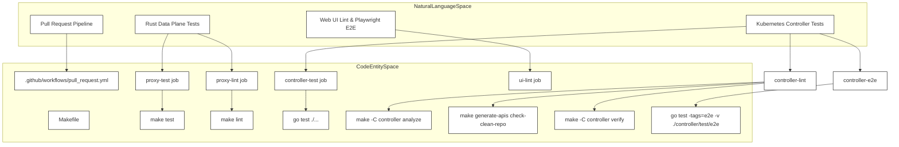
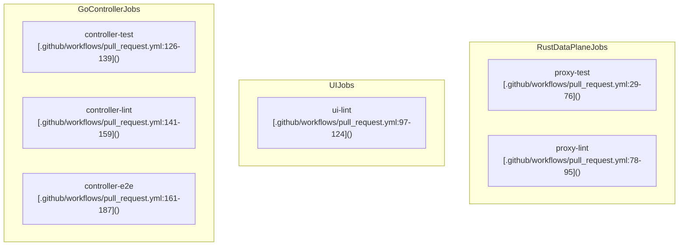
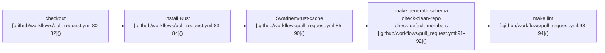
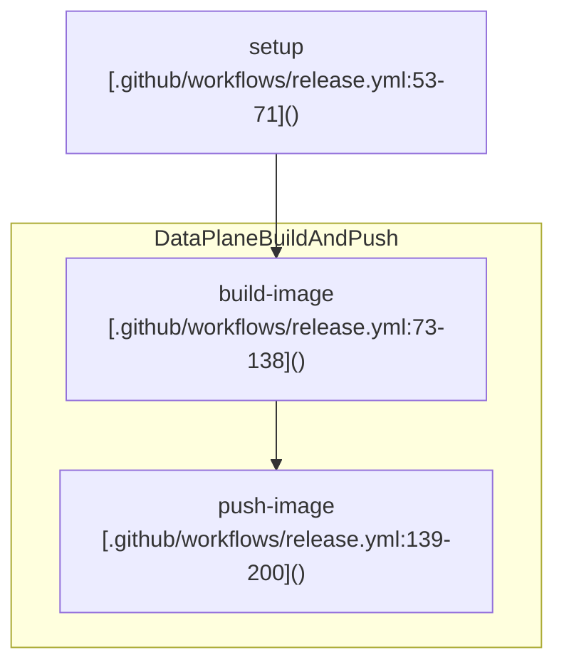
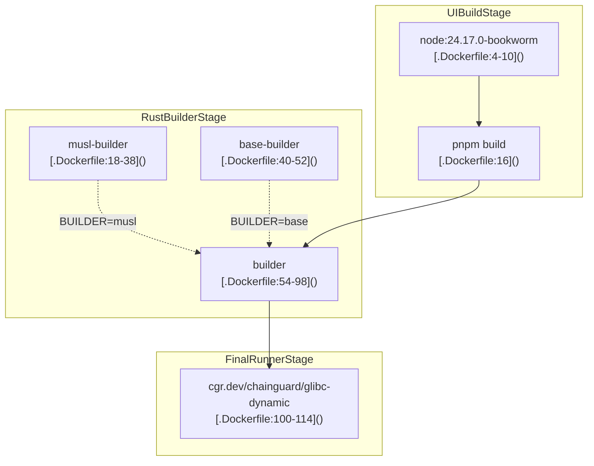

<!-- source: DeepWiki mcp.deepwiki.com · repo agentgateway/agentgateway · page 14.3 CI/CD Pipeline · fetched 2026-10-21 -->

# CI/CD Pipeline

Relevant source files

The following files were used as context for generating this wiki page:

- [.github/actions/controller-build-cache/action.yml](.github/actions/controller-build-cache/action.yml)
- [.github/actions/rust-build-cache/action.yml](.github/actions/rust-build-cache/action.yml)
- [.github/actions/setup-rust/action.yml](.github/actions/setup-rust/action.yml)
- [.github/dependabot.yml](.github/dependabot.yml)
- [.github/workflows/debug_cache.yml](.github/workflows/debug_cache.yml)
- [.github/workflows/model-catalog.yml](.github/workflows/model-catalog.yml)
- [.github/workflows/nightly.yml](.github/workflows/nightly.yml)
- [.github/workflows/pull_request.yml](.github/workflows/pull_request.yml)
- [.github/workflows/release.yml](.github/workflows/release.yml)
- [.gitignore](.gitignore)
- [Dockerfile](Dockerfile)
- [Dockerfile.s390x](Dockerfile.s390x)
- [Makefile](Makefile)
- [controller/Makefile](controller/Makefile)
- [controller/hack/utils/oss_compliance/osa_provided.md](controller/hack/utils/oss_compliance/osa_provided.md)
- [controller/pkg/client/clientset/versioned/fake/clientset_generated.go](controller/pkg/client/clientset/versioned/fake/clientset_generated.go)
- [controller/pkg/utils/fsutils/fsutils.go](controller/pkg/utils/fsutils/fsutils.go)
- [controller/pkg/utils/fsutils/source_path_test.go](controller/pkg/utils/fsutils/source_path_test.go)
- [controller/test/e2e/base/manifest.go](controller/test/e2e/base/manifest.go)
- [controller/test/e2e/daemonset_test.go](controller/test/e2e/daemonset_test.go)
- [controller/test/e2e/modelcatalog_test.go](controller/test/e2e/modelcatalog_test.go)
- [crates/agentgateway/src/proxy/admission.rs](crates/agentgateway/src/proxy/admission.rs)
- [crates/cel-fork/cel/Cargo.toml](crates/cel-fork/cel/Cargo.toml)
- [crates/cel-fork/cel/src/ser.rs](crates/cel-fork/cel/src/ser.rs)
- [crates/cel-fork/cel/src/types/map.rs](crates/cel-fork/cel/src/types/map.rs)
- [crates/celx/benches/cel_bench.rs](crates/celx/benches/cel_bench.rs)
- [crates/celx/src/benches.rs](crates/celx/src/benches.rs)
- [examples/traffic-a2a/strands-agents/.gitignore](examples/traffic-a2a/strands-agents/.gitignore)
- [go.mod](go.mod)
- [go.sum](go.sum)
- [rust-toolchain.toml](rust-toolchain.toml)
- [tools/go.mod](tools/go.mod)
- [tools/go.sum](tools/go.sum)

This document describes the GitHub Actions-based continuous integration and continuous delivery (CI/CD) pipeline for the AgentGateway project. The pipeline automates testing, linting, building, multi-platform artifact packaging, caching, and releasing of both the Rust-based data plane and the Go-based Kubernetes controller.

For information about the build system and local development tools, see [Build System and Tools](14.2). For testing frameworks and strategies, see [Testing Framework](14.4).

Sources: [.github/workflows/pull_request.yml:1-25](), [.github/workflows/release.yml:1-55]()

## Overview

The CI/CD pipeline consists of three primary workflows defined in GitHub Actions:

- **Pull Request Workflow** ([.github/workflows/pull_request.yml:1-310]()): Runs comprehensive checks on every pull request and push to `main`, including unit tests, linting, and end-to-end tests across multiple platforms.
- **Release Workflow** ([.github/workflows/release.yml:1-565]()): Automates the release process, building multi-architecture Docker images (glibc and musl variants), native binaries, manifest lists, and publishing GitHub releases signed with Cosign.
- **Nightly Release Workflow** ([.github/workflows/nightly.yml:1-156]()): Scheduled to run daily at 02:00 UTC, it checks for recent commits since the previous successful run and triggers a pre-release build with development tags.

All workflows enforce toolchain parity by specifying `RUST_VERSION: "1.99.0"` and `GO_VERSION: "1.27.1"` via workflow-level environment variables [[.github/workflows/pull_request.yml:18-23](), [.github/workflows/release.yml:38-42]()]. The Rust toolchain version is also specified in [rust-toolchain.toml:1-3]().

Sources: [.github/workflows/pull_request.yml:18-23](), [.github/workflows/release.yml:38-42](), [.github/workflows/nightly.yml:1-15](), [rust-toolchain.toml:1-3]()

## Pull Request Workflow Architecture

The pull request workflow runs on every push to `main` and on all pull requests. It uses a concurrency group keyed by workflow name and reference or SHA to cancel in-progress runs when new commits are pushed to a pull request [[.github/workflows/pull_request.yml:11-17]()].

### Pull Request Job Layout & Code Entity Mapping

The following diagram bridges natural language workflow subsystems to their underlying codebase entities, workflow files, and build targets:

Sources: [.github/workflows/pull_request.yml:1-310](), [Makefile:105-109](), [Makefile:86-90](), [controller/Makefile:133-134](), [controller/Makefile:157-159]()

**Pull Request / main branch job layout** (`pull_request.yml`):

Sources: [.github/workflows/pull_request.yml:11-187]()

### `proxy-test` and Caching Strategy (`rust-build-cache`)

The `proxy-test` job runs on a matrix of operating systems (`blacksmith-4vcpu-ubuntu-2404`, `windows-2025`, `macos-15`) [[.github/workflows/pull_request.yml:38-44]()]. It uses a custom composite action `.github/actions/rust-build-cache` to restore and save source-aware Cargo build caches [[.github/workflows/pull_request.yml:53-58](), [.github/actions/rust-build-cache/action.yml:1-39]()].

**Rust Build Cache Flow**:
1. Installs the specified Rust toolchain via `dtolnay/rust-toolchain` [[.github/actions/setup-rust/action.yml:1-16]()].
2. Restores Git source modification times (`mtimes`) using a Python-based script (`git-restore-mtime`) to ensure Cargo's incremental build timestamps remain valid across fresh runners [[.github/actions/rust-build-cache/action.yml:26-36]()].
3. Computes a source-aware generation hash based on the `crates/` directory tree and writes a producer marker [[.github/actions/rust-build-cache/action.yml:40-54]()].
4. Restores or saves cache archives using `Swatinem/rust-cache` [[.github/actions/rust-build-cache/action.yml:56-67]()].
5. Invalidates changed Rust sources from fallback caches by touching modified files if fallback restores occur across different commits [[.github/actions/rust-build-cache/action.yml:75-125]()].

Sources: [.github/workflows/pull_request.yml:29-76](), [.github/actions/rust-build-cache/action.yml:1-39](), [.github/actions/setup-rust/action.yml:1-16]()

### `proxy-lint` and Code Generation

The `proxy-lint` job performs static analysis and verifies repository cleanliness.

The `check-clean-repo` target fails the workflow if generated files (such as schemas or proto bindings) have uncommitted modifications [[Makefile:126-128]()].

Sources: [.github/workflows/pull_request.yml:78-95](), [Makefile:126-128]()

### UI Lint and Playwright E2E

The `ui-lint` job runs within the `ui/` directory using Node.js and `pnpm` [[.github/workflows/pull_request.yml:97-124]()]:
- Installs dependencies using `pnpm install --frozen-lockfile` [[.github/workflows/pull_request.yml:112]()].
- Runs `pnpm lint` and executes end-to-end tests via Playwright (`pnpm test:e2e`) [[.github/workflows/pull_request.yml:113-117]()].
- Configures Playwright via `ui/playwright.config.ts`, specifying test directories, web servers, and failure trace retention.

Sources: [.github/workflows/pull_request.yml:97-124]()

### Controller Jobs and Go Caching (`controller-build-cache`)

The Go controller jobs (`controller-test`, `controller-lint`, `controller-e2e`) rely on `.github/actions/controller-build-cache/action.yml` to manage Go module (`GOMODCACHE`) and build (`GOCACHE`) caches [[.github/actions/controller-build-cache/action.yml:1-58]()].

**Go Cache Key Generation**:
- Hashes `go.mod` and `go.sum` files across the repository to produce a stable dependency generation hash [[.github/actions/controller-build-cache/action.yml:58]()].
- Combines the Git revisions of the `controller` and `api` trees to form source-aware build cache keys [[.github/actions/controller-build-cache/action.yml:58]()].
- Uses separate writable caches for postsubmit (`save: true`) and read-only fallback caches for pull requests [[.github/actions/controller-build-cache/action.yml:58]()].

Sources: [.github/workflows/pull_request.yml:126-159](), [.github/actions/controller-build-cache/action.yml:1-58]()

### End-to-End Test Job

The `controller-e2e` job initializes a Kind Kubernetes cluster and executes integration tests [[.github/workflows/pull_request.yml:161-187]()]:
- Sets up both Rust and Go build caches via composite actions [[.github/workflows/pull_request.yml:170-175]()].
- Runs setup scripts and executes `go test -trimpath -tags=e2e,agent,disable_pgv -v ./controller/test/e2e` [[.github/workflows/pull_request.yml:176-181]()].

Sources: [.github/workflows/pull_request.yml:161-187]()

## Release Workflow Architecture

The release workflow is triggered by version tags (`v*.*.*`), manual workflow dispatch, or calls from the nightly workflow [[.github/workflows/release.yml:1-37]()].

**Release workflow job dependency graph** (`release.yml`):

Sources: [.github/workflows/release.yml:1-200]()

### Version Determination and Setup

The `setup` job determines the target version by inspecting manual workflow inputs or the `github.ref_name`, stripping any leading `v` prefix to establish a canonical version output [[.github/workflows/release.yml:53-71]()].

Sources: [.github/workflows/release.yml:53-71]()

### Multi-Architecture Docker Image Building and Digest Uploads

The `build-image` job runs across a matrix of platforms (`linux/amd64` and `linux/arm64`) using specialized runners [[.github/workflows/release.yml:73-87]()].
- Utilizes `docker/metadata-action` and `docker/login-action` to authenticate against GitHub Container Registry (`ghcr.io`) [[.github/workflows/release.yml:95-106]()].
- Builds and pushes individual images by digest using `docker/build-push-action` with `push-by-digest=true` [[.github/workflows/release.yml:113-124]()].
- Exports platform digests to temporary artifacts (`digests-${{ env.PLATFORM_PAIR }}`) with a 1-day retention period [[.github/workflows/release.yml:125-138]()].

Sources: [.github/workflows/release.yml:73-138]()

### Manifest Creation and Cosign Signing

The `push-image` job coordinates final image publication:
- Downloads all platform digests from `digests-linux-*` artifacts [[.github/workflows/release.yml:154-160]()].
- Combines individual architecture digests into a multi-architecture manifest list using `docker buildx imagetools create` [[.github/workflows/release.yml:181-186]()].
- Signs the container image tags using `cosign sign --yes` with keyless OIDC token signing [[.github/workflows/release.yml:187-198]()].

Sources: [.github/workflows/release.yml:139-200]()

## Nightly Release Workflow

The nightly release workflow executes according to a daily schedule (`0 2 * * *`) or via manual dispatch [[.github/workflows/nightly.yml:1-7]()]:
1. **Prepare Phase**: Verifies that the workflow runs in the official repository and queries GitHub APIs for the previous successful nightly run ID and commit SHA [[.github/workflows/nightly.yml:15-44]()].
2. **Commit Check**: Compares `HEAD` against `previous_sha` to determine if new commits exist [[.github/workflows/nightly.yml:46-73]()].
3. **Version Computation**: Generates an alpha version string in the format `0.0.0-alpha.${SHORT_SHA}` [[.github/workflows/nightly.yml:74-80]()].
4. **Changelog Generation**: Formats a markdown changelog summarizing commits since the previous nightly build and uploads it as an artifact [[.github/workflows/nightly.yml:81-144]()].
5. **Release Trigger**: Calls `release.yml` with `extra_tag: latest-dev` and `extra_helm_tag: 0.0.0-latest-dev` [[.github/workflows/nightly.yml:145-156]()].

Sources: [.github/workflows/nightly.yml:1-156]()

## Dockerfile Multi-Stage Build & Optimization

The project builds container images using a multi-stage `Dockerfile` that supports builder variants (`base` for glibc, `musl` for musl libc) [[.Dockerfile:1-114]()].

Key build optimizations:
- **UI Asset Embedding**: Copies prebuilt UI assets from the Node stage into the Rust builder stage [[.Dockerfile:69]()].
- **Cargo Fetching & Caching**: Uses Docker cache mounts (`type=cache`) for Cargo registry and git directories during `cargo fetch --locked` and `cargo build` [[.Dockerfile:71-77]()].
- **JEMALLOC Page Sizing**: Configures `JEMALLOC_SYS_WITH_LG_PAGE=16` on `arm64` targets to ensure compatibility with 64KB page-size host kernels [[.Dockerfile:81-85]()].
- **Version Verification**: Validates the compiled binary via `/out/agentgateway --version` and fails the build if the version resolves as `unknown` [[.Dockerfile:93-97]()].

Sources: [.Dockerfile:1-114]()

---

