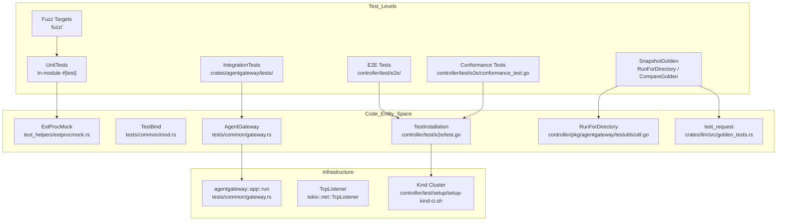
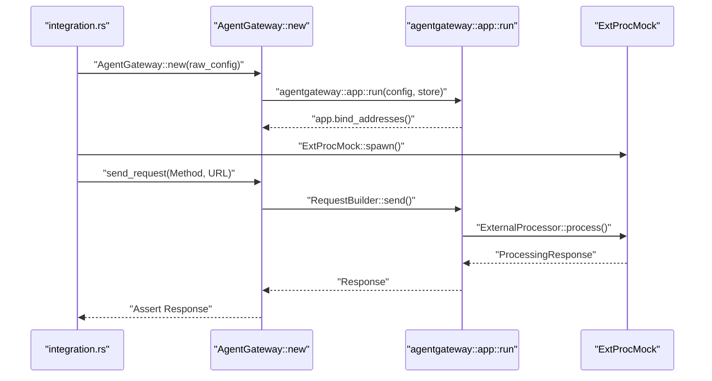

<!-- source: DeepWiki mcp.deepwiki.com · repo agentgateway/agentgateway · page 14.4 Testing Framework · fetched 2026-10-21 -->

# Testing Framework

Relevant source files

The following files were used as context for generating this wiki page:

- [controller/pkg/agentgateway/translator/testdata/gateways/invalid-tls.yaml](controller/pkg/agentgateway/translator/testdata/gateways/invalid-tls.yaml)
- [controller/pkg/agentgateway/translator/testdata/gateways/preserve-foreign-conditions.yaml](controller/pkg/agentgateway/translator/testdata/gateways/preserve-foreign-conditions.yaml)
- [controller/pkg/agentgateway/translator/testdata/gateways/tls-listeners-cross-ns.yaml](controller/pkg/agentgateway/translator/testdata/gateways/tls-listeners-cross-ns.yaml)
- [controller/pkg/agentgateway/translator/testdata/gateways/tls-listeners-dynamic-ca-cert-frontend-mtls.yaml](controller/pkg/agentgateway/translator/testdata/gateways/tls-listeners-dynamic-ca-cert-frontend-mtls.yaml)
- [controller/pkg/agentgateway/translator/testdata/gateways/tls-listeners.yaml](controller/pkg/agentgateway/translator/testdata/gateways/tls-listeners.yaml)
- [controller/pkg/reports/status.go](controller/pkg/reports/status.go)
- [controller/test/conformance/conformance_helpers_test.go](controller/test/conformance/conformance_helpers_test.go)
- [controller/test/conformance/conformance_test.go](controller/test/conformance/conformance_test.go)
- [controller/test/e2e/README-e2e-framework.md](controller/test/e2e/README-e2e-framework.md)
- [controller/test/e2e/aibackend_test.go](controller/test/e2e/aibackend_test.go)
- [controller/test/e2e/debugging.md](controller/test/e2e/debugging.md)
- [controller/test/e2e/dynamic_ca_cert_test.go](controller/test/e2e/dynamic_ca_cert_test.go)
- [controller/test/e2e/main_test.go](controller/test/e2e/main_test.go)
- [controller/test/e2e/test.go](controller/test/e2e/test.go)
- [controller/test/e2e/test_installation_test.go](controller/test/e2e/test_installation_test.go)
- [controller/test/e2e/testdata/aibackend/failover_eviction.yaml](controller/test/e2e/testdata/aibackend/failover_eviction.yaml)
- [controller/test/e2e/testdata/dynamic-ca-cert/dynamic-ca-cert-invalid-ca.yaml](controller/test/e2e/testdata/dynamic-ca-cert/dynamic-ca-cert-invalid-ca.yaml)
- [controller/test/e2e/testdata/dynamic-ca-cert/dynamic-ca-cert.yaml](controller/test/e2e/testdata/dynamic-ca-cert/dynamic-ca-cert.yaml)
- [controller/test/setup/conformance-images.txt](controller/test/setup/conformance-images.txt)
- [controller/test/setup/e2e-images.txt](controller/test/setup/e2e-images.txt)
- [controller/test/setup/gie-conformance-images.txt](controller/test/setup/gie-conformance-images.txt)
- [controller/test/setup/setup-kind-ci.sh](controller/test/setup/setup-kind-ci.sh)
- [controller/test/setup/verify-kind-images.sh](controller/test/setup/verify-kind-images.sh)
- [controller/test/testutils/env.go](controller/test/testutils/env.go)
- [tools/proxy-dev-build](tools/proxy-dev-build)

## Purpose and Scope

The `agentgateway` testing framework provides a multi-layered approach to validating the data plane (Rust) and control plane (Go). It encompasses unit tests for core logic, snapshot/golden files for configuration and translation output, integration tests for proxy behavior, fuzzing for protocol and expression robustness, Gateway API conformance tests, and full end-to-end (E2E) suites using Kubernetes and Kind. The framework is designed to handle complex AI-specific logic, such as LLM request translation, observability persistence, Model Context Protocol (MCP) multiplexing, and dynamic policy execution.

---

## Testing Architecture Overview

The testing strategy is divided into layers, ranging from low-level function validation to full system orchestration across both the Rust data plane and Go control plane.

Title: Testing Layers and Entity Mapping

**Sources:** [crates/agentgateway/tests/common/gateway.rs:90-92](), [crates/agentgateway/src/test_helpers/extprocmock.rs:191-193](), [controller/test/setup/setup-kind-ci.sh:82-108](), [crates/agentgateway/tests/common/mod.rs:21-25](), [controller/pkg/agentgateway/testutils/util.go:42-143](), [crates/llm/src/golden_tests.rs:51-105](), [controller/test/conformance/conformance_test.go:37-91]()

---

## Data Plane Unit and Integration Testing

The Rust data plane utilizes in-module unit tests and a specialized mock infrastructure housed in `test_helpers/` to validate proxying logic, header mutations, and auth mechanisms.

### Mock Infrastructure
The `crates/agentgateway/src/test_helpers/` directory contains specialized mocks for external services using the `MockInstance` wrapper, which dynamically binds to local TCP ports [crates/agentgateway/src/test_helpers/mod.rs:26-35]().

*   **`ExtProcMock`**: Mocks the External Processing gRPC service. It implements the `Handler` trait and allows tests to simulate request/response header and body mutations via `handle_request_headers` and `handle_request_body` [crates/agentgateway/src/test_helpers/extprocmock.rs:88-168]().
*   **`RateLimitMock`**: Mocks the remote rate limiting service [crates/agentgateway/src/test_helpers/mod.rs:11]().
*   **`ExtAuthMock`**: Mocks external authorization providers using Envoy `CheckRequest` and `CheckResponse` proto types [crates/agentgateway/src/test_helpers/mod.rs:136-141]().
*   **`OtelTraceMock`**: Verifies that spans are correctly exported to OTLP collectors [crates/agentgateway/src/test_helpers/mod.rs:146-154]().
*   **`spawn_service`**: A utility function binding to `127.0.0.1:0` to serve a `tower::Service` over HTTP/2 [crates/agentgateway/src/test_helpers/mod.rs:37-69]().

### Integration Test Helpers
The `AgentGateway` struct in `tests/common/gateway.rs` provides a managed integration environment:
*   **`AgentGateway::new`**: Configures a temporary gateway instance, replaces `$PORT` placeholders with OS-assigned free ports, and initializes an `App` instance [crates/agentgateway/tests/common/gateway.rs:44-92]().
*   **`send_request`**: Dispatches HTTP requests to the running gateway instance using a `RequestBuilder` [crates/agentgateway/tests/common/gateway.rs:135-143]().
*   **`send_request_json`**: A helper for sending POST requests with JSON bodies, automatically generating a unique `x-test-id` header [crates/agentgateway/tests/common/gateway.rs:145-170]().

Title: Integration Test Request Flow and Code Entities

**Sources:** [crates/agentgateway/src/test_helpers/mod.rs:1-104](), [crates/agentgateway/tests/common/gateway.rs:44-125](), [crates/agentgateway/src/test_helpers/extprocmock.rs:88-236](), [crates/agentgateway/tests/integration.rs:1-2]()

---

## Snapshot and Golden Tests

Snapshot and golden file testing are heavily used in the control plane (`controller/`) to verify that Kubernetes CRDs correctly translate into XDS configurations, translation artifacts, or policy outputs without regressions.

*   **`CompareGolden`**: Utility function wrapping Istio test utilities to compare rendered output content against a stored golden file path [controller/pkg/agentgateway/testutils/util.go:42-44]().
*   **`RunForDirectory`**: Iterates over input YAML files in a test directory, executes translation logic, validates resources with `AgentgatewayValidatorSkipMissing`, and compares the generated status and output against the `# Output` section of the file [controller/pkg/agentgateway/testutils/util.go:102-143]().
    *   Examples of golden files include `controller/pkg/agentgateway/translator/testdata/gateways/tls-listeners-cross-ns.yaml` [controller/pkg/agentgateway/translator/testdata/gateways/tls-listeners-cross-ns.yaml:76-133]() and `controller/pkg/agentgateway/translator/testdata/gateways/invalid-tls.yaml` [controller/pkg/agentgateway/translator/testdata/gateways/invalid-tls.yaml:20-42](). These files define Kubernetes Gateway API resources and their expected translated output, as well as the expected status conditions [controller/pkg/agentgateway/translator/testdata/gateways/tls-listeners-cross-ns.yaml:134-165](), [controller/pkg/agentgateway/translator/testdata/gateways/invalid-tls.yaml:43-91]().
*   **LLM Golden Tests**: The `crates/llm/src/golden_tests.rs` module contains extensive golden tests for LLM request and response translation. The `test_request` function [crates/llm/src/golden_tests.rs:51-105]() takes a provider, relative path to a fixture, and a translation function. It reads an input JSON, applies the translation, and then asserts the resulting JSON against a snapshot. This ensures that conversions between different LLM provider formats (e.g., Anthropic, Bedrock, Vertex, OpenAI) are consistent and correct [crates/llm/src/golden_tests.rs:144-205]().
    *   The `snapshot_path_and_name` function [crates/llm/src/golden_tests.rs:19-30]() determines the location and name of the snapshot file based on the input fixture and provider.
    *   Redaction rules are applied to sensitive or dynamic fields like `id` and `created` to ensure stable snapshots [crates/llm/src/golden_tests.rs:91-104]().
    *   Helper functions like `apply_test_prompts` [crates/llm/src/golden_tests.rs:108-111]() allow for testing prompt manipulation logic.
*   **Environment Flags**: Setting `REFRESH_GOLDEN=true` automatically updates golden test artifacts during local development or CI runs [controller/pkg/agentgateway/testutils/util.go:136-138]().

**Sources:** [controller/pkg/agentgateway/testutils/util.go:42-143](), [crates/llm/src/golden_tests.rs:19-105](), [crates/llm/src/golden_tests.rs:108-111](), [crates/llm/src/golden_tests.rs:144-205](), [controller/pkg/agentgateway/translator/testdata/gateways/tls-listeners-cross-ns.yaml:76-165](), [controller/pkg/agentgateway/translator/testdata/gateways/invalid-tls.yaml:20-91]()

---

## Observability and Persistence Testing

The testing framework includes validation for telemetry storage, request log database operations, and log metric aggregations.

*   **`PostgresLogStore` Testing**: Validates batch insertions using `COPY` commands and search capabilities with cursor-based pagination [crates/agentgateway/src/telemetry/log_store/postgres.rs:32-88]().
*   **Analytics Validation**: Tests the `analytics_summary` function which performs time-bucketed aggregation of request counts, token usage, and LLM costs [crates/agentgateway/src/telemetry/log_store/postgres.rs:101-143]().
*   **Database Migrations**: The test environment triggers schema migrations to ensure the `request_logs` and `request_log_payloads` tables are correctly initialized prior to assertions [crates/agentgateway/src/telemetry/log_store/postgres.rs:24-30]().

**Sources:** [crates/agentgateway/src/telemetry/log_store/postgres.rs:32-143]()

---

## Fuzzing

The `fuzz/` directory contains `cargo-fuzz` targets for high-risk components. These use the `libfuzzer-sys` crate to perform coverage-guided fuzzing on parsers and expression executors.

Key fuzz targets include:
*   **CEL Expressions**: Fuzzing the `agent-celx` crate and CEL evaluation engine with complex nested JSON, LLM attributes, and dynamic variables.
*   **LLM Conversions**: Fuzzing the `agent-llm` provider translation payloads to ensure malformed input schemas do not trigger panics or memory corruption. This includes testing various input formats like `completions` [crates/llm/src/conversion/completions.rs:1-188](), `messages` [crates/llm/src/conversion/messages.rs:1-200](), `bedrock` [crates/llm/src/conversion/bedrock.rs:1-225](), and `responses` [crates/llm/src/conversion/responses.rs:1-196](), as well as OpenAI compatibility [crates/llm/src/conversion/openai_compat.rs:1-199]().
*   **PROXY Protocol**: Validating the robustness of the PROXY protocol v2 parser against malformed TLV data streams.

**Sources:** [crates/agentgateway/src/test_helpers/mod.rs:1-10](), [controller/Makefile:1-163](), [crates/llm/src/conversion/completions.rs:1-188](), [crates/llm/src/conversion/messages.rs:1-200](), [crates/llm/src/conversion/bedrock.rs:1-225](), [crates/llm/src/conversion/responses.rs:1-196](), [crates/llm/src/conversion/openai_compat.rs:1-199]()

---

## E2E Testing with Kind and Conformance

End-to-end tests utilize Kubernetes-in-Docker (Kind) to validate the real-world integration between the Go controller, Kubernetes CRDs, and the Rust proxy data plane.

### Environment Configuration
The E2E framework uses structured test installations defined in `controller/test/e2e/test.go` and cluster setup scripts in `controller/test/setup/setup-kind-ci.sh`:
*   **`TestInstallation`**: Manages Helm lifecycles, CRD installations, and generated test assets per test cluster [controller/test/e2e/test.go:106-127]().
    *   The `InstallFromLocalChart` method [controller/test/e2e/test.go:160-163]() installs both CRDs and the core `agentgateway` chart from local filesystem paths.
    *   The `shouldSkipInstallAndTeardown` method [controller/test/e2e/test.go:133-135]() checks environment variables like `SKIP_INSTALL`, `PERSIST_INSTALL`, and `FAIL_FAST_AND_PERSIST` [controller/test/testutils/env.go:14-38]() to control the lifecycle of the test installation.
*   **`CreateSharedTestInstallation`**: Constructs a shared installation for package-level test fixtures [controller/test/e2e/test.go:43-54]().
*   **`step_create_kind_cluster`**: Provisions the Kind cluster with custom API server tuning flags [controller/test/setup/setup-kind-ci.sh:82-108]().
*   **`step_deploy_metallb`**: Deploys MetalLB and configures `IPAddressPool` and `L2Advertisement` primitives to support `LoadBalancer` service testing [controller/test/setup/setup-kind-ci.sh:110-181](). The `guessMetallbAddress` function [controller/test/conformance/conformance_test.go:178-197]() attempts to find a usable IP address from the MetalLB configuration for conformance tests.
*   **Image Management**: The setup scripts also handle creating a local Kind registry and pushing controller and proxy images to it, ensuring that the E2E tests use the correct, locally built images [controller/test/setup/setup-kind-ci.sh:210-221](). The `verify-kind-images.sh` script [controller/test/setup/verify-kind-images.sh:1-20]() verifies that the images loaded into Kind match the expected list from files like `conformance-images.txt` [controller/test/setup/conformance-images.txt:1-25]() or `e2e-images.txt` [controller/test/setup/e2e-images.txt:1-22]().
*   **AI Backend E2E Tests**: The `controller/test/e2e/aibackend_test.go` file contains E2E tests specifically for AI backend functionality, including routing, prompt guards, webhooks, and failover mechanisms [controller/test/e2e/aibackend_test.go:31-48](). For example, `testAIBackendPromptGuard` [controller/test/e2e/aibackend_test.go:59-75]() verifies that prompt guards correctly reject inappropriate content.

### Gateway API Conformance
Gateway API conformance suites run against the Kind cluster to ensure compliance with upstream Gateway API specifications (such as HTTPRoute matching, filter semantics, and reference grants).
*   The `TestConformance` function [controller/test/conformance/conformance_test.go:37-91]() in `controller/test/conformance/conformance_test.go` is the entry point for running these tests.
*   It dynamically detects the Gateway API channel (e.g., `experimental` or `standard`) [controller/test/conformance/conformance_test.go:40-47]() and configures the conformance profiles accordingly [controller/test/conformance/conformance_test.go:50-53]().
*   Features supported by the `GatewayClass` are fetched [controller/test/conformance/conformance_test.go:56-60]() and experimental features are exempted if the standard channel is detected [controller/test/conformance/conformance_test.go:62-64]().
*   The `options.UsableNetworkAddresses` are set using an IP address obtained from MetalLB to test `GatewayStaticAddresses` [controller/test/conformance/conformance_test.go:66-86]().
*   The `RunConformanceWithOptions` function from `sigs.k8s.io/gateway-api/conformance` is then called to execute the tests [controller/test/conformance/conformance_test.go:90]().
*   The `detectGatewayAPIChannel` function [controller/test/conformance/conformance_test.go:137-163]() inspects the `gateway.networking.k8s.io/channel` annotation on the `HTTPRoute` CRD to determine the installed Gateway API channel.
*   The `fetchGatewayClassSupportedFeatures` function [controller/test/conformance/conformance_test.go:101-133]() retrieves the `SupportedFeatures` from the `GatewayClass` resource.
*   The `guessMetallbAddress` function [controller/test/conformance/conformance_test.go:178-197]() attempts to find a suitable IPv4 address from MetalLB's `IPAddressPool` CRDs or ConfigMaps for static address testing. Helper functions like `chooseMetallbAddress` [controller/test/conformance/conformance_helpers_test.go:11-27]() and `candidateIPv4Addresses` [controller/test/conformance/conformance_helpers_test.go:79-82]() are used to select appropriate IP addresses.

**Sources:** [controller/test/e2e/test.go:43-127](), [controller/test/setup/setup-kind-ci.sh:82-181](), [controller/test/setup/setup-kind-ci.sh:210-221](), [controller/test/testutils/env.go:14-38](), [controller/test/setup/verify-kind-images.sh:1-20](), [controller/test/setup/conformance-images.txt:1-25](), [controller/test/setup/e2e-images.txt:1-22](), [controller/test/e2e/aibackend_test.go:31-75](), [controller/test/conformance/conformance_test.go:37-91](), [controller/test/conformance/conformance_test.go:137-163](), [controller/test/conformance/conformance_test.go:101-133](), [controller/test/conformance/conformance_test.go:178-197](), [controller/test/conformance/conformance_helpers_test.go:11-27](), [controller/test/conformance/conformance_helpers_test.go:79-82]()

---

## CLI and Configuration Validation

The gateway binary includes self-contained validation commands to test configurations prior to runtime execution.

*   **`validate` Command**: Implements a validation flow that parses the configuration schema and normalizes local configuration formats, ensuring all bindings, routes, and backends are well-formed before deployment. This command is part of the `RunArgs` structure [crates/agentgateway-app/src/lib.rs:62-80]() and executed via `commands::run::execute` [crates/agentgateway-app/src/lib.rs:161]().
*   **`read_config_contents`**: A utility used by the CLI to load configuration from files or environment variables with strict schema checking. It handles various sources like direct string input, file paths, and default configurations, including Kubernetes-specific checks [crates/agentgateway-app/src/lib.rs:165-204]().

**Sources:** [crates/agentgateway/tests/common/gateway.rs:44-92](), [crates/agentgateway-app/src/lib.rs:62-80](), [crates/agentgateway-app/src/lib.rs:161](), [crates/agentgateway-app/src/lib.rs:165-204]()

---

