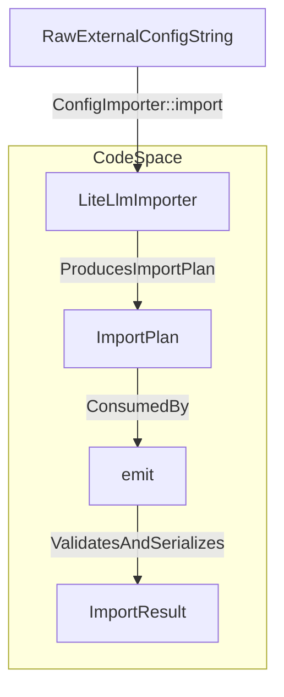
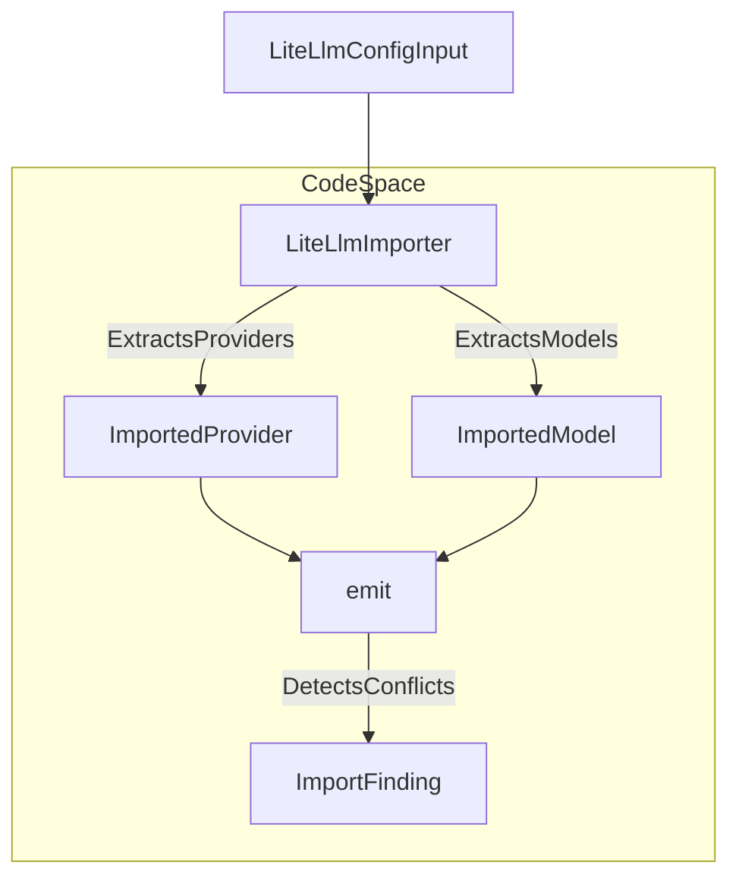
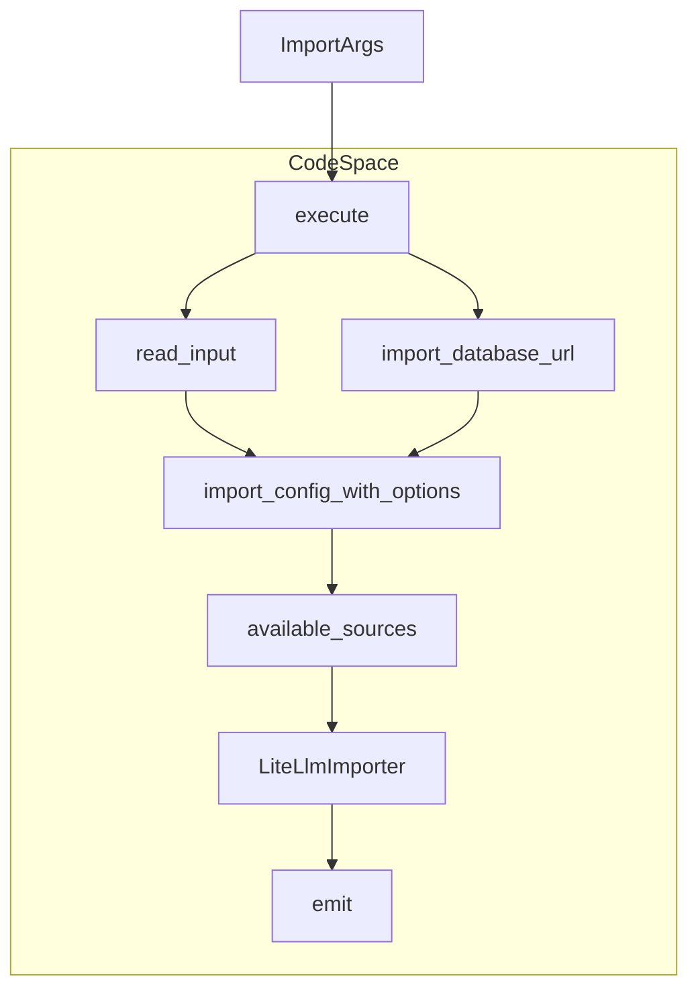
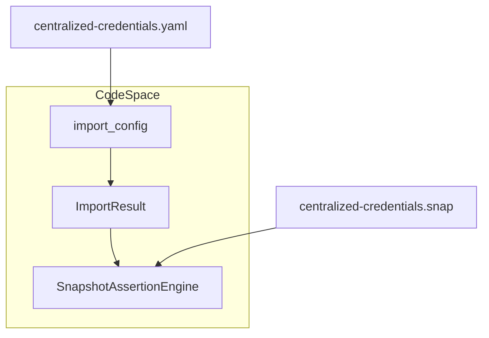

<!-- source: DeepWiki mcp.deepwiki.com · repo agentgateway/agentgateway · page 14.6 Config Import and Migration · fetched 2026-10-21 -->

# Config Import and Migration

Relevant source files

The following files were used as context for generating this wiki page:

- [catalog/model-catalog-overrides.yaml](catalog/model-catalog-overrides.yaml)
- [controller/pkg/cli/catalog/cmd.go](controller/pkg/cli/catalog/cmd.go)
- [controller/pkg/cli/catalog/model_catalog.go](controller/pkg/cli/catalog/model_catalog.go)
- [crates/agentgateway/src/app.rs](crates/agentgateway/src/app.rs)
- [crates/agentgateway/src/config.rs](crates/agentgateway/src/config.rs)
- [crates/agentgateway/src/config_store.rs](crates/agentgateway/src/config_store.rs)
- [crates/agentgateway/src/lib.rs](crates/agentgateway/src/lib.rs)
- [crates/agentgateway/src/llm/catalog/model.rs](crates/agentgateway/src/llm/catalog/model.rs)
- [crates/agentgateway/src/llm/catalog/refresh.rs](crates/agentgateway/src/llm/catalog/refresh.rs)
- [crates/agentgateway/src/llm/model_router.rs](crates/agentgateway/src/llm/model_router.rs)
- [crates/agentgateway/src/management/admin.rs](crates/agentgateway/src/management/admin.rs)
- [crates/agentgateway/src/management/admin_tests.rs](crates/agentgateway/src/management/admin_tests.rs)
- [crates/agentgateway/src/state_manager.rs](crates/agentgateway/src/state_manager.rs)
- [crates/agentgateway/src/types/loadbalancer.rs](crates/agentgateway/src/types/loadbalancer.rs)
- [crates/agentgateway/src/types/local_tests/basic_config.yaml](crates/agentgateway/src/types/local_tests/basic_config.yaml)
- [crates/agentgateway/src/types/local_tests/basic_normalized.snap](crates/agentgateway/src/types/local_tests/basic_normalized.snap)
- [crates/agentgateway/src/types/local_tests/llm_normalized.snap](crates/agentgateway/src/types/local_tests/llm_normalized.snap)
- [crates/agentgateway/src/types/local_tests/llm_simple_config.yaml](crates/agentgateway/src/types/local_tests/llm_simple_config.yaml)
- [crates/agentgateway/src/types/local_tests/llm_simple_normalized.snap](crates/agentgateway/src/types/local_tests/llm_simple_normalized.snap)
- [crates/agentgateway/src/types/local_tests/mcp_normalized.snap](crates/agentgateway/src/types/local_tests/mcp_normalized.snap)
- [crates/agentgateway/src/types/local_tests/mcp_simple_config.yaml](crates/agentgateway/src/types/local_tests/mcp_simple_config.yaml)
- [crates/agentgateway/src/types/local_tests/mcp_simple_normalized.snap](crates/agentgateway/src/types/local_tests/mcp_simple_normalized.snap)
- [crates/agentgateway/src/ui.rs](crates/agentgateway/src/ui.rs)
- [crates/xtask/src/schema.rs](crates/xtask/src/schema.rs)
- [tools/schema-to-md.sh](tools/schema-to-md.sh)
- [tools/schema_paths.jq](tools/schema_paths.jq)

## Purpose and Scope
This page details the configuration import and migration subsystems within `agentgateway`. It covers the ingestion and normalization of external gateway configurations (such as LiteLLM proxy setups), the translation pipeline that maps source-specific constructs into unified internal models via `[crates/agentgateway/src/import.rs:15-18]()`, the deprecation migration path for older local configuration schemas, and the snapshot testing framework used to verify import fidelity.

---

## 1. Importer Architecture and the `ConfigImporter` Trait

The import subsystem decouples source-specific parsing logic from the target configuration emitter through a standardized trait-based abstraction. 

*   **`ConfigImporter`**: Defined in `[crates/agentgateway/src/import.rs:15-18]()`, this trait exposes a `source()` identifier and an `import()` method that transforms a raw configuration string into an `ImportPlan`.
*   **`ImportPlan`**: Defined in `[crates/agentgateway/src/import.rs:20-27]()`, this source-neutral intermediate representation holds normalized `providers`, `models`, `routes`, and diagnostic `findings`.
*   **`emit`**: The shared emitter function located at `[crates/agentgateway/src/import.rs:142-239]()` processes the `ImportPlan`, resolves shared versus inline credentials, computes model name bindings, and serializes the result into an `ImportResult`.

Sources: `[crates/agentgateway/src/import.rs:15-142]()`, `[crates/agentgateway/src/import.rs:142-239]()`

---

## 2. LiteLLM Importer and Credential Resolution

The LiteLLM adapter parses YAML or JSON configurations containing `model_list` and `credential_list` blocks. 

### Credential Handling and Conflicts
The emitter handles centralized credentials (`litellm_credential_name`) by mapping them to reusable agentgateway providers or falling back to inline parameters if model-level overrides are detected `[crates/agentgateway/src/import.rs:149-205]()`. 
*   **Credential Conflicts**: When duplicate credential names or unsupported credential types (e.g., Azure AD tokens without equivalent static structures) are encountered, the engine generates explicit diagnostic findings with status levels (`Exact`, `Approximate`, `Manual`, `Unsupported`) defined at `[crates/agentgateway/src/import.rs:60-67]()`.
*   **Examples**: Credential validation rules and error cases are verified in test fixtures such as `[crates/agentgateway/src/tests/import/litellm/credential-conflicts.yaml:1-51]()` and its corresponding snapshot `[crates/agentgateway/src/tests/import/litellm/credential-conflicts.snap:1-81]()`.

### Header and Organization Mapping
OpenAI-compatible parameters like `organization` and `extra_headers` undergo normalization. Organization keys are mapped to upstream `openai-organization` request headers, and conflicting case-insensitive headers are flagged `[crates/agentgateway/src/tests/import/litellm/openai-compatible-headers.yaml:1-85]()`.

Sources: `[crates/agentgateway/src/import.rs:15-140]()`, `[crates/agentgateway/src/tests/import/litellm/credential-conflicts.yaml:1-51]()`, `[crates/agentgateway/src/tests/import/litellm/credential-conflicts.snap:1-81]()`

---

## 3. CLI Integration and Migration Options

The import process is governed by `ImportOptions` `[crates/agentgateway/src/import.rs:96-107]()`, which specifies default target settings such as the database URL (`sqlite://data.db`). 

*   **`import_config` & `import_config_with_options`**: High-level entrypoints at `[crates/agentgateway/src/import.rs:116-136]()` look up the matching importer via `available_sources()` `[crates/agentgateway/src/import.rs:109-114]()`, execute the translation, and invoke `emit`.
*   **CLI Execution**: The command-line interface command handler in `[crates/agentgateway-app/src/commands/import.rs:6-9]()` reads the input configuration file via `read_input` `[crates/agentgateway-app/src/commands/import.rs:49-56]()`, computes database URLs using `import_database_url` `[crates/agentgateway-app/src/commands/import.rs:36-47]()`, and outputs diagnostics.
*   **Migration of Deprecated Formats**: In addition to external imports, local configuration schema versions are migrated during startup normalization phases to ensure backward compatibility with older configuration structures. The `agctl migrate` command `[controller/pkg/cli/root.go:32]()` is specifically designed for this purpose, allowing users to update their configurations to the latest schema. This command is part of the `controller/pkg/cli/migrate` package.

Sources: `[crates/agentgateway/src/import.rs:96-136]()`, `[crates/agentgateway-app/src/commands/import.rs:6-47]()`, `[controller/pkg/cli/root.go:32]()`

---

## 4. Snapshot Testing Framework

To ensure import fidelity and prevent regressions across external gateway schema evolutions, `agentgateway` employs a suite of snapshot tests comparing input YAML manifests against expected output snapshots (`.snap` files).

*   **Test Fixtures**: Test inputs like `[crates/agentgateway/src/tests/import/litellm/centralized-credentials.yaml:1-17]()` define real-world LiteLLM gateway topologies containing shared credentials and model overrides.
*   **Snapshots**: Expected outputs are captured in files such as `[crates/agentgateway/src/tests/import/litellm/centralized-credentials.snap:1-51]()`, verifying both the generated configuration JSON/YAML structure and the exact sequence of `ImportFinding` diagnostic messages (`[crates/agentgateway/src/import.rs:80-86]()`).
*   **Normalization Tests**: The `normalize_test_yaml` function `[crates/agentgateway/src/types/local_tests.rs:154-168]()` is used to normalize YAML configurations and generate snapshots. This is crucial for verifying the internal representation of various LLM configurations, including simple models `[crates/agentgateway/src/types/local_tests/llm_simple_normalized.snap:1-500]()`, provider references `[crates/agentgateway/src/types/local_tests/llm_provider_reference_normalized.snap:1-150]()`, and virtual models with weighted `[crates/agentgateway/src/types/local_tests/llm_virtual_model_normalized.snap:1-195]()`, conditional `[crates/agentgateway/src/types/local_tests/llm_virtual_model_conditional_normalized.snap:1-157]()`, and failover `[crates/agentgateway/src/types/local_tests/llm_virtual_model_failover_normalized.snap:1-232]()` routing.

Sources: `[crates/agentgateway/src/tests/import/litellm/centralized-credentials.yaml:1-17]()`, `[crates/agentgateway/src/tests/import/litellm/centralized-credentials.snap:1-51]()`, `[crates/agentgateway/src/import.rs:80-94]()`, `[crates/agentgateway/src/types/local_tests.rs:154-168]()`, `[crates/agentgateway/src/types/local_tests/llm_simple_normalized.snap:1-500]()`, `[crates/agentgateway/src/types/local_tests/llm_provider_reference_normalized.snap:1-150]()`, `[crates/agentgateway/src/types/local_tests/llm_virtual_model_normalized.snap:1-195]()`, `[crates/agentgateway/src/types/local_tests/llm_virtual_model_conditional_normalized.snap:1-157]()`, `[crates/agentgateway/src/types/local_tests/llm_virtual_model_failover_normalized.snap:1-232]()`

---

