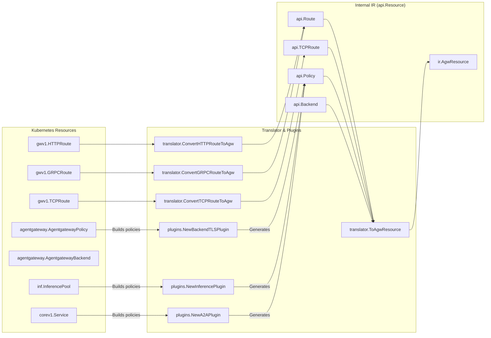

<!-- source: DeepWiki mcp.deepwiki.com · repo agentgateway/agentgateway · page 15 Kubernetes Controller · fetched 2026-10-21 -->

# Kubernetes Controller

<details>
<summary>Relevant source files</summary>

The following files were used as context for generating this wiki page:

- [controller/pkg/agentgateway/plugins/a2a_plugin.go](controller/pkg/agentgateway/plugins/a2a_plugin.go)
- [controller/pkg/agentgateway/plugins/backend_tls_plugin.go](controller/pkg/agentgateway/plugins/backend_tls_plugin.go)
- [controller/pkg/agentgateway/plugins/inference_plugin.go](controller/pkg/agentgateway/plugins/inference_plugin.go)
- [controller/pkg/agentgateway/plugins/interfaces.go](controller/pkg/agentgateway/plugins/interfaces.go)
- [controller/pkg/agentgateway/plugins/reference_indexes.go](controller/pkg/agentgateway/plugins/reference_indexes.go)
- [controller/pkg/agentgateway/translator/conversion.go](controller/pkg/agentgateway/translator/conversion.go)
- [controller/pkg/agentgateway/translator/gateway_collection.go](controller/pkg/agentgateway/translator/gateway_collection.go)
- [controller/pkg/agentgateway/translator/golden_test.go](controller/pkg/agentgateway/translator/golden_test.go)
- [controller/pkg/agentgateway/translator/route_collections.go](controller/pkg/agentgateway/translator/route_collections.go)
- [controller/pkg/agentgateway/translator/testdata/models/custom-inferencepool.yaml](controller/pkg/agentgateway/translator/testdata/models/custom-inferencepool.yaml)
- [controller/pkg/agentgateway/translator/testdata/references/service-targeted-backend-policy-via-traffic-policy.yaml](controller/pkg/agentgateway/translator/testdata/references/service-targeted-backend-policy-via-traffic-policy.yaml)
- [controller/pkg/agentgateway/utils/utils.go](controller/pkg/agentgateway/utils/utils.go)
- [controller/pkg/pluginsdk/krtutil/spec.go](controller/pkg/pluginsdk/krtutil/spec.go)
- [controller/pkg/reports/reporter.go](controller/pkg/reports/reporter.go)
- [controller/pkg/reports/reporter_test.go](controller/pkg/reports/reporter_test.go)
- [controller/pkg/syncer/backend/testdata/Valid_custom_backend_with_host_target.yaml](controller/pkg/syncer/backend/testdata/Valid_custom_backend_with_host_target.yaml)
- [controller/pkg/syncer/policy_collections.go](controller/pkg/syncer/policy_collections.go)
- [controller/pkg/syncer/syncer.go](controller/pkg/syncer/syncer.go)

</details>


This page covers the Go-based Kubernetes controller component of agentgateway: its purpose, the custom resource definitions (CRDs) it introduces, how it watches and translates Kubernetes resources, and how it delivers configuration to the Rust data plane. For details on controller design and XDS generation, see [Controller Architecture](#15.1). For Helm-based deployment procedures, see [Kubernetes Deployment](#13.4).

---

## Purpose and Scope

The controller is a Go binary that runs inside a Kubernetes cluster and bridges Kubernetes-native resource declarations to the agentgateway data plane. It watches standard Gateway API resources (`Gateway`, `HTTPRoute`, `GRPCRoute`, `TCPRoute`) alongside custom resource definitions in the `agentgateway.dev` API group, translates them into protobuf-encoded configuration, and distributes that configuration to data plane instances via xDS [controller/pkg/syncer/syncer.go:48-51](). It also manages the lifecycle of data plane `Deployment` objects through its integrated deployer logic.

The controller source lives primarily under `controller/` in the monorepo, with logic distributed between the `syncer` (resource orchestration), `translator` (conversion logic), and `plugins` (policy and backend specific logic) packages.

Sources: [controller/pkg/syncer/syncer.go:48-51]()

---

## Custom Resources

The controller registers several primary CRDs, all in the `agentgateway.dev/v1alpha1` API version:

| Kind | Short Name | Plural | Scope | Purpose |
|---|---|---|---|---|
| `AgentgatewayPolicy` | `agpol` | `agentgatewaypolicies` | Namespaced | Attaches traffic, frontend, and backend policies to Gateway API resources [controller/pkg/agentgateway/plugins/interfaces.go:55-58]() |
| `AgentgatewayBackend` | `agbe` | `agentgatewaybackends` | Namespaced | Declares AI, MCP, or A2A backend targets |
| `AgentgatewayParameters` | *(none)* | `agentgatewayparameters` | Namespaced | Customizes data plane Deployments and controller settings [controller/pkg/syncer/syncer.go:87-90]() |

The controller also utilizes upstream Gateway API and Inference Extension CRDs, such as `ReferenceGrant` and `InferencePool` [controller/pkg/agentgateway/plugins/reference_indexes.go:94-95](). For specific CRD deep dives, see [AgentgatewayPolicy CRD](#15.2), [AgentgatewayBackend CRD](#15.3), and [AgentgatewayParameters CRD](#15.4).

Sources: [controller/pkg/syncer/syncer.go:87-90](), [controller/pkg/agentgateway/plugins/reference_indexes.go:94-95](), [controller/pkg/agentgateway/plugins/interfaces.go:55-58]()

---

## Architecture Overview

The controller uses `istio.io/istio/pkg/kube/krt` (Kubernetes Runtime) collections within `syncer.Syncer` to build a reactive dependency graph of resources [controller/pkg/syncer/syncer.go:48-55](), [controller/pkg/syncer/syncer.go:143-171](). This architecture allows the controller to efficiently re-translate only the affected parts of the configuration when a Kubernetes resource changes.

Title: Controller Component Relationships
```mermaid
flowchart TD
    subgraph K8s["Kubernetes API Server"]
        Gateway["gwv1.Gateway"]
        HTTPRoute["gwv1.HTTPRoute"]
        GRPCRoute["gwv1.GRPCRoute"]
        TCPRoute["gwv1.TCPRoute"]
        Service["corev1.Service"]
        AgentgatewayPolicy["agentgateway.AgentgatewayPolicy"]
        AgentgatewayBackend["agentgateway.AgentgatewayBackend"]
        InferencePool["inf.InferencePool"]
        ReferenceGrant["gwv1beta1.ReferenceGrant"]
    end

    subgraph GoCtrl["Controller Binary (Go)"]
        AgwCollections["plugins.AgwCollections"]
        SyncerNode["syncer.Syncer"]
        Translator["translator.Translator"]
        AgwPlugin["plugins.AgwPlugin"]
        ApiClient["apiclient.Client"]
    end

    subgraph DataPlane["Data Plane"]
        Proxy["agentgateway Rust Proxy"]
    end

    Gateway --> AgwCollections
    HTTPRoute --> AgwCollections
    GRPCRoute --> AgwCollections
    TCPRoute --> AgwCollections
    Service --> AgwCollections
    AgentgatewayPolicy --> AgwCollections
    AgentgatewayBackend --> AgwCollections
    InferencePool --> AgwCollections
    ReferenceGrant --> AgwCollections

    AgwCollections -- "Watches resources" --> SyncerNode
    SyncerNode -- "Uses plugins" --> AgwPlugin
    SyncerNode -- "Translates via" --> Translator
    Translator -- "Generates XDS config" --> ApiClient
    ApiClient -->| "ADS stream" | Proxy

    AgentgatewayPolicy -.->| "TargetRefs" | HTTPRoute
    ReferenceGrant -.->| "BackendAllowed" | Service
```
Sources: [controller/pkg/syncer/syncer.go:48-80](), [controller/pkg/syncer/syncer.go:143-171](), [controller/pkg/agentgateway/plugins/reference_indexes.go:94-95]()

---

## Resource Translation Pipeline

The translation pipeline is built on `krt.Collection` objects that transform Kubernetes state into `api.Resource` Intermediate Representation (IR) via functions like `ToAgwResource` and `ConvertHTTPRouteToAgw` [controller/pkg/agentgateway/translator/conversion.go:41-50](), [controller/pkg/agentgateway/translator/gateway_collection.go:40-58]().

The `translator` package contains the core logic for converting Kubernetes Gateway API and custom resources into the agentgateway's internal API (`api.Resource`) format. For example, `ConvertHTTPRouteToAgw` [controller/pkg/agentgateway/translator/conversion.go:41-98]() processes an `HTTPRoute` object, extracting matches, filters, timeouts, retries, and backend references to construct an `api.Route` object. Similarly, `ConvertTCPRouteToAgw` [controller/pkg/agentgateway/translator/conversion.go:151-171]() handles `TCPRoute` resources.

The `plugins` package provides an extension mechanism for custom logic, such as `NewInferencePlugin` [controller/pkg/agentgateway/plugins/inference_plugin.go:31-43]() for `InferencePool` resources and `NewBackendTLSPlugin` [controller/pkg/agentgateway/plugins/backend_tls_plugin.go:32-34]() for `BackendTLSPolicy`. These plugins contribute to the overall policy and backend configuration.

Title: Resource Translation Pipeline

Sources: [controller/pkg/agentgateway/translator/conversion.go:41-98](), [controller/pkg/agentgateway/translator/conversion.go:151-171](), [controller/pkg/agentgateway/translator/conversion.go:185-202](), [controller/pkg/agentgateway/translator/gateway_collection.go:40-58](), [controller/pkg/agentgateway/plugins/inference_plugin.go:31-43](), [controller/pkg/agentgateway/plugins/backend_tls_plugin.go:32-34](), [controller/pkg/agentgateway/plugins/a2a_plugin.go:24-36]()

---

## XDS Generation and Delivery

The controller acts as an Aggregated Discovery Service (ADS) server, pushing translated resources to the data plane proxies. The `syncer.Syncer` orchestrates the `apiclient.Client` to maintain these connections [controller/pkg/syncer/syncer.go:53-55]().

The `plugins.AgwCollections` struct holds the primary Kubernetes informers used to populate the translation graph [controller/pkg/syncer/syncer.go:52](). Resources are translated into `api.Resource` protobuf messages which include `Bind`, `Listener`, `Route`, `TcpRoute`, `Backend`, and `Policy` types [controller/pkg/agentgateway/translator/gateway_collection.go:40-58]().

The `syncer.Syncer`'s `buildResourceCollections` method [controller/pkg/syncer/syncer.go:143-175]() is responsible for setting up the KRT collections that process Gateway API resources and custom resources. This includes `GatewayClasses`, `ReferenceGrants`, `ListenerSets`, and the core `Gateway` resources. Policy-related collections are built by `BuildPolicies` [controller/pkg/syncer/policy_collections.go:33-53]() which iterates through registered `AgwPlugin` instances.

Sources: [controller/pkg/syncer/syncer.go:48-55](), [controller/pkg/syncer/syncer.go:52](), [controller/pkg/syncer/syncer.go:143-175](), [controller/pkg/agentgateway/translator/gateway_collection.go:40-58](), [controller/pkg/syncer/policy_collections.go:33-53]()

---

## Child Pages

- [Controller Architecture](#15.1) — Controller design, KRT collections, resource watching, plugin registry, and XDS translation. Covers `setup.go`, `syncer`, `translator`, and plugins.
- [AgentgatewayPolicy CRD](#15.2) — AgentgatewayPolicy CRD specification, targetRefs, targetSelectors, and policy merge semantics. Covers the CRD YAML, Go types, and plugin translation.
- [AgentgatewayBackend CRD](#15.3) — AgentgatewayBackend CRD specification, AI backend priority groups, MCP backend configuration, and InferencePool backend support. Covers `backend_types.go` and the backend translation pipeline.
- [AgentgatewayParameters CRD](#15.4) — GatewayClass parameters, controller settings, and advanced configuration. Covers `agentgateway_parameters_types.go` and the deployer integration.
- [Route Delegation in Kubernetes](#15.5) — HTTPRoute delegation pattern, parent-child route relationships, cross-namespace delegation via ReferenceGrants, and policy composition along the delegation chain.
- [Status Reporting and JWKS Resolution](#15.6) — Status syncer, policy ancestor status reporting, and controller-side JWKS fetching/caching with SSRF protection and CA bundle resolution.
- [agctl CLI](#15.7) — The agctl command-line tool: proxy config dump, trace, logging level control, catalog refresh, and version commands. Covers `controller/pkg/cli`.

---

