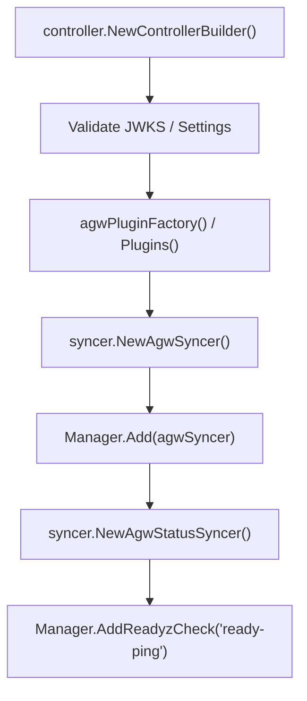
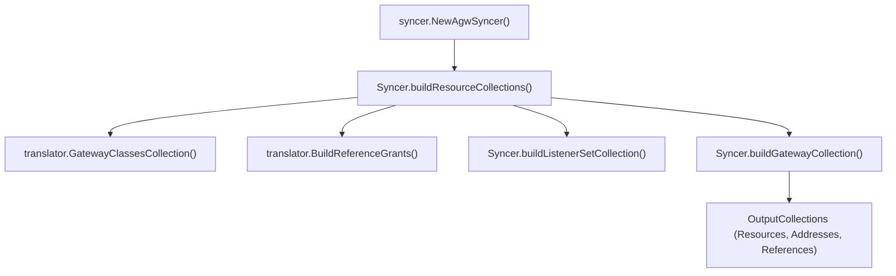
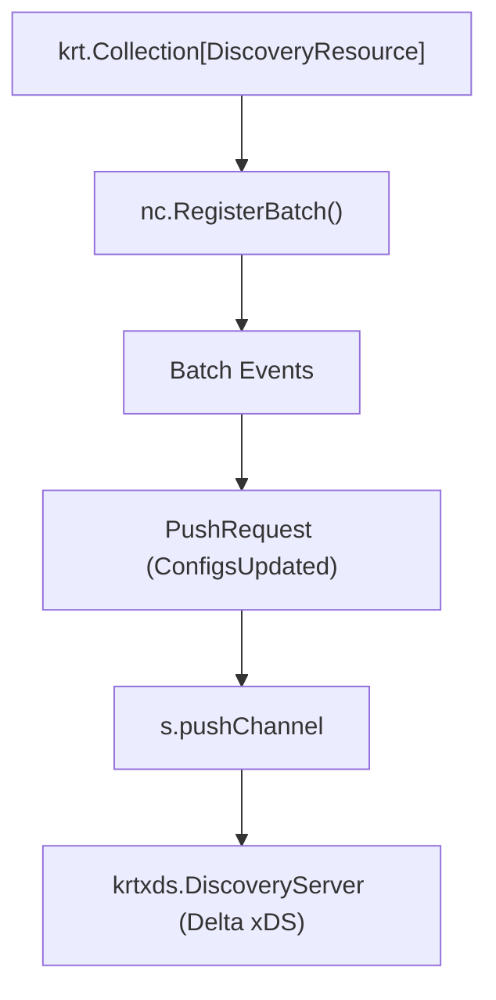

<!-- source: DeepWiki mcp.deepwiki.com · repo agentgateway/agentgateway · page 15.1 Controller Architecture · fetched 2026-10-21 -->

# Controller Architecture

<details>
<summary>Relevant source files</summary>

The following files were used as context for generating this wiki page:

- [controller/api/tests/cel_test.go](controller/api/tests/cel_test.go)
- [controller/api/tests/validator.go](controller/api/tests/validator.go)
- [controller/cmd/agentgateway/Dockerfile.agentgateway](controller/cmd/agentgateway/Dockerfile.agentgateway)
- [controller/cmd/agentgateway/main.go](controller/cmd/agentgateway/main.go)
- [controller/pkg/agentgateway/plugins/a2a_plugin.go](controller/pkg/agentgateway/plugins/a2a_plugin.go)
- [controller/pkg/agentgateway/plugins/backend_tls_plugin.go](controller/pkg/agentgateway/plugins/backend_tls_plugin.go)
- [controller/pkg/agentgateway/plugins/backend_tls_policy_test.go](controller/pkg/agentgateway/plugins/backend_tls_policy_test.go)
- [controller/pkg/agentgateway/plugins/inference_plugin.go](controller/pkg/agentgateway/plugins/inference_plugin.go)
- [controller/pkg/agentgateway/plugins/interfaces.go](controller/pkg/agentgateway/plugins/interfaces.go)
- [controller/pkg/agentgateway/plugins/reference_indexes.go](controller/pkg/agentgateway/plugins/reference_indexes.go)
- [controller/pkg/agentgateway/plugins/registry.go](controller/pkg/agentgateway/plugins/registry.go)
- [controller/pkg/agentgateway/plugins/registry_test.go](controller/pkg/agentgateway/plugins/registry_test.go)
- [controller/pkg/agentgateway/plugins/testdata/trafficpolicy/gateway-class-missing-not-attached.yaml](controller/pkg/agentgateway/plugins/testdata/trafficpolicy/gateway-class-missing-not-attached.yaml)
- [controller/pkg/agentgateway/plugins/testdata/trafficpolicy/gateway-class-other-controller-not-attached.yaml](controller/pkg/agentgateway/plugins/testdata/trafficpolicy/gateway-class-other-controller-not-attached.yaml)
- [controller/pkg/agentgateway/remotehttp/secret_ca_test.go](controller/pkg/agentgateway/remotehttp/secret_ca_test.go)
- [controller/pkg/agentgateway/testutils/util.go](controller/pkg/agentgateway/testutils/util.go)
- [controller/pkg/agentgateway/translator/ancestors_test.go](controller/pkg/agentgateway/translator/ancestors_test.go)
- [controller/pkg/agentgateway/translator/conversion.go](controller/pkg/agentgateway/translator/conversion.go)
- [controller/pkg/agentgateway/translator/gateway_collection.go](controller/pkg/agentgateway/translator/gateway_collection.go)
- [controller/pkg/agentgateway/translator/golden_test.go](controller/pkg/agentgateway/translator/golden_test.go)
- [controller/pkg/agentgateway/translator/route_collections.go](controller/pkg/agentgateway/translator/route_collections.go)
- [controller/pkg/agentgateway/translator/testdata/models/custom-inferencepool.yaml](controller/pkg/agentgateway/translator/testdata/models/custom-inferencepool.yaml)
- [controller/pkg/agentgateway/translator/testdata/references/service-targeted-backend-policy-via-traffic-policy.yaml](controller/pkg/agentgateway/translator/testdata/references/service-targeted-backend-policy-via-traffic-policy.yaml)
- [controller/pkg/agentgateway/utils/utils.go](controller/pkg/agentgateway/utils/utils.go)
- [controller/pkg/controller/start.go](controller/pkg/controller/start.go)
- [controller/pkg/controller/start_internal_test.go](controller/pkg/controller/start_internal_test.go)
- [controller/pkg/metrics/build_info.go](controller/pkg/metrics/build_info.go)
- [controller/pkg/metrics/build_info_test.go](controller/pkg/metrics/build_info_test.go)
- [controller/pkg/metrics/metrics.go](controller/pkg/metrics/metrics.go)
- [controller/pkg/metrics/metrics_test.go](controller/pkg/metrics/metrics_test.go)
- [controller/pkg/pluginsdk/krtutil/spec.go](controller/pkg/pluginsdk/krtutil/spec.go)
- [controller/pkg/reports/reporter.go](controller/pkg/reports/reporter.go)
- [controller/pkg/reports/reporter_test.go](controller/pkg/reports/reporter_test.go)
- [controller/pkg/schemes/scheme.go](controller/pkg/schemes/scheme.go)
- [controller/pkg/setup/istio_logging.go](controller/pkg/setup/istio_logging.go)
- [controller/pkg/setup/istio_logging_test.go](controller/pkg/setup/istio_logging_test.go)
- [controller/pkg/setup/setup.go](controller/pkg/setup/setup.go)
- [controller/pkg/syncer/backend/testdata/Valid_custom_backend_with_host_target.yaml](controller/pkg/syncer/backend/testdata/Valid_custom_backend_with_host_target.yaml)
- [controller/pkg/syncer/krtxds/xds_test.go](controller/pkg/syncer/krtxds/xds_test.go)
- [controller/pkg/syncer/nack/publisher.go](controller/pkg/syncer/nack/publisher.go)
- [controller/pkg/syncer/policy_collections.go](controller/pkg/syncer/policy_collections.go)
- [controller/pkg/syncer/syncer.go](controller/pkg/syncer/syncer.go)
- [controller/pkg/version/version.go](controller/pkg/version/version.go)
- [controller/test/e2e/transformation_test.go](controller/test/e2e/transformation_test.go)

</details>


## Purpose and Scope

This page documents the internal architecture of the Go-based Kubernetes controller for `agentgateway`: how it initializes via controller-runtime and setup routines, manages state via Istio's KRT framework (`krt.Collection`), watches Kubernetes Gateway API and custom resources, evaluates plugins through `plugins.AgwPlugin`, and translates resources into xDS resources (`krtxds.DiscoveryResource`) for the Rust data plane. For related CRD specifications, see pages [15.2](), [15.3](), and [15.4](); for xDS protocol details, see [3.7]().

Sources: [controller/pkg/controller/start.go:97-176](), [controller/pkg/syncer/syncer.go:47-116]()

---

## 1. Controller Initialization and Setup (`controller/pkg/controller/start.go`)

The controller lifecycle is initialized via `NewControllerBuilder` in `controller/pkg/controller/start.go`, which configures logging, checks JWKS lookup dependencies, instantiates plugin factories (`agwPluginFactory`), and creates the main `syncer.Syncer` [controller/pkg/controller/start.go:103-134](). It registers `agwSyncer` and status syncers with the `controller-runtime` manager and sets up readiness checks (`ready-ping`) [controller/pkg/controller/start.go:136-175]().

The `setup` struct [controller/pkg/setup/setup.go:91]() encapsulates the controller's options, including API client, additional GatewayClasses, extra plugins, and Kubernetes REST configuration. The `New` function [controller/pkg/setup/setup.go:98-181]() initializes these options, sets up logging, and creates the XDS listener.

**Diagram: Controller Setup and Component Wiring (Code Entity Space)**

Sources: [controller/pkg/controller/start.go:103-176](), [controller/pkg/setup/setup.go:91-181]()

---

## 2. Synchronization and KRT Collections (`controller/pkg/syncer/syncer.go`)

`Syncer` synchronizes Kubernetes Gateway API and custom resources with xDS configuration [controller/pkg/syncer/syncer.go:47-49](). Initialized via `NewAgwSyncer` [controller/pkg/syncer/syncer.go:84-111](), it maintains reference indexes, status collections, and output collections (`OutputCollections`) containing resources (`Resources`), addresses (`Addresses`), and references (`References`) [controller/pkg/syncer/syncer.go:122-128]().

The `buildResourceCollections` method [controller/pkg/syncer/syncer.go:143-174]() sets up gateway classes, reference grants (`ReferenceGrants`), listener sets, and gateway collections using Istio KRT collections. This involves:
*   `plugins.DefaultReferenceTypes` [controller/pkg/agentgateway/plugins/reference_indexes.go:76]() to define known `GroupKind`s for `ReferenceGrant` checks.
*   `translator.GatewayClassesCollection` [controller/pkg/agentgateway/translator/gateway_collection.go:213]() to manage `GatewayClass` resources.
*   `translator.BuildReferenceGrants` [controller/pkg/agentgateway/translator/gateway_collection.go:216]() to process `ReferenceGrant` objects.
*   `buildListenerSetCollection` [controller/pkg/syncer/syncer.go:156]() and `buildGatewayCollection` [controller/pkg/syncer/syncer.go:173]() to process `ListenerSet` and `Gateway` resources respectively.

**Diagram: Syncer and KRT Collection Architecture**

Sources: [controller/pkg/syncer/syncer.go:47-174](), [controller/pkg/agentgateway/plugins/reference_indexes.go:76](), [controller/pkg/agentgateway/translator/gateway_collection.go:213](), [controller/pkg/agentgateway/translator/gateway_collection.go:216]()

---

## 3. Translation Pipeline and IR Conversion (`controller/pkg/agentgateway/translator/`)

The translation pipeline converts Kubernetes Gateway API rules (such as `HTTPRouteRule`, `TCPRouteRule`, `GRPCRouteRule`) into intermediate representation objects and ultimately into `api.Resource` protobuf messages via `ToAgwResource` [controller/pkg/agentgateway/translator/gateway_collection.go:40-58]().

### Resource Conversion and Wrapper Mapping
*   **HTTPRoute**: Converted via `ConvertHTTPRouteToAgw` [controller/pkg/agentgateway/translator/conversion.go:41-99](), processing path, header, method, and query parameter matchers using helper functions like `processRouteMatches` [controller/pkg/agentgateway/translator/conversion.go:101-131]().
*   **GRPCRoute**: Converted via `ConvertGRPCRouteToAgw` [controller/pkg/agentgateway/translator/conversion.go:184-202](), mapping gRPC service/method identifiers to exact path matches.
*   **TCPRoute**: Converted via `ConvertTCPRouteToAgw` [controller/pkg/agentgateway/translator/conversion.go:151-171]().
*   **Route Delegation**: Managed via `buildHTTPRouteGroupBindings` [controller/pkg/agentgateway/translator/route_collections.go:185-199]() and `isDelegatedChildHTTPRoute` [controller/pkg/agentgateway/translator/route_collections.go:102-119](). The `routeGroupBindingKey` struct [controller/pkg/agentgateway/translator/route_collections.go:50-56]() is used to identify delegated routes.

| Internal Wrapper Type | Protobuf Resource Kind | Source Key Function / Field |
|---|---|---|
| `AgwBind` | `Resource_Bind` | `tt.Bind.Key` [controller/pkg/agentgateway/translator/gateway_collection.go:78-80]() |
| `AgwListener` | `Resource_Listener` | `tt.Listener.Key` [controller/pkg/agentgateway/translator/gateway_collection.go:91-93]() |
| `AgwRoute` | `Resource_Route` | `tt.Route.Key` [controller/pkg/agentgateway/translator/gateway_collection.go:120-122]() |
| `AgwTCPRoute` | `Resource_TcpRoute` | `tt.TCPRoute.Key` [controller/pkg/agentgateway/translator/gateway_collection.go:133-135]() |
| `AgwPolicy` | `Resource_Policy` | `plugins.AgwPolicy` [controller/pkg/agentgateway/translator/gateway_collection.go:100]() |
| `AgwBackend` | `Resource_Backend` | `tt.Backend.Key` [controller/pkg/agentgateway/translator/gateway_collection.go:107-109]() |

Sources: [controller/pkg/agentgateway/translator/gateway_collection.go:40-139](), [controller/pkg/agentgateway/translator/conversion.go:41-202](), [controller/pkg/agentgateway/translator/route_collections.go:102-199]()

---

## 4. Plugin Registry and Architecture (`controller/pkg/agentgateway/plugins/`)

The plugin system is structured around `AgwPlugin`, `PolicyPlugin`, and `BackendPlugin` definitions [controller/pkg/agentgateway/plugins/interfaces.go:37-52](). Built-in plugins are instantiated via `Plugins(...)` [controller/pkg/controller/start.go:178-187]() and registered into the controller runtime. The `MergePlugins` function [controller/pkg/agentgateway/plugins/registry.go:18-61]() combines contributions from multiple plugins, ensuring that `AddResourcesPlugin` fields are disjoint to prevent conflicts.

### Core Plugin Types
*   **Inference Plugin**: Defined by `NewInferencePlugin` [controller/pkg/agentgateway/plugins/inference_plugin.go:31-44](), translating `InferencePool` objects into backend routing policies and endpoint picker configurations [controller/pkg/agentgateway/plugins/inference_plugin.go:47-101](). It uses `validateInferencePoolEndpointPickerRef` [controller/pkg/agentgateway/plugins/inference_plugin.go:145-181]() to ensure the validity of the endpoint picker reference.
*   **Backend TLS Plugin**: Defined by `NewBackendTLSPlugin` [controller/pkg/agentgateway/plugins/backend_tls_plugin.go:32-35](), translating `BackendTLSPolicy` into backend TLS validation attributes and CA certificate mappings [controller/pkg/agentgateway/plugins/backend_tls_plugin.go:64-159](). It uses `translatePoliciesForBackendTLS` [controller/pkg/agentgateway/plugins/backend_tls_plugin.go:64-75]() for the translation logic.
*   **Reference Indexing**: Managed by `ReferenceTypes` [controller/pkg/agentgateway/plugins/reference_indexes.go:34-47]() and `DefaultReferenceTypes` [controller/pkg/agentgateway/plugins/reference_indexes.go:76-144](), providing lookup functions for gateway backends and policy targets. This includes `KnownFromReferences` and `KnownToReferences` sets for `ReferenceGrant` checks.
*   **Policy Target Utilities**: The `utils` package provides helper functions like `ServiceTarget` [controller/pkg/agentgateway/utils/utils.go:85-92](), `GatewayTarget` [controller/pkg/agentgateway/utils/utils.go:129-146](), and `RouteTarget` [controller/pkg/agentgateway/utils/utils.go:163-176]() to construct `api.PolicyTarget` objects.

**Diagram: Plugin Architecture and Data Flow**
```mermaid
graph TD
    A[Kubernetes Resources] --> B{AgwPluginFactory}
    B --> C[NewAgentPlugin]
    B --> D[NewInferencePlugin]
    B --> E[NewA2APlugin]
    B --> F[NewBackendTLSPlugin]
    B --> G[NewBackendPlugin]

    D -- "InferencePool -> BackendPolicySpec_InferenceRouting" --> H[api.Policy]
    F -- "BackendTLSPolicy -> BackendPolicySpec_BackendTls" --> H
    H --> I[AgwPolicy (KRT Collection)]
    I --> J[Syncer]
    J --> K[xDS Translation]
    K --> L[Rust Data Plane]

    subgraph Reference Management
        M[ReferenceTypes] --> N[KnownFromReferences]
        M --> O[KnownToReferences]
        M --> P[PolicyTargets Lookup]
    end

    C,D,E,F,G --> M
```
Sources: [controller/pkg/agentgateway/plugins/interfaces.go:37-52](), [controller/pkg/agentgateway/plugins/inference_plugin.go:31-181](), [controller/pkg/agentgateway/plugins/backend_tls_plugin.go:32-159](), [controller/pkg/agentgateway/plugins/reference_indexes.go:34-144](), [controller/pkg/controller/start.go:178-187](), [controller/pkg/agentgateway/utils/utils.go:85-176](), [controller/pkg/agentgateway/plugins/registry.go:18-61]()

---

## 5. XDS Translation and Delivery (`controller/pkg/syncer/krtxds/`)

Once resources are translated into KRT collections of `DiscoveryResource` via `PerGatewayCollection` or `Collection`, `DiscoveryServer` manages delta xDS streaming and push notifications [controller/pkg/syncer/krtxds/xds.go:108-188](), [controller/pkg/syncer/krtxds/xds.go:211-214]().

Changes in underlying KRT collections trigger batch events which generate push requests (`PushRequest`) through `pushChannel`, throttling pushes via debounce timers (`KGW_DEBOUNCE_AFTER`, `KGW_DEBOUNCE_MAX`) [controller/pkg/syncer/krtxds/xds.go:164-209]().

**Diagram: xDS Discovery Server and Push Flow (Code Entity Space)**

Sources: [controller/pkg/syncer/krtxds/xds.go:108-214]()

---

