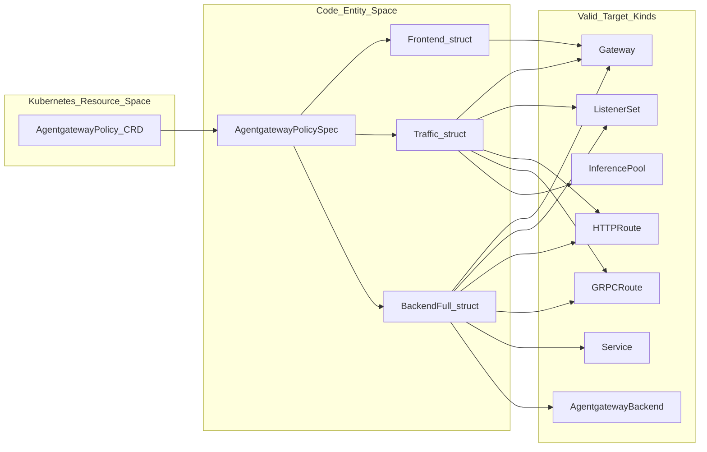
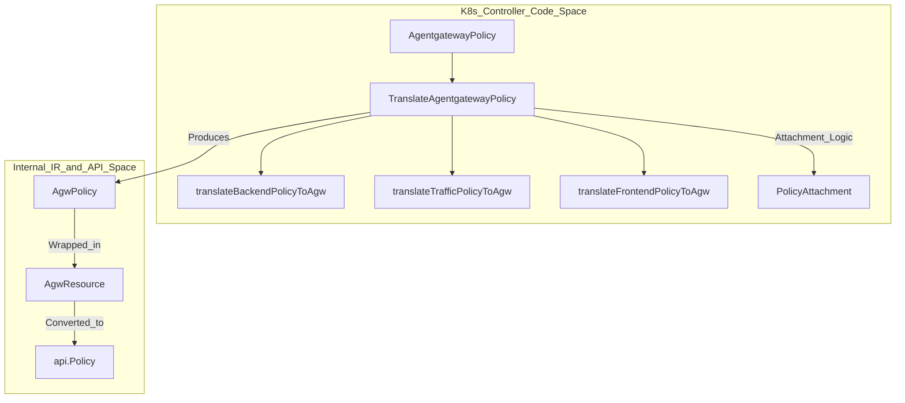

<!-- source: DeepWiki mcp.deepwiki.com · repo agentgateway/agentgateway · page 15.2 AgentgatewayPolicy CRD · fetched 2026-10-21 -->

# AgentgatewayPolicy CRD

<details>
<summary>Relevant source files</summary>

The following files were used as context for generating this wiki page:

- [controller/api/tests/testdata/agentgateway_policy_invalid.yaml](controller/api/tests/testdata/agentgateway_policy_invalid.yaml)
- [controller/api/tests/testdata/agentgateway_policy_valid.yaml](controller/api/tests/testdata/agentgateway_policy_valid.yaml)
- [controller/pkg/agentgateway/plugins/frontend_policies.go](controller/pkg/agentgateway/plugins/frontend_policies.go)

</details>


This page provides full technical documentation for the `AgentgatewayPolicy` Custom Resource Definition (CRD). It covers the YAML specification, core Go types, validation rules, target binding semantics, policy merge semantics, and the controller-side translation pipeline that converts Kubernetes policies into data-plane protobuf representations. For related resource definitions, see [15.3]() (`AgentgatewayBackend`) and [15.1]() (Controller Architecture). For standalone YAML policy configuration, see [4.4]().

Sources: [controller/api/v1alpha1/agentgateway/agentgateway_policy_types.go:1-52]()

---

## Overview

`AgentgatewayPolicy` is a namespaced custom resource in the `agentgateway.dev` API group (`agentgatewaypolicies`, short name `agpol`). It serves as the primary declarative interface for attaching traffic management, authentication, frontend transport, and backend connectivity policies to Gateway API resources (such as `Gateway`, `HTTPRoute`, `GRPCRoute`, `ListenerSet`) as well as `AgentgatewayBackend` and `Service` objects.

| Field | Value |
|---|---|
| API Group | `agentgateway.dev` |
| Kind | `AgentgatewayPolicy` |
| Plural | `agentgatewaypolicies` |
| Short name | `agpol` |
| Scope | Namespaced |
| Version | `v1alpha1` |
| Policy Type Label | `gateway.networking.k8s.io/policy=Direct` |

The Go type definition for `AgentgatewayPolicy` is located in `controller/api/v1alpha1/agentgateway/agentgateway_policy_types.go` [controller/api/v1alpha1/agentgateway/agentgateway_policy_types.go:29-45]().

Sources: [controller/api/v1alpha1/agentgateway/agentgateway_policy_types.go:1-52](), [controller/install/helm/agentgateway-crds/templates/agentgateway.dev_agentgatewaypolicies.yaml:2-37]()

---

## Spec Structure and Validation Rules

The top-level configuration container is `AgentgatewayPolicySpec` defined in `controller/api/v1alpha1/agentgateway/agentgateway_policy_types.go` [controller/api/v1alpha1/agentgateway/agentgateway_policy_types.go:36-39]().

```yaml
spec:
  targetRefs:        # or targetSelectors (mutually exclusive)
    - group: ...
      kind: ...
      name: ...
      sectionName: ...  # optional
  frontend:          # Gateway-level inbound settings
    ...
  traffic:           # Route/Gateway-level traffic processing
    ...
  backend:           # Backend connectivity settings
    ...
```

### CEL Validation Rules
Kubebuilder validation markers enforce structural correctness on `AgentgatewayPolicy` [controller/api/v1alpha1/agentgateway/agentgateway_policy_types.go:54-71]():
- Exactly one of `targetRefs` or `targetSelectors` must be provided.
- At least one policy block (`traffic`, `frontend`, or `backend`) must be specified.
- `strategy.inheritance` can only be set on traffic policies [controller/api/v1alpha1/agentgateway/agentgateway_policy_types.go:56]().
- `backend.mcp` and `backend.ai` cannot target raw Kubernetes `Service` objects [controller/api/v1alpha1/agentgateway/agentgateway_policy_types.go:57-59]().
- `frontend` policies can only target a `Gateway` resource [controller/api/v1alpha1/agentgateway/agentgateway_policy_types.go:62-63]().
- Connection-level frontend policies (`tcp`, `tls`, `http`, etc.) may only target a `Gateway` or port, not a specific listener `sectionName` [controller/api/v1alpha1/agentgateway/agentgateway_policy_types.go:64-65]().

Invalid configurations are rejected by the webhook validator, as demonstrated in test fixtures like `controller/api/tests/testdata/agentgateway_policy_invalid.yaml` [controller/api/tests/testdata/agentgateway_policy_invalid.yaml:1-11](). Valid configurations span properties such as `backend.tls`, `backend.tcp`, `backend.ai`, and `frontend.http` [controller/api/tests/testdata/agentgateway_policy_valid.yaml:1-292]().

Sources: [controller/api/v1alpha1/agentgateway/agentgateway_policy_types.go:53-116](), [controller/install/helm/agentgateway-crds/templates/agentgateway.dev_agentgatewaypolicies.yaml:58-80](), [controller/api/tests/testdata/agentgateway_policy_invalid.yaml:1-279](), [controller/api/tests/testdata/agentgateway_policy_valid.yaml:1-292]()

---

## Target References

Policies attach to resources via `targetRefs` or `targetSelectors`. Each reference specifies the target `group`, `kind`, `name`, and an optional `sectionName` or `port`.

### Target Kinds and Section Name Semantics

| Target Kind | Valid Policy Sections | `sectionName` Meaning |
|---|---|---|
| `Gateway` | `frontend`, `traffic`, `backend` | Listener name |
| `ListenerSet` | `traffic`, `backend` | Listener name |
| `HTTPRoute` / `GRPCRoute` | `traffic`, `backend` | Route rule name |
| `InferencePool` | `traffic`, `backend` | N/A |
| `Service` | `backend` | Numeric port (1-65535) |
| `AgentgatewayBackend` | `backend` | AI provider name or MCP target name |

### Target Targeting Matrix Diagram


Sources: [controller/api/v1alpha1/agentgateway/agentgateway_policy_types.go:53-116](), [controller/install/helm/agentgateway-crds/templates/agentgateway.dev_agentgatewaypolicies.yaml:61-75]()

---

## Policy Subsystems

### Frontend Policy (`frontend`)
`Frontend` configures inbound connection characteristics at the Gateway or port level. Handled in controller translation logic via functions such as `translateFrontendPolicyToAgw` [controller/pkg/agentgateway/plugins/frontend_policies.go:26-88]() and `translateFrontendTracing` [controller/pkg/agentgateway/plugins/frontend_policies.go:90-199]().
- **Connection/L4 Fields**: Resolved at bind time (`tcp`, `networkAuthorization`, `tls`, `http`, `proxyProtocol`, `connect`). These cannot use `sectionName` [controller/api/v1alpha1/agentgateway/agentgateway_policy_types.go:63-65]().
- **Observability Fields**: Resolved per listener (`accessLog`, `tracing`, `metrics`).
- Defined via structs in `zz_generated.deepcopy.go` [controller/api/v1alpha1/agentgateway/zz_generated.deepcopy.go:241-299]().

Sources: [controller/api/v1alpha1/agentgateway/agentgateway_policy_types.go:53-116](), [controller/api/v1alpha1/agentgateway/zz_generated.deepcopy.go:241-299](), [controller/pkg/agentgateway/plugins/frontend_policies.go:26-199]()

### Traffic Policy (`traffic`)
`Traffic` controls request processing logic and can operate in two phases:
- `PostRouting` (default): Executed after route resolution.
- `PreRouting`: Executed prior to routing (restricted to `Gateway` or `ListenerSet` targets) [controller/api/v1alpha1/agentgateway/agentgateway_policy_types.go:69-71]().
- Sub-components include `transformation`, `jwtAuthentication`, `authorization` (RBAC), `rateLimit`, `extAuth`, and `extProc` [controller/pkg/agentgateway/plugins/traffic_plugin.go:46-66]().

Sources: [controller/pkg/agentgateway/plugins/traffic_plugin.go:46-66](), [controller/api/v1alpha1/agentgateway/agentgateway_policy_types.go:67-70]()

### Backend Policy (`backend`)
`BackendFull` specifies upstream connectivity policies:
- `backend.ai`: LLM-specific configurations including `promptEnrichment`, `promptGuard`, `defaults`, `overrides`, and `modelAliases` [controller/api/v1alpha1/agentgateway/zz_generated.deepcopy.go:58-99]().
- `backend.mcp`: Model Context Protocol settings for `authentication`, `authorization`, and `guardrails` [controller/pkg/agentgateway/plugins/backend_policies.go:36-38]().
- `backend.auth`: Upstream credentials (`aws`, `azure`, `gcp`, or API keys) [controller/pkg/agentgateway/plugins/backend_policies.go:32]().

Sources: [controller/pkg/agentgateway/plugins/backend_policies.go:29-40](), [controller/install/helm/agentgateway-crds/templates/agentgateway.dev_agentgatewaypolicies.yaml:82-139]()

---

## Merge Semantics

When multiple policies apply to a single target resource or request path, configuration is merged on a **field-level (shallow) basis**, rather than a deep merge.

### Precedence Hierarchy
Precedence flows from least specific to most specific:
$$\text{Gateway} < \text{Listener} < \text{Route} < \text{Route Rule} < \text{Backend / Service}$$

If a `Gateway` policy sets connection parameters (`tcp`, `tls`) and a `Backend` policy overrides `tls`, the effective configuration combines `tcp` from the Gateway and the overridden `tls` from the Backend [controller/install/helm/agentgateway-crds/templates/agentgateway.dev_agentgatewaypolicies.yaml:71-80]().

Sources: [controller/install/helm/agentgateway-crds/templates/agentgateway.dev_agentgatewaypolicies.yaml:71-80]()

---

## Controller Implementation and Translation Pipeline

The Kubernetes controller watches `AgentgatewayPolicy` custom resources and translates them into internal data-plane protobuf messages (`api.Policy`).

### Translation Flow Diagram


Sources: [controller/pkg/agentgateway/plugins/traffic_plugin.go:99-120](), [controller/pkg/agentgateway/plugins/frontend_policies.go:26-88]()

### Key Functions and Components
- `NewAgentPlugin`: Initializes the plugin registration for `AgentgatewayPolicy` and wires up `krt` collections [controller/pkg/agentgateway/plugins/traffic_plugin.go:99-120]().
- `TranslateAgentgatewayPolicy`: Main entry point invoked by collection reconcilers to transform a policy resource into `AgwPolicy` items and compute `PolicyStatus` conditions [controller/pkg/agentgateway/plugins/traffic_plugin.go:104-109]().
- `translateFrontendPolicyToAgw`: Dispatches frontend translation sub-routines (e.g., `translateFrontendTracing`, `translateFrontendHTTP`) [controller/pkg/agentgateway/plugins/frontend_policies.go:26-88]().
- `translateBackendPolicyToAgw`: Iterates through `backend` fields (`HTTP`, `Tunnel`, `TLS`, `TCP`, `AI`, `MCP`, `Auth`) and generates corresponding `api.Policy` descriptors [controller/pkg/agentgateway/plugins/backend_policies.go:136-216]().

Sources: [controller/pkg/agentgateway/plugins/traffic_plugin.go:99-120](), [controller/pkg/agentgateway/plugins/traffic_plugin.go:178-185](), [controller/pkg/agentgateway/plugins/frontend_policies.go:26-88](), [controller/pkg/agentgateway/plugins/backend_policies.go:136-216]()

---

