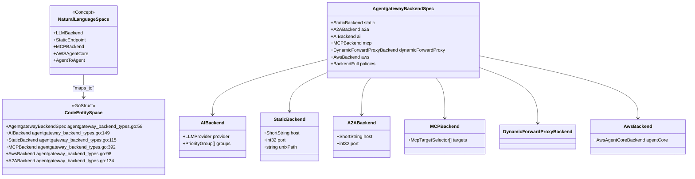
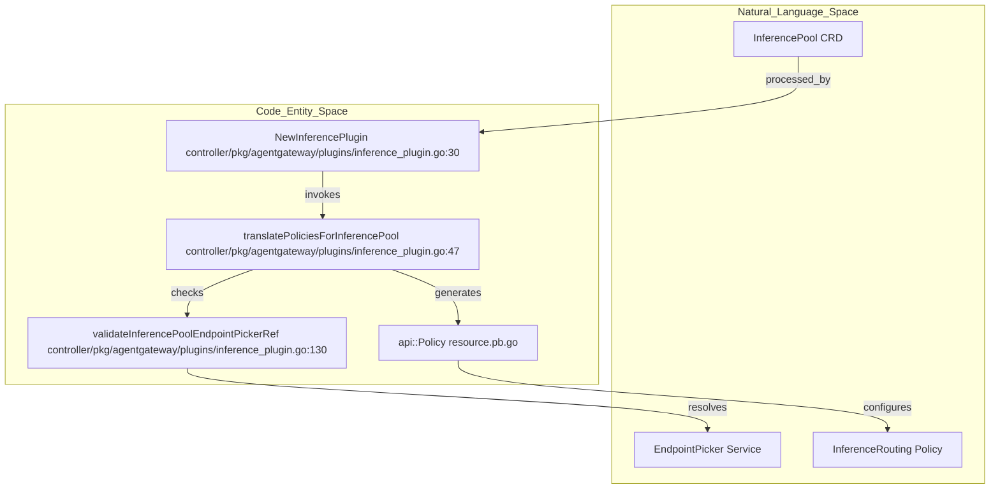
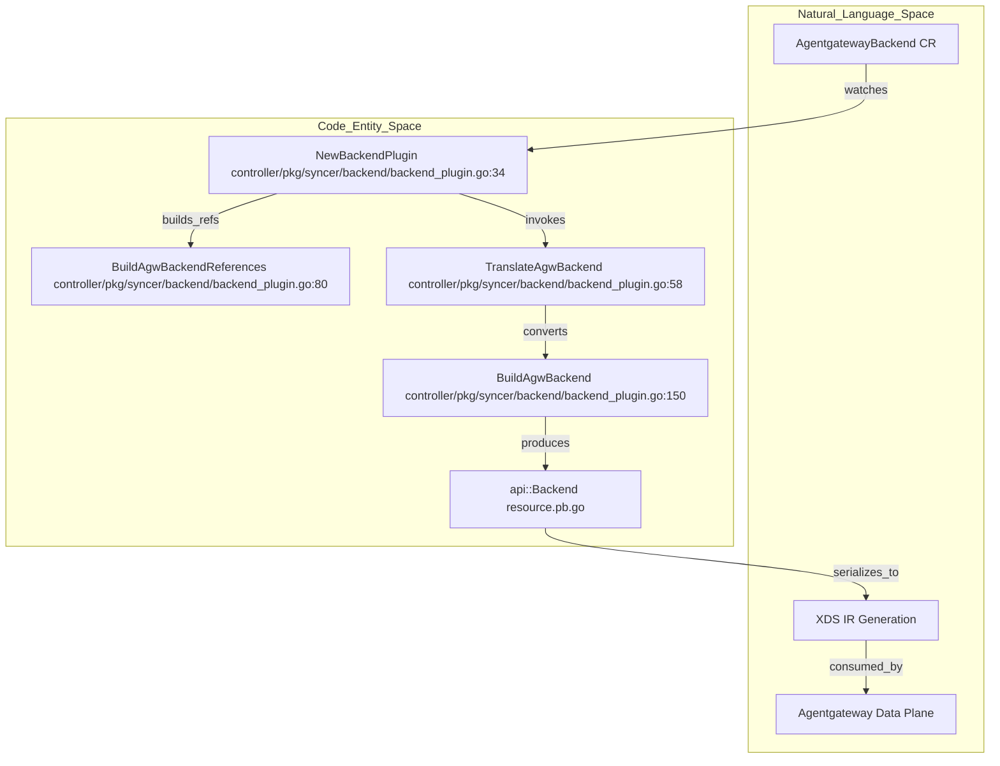

<!-- source: DeepWiki mcp.deepwiki.com · repo agentgateway/agentgateway · page 15.3 AgentgatewayBackend CRD · fetched 2026-10-21 -->

# AgentgatewayBackend CR

<details>
<summary>Relevant source files</summary>

The following files were used as context for generating this wiki page:

- [controller/api/tests/testdata/agentgateway_backend_invalid.yaml](controller/api/tests/testdata/agentgateway_backend_invalid.yaml)
- [controller/api/tests/testdata/agentgateway_backend_valid.yaml](controller/api/tests/testdata/agentgateway_backend_valid.yaml)
- [controller/api/tests/testdata/agentgateway_model_invalid.yaml](controller/api/tests/testdata/agentgateway_model_invalid.yaml)
- [controller/api/tests/testdata/agentgateway_model_valid.yaml](controller/api/tests/testdata/agentgateway_model_valid.yaml)
- [controller/api/v1alpha1/agentgateway/agentgateway_backend_types.go](controller/api/v1alpha1/agentgateway/agentgateway_backend_types.go)
- [controller/pkg/agentgateway/plugins/testdata/backendpolicy/backend-http-authorization.yaml](controller/pkg/agentgateway/plugins/testdata/backendpolicy/backend-http-authorization.yaml)
- [controller/pkg/syncer/backend/backend_plugin.go](controller/pkg/syncer/backend/backend_plugin.go)
- [controller/pkg/syncer/backend/backend_plugin_test.go](controller/pkg/syncer/backend/backend_plugin_test.go)
- [controller/pkg/syncer/backend/testdata/MultiPool_backend_-_translates_all_providers_for_failover.yaml](controller/pkg/syncer/backend/testdata/MultiPool_backend_-_translates_all_providers_for_failover.yaml)
- [crates/llm/src/bedrock.rs](crates/llm/src/bedrock.rs)
- [ui/src/pages/models/ProviderConfigEditor.tsx](ui/src/pages/models/ProviderConfigEditor.tsx)

</details>


This page is a complete reference for the `AgentgatewayBackend` custom resource. It covers the resource structure, all backend types (`ai`, `static`, `mcp`, `dynamicForwardProxy`, `aws`, `a2a`), their sub-fields, priority groups for AI backends, InferencePool backends, and how the controller translates them into data-plane configuration via the backend translation pipeline.

For policies that attach to a backend (auth, TLS, AI prompt guards, etc.), see the [AgentgatewayPolicy CRD](15.2). For how the controller reconciles these resources and pushes config to the data plane, see [Controller Architecture](15.1). For the data-plane handling of LLM and MCP backends, see [AI Gateway Architecture](8.1) and [MCP Overview](9.1).

---

## Resource Identity

| Field | Value |
|---|---|
| API Group | `agentgateway.dev` |
| Version | `v1alpha1` |
| Kind | `AgentgatewayBackend` |
| List Kind | `AgentgatewayBackendList` |
| Plural | `agentgatewaybackends` |
| Short Name | `agbe` |
| Category | `agentgateway` |
| Scope | Namespaced |

The Go type is defined in `AgentgatewayBackend` [controller/api/v1alpha1/agentgateway/agentgateway_backend_types.go:20-36]().

**Status columns** (visible via `kubectl get agbe`):

| Column | Source JSONPath | Description |
|---|---|---|
| `Accepted` | `.status.conditions[?(@.type=='Accepted')].status` | Whether the backend was accepted by the controller |
| `Age` | `.metadata.creationTimestamp` | Resource age |

Sources: [controller/api/v1alpha1/agentgateway/agentgateway_backend_types.go:9-23](), [controller/api/v1alpha1/agentgateway/agentgateway_backend_types.go:49-53]()

---

## Spec Overview

The `spec` is defined by `AgentgatewayBackendSpec` [controller/api/v1alpha1/agentgateway/agentgateway_backend_types.go:58-92](). Exactly **one** of the backend type fields must be set, enforced via Kubernetes CEL validation rules (`ExactlyOneOf`) [controller/api/v1alpha1/agentgateway/agentgateway_backend_types.go:55-57]().

```yaml
spec:
  ai:          # LLM backend and priority groups
  static:      # Static host:port or UDS backend
  mcp:         # Model Context Protocol backend
  aws:         # AWS service backend (e.g. Bedrock AgentCore)
  a2a:         # Agent-to-Agent protocol backend
  dynamicForwardProxy: # Forward based on Host header / SNI
  policies:    # Optional: backend-level policies (BackendFull)
```

**Top-level spec diagram bridging Natural Language Space to Code Entity Space:**

Title: AgentgatewayBackendSpec Structure Mapping


Sources: [controller/api/v1alpha1/agentgateway/agentgateway_backend_types.go:58-146](), [controller/api/v1alpha1/agentgateway/agentgateway_backend_types.go:149-182]()

---

## AI Backend and Priority Groups (`spec.ai`)

`AIBackend` [controller/api/v1alpha1/agentgateway/agentgateway_backend_types.go:149-182]() routes requests to LLM providers. It supports either a single `provider` configuration or multiple `groups` configured in priority order for failover and high availability.

### Priority Groups and Provider Selection
Each priority group defines a set of LLM providers. The group order determines the fallback sequence: if higher-priority groups fail or are unavailable, the gateway falls back to subsequent groups. Providers within the same group are load-balanced based on health and weighting. Provider names must be unique across all priority groups so that backend policies can target a specific provider using `targetRefs[].sectionName` [controller/api/v1alpha1/agentgateway/agentgateway_backend_types.go:157-161]().

An example of an AI backend with two priority groups:
```yaml
spec:
  ai:
    groups:
    - providers:
      - azureopenai:
          deploymentName: gpt-4o-mini
          apiVersion: 2024-02-15-preview
          endpoint: ai-gateway.openai.azure.com
    - providers:
      - azureopenai:
          deploymentName: gpt-4o-mini-2
          apiVersion: 2024-02-15-preview
          endpoint: ai-gateway-2.openai.azure.com
          policies:
            auth:
              secretRef:
                name: azure-secret
```
Sources: [controller/api/v1alpha1/agentgateway/agentgateway_backend_types.go:149-182](), [controller/api/v1alpha1/agentgateway/agentgateway_backend_types.go:163-181]()

### AI Policies and Prompt Management
AI backends support extensive inline policies including prompt enrichment (`AIPromptEnrichment`) which prepends or appends system messages, prompt guards (regex, webhook, OpenAI moderation, Bedrock guardrails, Google Model Armor), and prompt caching. The controller translates these structures via `processPromptEnrichment` and related guard processors.

Sources: [controller/api/v1alpha1/agentgateway/agentgateway_backend_types.go:149-182](), [controller/api/tests/testdata/agentgateway_backend_valid.yaml:25-58]()

---

## MCP Backend (`spec.mcp`)

`MCPBackend` [controller/api/v1alpha1/agentgateway/agentgateway_backend_types.go:392-411]() manages Model Context Protocol (MCP) servers and transports (such as Streamable HTTP, SSE, or Stdio).

### Target Resolution and Selector Matching
MCP targets can be defined explicitly via static endpoints or dynamically via `McpTargetSelector` using Kubernetes Service and Namespace selectors [controller/api/v1alpha1/agentgateway/agentgateway_backend_types.go:420-435](). The controller evaluates these selectors against Kubernetes services annotated with `agentgateway.dev/mcp` or legacy annotations [controller/pkg/syncer/backend/backend_plugin_test.go:129-173]() to construct upstream MCP routing entries.

Example of an MCP backend with static and selector targets:
```yaml
spec:
  mcp:
    prefixMode: Never
    targets:
    - name: everything
      static:
        host: example.com
        port: 443
        policies:
          tls: {}
    - name: k8s
      selector:
        namespaces:
          matchLabels:
            kubernetes.io/metadata.name: mcp-servers
```
Sources: [controller/api/v1alpha1/agentgateway/agentgateway_backend_types.go:392-435](), [controller/pkg/syncer/backend/backend_plugin_test.go:129-173](), [controller/api/tests/testdata/agentgateway_backend_valid.yaml:86-98]()

---

## InferencePool Backends and Integration

The controller integrates natively with the Gateway API Inference Extension via `InferencePool` resources. This allows `AgentgatewayBackend` to reference `InferencePool` objects for custom AI provider configurations.

An `AIBackend` can specify a `custom` provider that references an `InferencePool`:
```yaml
spec:
  ai:
    provider:
      custom:
        backendRef:
          group: inference.networking.k8s.io
          kind: InferencePool
          name: llama-pool
        formats:
        - type: Completions
```
This configuration allows the Agentgateway to route AI requests to an `InferencePool` managed by the Inference Extension.

### InferencePool Translation Flow Diagram bridging Natural Language Space to Code Entity Space

Title: InferencePool Translation Architecture


Sources: [controller/api/tests/testdata/agentgateway_backend_valid.yaml:193-207](), [controller/pkg/agentgateway/plugins/inference_plugin.go:30-143]()

---

## Other Backend Types (`static`, `a2a`, `aws`, `dynamicForwardProxy`)

- **Static Backend (`spec.static`)**: Configures direct TCP endpoints (`host` and `port`) or Unix Domain Sockets (`unixPath`) with mutual exclusivity validation [controller/api/v1alpha1/agentgateway/agentgateway_backend_types.go:115-133]().
  ```yaml
  spec:
    static:
      host: example.com
      port: 443
  ```
- **A2A Backend (`spec.a2a`)**: Agent-to-Agent protocol communication endpoints [controller/api/v1alpha1/agentgateway/agentgateway_backend_types.go:134-146](), supported via `NewA2APlugin`.
  ```yaml
  spec:
    a2a:
      host: a2a-service.default.svc.cluster.local
      port: 8080
  ```
- **AWS Backend (`spec.aws`)**: Supports Amazon Bedrock AgentCore runtimes via `AwsAgentCoreBackend` [controller/api/v1alpha1/agentgateway/agentgateway_backend_types.go:98-113]().
  ```yaml
  spec:
    aws:
      agentCore:
        agentRuntimeArn: arn:aws:bedrock:us-east-1:123456789012:agent/ABCDEFG
        qualifier: DRAFT
  ```
  The `endpointPreference` field in Bedrock provider configuration [crates/llm/src/bedrock.rs:13-19]() allows specifying whether to prefer the Bedrock Runtime or Mantle endpoints. This can be `RuntimePreferred`, `MantlePreferred`, `MantleOnly`, or `RuntimeOnly`.
  ```yaml
  spec:
    ai:
      provider:
        bedrock:
          endpointPreference: RuntimePreferred
          guardrail:
            identifier: test-guardrail
            version: "1"
  ```
  Sources: [controller/api/tests/testdata/agentgateway_backend_valid.yaml:226-269](), [crates/llm/src/bedrock.rs:13-19]()
- **Dynamic Forward Proxy (`spec.dynamicForwardProxy`)**: Routes requests dynamically based on incoming HTTP host headers or TLS SNI [controller/api/v1alpha1/agentgateway/agentgateway_backend_types.go:74-95]().
  ```yaml
  spec:
    dynamicForwardProxy: {}
  ```

Sources: [controller/api/v1alpha1/agentgateway/agentgateway_backend_types.go:74-146](), [controller/pkg/syncer/backend/backend_plugin.go:160-175](), [controller/api/tests/testdata/agentgateway_backend_valid.yaml:103-115]()

---

## Backend Translation Pipeline

The controller uses a plugin-based architecture to translate `AgentgatewayBackend` and related custom resources into XDS-compatible Intermediate Representation (`api::Backend`).

### Translation Data Flow Diagram



### Key Functions
- `NewBackendPlugin`: Registers backend translation handlers for `AgentgatewayBackend` and `XBackend` [controller/pkg/syncer/backend/backend_plugin.go:34-78]().
- `BuildAgwBackendReferences`: Extracts backend dependencies (such as underlying `Service` or `Secret` references) for policy attachment indexing [controller/pkg/syncer/backend/backend_plugin.go:80-128](). This function also appends references for LLM providers [controller/pkg/syncer/backend/backend_plugin.go:102-104]() and MCP targets [controller/pkg/syncer/backend/backend_plugin.go:118-126]().
- `BuildAgwBackend`: Translates backend specs into protobuf `api::Backend` structures supporting static endpoints, AI provider groups, and MCP targets [controller/pkg/syncer/backend/backend_plugin.go:150-177]().

Sources: [controller/pkg/syncer/backend/backend_plugin.go:34-177]()

---

