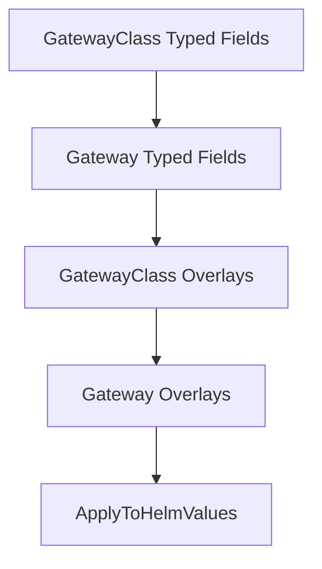
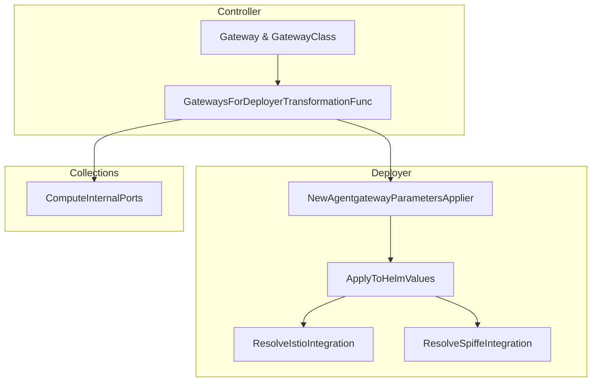

<!-- source: DeepWiki mcp.deepwiki.com · repo agentgateway/agentgateway · page 15.4 AgentgatewayParameters CRD · fetched 2026-10-21 -->

# AgentgatewayParameters CRD

Relevant source files

The following files were used as context for generating this wiki page:

- [controller/api/annotations/agentgateway.go](controller/api/annotations/agentgateway.go)
- [controller/api/annotations/agentgateway_test.go](controller/api/annotations/agentgateway_test.go)
- [controller/api/v1alpha1/agentgateway/agentgateway_parameters_types.go](controller/api/v1alpha1/agentgateway/agentgateway_parameters_types.go)
- [controller/hack/testbox/llm.go](controller/hack/testbox/llm.go)
- [controller/install/helm/agentgateway-crds/templates/agentgateway.dev_agentgatewayparameters.yaml](controller/install/helm/agentgateway-crds/templates/agentgateway.dev_agentgatewayparameters.yaml)
- [controller/pkg/agentgateway/translator/testdata/gateways/internal-bind-disagreement.yaml](controller/pkg/agentgateway/translator/testdata/gateways/internal-bind-disagreement.yaml)
- [controller/pkg/agentgateway/translator/testdata/gateways/internal-bind-invalid.yaml](controller/pkg/agentgateway/translator/testdata/gateways/internal-bind-invalid.yaml)
- [controller/pkg/agentgateway/translator/testdata/gateways/internal-bind-listenerset-conflict.yaml](controller/pkg/agentgateway/translator/testdata/gateways/internal-bind-listenerset-conflict.yaml)
- [controller/pkg/agentgateway/translator/testdata/gateways/internal-bind-listenerset.yaml](controller/pkg/agentgateway/translator/testdata/gateways/internal-bind-listenerset.yaml)
- [controller/pkg/agentgateway/translator/testdata/gateways/internal-bind.yaml](controller/pkg/agentgateway/translator/testdata/gateways/internal-bind.yaml)
- [controller/pkg/deployer/agentgateway_parameters.go](controller/pkg/deployer/agentgateway_parameters.go)
- [controller/pkg/deployer/agentgateway_parameters_test.go](controller/pkg/deployer/agentgateway_parameters_test.go)
- [controller/pkg/deployer/values_helpers.go](controller/pkg/deployer/values_helpers.go)
- [controller/pkg/helm/agentgateway/templates/_helpers.tpl](controller/pkg/helm/agentgateway/templates/_helpers.tpl)
- [controller/pkg/helm/agentgateway/templates/configmap.yaml](controller/pkg/helm/agentgateway/templates/configmap.yaml)
- [controller/pkg/helm/agentgateway/templates/deployment.yaml](controller/pkg/helm/agentgateway/templates/deployment.yaml)
- [controller/pkg/pluginsdk/collections/deployer.go](controller/pkg/pluginsdk/collections/deployer.go)
- [controller/pkg/pluginsdk/collections/deployer_internalports_test.go](controller/pkg/pluginsdk/collections/deployer_internalports_test.go)
- [controller/pkg/syncer/backend/mcp.go](controller/pkg/syncer/backend/mcp.go)
- [controller/pkg/syncer/backend/testdata/Service_selector_MCPBackend_backend_-_target_name_annotation.yaml](controller/pkg/syncer/backend/testdata/Service_selector_MCPBackend_backend_-_target_name_annotation.yaml)
- [controller/test/deployer/internal_helm_test.go](controller/test/deployer/internal_helm_test.go)
- [controller/test/deployer/testdata/agentgateway-istio-additional-trust-domains-out.yaml](controller/test/deployer/testdata/agentgateway-istio-additional-trust-domains-out.yaml)
- [controller/test/deployer/testdata/agentgateway-istio-additional-trust-domains.yaml](controller/test/deployer/testdata/agentgateway-istio-additional-trust-domains.yaml)
- [controller/test/deployer/testdata/agentgateway-istio-noparams-out.yaml](controller/test/deployer/testdata/agentgateway-istio-noparams-out.yaml)
- [controller/test/deployer/testdata/agentgateway-model-catalog-configmap-out.yaml](controller/test/deployer/testdata/agentgateway-model-catalog-configmap-out.yaml)
- [controller/test/e2e/testdata/modelcatalog/alt-catalog.yaml](controller/test/e2e/testdata/modelcatalog/alt-catalog.yaml)
- [controller/test/e2e/testdata/modelcatalog/setup.yaml](controller/test/e2e/testdata/modelcatalog/setup.yaml)
- [controller/test/e2e/testdata/modelcatalog/updated-catalog.yaml](controller/test/e2e/testdata/modelcatalog/updated-catalog.yaml)

This page provides full technical detail on the `AgentgatewayParameters` custom resource definition (CRD), its schema, controller settings, and integration with the deployment engine for managing agentgateway data plane workloads.

---

## Purpose and Scope

`AgentgatewayParameters` is a namespaced CRD in the `agentgateway.dev` group that defines configuration used to dynamically provision the agentgateway data plane `[controller/api/v1alpha1/agentgateway/agentgateway_parameters_types.go:12-17]()`. It controls how the Go controller provisions the agentgateway data plane `Deployment` or `DaemonSet` (along with supporting resources like `Service` and `ServiceAccount`) for a given `Gateway`. 

The CRD serves two major roles:
1. **Typed Configuration** — structured fields for core runtime settings (workloads, images, resource requirements, environment variables, logging formats, Istio/SPIFFE integrations, and model catalogs).
2. **Resource Overlays** — opaque Strategic Merge Patch blocks that allow direct customization of rendered Kubernetes resources.

A single `AgentgatewayParameters` object can be referenced from a `GatewayClass` (via `spec.parametersRef`) or from an individual `Gateway` (via `spec.infrastructure.parametersRef`). Both levels are resolved, merged, and applied by the controller's deployer before helm chart rendering `[controller/test/deployer/internal_helm_test.go:3-22]()`.

Sources: `[controller/api/v1alpha1/agentgateway/agentgateway_parameters_types.go:12-40]()`, `[controller/test/deployer/internal_helm_test.go:3-22]()`

---

## Resource Identity

| Field | Value |
|---|---|
| API Group | `agentgateway.dev` |
| Kind | `AgentgatewayParameters` |
| Plural | `agentgatewayparameters` |
| Short Name | `agpar` |
| Scope | Namespaced |
| Version | `v1alpha1` |

Sources: `[controller/api/v1alpha1/agentgateway/agentgateway_parameters_types.go:21-29]()`

---

## Spec Structure

The `AgentgatewayParameters` spec combines typed configuration collections with overlay specifications `[controller/api/v1alpha1/agentgateway/agentgateway_parameters_types.go:53-56]()`.

**Diagram: AgentgatewayParametersSpec Code Structure**

```mermaid
graph TD
  AgentgatewayParametersSpec["AgentgatewayParametersSpec"] --> AgentgatewayParametersConfigs["AgentgatewayParametersConfigs"]
  AgentgatewayParametersSpec --> AgentgatewayParametersOverlays["AgentgatewayParametersOverlays"]

  subgraph "TypedConfiguration"
    AgentgatewayParametersConfigs --> workload["AgentgatewayParametersWorkload"]
    AgentgatewayParametersConfigs --> image["Image"]
    AgentgatewayParametersConfigs --> resources["corev1.ResourceRequirements"]
    AgentgatewayParametersConfigs --> logging["AgentgatewayParametersLogging"]
    AgentgatewayParametersConfigs --> istio["IstioSpec"]
    AgentgatewayParametersConfigs --> spiffe["SpiffeSpec"]
    AgentgatewayParametersConfigs --> rawConfig["apiextensionsv1.JSON"]
    AgentgatewayParametersConfigs --> env["[]corev1.EnvVar"]
    AgentgatewayParametersConfigs --> modelCatalog["ModelCatalog"]
    AgentgatewayParametersConfigs --> shutdown["Shutdown"]
  end

  subgraph "ResourceOverlays"
    AgentgatewayParametersOverlays --> deployment["KubernetesResourceOverlay (Deployment)"]
    AgentgatewayParametersOverlays --> daemonSet["KubernetesResourceOverlay (DaemonSet)"]
    AgentgatewayParametersOverlays --> service["KubernetesResourceOverlay (Service)"]
    AgentgatewayParametersOverlays --> serviceAccount["KubernetesResourceOverlay (ServiceAccount)"]
    AgentgatewayParametersOverlays --> hpa["HorizontalPodAutoscaler"]
  end
```

Sources: `[controller/api/v1alpha1/agentgateway/agentgateway_parameters_types.go:53-193]()`

---

### Typed Configuration Fields (`AgentgatewayParametersConfigs`)

Typed fields offer schema-validated configuration options that get translated into Helm values and translated config maps `[controller/api/v1alpha1/agentgateway/agentgateway_parameters_types.go:102-145]()`.

| Field | Type | Description |
|---|---|---|
| `workload` | `AgentgatewayParametersWorkload` | Selects Kubernetes workload kind: `Deployment` (default) or `DaemonSet` `[controller/api/v1alpha1/agentgateway/agentgateway_parameters_types.go:84-89]()`. |
| `logging` | `AgentgatewayParametersLogging` | Configures logging `level` (`RUST_LOG` syntax) and `format` (`json`/`text`) `[controller/api/v1alpha1/agentgateway/agentgateway_parameters_types.go:91-100]()`. |
| `rawConfig` | `apiextensionsv1.JSON` | Arbitrary raw configuration to merge directly into the data plane config file `[controller/api/v1alpha1/agentgateway/agentgateway_parameters_types.go:145]()`. |
| `image` | `Image` | Container image fields (`registry`, `repository`, `tag`, `pullPolicy`, `digest`) `[controller/api/v1alpha1/agentgateway/agentgateway_parameters_types.go:159-160]()`. |
| `env` | `[]corev1.EnvVar` | Container environment variables. Explicit values override defaults `[controller/api/v1alpha1/agentgateway/agentgateway_parameters_types.go:161-171]()`. |
| `resources` | `corev1.ResourceRequirements` | Compute resources (CPU/memory `requests` and `limits`) for the agentgateway container `[controller/api/v1alpha1/agentgateway/agentgateway_parameters_types.go:174-175]()`. |
| `istio` | `IstioSpec` | Istio integration settings, including `enabled`, `caAddress`, `trustDomain`, `clusterId`, `network`, and `additionalTrustDomains` `[controller/api/v1alpha1/agentgateway/agentgateway_parameters_types.go:178-179]()`. |
| `spiffe` | `SpiffeSpec` | SPIFFE integration settings, including `enabled` and `socketPath` `[controller/api/v1alpha1/agentgateway/agentgateway_parameters_types.go:182-183]()`. |
| `modelCatalog` | `ModelCatalog` | Configuration for model catalog sources `[controller/api/v1alpha1/agentgateway/agentgateway_parameters_types.go:186-187]()`. |
| `shutdown` | `Shutdown` | Graceful shutdown configuration `[controller/api/v1alpha1/agentgateway/agentgateway_parameters_types.go:190-191]()`. |

Sources: `[controller/api/v1alpha1/agentgateway/agentgateway_parameters_types.go:57-193]()`

---

### Overlay Fields (`AgentgatewayParametersOverlays`)

Overlay fields enable direct Strategic Merge Patch modifications on rendered resources `[controller/test/deployer/internal_helm_test.go:3-22]()`.

| Overlay Field | Target Resource | Notes |
|---|---|---|
| `deployment` | `Deployment` | Valid only when `workload.kind` is `Deployment` or unset `[controller/api/v1alpha1/agentgateway/agentgateway_parameters_types.go:50]()`. |
| `daemonSet` | `DaemonSet` | Valid only when `workload.kind` is `DaemonSet` `[controller/api/v1alpha1/agentgateway/agentgateway_parameters_types.go:51]()`. |
| `horizontalPodAutoscaler` | `HorizontalPodAutoscaler` | Invalid when `workload.kind` is `DaemonSet` `[controller/api/v1alpha1/agentgateway/agentgateway_parameters_types.go:52]()`. |
| `service` | `Service` | Overrides for the generated `Service` resource `[controller/api/v1alpha1/agentgateway/agentgateway_parameters_types.go:290-291]()`. |
| `serviceAccount` | `ServiceAccount` | Overrides for the generated `ServiceAccount` resource `[controller/api/v1alpha1/agentgateway/agentgateway_parameters_types.go:300-301]()`. |

Sources: `[controller/api/v1alpha1/agentgateway/agentgateway_parameters_types.go:50-53]()`, `[controller/test/deployer/internal_helm_test.go:3-22]()`, `[controller/api/v1alpha1/agentgateway/agentgateway_parameters_types.go:290-301]()`

---

## Merge Order and Resolution

When parameters are defined at both `GatewayClass` and `Gateway` levels, the controller performs deep-copy merging followed by sequential overlay application `[controller/install/helm/agentgateway-crds/templates/agentgateway.dev_agentgatewayparameters.yaml:94-98]()`.

**Diagram: ParameterMergeOrder**

Sources: `[controller/install/helm/agentgateway-crds/templates/agentgateway.dev_agentgatewayparameters.yaml:94-98]()`, `[controller/pkg/deployer/agentgateway_parameters.go:129-179]()`

### Strategic Merge Patch Mechanism
- **Scalar Replacement**: Simple fields (strings, integers, booleans) in the config will overwrite the generated defaults.
- **List Merging**: Lists with "merge keys", like `containers` which merges on `name`, or `tolerations` which merges on `key`, will append items to the generated list, or update existing items if keys match.
- **Explicit Deletion**: To remove a field or list item from the generated resource, use the `$patch: delete` directive. This works for both map fields and list items, and is the recommended approach because it works with both client-side and server-side apply `[controller/install/helm/agentgateway-crds/templates/agentgateway.dev_agentgatewayparameters.yaml:108-119]()`.
- **Null Values**: Setting a field to `null` can also remove it, but this ONLY works with `kubectl apply --server-side` or equivalent. With regular client-side `kubectl apply`, null values are stripped by kubectl before reaching the API server, so the deletion won't occur. Prefer `$patch: delete` for consistent behavior across both apply modes `[controller/install/helm/agentgateway-crds/templates/agentgateway.dev_agentgatewayparameters.yaml:120-125]()`.

Sources: `[controller/test/deployer/internal_helm_test.go:3-22]()`, `[controller/install/helm/agentgateway-crds/templates/agentgateway.dev_agentgatewayparameters.yaml:101-125]()`

---

## Internal Ports and Session Key Management

### Internal Ports (`ComputeInternalPorts`)
Ports can be marked as internal (routing-only sockets without an external listener or container port) using the `agentgateway.dev/internal-ports` annotation on a `Gateway` or `ListenerSet` `[controller/pkg/pluginsdk/collections/deployer.go:178-181]()`. The `ComputeInternalPorts` function `[controller/pkg/pluginsdk/collections/deployer.go:100-170]()` determines which ports are internal. It handles precedence: Gateway listeners take priority over ListenerSets. ListenerSets are ordered by creation timestamp (oldest first), then by namespace/name, to resolve conflicts `[controller/pkg/pluginsdk/collections/deployer.go:95-99]()`.

Sources: `[controller/pkg/pluginsdk/collections/deployer.go:95-181]()`, `[controller/api/annotations/agentgateway.go:25-61]()`

### Session Key Injection
The deployer provisions a managed `SESSION_KEY` secret used by the data plane for stateful features (e.g., MCP session encoding) `[controller/pkg/deployer/agentgateway_parameters.go:30-30]()`. This secret is mounted as an environment variable in the agentgateway container `[controller/test/deployer/testdata/agentgateway-model-catalog-configmap-out.yaml:113-117]()`. Explicitly specifying `SESSION_KEY` within `env` in `AgentgatewayParameters` overrides this default behavior `[controller/api/v1alpha1/agentgateway/agentgateway_parameters_types.go:171-173]()`.

Sources: `[controller/pkg/deployer/agentgateway_parameters.go:30-30]()`, `[controller/api/v1alpha1/agentgateway/agentgateway_parameters_types.go:171-173]()`, `[controller/test/deployer/testdata/agentgateway-model-catalog-configmap-out.yaml:113-117]()`

---

## Istio and SPIFFE Integration

The `AgentgatewayParametersApplier` includes logic to resolve and apply Istio and SPIFFE integration settings.

### Istio Integration (`ResolveIstioIntegration`)
The `istioEnabledForGateway` function `[controller/pkg/deployer/agentgateway_parameters.go:60-71]()` determines if Istio integration is enabled for a given Gateway, considering explicit `spec.istio.enabled` settings and control-plane defaults. If enabled, `ResolveIstioIntegration` `[controller/pkg/deployer/agentgateway_parameters.go:77-111]()` populates unset Istio-related fields (e.g., `ClusterId`, `Network`, `CaAddress`) from controller-level settings and infers the `TrustDomain` from mesh configuration. If disabled, the Istio block is cleared to prevent rendering Istio-related configurations in the deployment `[controller/pkg/deployer/agentgateway_parameters.go:82-83]()`.

Sources: `[controller/pkg/deployer/agentgateway_parameters.go:60-111]()`, `[controller/test/deployer/testdata/agentgateway-istio-noparams-out.yaml:139-146]()`

### SPIFFE Integration (`ResolveSpiffeIntegration`)
The `ResolveSpiffeIntegration` function `[controller/pkg/deployer/agentgateway_parameters.go:117-124]()` handles SPIFFE settings. If `spec.spiffe.enabled` is explicitly set to `false`, the SPIFFE block is cleared, ensuring no socket mount or SPIFFE environment variables are rendered in the Helm template `[controller/pkg/deployer/agentgateway_parameters.go:121-123]()`.

Sources: `[controller/pkg/deployer/agentgateway_parameters.go:117-124]()`

---

## Code Entities Involved

**Diagram: AGWPIntensityProcessingFlow**

Sources: `[controller/pkg/pluginsdk/collections/deployer.go:34-93]()`, `[controller/pkg/deployer/agentgateway_parameters.go:37-179]()`

| Code Entity | File Path | Role |
|---|---|---|
| `AgentgatewayParameters` | `[controller/api/v1alpha1/agentgateway/agentgateway_parameters_types.go:24-38]()` | Root CRD Go type definition. |
| `AgentgatewayParametersApplier` | `[controller/pkg/deployer/agentgateway_parameters.go:37-40]()` | Applies parameters and configuration overlays to Helm configs. |
| `ComputeInternalPorts` | `[controller/pkg/pluginsdk/collections/deployer.go:100-170]()` | Determines routing-only internal ports from annotations. |
| `ResolveIstioIntegration` | `[controller/pkg/deployer/agentgateway_parameters.go:77-111]()` | Finalizes Istio integration settings for the gateway. |
| `ResolveSpiffeIntegration` | `[controller/pkg/deployer/agentgateway_parameters.go:117-124]()` | Finalizes SPIFFE integration settings for the gateway. |
| `TestRenderHelmChart` | `[controller/test/deployer/internal_helm_test.go:50-100]()` | Test suite validating helm chart rendering and strategic-merge overlays. |

Sources: `[controller/api/v1alpha1/agentgateway/agentgateway_parameters_types.go:24-38]()`, `[controller/pkg/deployer/agentgateway_parameters.go:37-40]()`, `[controller/pkg/pluginsdk/collections/deployer.go:100-170]()`, `[controller/pkg/deployer/agentgateway_parameters.go:77-111]()`, `[controller/pkg/deployer/agentgateway_parameters.go:117-124]()`, `[controller/test/deployer/internal_helm_test.go:50-100]()`

---

