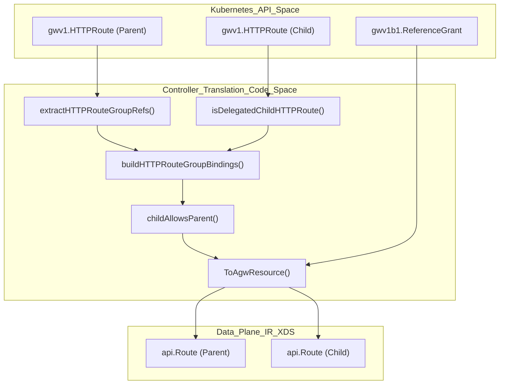
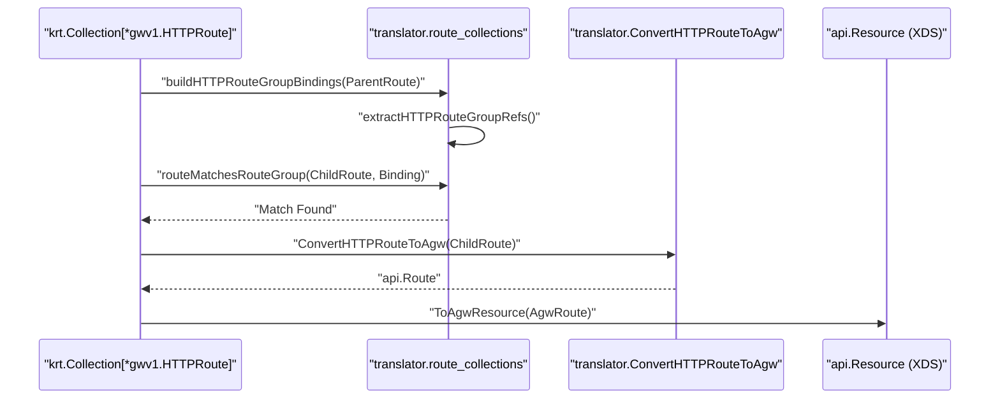

<!-- source: DeepWiki mcp.deepwiki.com · repo agentgateway/agentgateway · page 15.5 Route Delegation in Kubernetes · fetched 2026-10-21 -->

# Route Delegation in Kubernetes

Relevant source files

The following files were used as context for generating this wiki page:

- [controller/pkg/agentgateway/translator/agw.go](controller/pkg/agentgateway/translator/agw.go)
- [controller/pkg/agentgateway/translator/agw_test.go](controller/pkg/agentgateway/translator/agw_test.go)
- [controller/pkg/agentgateway/translator/gateway_collection_test.go](controller/pkg/agentgateway/translator/gateway_collection_test.go)
- [controller/pkg/agentgateway/translator/option.go](controller/pkg/agentgateway/translator/option.go)
- [controller/pkg/agentgateway/translator/option_test.go](controller/pkg/agentgateway/translator/option_test.go)
- [controller/pkg/agentgateway/translator/testdata/routes/httproute-backend-url-rewrite.yaml](controller/pkg/agentgateway/translator/testdata/routes/httproute-backend-url-rewrite.yaml)
- [controller/pkg/agentgateway/translator/testdata/routes/httproute-path-prefix-regex.yaml](controller/pkg/agentgateway/translator/testdata/routes/httproute-path-prefix-regex.yaml)
- [controller/pkg/syncer/listenerset_contribution_test.go](controller/pkg/syncer/listenerset_contribution_test.go)
- [controller/pkg/syncer/listenerset_option_test.go](controller/pkg/syncer/listenerset_option_test.go)
- [controller/pkg/syncer/option.go](controller/pkg/syncer/option.go)

This page details the HTTPRoute delegation pattern implemented in the `agentgateway` Kubernetes controller. It covers parent-child route relationships, route groups, cross-namespace delegation via `ReferenceGrant`, and policy composition along the delegation chain.

---

## 1. Overview of Delegation

Route delegation allows for hierarchical composition of `HTTPRoute` resources, enabling a parent route to delegate request handling for specific paths or hostnames to child routes. This pattern is essential for multi-tenant environments where a central platform team manages the Gateway and top-level routing, while individual application teams manage sub-paths.

### Key Components
*   **Parent Route**: An `HTTPRoute` that references another `HTTPRoute` in its `backendRefs` [controller/pkg/agentgateway/translator/agw.go:206-219]().
*   **Child Route**: An `HTTPRoute` that is either orphaned (no `parentRefs`) or explicitly references a parent `HTTPRoute`.
*   **RouteGroup**: An internal abstraction used to group child routes that match a delegation selector (e.g., a wildcard `*` or label selector).
*   **ReferenceGrant**: Required for cross-namespace delegation to authorize the parent route to interact with child routes in a different namespace.

Sources: [controller/pkg/agentgateway/translator/agw.go:206-219]()

---

## 2. Delegation Translation Flow

The translation process converts the Kubernetes `HTTPRoute` hierarchy into a flattened set of `api.Route` objects for the data plane. The `translator` package processes these resources using `krt` (Kubernetes Runtime) collections to maintain a reactive dependency graph.

### Data Flow Diagram: Route Delegation Translation

This diagram bridges natural language concepts to concrete code entities in the `translator` package:

Sources: [controller/pkg/agentgateway/translator/agw.go:18-203]()

---

## 3. Implementation Details

### Parent-Child Relationships
The controller identifies delegation by inspecting `HTTPRouteRule.BackendRefs`. If a reference points to a Group/Kind of `gateway.networking.k8s.io/HTTPRoute`, it is treated as a delegation point.

Child routes are validated using two primary checks:
1.  **Orphan or Explicit**: A route can be a child if it has no parents (it "adopts" the delegator) or if it explicitly lists the parent `HTTPRoute` in its `parentRefs`.
2.  **Parent Authorization**: The function `childAllowsParent` ensures that if a child route specifies `parentRefs`, the actual parent matches one of those references. If it is parentless and in a different namespace, a `ReferenceGrant` is checked via `ParentlessHTTPRouteAllowed`.

### Route Groups and Keys
To handle selectors like `name: "*"` (delegate to all routes in a namespace) or label selectors (e.g., `app=primary`), the controller uses route group binding keys.

| Field | Description |
| :--- | :--- |
| `Source` | The `NamespacedName` of the parent route. |
| `Namespace` | The target namespace of the child routes. |
| `Name` | The name of the child route, or `*` for wildcard, or `key=value` for label matching. |
| `ServiceKey` | Links a parent reference to an individual Service. |

The resulting `api.Route` for a child contains a `Key` which includes the rule position and internal route identifiers, generated via `delegatedRouteKey` to ensure uniqueness.

### Cross-Namespace Delegation
Cross-namespace delegation is protected by `ReferenceGrant`. The `AllowedListenersResolver` type [controller/pkg/syncer/option.go:91-92]() and its usage in `WithAllowedListenersResolver` [controller/pkg/syncer/option.go:94-103]() are relevant for how listeners are allowed to attach to Gateways, which indirectly affects cross-namespace routing. The `joinExtraListenerSets` function [controller/pkg/syncer/listenerset_option.go:95-96]() in the syncer processes `ListenerSet` resources, including those contributed from external sources, and applies `AllowedListeners` policies. This ensures that only authorized listeners (and by extension, routes) can attach to a Gateway, which is a prerequisite for cross-namespace delegation. Test cases like `TestJoinExtraListenerSetsHonoursNamespaceSelector` [controller/pkg/syncer/listenerset_option.go:123-131]() demonstrate how namespace selectors are honored for contributed listener sets, which is analogous to how `ReferenceGrant` would authorize cross-namespace references.

Sources: [controller/pkg/syncer/option.go:91-103](), [controller/pkg/syncer/listenerset_option.go:95-96](), [controller/pkg/syncer/listenerset_option.go:123-131]()

---

## 4. Policy Composition along the Delegation Chain

Policies applied at the parent level are composed with policies at the child level. The policy system uses a hierarchical merge model where policies can target different levels of the delegation chain.

1.  **Gateway Policies**: Applied to all routes attached to the Gateway via `GatewayTarget`.
2.  **Route Policies**: Applied to specific routes or route rules via `RouteTarget`. In a delegation chain, child routes inherit the context of the parent.
3.  **Backend Policies**: Applied to the final destination via `BackendTarget`. The `CreateAgwHeadersFilter` [controller/pkg/agentgateway/translator/agw.go:157-167]() and `CreateAgwRewriteFilter` [controller/pkg/agentgateway/translator/agw.go:181-203]() functions demonstrate how HTTPRoute filters are translated into `api.HeaderModifier` and `api.UrlRewrite` for backend policies. These can be applied directly to `backendRefs` within an `HTTPRoute` rule, as seen in `httproute-backend-url-rewrite.yaml` [controller/pkg/agentgateway/translator/testdata/routes/httproute-backend-url-rewrite.yaml:17-36]().

### Sequence Diagram: Delegation Resolution

This diagram illustrates the interaction between `krt.Collection` and translation routines during resolution:

Sources: [controller/pkg/agentgateway/translator/agw.go:157-203](), [controller/pkg/agentgateway/translator/testdata/routes/httproute-backend-url-rewrite.yaml:17-36]()

---

## 5. Technical Reference

### Key Functions
*   `CreateAgwMethodMatch`: Creates an `api.MethodMatch` from a `gwv1.HTTPRouteMatch` [controller/pkg/agentgateway/translator/agw.go:18-25]().
*   `CreateAgwQueryMatch`: Creates `api.QueryMatch` objects from `gwv1.HTTPRouteMatch` query parameters [controller/pkg/agentgateway/translator/agw.go:27-59]().
*   `CreateAgwPathMatch`: Creates an `api.PathMatch` from a `gwv1.HTTPRouteMatch` path, handling `PathPrefix`, `Exact`, and `RegularExpression` types [controller/pkg/agentgateway/translator/agw.go:62-119]().
*   `CreateAgwHeadersMatch`: Creates `api.HeaderMatch` objects from `gwv1.HTTPRouteMatch` headers [controller/pkg/agentgateway/translator/agw.go:123-155]().
*   `CreateAgwHeadersFilter`: Translates `gwv1.HTTPHeaderFilter` into `api.HeaderModifier` for request headers [controller/pkg/agentgateway/translator/agw.go:157-167]().
*   `CreateAgwResponseHeadersFilter`: Translates `gwv1.HTTPHeaderFilter` into `api.HeaderModifier` for response headers [controller/pkg/agentgateway/translator/agw.go:170-179]().
*   `CreateAgwRewriteFilter`: Translates `gwv1.HTTPURLRewriteFilter` into `api.UrlRewrite` for URL rewriting [controller/pkg/agentgateway/translator/agw.go:181-203](). This function is tested in `TestCreateAgwRewriteFilterFullPath` [controller/pkg/agentgateway/translator/agw_test.go:10-31]() and `TestCreateAgwRewriteFilterPrefix` [controller/pkg/agentgateway/translator/agw_test.go:34-43]().
*   `CreateAgwMirrorFilter`: Translates `gwv1.HTTPRequestMirrorFilter` into `api.RequestMirrors_Mirror` for request mirroring [controller/pkg/agentgateway/translator/agw.go:206-224]().
*   `WithExtraListenerSets`: An option for the `Syncer` to contribute listener sets from sources other than Gateway API `ListenerSet` CRDs [controller/pkg/syncer/option.go:71-89](). This is tested in `TestContributedListenerSetsAreArbitrated` [controller/pkg/syncer/listenerset_contribution_test.go:107-120]() and `TestContributedListenerSetsTakeListenerPrecedence` [controller/pkg/syncer/listenerset_contribution_test.go:170-187]().
*   `WithGatewayTransformationFunc`: An option to provide a custom function for transforming `gwv1.Gateway` objects [controller/pkg/agentgateway/translator/option.go:13-19](). This is tested in `TestWithGatewayTransformationFunc` [controller/pkg/agentgateway/translator/option_test.go:22-33]().

### Testdata and Validation
The delegation logic and policy application are verified using testdata YAMLs:
*   **HTTPRoute Match Types**: `httproute-path-prefix-regex.yaml` demonstrates path matching including regular expressions [controller/pkg/agentgateway/translator/testdata/routes/httproute-path-prefix-regex.yaml:1-19]().
*   **Backend URL Rewrite**: `httproute-backend-url-rewrite.yaml` shows how `URLRewrite` filters are applied to backend references [controller/pkg/agentgateway/translator/testdata/routes/httproute-backend-url-rewrite.yaml:1-37]().

Sources: [controller/pkg/agentgateway/translator/agw.go:18-224](), [controller/pkg/agentgateway/translator/agw_test.go:10-43](), [controller/pkg/syncer/option.go:71-89](), [controller/pkg/syncer/listenerset_contribution_test.go:107-187](), [controller/pkg/agentgateway/translator/option.go:13-19](), [controller/pkg/agentgateway/translator/option_test.go:22-33](), [controller/pkg/agentgateway/translator/testdata/routes/httproute-path-prefix-regex.yaml:1-19](), [controller/pkg/agentgateway/translator/testdata/routes/httproute-backend-url-rewrite.yaml:1-37]()

---

