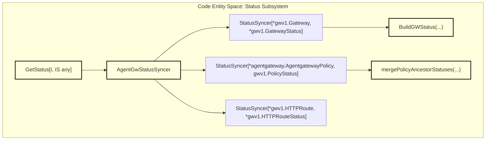
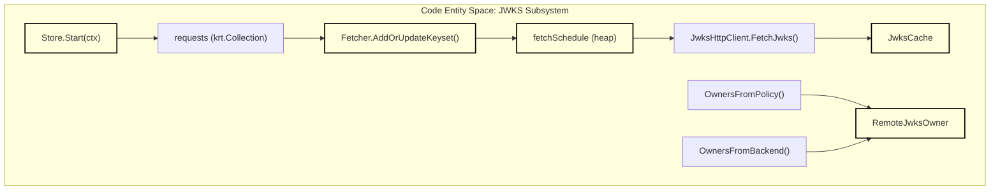

<!-- source: DeepWiki mcp.deepwiki.com · repo agentgateway/agentgateway · page 15.6 Status Reporting and JWKS Resolution · fetched 2026-10-21 -->

# Status Reporting and JWKS Resolution

<details>
<summary>Relevant source files</summary>

The following files were used as context for generating this wiki page:

- [controller/pkg/agentgateway/jwks/cache.go](controller/pkg/agentgateway/jwks/cache.go)
- [controller/pkg/agentgateway/jwks/collections.go](controller/pkg/agentgateway/jwks/collections.go)
- [controller/pkg/agentgateway/jwks/collections_test.go](controller/pkg/agentgateway/jwks/collections_test.go)
- [controller/pkg/agentgateway/jwks/fetcher.go](controller/pkg/agentgateway/jwks/fetcher.go)
- [controller/pkg/agentgateway/jwks/fetcher_test.go](controller/pkg/agentgateway/jwks/fetcher_test.go)
- [controller/pkg/agentgateway/jwks/lookup.go](controller/pkg/agentgateway/jwks/lookup.go)
- [controller/pkg/agentgateway/jwks/lookup_test.go](controller/pkg/agentgateway/jwks/lookup_test.go)
- [controller/pkg/agentgateway/jwks/owner.go](controller/pkg/agentgateway/jwks/owner.go)
- [controller/pkg/agentgateway/jwks/owner_test.go](controller/pkg/agentgateway/jwks/owner_test.go)
- [controller/pkg/agentgateway/jwks/request.go](controller/pkg/agentgateway/jwks/request.go)
- [controller/pkg/agentgateway/jwks/request_test.go](controller/pkg/agentgateway/jwks/request_test.go)
- [controller/pkg/agentgateway/jwks/resolver.go](controller/pkg/agentgateway/jwks/resolver.go)
- [controller/pkg/agentgateway/jwks/resolver_test.go](controller/pkg/agentgateway/jwks/resolver_test.go)
- [controller/pkg/agentgateway/jwks/store.go](controller/pkg/agentgateway/jwks/store.go)
- [controller/pkg/agentgateway/jwks/store_test.go](controller/pkg/agentgateway/jwks/store_test.go)
- [controller/pkg/agentgateway/jwks/types.go](controller/pkg/agentgateway/jwks/types.go)
- [controller/pkg/agentgateway/jwks/types_json_test.go](controller/pkg/agentgateway/jwks/types_json_test.go)
- [controller/pkg/agentgateway/plugins/testdata/backendpolicy/mcp-auth-resolver-backend-missing.yaml](controller/pkg/agentgateway/plugins/testdata/backendpolicy/mcp-auth-resolver-backend-missing.yaml)
- [controller/pkg/agentgateway/plugins/testdata/trafficpolicy/jwt-remote-resolver-backend-missing.yaml](controller/pkg/agentgateway/plugins/testdata/trafficpolicy/jwt-remote-resolver-backend-missing.yaml)
- [controller/pkg/agentgateway/policyselection/selector.go](controller/pkg/agentgateway/policyselection/selector.go)
- [controller/pkg/agentgateway/remotehttp/connection_resolver.go](controller/pkg/agentgateway/remotehttp/connection_resolver.go)
- [controller/pkg/agentgateway/remotehttp/resolver.go](controller/pkg/agentgateway/remotehttp/resolver.go)
- [controller/pkg/agentgateway/translator/builtin_helpers.go](controller/pkg/agentgateway/translator/builtin_helpers.go)
- [controller/pkg/agentgateway/translator/model.go](controller/pkg/agentgateway/translator/model.go)
- [controller/pkg/agentgateway/translator/testdata/backends/mcp-authentication-jwks-resolver-backend-missing.yaml](controller/pkg/agentgateway/translator/testdata/backends/mcp-authentication-jwks-resolver-backend-missing.yaml)
- [controller/pkg/agentgateway/translator/testdata/references-policy-refgrants/backend-owned-cross-namespace-tunnel.yaml](controller/pkg/agentgateway/translator/testdata/references-policy-refgrants/backend-owned-cross-namespace-tunnel.yaml)
- [controller/pkg/agentgateway/translator/testdata/references-policy-refgrants/denied-backend-tunnel-chain.yaml](controller/pkg/agentgateway/translator/testdata/references-policy-refgrants/denied-backend-tunnel-chain.yaml)
- [controller/pkg/agentgateway/translator/testdata/references-policy-refgrants/direct-policy-backend-refgrants.yaml](controller/pkg/agentgateway/translator/testdata/references-policy-refgrants/direct-policy-backend-refgrants.yaml)
- [controller/pkg/apiclient/filters.go](controller/pkg/apiclient/filters.go)
- [controller/pkg/controller/gw_controller.go](controller/pkg/controller/gw_controller.go)
- [controller/pkg/syncer/backend_collections.go](controller/pkg/syncer/backend_collections.go)
- [controller/pkg/syncer/status/collection.go](controller/pkg/syncer/status/collection.go)
- [controller/pkg/syncer/status/collection_test.go](controller/pkg/syncer/status/collection_test.go)
- [controller/pkg/syncer/status/workerpool.go](controller/pkg/syncer/status/workerpool.go)
- [controller/pkg/syncer/status_syncer.go](controller/pkg/syncer/status_syncer.go)
- [controller/pkg/syncer/status_syncer_test.go](controller/pkg/syncer/status_syncer_test.go)
- [controller/pkg/utils/ssrf/dial.go](controller/pkg/utils/ssrf/dial.go)
- [controller/pkg/utils/ssrf/dial_test.go](controller/pkg/utils/ssrf/dial_test.go)

</details>


This page documents the Kubernetes status synchronization subsystem (`AgentGwStatusSyncer`), policy ancestor and parent status reporting, gateway status building, and the controller-side JSON Web Key Set (JWKS) fetching and caching architecture with integrated Server-Side Request Forgery (SSRF) protection.

---

## 1. Kubernetes Status Syncer and Ancestor Status Reporting

The status reporting architecture runs leader-elected loops that synchronize data-plane states and translation results back to Kubernetes Gateway API resources and custom resources.

### AgentGwStatusSyncer and Resource Handlers

The `AgentGwStatusSyncer` struct orchestrates status updates for `AgentgatewayPolicy`, `AgentgatewayBackend`, `AgentgatewayModel`, standard Gateway API routes (`HTTPRoute`, `GRPCRoute`, `TLSRoute`, `TCPRoute`), `ListenerSet`, `Gateway`, `BackendTLSPolicy`, `XBackend`, and `InferencePool` resources [controller/pkg/syncer/status_syncer.go:43-70]().

Each resource type is managed via a generic `StatusSyncer` object that handles client filtering, namespace scoping, and status patch/update operations with retry policies [controller/pkg/syncer/status_syncer.go:91-114](). Status retrieval across heterogeneous resource types uses the generic helper `GetStatus` [controller/pkg/agentgateway/translator/builtin_helpers.go:95-122]().


*Figure 1: Status synchronization component relationships bridging natural language subsystems to code entities.*

Sources: [controller/pkg/syncer/status_syncer.go:43-114](), [controller/pkg/reports/status.go:40-110](), [controller/pkg/syncer/status_syncer_test.go:19-46](), [controller/pkg/agentgateway/translator/builtin_helpers.go:95-122]().

---

### Gateway Status and Listener Conditions

Gateway status reporting evaluates listener conditions, conflict states, and reference resolutions via `BuildGWStatus` [controller/pkg/reports/status.go:40-110](). It iterates over `gw.Spec.Listeners`, computes missing listener conditions, aggregates invalid listener counts, checks for insecure frontend validation modes, and verifies backend TLS references [controller/pkg/reports/status.go:54-164]().

When configuration errors occur (such as missing TLS secrets or invalid parameters), specific condition reasons like `InvalidCertificateRef` or `ListenersNotValid` are populated on both listener statuses and parent gateway conditions [controller/pkg/agentgateway/translator/testdata/gateways/invalid-tls.yaml:43-86]().

Sources: [controller/pkg/reports/status.go:40-164](), [controller/pkg/agentgateway/translator/testdata/gateways/invalid-tls.yaml:43-86]().

---

### Ancestor and Parent Status Merging

Policies maintain an `Ancestors` status array where entries owned by the agentgateway controller are sorted and merged deterministically alongside entries from other controllers [controller/pkg/syncer/status_syncer_test.go:19-46](). Similarly, route parent statuses and inference pool parent statuses ensure that foreign controller entries are preserved while agentgateway-specific status entries are updated or pruned cleanly [controller/pkg/syncer/status_syncer_test.go:48-147]().

The `mergePolicyAncestorStatuses` function [controller/pkg/syncer/status_syncer_test.go:19-46]() specifically handles `gwv1.PolicyAncestorStatus` for `AgentgatewayPolicy` resources. It filters out existing entries belonging to the current controller, appends the desired new entries, and then sorts the combined list by `ControllerName` and `AncestorRef.Name` to ensure deterministic ordering. This prevents unnecessary status updates due to unstable ordering.

For `gwv1.RouteParentStatus` (used by HTTPRoute, GRPCRoute, etc.), `mergeRouteParentStatuses` [controller/pkg/syncer/status_syncer_test.go:48-75]() applies a similar logic, preserving foreign controller entries and deterministically sorting the current controller's entries.

For `inf.InferencePoolStatus`, `mergeInferencePoolParentStatuses` [controller/pkg/syncer/status_syncer_test.go:77-86]() clears existing entries from the current controller before adding new ones, ensuring that only the most up-to-date status from the `agentgateway` controller is reflected.

Sources: [controller/pkg/syncer/status_syncer_test.go:19-147](), [controller/pkg/syncer/status_syncer_test.go:19-46](), [controller/pkg/syncer/status_syncer_test.go:48-75](), [controller/pkg/syncer/status_syncer_test.go:77-86]().

---

## 2. Controller-Side JWKS Fetching, Caching, and Lifecycle

Remote JSON Web Key Sets (JWKS) required for JWT authentication and MCP backend verification are fetched, cached, and scheduled directly inside the controller.

### JwksStore and KRT Integration

The `Store` struct bridges KRT-derived shared JWKS requests (`SharedJwksRequest`) to the runtime fetcher and persistence layers [controller/pkg/agentgateway/jwks/types.go:66-74](). When policies or backends specify remote JWKS endpoints, `OwnersFromPolicy` [controller/pkg/agentgateway/jwks/owner.go:50-76]() and `OwnersFromBackend` [controller/pkg/agentgateway/jwks/owner.go:78-88]() extract the configurations. KRT collapses equivalent sources onto shared request keys [controller/pkg/agentgateway/jwks/types.go:13-74]().

Each `RemoteJwksOwner` defines an unique identifier (`JwksOwnerID`), default namespace, target remote definition, and TTL derived via `TTLForRemote` (defaulting to 5 minutes if unset) [controller/pkg/agentgateway/jwks/owner.go:19-48](), [controller/pkg/agentgateway/jwks/owner.go:136-141]().

The `JwksOwnerID` [controller/pkg/agentgateway/jwks/owner.go:19-24]() uniquely identifies the Kubernetes resource that owns a JWKS configuration, including its `Kind` (e.g., `AgentgatewayPolicy`, `AgentgatewayBackend`), `Namespace`, `Name`, and a `Path` to the specific JWKS configuration within the resource's spec. This allows for fine-grained tracking of JWKS sources.

The `SharedJwksRequest` [controller/pkg/agentgateway/jwks/types.go:66-74]() represents a canonical request for a JWKS, consolidating multiple `JwksSource` entries that point to the same remote JWKS URL. This de-duplication is crucial for efficient fetching and caching. It includes the `RequestKey` (derived from the target URL), `Target` (containing the URL and transport details), and `TTL` (minimum cache duration requested by all owners).


*Figure 2: JWKS Store, Fetcher, and Schedule pipeline interaction.*

Sources: [controller/pkg/agentgateway/jwks/fetcher.go:33-140](), [controller/pkg/agentgateway/jwks/store.go:26-95](), [controller/pkg/agentgateway/jwks/owner.go:19-141](), [controller/pkg/agentgateway/jwks/types.go:13-74](), [controller/pkg/agentgateway/jwks/owner.go:19-24](), [controller/pkg/agentgateway/jwks/owner.go:50-76](), [controller/pkg/agentgateway/jwks/owner.go:78-88](), [controller/pkg/agentgateway/jwks/types.go:66-74]().

### JWKS Fetcher and Cache

The `Fetcher` [controller/pkg/agentgateway/jwks/fetcher.go:210-245]() is responsible for fetching and periodically refreshing remote JWKS keysets. It uses a `fetchSchedule` [controller/pkg/agentgateway/jwks/fetcher.go:67-70]() (implemented as a min-heap) to manage scheduled fetches based on their `At` time [controller/pkg/agentgateway/jwks/fetcher.go:41-45]().

When a `SharedJwksRequest` is added or updated via `AddOrUpdateKeyset` [controller/pkg/agentgateway/jwks/fetcher.go:250-279](), the fetcher either schedules an immediate fetch if the cached entry is stale or delays it based on the `TTL` [controller/pkg/agentgateway/jwks/fetcher_test.go:149-193](). `RemoveKeyset` [controller/pkg/agentgateway/jwks/fetcher.go:281-290]() removes a keyset from the schedule and cache, while `RetireKeyset` [controller/pkg/agentgateway/jwks/fetcher.go:292-301]() removes it from the schedule but keeps it in the cache until a new fetch sweeps it [controller/pkg/agentgateway/jwks/fetcher_test.go:82-130]().

The `JwksCache` [controller/pkg/agentgateway/jwks/cache.go:13-20]() stores fetched `jose.JSONWebKeySet` objects, indexed by `remotehttp.FetchKey`. It also tracks the `FetchedAt` timestamp and `JwksJSON` string for each keyset [controller/pkg/agentgateway/jwks/types.go:13-18]().

The `fetchSchedule` [controller/pkg/agentgateway/jwks/fetcher.go:67-70]() is a min-heap (`fetchHeap` [controller/pkg/agentgateway/jwks/fetcher.go:41-45]()) that stores `fetchAt` entries. Each `fetchAt` entry contains the `RequestKey` of the JWKS, the `At` timestamp for its next fetch, a `Generation` counter to track updates, and `RetryAttempt` for exponential backoff. The `Schedule` method [controller/pkg/agentgateway/jwks/fetcher.go:105-123]() adds or updates entries in the heap, while `PopDue` [controller/pkg/agentgateway/jwks/fetcher.go:92-102]() extracts all entries whose `At` time has passed.

The `nextRetryDelay` function [controller/pkg/agentgateway/jwks/fetcher.go:132-140]() implements an exponential backoff strategy for failed fetches, starting with `initialRetryDelay` and capping at `maxRetryDelay`.

```mermaid
graph TD
    subgraph "JWKS Fetcher and Cache Lifecycle"
        A[NewFetcher] --> B{Fetcher}
        B --> C[JwksCache]
        B --> D[fetchSchedule]
        B --> E[JwksHttpClient]

        subgraph "Fetcher Operations"
            F[AddOrUpdateKeyset] --> D
            F --> C
            G[RemoveKeyset] --> D
            G --> C
            H[RetireKeyset] --> D
            H --> C
            I[maybeFetchJwks] --> D
            I --> E
            E --> C
        end

        F -- "Adds/Updates" --> B
        G -- "Removes" --> B
        H -- "Retires" --> B
        I -- "Periodically fetches" --> B
        B -- "Stores/Retrieves" --> C
        B -- "Manages schedule" --> D
        B -- "Uses to fetch" --> E

        style B fill:none,stroke:#000,stroke-width:2px
        style C fill:none,stroke:#000,stroke-width:2px
        style D fill:none,stroke:#000,stroke-width:2px
        style E fill:none,stroke:#000,stroke-width:2px
```
*Figure 3: Detailed interaction of the JWKS Fetcher, Cache, and Schedule.*

Sources: [controller/pkg/agentgateway/jwks/fetcher.go:210-245](), [controller/pkg/agentgateway/jwks/fetcher.go:67-70](), [controller/pkg/agentgateway/jwks/fetcher.go:41-45](), [controller/pkg/agentgateway/jwks/fetcher.go:250-279](), [controller/pkg/agentgateway/jwks/fetcher_test.go:149-193](), [controller/pkg/agentgateway/jwks/fetcher.go:281-290](), [controller/pkg/agentgateway/jwks/fetcher.go:292-301](), [controller/pkg/agentgateway/jwks/fetcher_test.go:82-130](), [controller/pkg/agentgateway/jwks/cache.go:13-20](), [controller/pkg/agentgateway/jwks/types.go:13-18](), [controller/pkg/agentgateway/jwks/fetcher.go:105-123](), [controller/pkg/agentgateway/jwks/fetcher.go:92-102](), [controller/pkg/agentgateway/jwks/fetcher.go:132-140]().

---

## 3. SSRF Protection and CA Bundle Resolution

To prevent Server-Side Request Forgery (SSRF) when fetching remote keysets or establishing upstream connections, HTTP clients integrate strict safety constraints.

### Safe Dial Context and Client Construction

The `makeFetchClient` function builds custom `http.Client` instances configured with safe dial contexts (`ssrf.SafeDialContext`) [controller/pkg/agentgateway/jwks/fetcher.go:142-171](). This dialer wraps `net.Dialer` to inspect and block loopback, link-local, and private IP ranges unless explicitly allowed by network policy [controller/pkg/utils/ssrf/dial.go:20-30]().

Additionally, proxy TLS dial contexts wrap TCP connections in TLS when tunnel proxy backends require authenticated TLS encapsulation during JWKS retrieval [controller/pkg/agentgateway/jwks/fetcher.go:173-192](). The `remotehttp.Resolver` [controller/pkg/agentgateway/remotehttp/resolver.go:57-64]() is responsible for resolving `BackendObjectReference` or URLs into `ResolvedTarget` objects, which include `TLSConfig` and `ProxyTLSConfig` for secure connections [controller/pkg/agentgateway/remotehttp/resolver.go:136-198](). This resolution process involves looking up `ConfigMaps` and `Secrets` for CA bundles and client certificates [controller/pkg/agentgateway/remotehttp/resolver.go:59-60]().

The `ssrf.SafeDialContext` [controller/pkg/utils/ssrf/dial.go:20-30]() ensures that outgoing connections from the controller do not inadvertently access internal services or sensitive endpoints. It performs checks against the resolved IP addresses to prevent connections to private networks, loopback addresses, and link-local addresses, mitigating potential SSRF vulnerabilities.

The `remotehttp.Resolver` [controller/pkg/agentgateway/remotehttp/resolver.go:57-64]() uses `BackendRefGrantChecker` [controller/pkg/agentgateway/jwks/resolver.go:31-41]() to enforce `ReferenceGrant` policies for cross-namespace backend references, further enhancing security by controlling which resources can be referenced across namespaces [controller/pkg/agentgateway/jwks/resolver.go:65-79](). This is particularly important for JWKS fetching where a malicious policy could attempt to reference an internal service.

Sources: [controller/pkg/agentgateway/jwks/fetcher.go:142-192](), [controller/pkg/utils/ssrf/dial.go:20-30](), [controller/pkg/agentgateway/remotehttp/resolver.go:57-64](), [controller/pkg/agentgateway/remotehttp/resolver.go:136-198](), [controller/pkg/agentgateway/remotehttp/resolver.go:59-60](), [controller/pkg/agentgateway/jwks/resolver.go:31-41](), [controller/pkg/agentgateway/jwks/resolver.go:65-79]().

---

