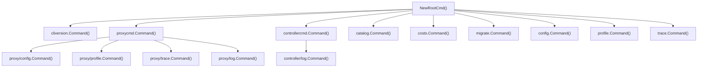
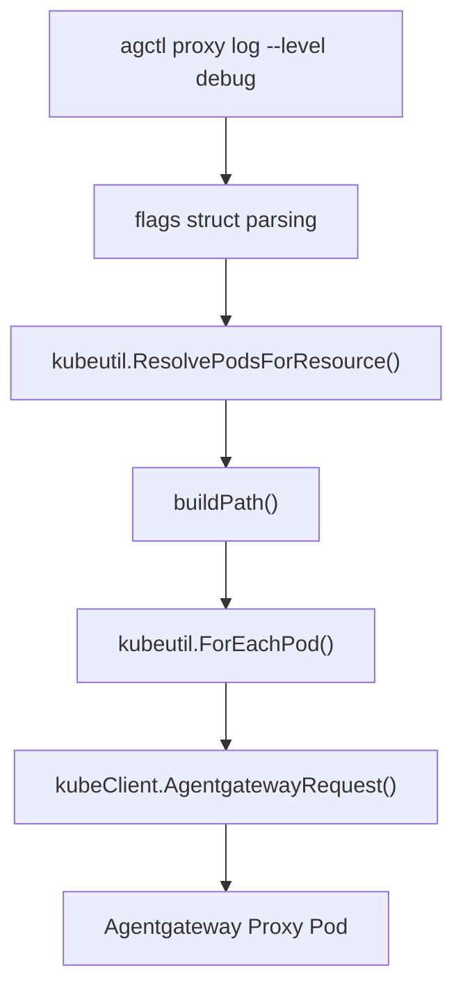
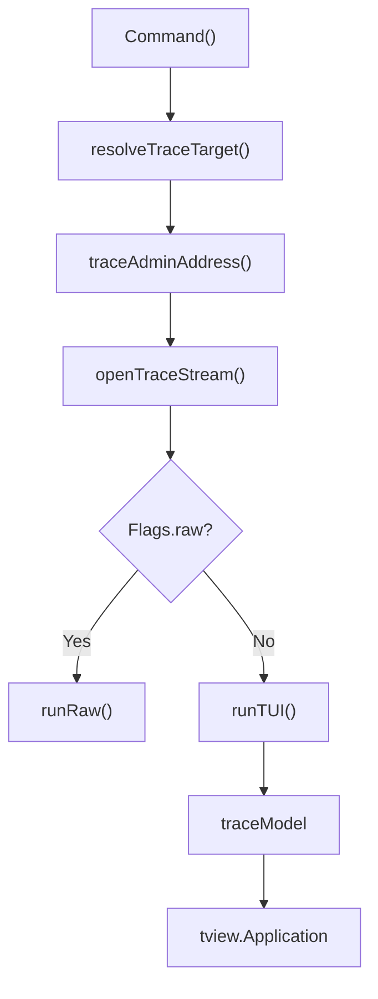

<!-- source: DeepWiki mcp.deepwiki.com · repo agentgateway/agentgateway · page 15.7 agctl CLI · fetched 2026-10-21 -->

# agctl CLI

Relevant source files

The following files were used as context for generating this wiki page:

- [controller/pkg/admin/logging.go](controller/pkg/admin/logging.go)
- [controller/pkg/admin/server.go](controller/pkg/admin/server.go)
- [controller/pkg/cli/config/cmd.go](controller/pkg/cli/config/cmd.go)
- [controller/pkg/cli/controller/cmd.go](controller/pkg/cli/controller/cmd.go)
- [controller/pkg/cli/controller/log/cmd.go](controller/pkg/cli/controller/log/cmd.go)
- [controller/pkg/cli/flag/cmd.go](controller/pkg/cli/flag/cmd.go)
- [controller/pkg/cli/kubeutil/kube.go](controller/pkg/cli/kubeutil/kube.go)
- [controller/pkg/cli/proxy/cmd.go](controller/pkg/cli/proxy/cmd.go)
- [controller/pkg/cli/proxy/config/all.go](controller/pkg/cli/proxy/config/all.go)
- [controller/pkg/cli/proxy/config/backends.go](controller/pkg/cli/proxy/config/backends.go)
- [controller/pkg/cli/proxy/config/backends_test.go](controller/pkg/cli/proxy/config/backends_test.go)
- [controller/pkg/cli/proxy/config/configdump.go](controller/pkg/cli/proxy/config/configdump.go)
- [controller/pkg/cli/proxy/config/table.go](controller/pkg/cli/proxy/config/table.go)
- [controller/pkg/cli/proxy/log/cmd.go](controller/pkg/cli/proxy/log/cmd.go)
- [controller/pkg/cli/proxy/trace/cmd.go](controller/pkg/cli/proxy/trace/cmd.go)
- [controller/pkg/cli/proxy/trace/trace.go](controller/pkg/cli/proxy/trace/trace.go)
- [controller/pkg/cli/proxy/trace/trace_test.go](controller/pkg/cli/proxy/trace/trace_test.go)
- [controller/pkg/cli/root.go](controller/pkg/cli/root.go)
- [controller/pkg/cli/trace/cmd.go](controller/pkg/cli/trace/cmd.go)
- [controller/pkg/cli/version/cmd.go](controller/pkg/cli/version/cmd.go)
- [controller/pkg/metrics/cmd/findmetrics/main.go](controller/pkg/metrics/cmd/findmetrics/main.go)
- [controller/pkg/wellknown/labels.go](controller/pkg/wellknown/labels.go)
- [controller/pkg/wellknown/ports.go](controller/pkg/wellknown/ports.go)
- [crates/agentgateway/src/proxy/dtrace.rs](crates/agentgateway/src/proxy/dtrace.rs)

The `agctl` command-line utility serves as the primary administration, debugging, and inspection tool for `agentgateway` deployments. It provides direct command-line interfaces for interacting with proxy admin endpoints, managing logging levels dynamically, inspecting configurations and backend health, generating and rendering runtime debug traces, controlling the Kubernetes controller and data plane proxies, and executing catalog synchronization.

The core implementation of the CLI resides under the `controller/pkg/cli` package, utilizing the `spf13/cobra` command framework and interacting with Kubernetes clusters through standard `client-go` abstractions.

Sources: [controller/pkg/cli/root.go:20-38](), [controller/pkg/cli/proxy/cmd.go:13-26]()

---

## 1. Command Tree Structure and Root Execution

The entrypoint for `agctl` is defined by `NewRootCmd()` in `controller/pkg/cli/root.go`, which initializes the root Cobra command and registers all top-level subcommands including version reporting, proxy management, controller operations, cataloging, cost tracking, migration tools, configuration inspection, profiling, and tracing.

*Figure 1: Mapping natural language command spaces to code entity functions within `controller/pkg/cli`.*

Sources: [controller/pkg/cli/root.go:20-38](), [controller/pkg/cli/proxy/cmd.go:13-26](), [controller/pkg/cli/controller/cmd.go:9-19](), [controller/pkg/cli/trace/cmd.go:8-13](), [controller/pkg/cli/config/cmd.go:8-13]()

---

## 2. Kubernetes Target and Pod Resolution

Many `agctl` subcommands operate directly against running pods inside a Kubernetes cluster. The `controller/pkg/cli/kubeutil/kube.go` package handles namespace loading, target resource resolution, pod discovery, and fan-out execution across multiple replicas.

### Key Functions and Data Structures
* `ResourceTarget`: Struct holding `KubeClient`, `ResourceName`, and `Pod` metadata representing a single proxy instance [controller/pkg/cli/kubeutil/kube.go:28-32]().
* `ResolveResourceTarget`: Resolves an optional resource argument or infers a single gateway resource name to target a specific proxy pod [controller/pkg/cli/kubeutil/kube.go:35-61]().
* `ResolvePodsForResource`: Queries pods backing a named Gateway resource, sorting them alphabetically for deterministic output [controller/pkg/cli/kubeutil/kube.go:106-120]().
* `ResolveControllerPods`: Identifies controller pods matching the label selector `agentgateway=agentgateway` [controller/pkg/cli/kubeutil/kube.go:124-148]().
* `ForEachPod`: Iterates over a collection of pods, executes a callback function per pod (`fn`), prefixes output when multiple pods are present, and aggregates errors using `errors.NewAggregate` [controller/pkg/cli/kubeutil/kube.go:158-173]().

Sources: [controller/pkg/cli/kubeutil/kube.go:28-173]()

---

## 3. Proxy and Controller Logging Level Control

The logging commands (`agctl proxy log` and `agctl controller log`) allow administrators to read or modify logging verbosity dynamically at runtime without restarting processes.

*Figure 2: Execution pipeline for updating logging levels across proxy pods.*

### Proxy Logging (`agctl proxy log`)
The proxy logging command targets the proxy admin API (default port `15000`) [controller/pkg/cli/proxy/log/cmd.go:14](). 
* Supports reading active Rust `tracing-subscriber` filter directives when executed without flags [controller/pkg/cli/proxy/log/cmd.go:29-31]().
* `--level` sets a global level (`error`, `warn`, `info`, `debug`, `trace`, `off`) [controller/pkg/cli/proxy/log/cmd.go:54]().
* `--set` allows additive, per-module log configuration using module-to-level mapping (e.g., `agentgateway::proxy=debug`) [controller/pkg/cli/proxy/log/cmd.go:35-37]().

### Controller Logging (`agctl controller log`)
The controller logging command targets the controller admin port (`9095`) [controller/pkg/cli/controller/log/cmd.go:15]().
* Supports component-level verbosity configuration via query parameters generated in `buildPath()` [controller/pkg/cli/controller/log/cmd.go:86-122]().

Sources: [controller/pkg/cli/proxy/log/cmd.go:14-149](), [controller/pkg/cli/controller/log/cmd.go:15-131]()

---

## 4. Proxy Configuration Dump and Backends Inspection (`agctl proxy config`)

The `agctl proxy config` subcommand tree provides visibility into the active xDS snapshot configuration loaded by data plane proxy instances.

### Backend Status Inspection (`agctl proxy config backends`)
The `backends` command (aliased as `b` or `be`) retrieves endpoint status, active health metrics, request counts, and latency statistics from the proxy config dump [controller/pkg/cli/proxy/config/backends.go:78-110]().

* **Data Structures**:
  * `backendConfigDump`: Holds parsed `Services` and top-level `Backends` [controller/pkg/cli/proxy/config/backends.go:19-22]().
  * `backendEndpoint`: Contains maps of `Active` and `Rejected` endpoint states [controller/pkg/cli/proxy/config/backends.go:30-33]().
  * `backendEndpointInfo`: Captures numerical metrics including health scores, request latency (`requestLatency` / `request_latency`), and total request counts [controller/pkg/cli/proxy/config/backends.go:43-50]().
* **Execution Flow**:
  1. `backendsCommand` loads the configuration dump source via `loadConfigDumpSource` [controller/pkg/cli/proxy/config/backends.go:93-96]().
  2. `parseBackendRows` iterates through all services and backend variants, organizing active and evicted/rejected endpoints into `backendRow` entries [controller/pkg/cli/proxy/config/backends.go:113-147]().
  3. Rows are sorted deterministically by type, namespace, name, and endpoint address [controller/pkg/cli/proxy/config/backends.go:133-145]().
  4. Output is formatted as a human-readable tabbed table or serialized into JSON/YAML [controller/pkg/cli/proxy/config/backends.go:102-106]().

Sources: [controller/pkg/cli/proxy/config/backends.go:19-147]()

---

## 5. Debug Tracing and TUI (`agctl proxy trace`)

The `agctl proxy trace` command captures, streams, and renders runtime per-request debug traces (`dtrace`) generated by data plane proxies.

*Figure 3: Trace initialization and rendering pipeline linking Cobra command execution to the `tview` interface.*

### Key Implementation Components
* **Flags and Arguments (`traceFlags`)**: Configures namespace, admin port (`wellknown.ProxyAdminPort`), trace input files (`--file`), CEL filter expressions (`--expression`), follow duration (`--follow`), raw JSONL output (`--raw`), trigger port (`--port`), and local mode (`--local`) [controller/pkg/cli/proxy/trace/cmd.go:15-24]().
* **Envelope Schema (`traceEnvelope` & `traceEvent`)**: Deserializes streaming trace payloads containing `requestId`, `eventStart`, `eventEnd`, `severity`, `scope`, and structured message events (such as `bodySnapshot`, `policyEvent`, `requestState`) [controller/pkg/cli/proxy/trace/trace.go:55-93]().
* **Terminal User Interface (`traceModel`)**: Built on `github.com/rivo/tview` and `github.com/gdamore/tcell/v2`, the TUI renders real-time trace events, body snapshots, and differential state analysis across detail modes (`snapshot`, `snapshot diff`, `raw event`) [controller/pkg/cli/proxy/trace/trace.go:109-136]()
* **Testing & Robustness**: Unit tests in `trace_test.go` validate stream consumption, body snapshot updates, and long-event handling up to multi-megabyte payloads [controller/pkg/cli/proxy/trace/trace_test.go:22-182]().

Sources: [controller/pkg/cli/proxy/trace/cmd.go:15-148](), [controller/pkg/cli/proxy/trace/trace.go:55-192](), [controller/pkg/cli/proxy/trace/trace_test.go:22-182](), [crates/agentgateway/src/proxy/dtrace.rs:1-50]()

---

## 6. Additional Management and Inspection Commands

Beyond logging, proxy configuration, and tracing, `agctl` bundles several ancillary operational commands:

* **Version (`agctl version`)**: Prints build, git commit, and Go version metadata parsed from `controller/pkg/version` [controller/pkg/cli/version/cmd.go:9-21]().
* **Catalog Refresh (`agctl catalog`)**: Triggers or inspects model and pricing cost catalog synchronizations across LLM providers.
* **Cost Tracking (`agctl costs`)**: Inspects model cost metrics and catalog mappings.
* **Migration Tools (`agctl migrate`)**: Handles legacy configuration conversions, LiteLLM imports, and deprecated format migrations.
* **Profiling (`agctl proxy profile` and `agctl profile`)**: Collects CPU and memory profiles from proxies and controller instances via pprof endpoints.

Sources: [controller/pkg/cli/root.go:27-36](), [controller/pkg/cli/version/cmd.go:12-22]()

---

