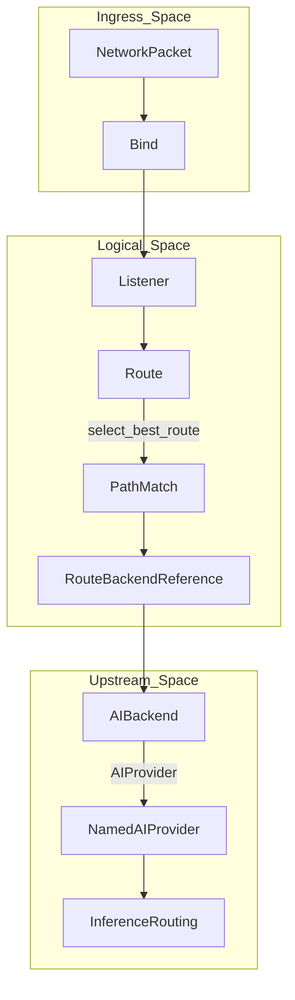
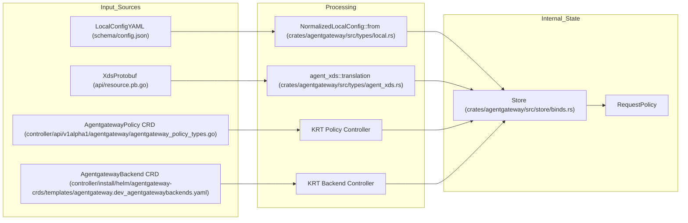

<!-- source: DeepWiki mcp.deepwiki.com · repo agentgateway/agentgateway · page 16 Glossary · fetched 2026-10-21 -->

# Glossary

Relevant source files

The following files were used as context for generating this wiki page:

- [api/resource.pb.go](api/resource.pb.go)
- [controller/api/v1alpha1/agentgateway/agentgateway_policy_types.go](controller/api/v1alpha1/agentgateway/agentgateway_policy_types.go)
- [controller/api/v1alpha1/agentgateway/zz_generated.deepcopy.go](controller/api/v1alpha1/agentgateway/zz_generated.deepcopy.go)
- [controller/install/helm/agentgateway-crds/templates/agentgateway.dev_agentgatewaybackends.yaml](controller/install/helm/agentgateway-crds/templates/agentgateway.dev_agentgatewaybackends.yaml)
- [controller/install/helm/agentgateway-crds/templates/agentgateway.dev_agentgatewaypolicies.yaml](controller/install/helm/agentgateway-crds/templates/agentgateway.dev_agentgatewaypolicies.yaml)
- [controller/pkg/agentgateway/plugins/backend_policies.go](controller/pkg/agentgateway/plugins/backend_policies.go)
- [controller/pkg/agentgateway/plugins/traffic_plugin.go](controller/pkg/agentgateway/plugins/traffic_plugin.go)
- [crates/agentgateway/src/llm/mod.rs](crates/agentgateway/src/llm/mod.rs)
- [crates/agentgateway/src/llm/tests.rs](crates/agentgateway/src/llm/tests.rs)
- [crates/agentgateway/src/mcp/handler.rs](crates/agentgateway/src/mcp/handler.rs)
- [crates/agentgateway/src/mcp/mcp_tests.rs](crates/agentgateway/src/mcp/mcp_tests.rs)
- [crates/agentgateway/src/mcp/mod.rs](crates/agentgateway/src/mcp/mod.rs)
- [crates/agentgateway/src/mcp/router.rs](crates/agentgateway/src/mcp/router.rs)
- [crates/agentgateway/src/mcp/session.rs](crates/agentgateway/src/mcp/session.rs)
- [crates/agentgateway/src/mcp/sse.rs](crates/agentgateway/src/mcp/sse.rs)
- [crates/agentgateway/src/mcp/streamablehttp.rs](crates/agentgateway/src/mcp/streamablehttp.rs)
- [crates/agentgateway/src/mcp/upstream/mod.rs](crates/agentgateway/src/mcp/upstream/mod.rs)
- [crates/agentgateway/src/mcp/upstream/openapi/mod.rs](crates/agentgateway/src/mcp/upstream/openapi/mod.rs)
- [crates/agentgateway/src/mcp/upstream/openapi/tests.rs](crates/agentgateway/src/mcp/upstream/openapi/tests.rs)
- [crates/agentgateway/src/mcp/upstream/sse.rs](crates/agentgateway/src/mcp/upstream/sse.rs)
- [crates/agentgateway/src/mcp/upstream/streamablehttp.rs](crates/agentgateway/src/mcp/upstream/streamablehttp.rs)
- [crates/agentgateway/src/proxy/httpproxy.rs](crates/agentgateway/src/proxy/httpproxy.rs)
- [crates/agentgateway/src/proxy/mod.rs](crates/agentgateway/src/proxy/mod.rs)
- [crates/agentgateway/src/store/binds.rs](crates/agentgateway/src/store/binds.rs)
- [crates/agentgateway/src/telemetry/log.rs](crates/agentgateway/src/telemetry/log.rs)
- [crates/agentgateway/src/telemetry/metrics.rs](crates/agentgateway/src/telemetry/metrics.rs)
- [crates/agentgateway/src/telemetry/trc.rs](crates/agentgateway/src/telemetry/trc.rs)
- [crates/agentgateway/src/types/agent.rs](crates/agentgateway/src/types/agent.rs)
- [crates/agentgateway/src/types/agent_xds.rs](crates/agentgateway/src/types/agent_xds.rs)
- [crates/agentgateway/src/types/local.rs](crates/agentgateway/src/types/local.rs)
- [crates/agentgateway/src/types/local_tests.rs](crates/agentgateway/src/types/local_tests.rs)
- [crates/agentgateway/tests/tests/llm.rs](crates/agentgateway/tests/tests/llm.rs)
- [crates/core/src/lib.rs](crates/core/src/lib.rs)
- [crates/core/src/metrics.rs](crates/core/src/metrics.rs)
- [crates/core/src/tokio_metrics.rs](crates/core/src/tokio_metrics.rs)
- [crates/protos/proto/resource.proto](crates/protos/proto/resource.proto)
- [schema/config.json](schema/config.json)
- [schema/config.md](schema/config.md)

This glossary defines codebase-specific terms, abbreviations, and domain concepts used within the `agentgateway` project. It serves as a technical reference to map conceptual terminology to specific implementation details and code entities across the Rust data plane and Go control plane.

## Core Networking and Proxy Terms

### Bind
A `Bind` represents a specific network interface and port that the gateway listens on. It serves as the parent container for one or more **Listeners**.
*   **Implementation**: Defined by the `Bind` struct in [crates/agentgateway/src/types/agent.rs:48-57]().
*   **Lifecycle**: The `Gateway::run` function manages the lifecycle of binds, subscribing to `BindEvent` updates and spawning `run_bind` for each configured entry [crates/agentgateway/src/store/binds.rs:135-139]().
*   **Internal Wildcard**: An internal bind with port 0 acts as a fallback for in-process routing (CONNECT re-entry) [crates/agentgateway/src/types/agent.rs:62-65]().
*   **Configuration**: In local configuration, these are defined as an array of `LocalBind` objects [schema/config.json:18-24]().

Sources: [crates/agentgateway/src/types/agent.rs:48-65](), [crates/agentgateway/src/store/binds.rs:135-139](), [schema/config.json:18-24]()

### Listener
A `Listener` is a logical grouping of routes associated with a specific hostname (which can be a wildcard) and protocol.
*   **Implementation**: Defined in the Rust types as `Listener` [crates/agentgateway/src/types/agent.rs:118-127]().
*   **Matching**: Listeners filter traffic based on the `hostname` field, supporting SNI and Host header matching via the `matches` function [crates/agentgateway/src/types/agent.rs:130-135]().

Sources: [crates/agentgateway/src/types/agent.rs:118-135]()

### Route
A `Route` defines how an incoming request (HTTP or TCP) is matched and which **Backend** it should be forwarded to.
*   **HTTP Route**: Matches based on path, headers, and methods. Defined via `Route` [crates/agentgateway/src/types/agent.rs:33-33]().
*   **TCP Route**: Used for Layer 4 proxying. Defined via `TCPRoute` [crates/agentgateway/src/types/agent.rs:33-33]().
*   **Delegation**: Routes can be organized into `RouteGroups` for hierarchical composition. The selection logic follows a chain resolved by `select_route_chain`, which includes cycle detection and lookup in the `BindStore` [crates/agentgateway/src/proxy/httpproxy.rs:112-153]().

Sources: [crates/agentgateway/src/types/agent.rs:33-33](), [crates/agentgateway/src/proxy/httpproxy.rs:112-153]()

### Backend
A `Backend` is an upstream service or endpoint that receives traffic from the gateway.
*   **Types**: Can be a simple service, an AI provider, or an MCP server.
*   **Implementation**: Represented in code by the `Backend` struct [crates/agentgateway/src/types/agent.rs:28-28]() and handled for AI specifically via `AIBackend` [crates/agentgateway/src/llm/mod.rs:72-88]().
*   **Selection**: Backends are selected via weighted distribution in `select_backend` [crates/agentgateway/src/proxy/httpproxy.rs:60-65]().

Sources: [crates/agentgateway/src/types/agent.rs:28-28](), [crates/agentgateway/src/llm/mod.rs:72-88](), [crates/agentgateway/src/proxy/httpproxy.rs:60-65]()

### Natural Language to Code Entity: Traffic Routing
The following diagram bridges the conceptual flow of a request to the specific Rust structs and logic used in the codebase.

Title: "Request Routing Flow"

Sources: [crates/agentgateway/src/types/agent.rs:48-127](), [crates/agentgateway/src/proxy/httpproxy.rs:60-153](), [crates/agentgateway/src/store/binds.rs:18-42](), [crates/agentgateway/src/llm/mod.rs:72-121]()

---

## AI and Agentic Protocols

### MCP (Model Context Protocol)
A protocol that allows AI models to interact with external tools, prompts, and resources.
*   **Implementation**: Configured via `McpBackend` [crates/agentgateway/src/types/agent.rs:31-31]() and `McpTarget` [crates/agentgateway/src/types/agent.rs:31-31](). The `set_mcp_cel_context` function populates CEL context with MCP-specific information [crates/agentgateway/src/proxy/httpproxy.rs:100-110]().
*   **Authorization**: Handled via `McpAuthorizationSet` which defines RBAC access control for tools and resources [crates/agentgateway/src/store/binds.rs:24-24]().
*   **Authentication**: Supports custom authentication logic via `McpAuthentication` [crates/agentgateway/src/types/agent.rs:31-31]().
*   **Multiplexing**: The gateway can fan-out requests to multiple MCP backends and merge responses, often using name prefixing to avoid collisions [crates/agentgateway/src/mcp/mod.rs:1-30]().

Sources: [crates/agentgateway/src/types/agent.rs:31-31](), [crates/agentgateway/src/store/binds.rs:24-24](), [crates/agentgateway/src/mcp/mod.rs:1-30](), [crates/agentgateway/src/proxy/httpproxy.rs:100-110]()

### A2A (Agent-to-Agent)
A protocol enabling direct communication between autonomous agents, supporting skill discovery and card metadata.
*   **Implementation**: Logic for A2A policies is encapsulated in `A2aPolicy` [crates/agentgateway/src/types/agent.rs:28-28]().

Sources: [crates/agentgateway/src/types/agent.rs:28-28]()

### AgentCore
Integration with AWS Bedrock AgentCore for running agentic workflows.
*   **Implementation**: Managed via the `agentcore` module [crates/agentgateway/src/types/local.rs:41-42]().

Sources: [crates/agentgateway/src/types/local.rs:41-42]()

### Token-Based Processing
*   **Token Counting**: The gateway can count or estimate tokens to enable accurate rate limits via integration with `agent_llm::tokenizer` [crates/agentgateway/src/llm/mod.rs:9-15]().
*   **SSE (Server-Sent Events)**: Standard for streaming AI responses. SSE targets are specified via `SseTargetSpec` [crates/agentgateway/src/types/local.rs:36-36]().

Sources: [crates/agentgateway/src/llm/mod.rs:9-15](), [crates/agentgateway/src/types/local.rs:36-36]()

### ModelCatalog
A system for tracking LLM cost, model pricing, and cost-based observability.
*   **Implementation**: Configured via `ModelCatalogSource` [schema/config.json:153-162](). Pricing includes rates for input, output, cache reads/writes, and reasoning tokens [schema/config.md:17-25]().

Sources: [schema/config.json:153-162](), [schema/config.md:17-25]()

### InferencePool and EPP
Integration with Gateway API Inference Extension `InferencePool` and the Endpoint Picker Protocol (EPP) for advanced LLM load balancing.
*   **Implementation**: Traffic policies can target `InferencePool`. `InferenceRouting` defines the destination mode [crates/agentgateway/src/store/binds.rs:18-19]().

Sources: [crates/agentgateway/src/store/binds.rs:18-19]()

---

## Policy and Security

### CEL (Common Expression Language)
A non-Turing complete language used throughout the gateway for dynamic policy evaluation, log filtering, and authorization.
*   **Architecture**: Expressions are compiled and executed via the `cel` crate. The `Executor` handles evaluation within a context [crates/agentgateway/src/proxy/httpproxy.rs:200-209]().
*   **Usage**: Used for log filtering, header modification, and RBAC via `ContextBuilder` [crates/agentgateway/src/store/binds.rs:14-16]().

Sources: [crates/agentgateway/src/proxy/httpproxy.rs:200-209](), [crates/agentgateway/src/store/binds.rs:14-16]()

### ExtAuthz (External Authorization)
A policy that delegates authorization decisions to an external service via gRPC or HTTP.
*   **Implementation**: Represented as `LocalExtAuthzPolicy` [crates/agentgateway/src/types/local.rs:44-44](). Applied during the request pipeline in `apply_request_policies` [crates/agentgateway/src/proxy/httpproxy.rs:207-209]().

Sources: [crates/agentgateway/src/types/local.rs:44-44](), [crates/agentgateway/src/proxy/httpproxy.rs:207-209]()

### ExtProc (External Processing)
A policy that allows an external service to mutate requests or responses using bidirectional streaming.
*   **Implementation**: Defined as `LocalExtProcPolicy` [crates/agentgateway/src/types/local.rs:46-46]().
*   **Modes**: Supports various `BodySendMode` (None, Buffered, Streamed) [crates/agentgateway/src/types/agent_xds.rs:70-79]().

Sources: [crates/agentgateway/src/types/local.rs:46-46](), [crates/agentgateway/src/types/agent_xds.rs:70-79]()

### RBAC (Role-Based Access Control)
Implemented using `RuleSet` and `Authorization` policies which define allow/deny logic based on CEL [crates/agentgateway/src/types/agent.rs:29-30]().

Sources: [crates/agentgateway/src/types/agent.rs:29-30]()

### OIDC (OpenID Connect)
Browser-native authentication flow supporting PKCE and session management.
*   **Implementation**: Managed via the `oidc` module and applied in the proxy pipeline [crates/agentgateway/src/store/binds.rs:21-22]().

Sources: [crates/agentgateway/src/store/binds.rs:21-22]()

### ID-JAG / Cross-App Access / OAuth Token Exchange
Identity Assertion Authorization Grant mechanisms and RFC 8693 Token Exchange for secure cross-application access.
*   **Implementation**: Included in `BackendAuth` and token exchange logic [crates/agentgateway/src/types/local.rs:18-20]().

Sources: [crates/agentgateway/src/types/local.rs:18-20]()

---

## Infrastructure and Integration

### XDS (xDS API)
The protocol used by the control plane to push dynamic configuration to the gateway.
*   **Conversion**: The gateway converts XDS protobufs into internal representations in the `agent_xds` module [crates/agentgateway/src/types/agent_xds.rs:1-16]().
*   **Diagnostics**: Configuration translation errors and warnings are tracked via the `Diagnostics` struct [crates/agentgateway/src/types/agent_xds.rs:51-68]().

Sources: [crates/agentgateway/src/types/agent_xds.rs:1-16](), [crates/agentgateway/src/types/agent_xds.rs:51-68]()

### HBONE (HTTP-Based Overlay Network)
A tunneling protocol used in service mesh integrations (Istio) that wraps TCP traffic in HTTP/2.
*   **Implementation**: Identified as a `BindProtocol` [api/resource.pb.go:198-207]().

Sources: [api/resource.pb.go:198-207]()

### KRT (Kubernetes Runtime)
The collection-based processing system used in the Go-based Kubernetes controller to track and transform resources into XDS configuration.

Sources: [controller/pkg/agentgateway/plugins/traffic_plugin.go:1-1]()

### Waypoint
An architectural pattern where the gateway acts as a dedicated policy enforcement point for a specific service or workload in a mesh.
*   **Implementation**: Supported via `HBONE_WAYPOINT` `Bind_TunnelProtocol` [api/resource.pb.go:203-203]().

Sources: [api/resource.pb.go:203-203]()

### Natural Language to Code Entity: Configuration Management
The following diagram shows how configuration is ingested and processed.

Title: "Configuration Ingestion Pipeline"

Sources: [crates/agentgateway/src/types/local.rs:78-105](), [crates/agentgateway/src/types/agent_xds.rs:1-16](), [crates/agentgateway/src/store/binds.rs:94-116](), [schema/config.json:1-122](), [api/resource.pb.go:1-249](), [controller/api/v1alpha1/agentgateway/agentgateway_policy_types.go:1-71](), [controller/install/helm/agentgateway-crds/templates/agentgateway.dev_agentgatewaybackends.yaml:1-142]()

---

## Abbreviations Table

| Abbreviation | Full Name | Code Pointer / Context |
| :--- | :--- | :--- |
| **CEL** | Common Expression Language | Core logic for dynamic policies [crates/agentgateway/src/proxy/httpproxy.rs:207-209](). |
| **JWKS** | JSON Web Key Set | Used for JWT authentication [crates/agentgateway/src/types/agent.rs:29-30](). |
| **mTLS** | Mutual TLS | Handled via `ServerTLSConfig` with client cert verifiers [crates/agentgateway/src/types/agent.rs:213-222](). |
| **OTLP** | OpenTelemetry Protocol | Used for tracing and logging [schema/config.md:61-63](). |
| **SSE** | Server-Sent Events | Standard for streaming AI responses [crates/agentgateway/src/types/local.rs:36-36](). |
| **A2A** | Agent-to-Agent | Inter-agent communication protocol [crates/agentgateway/src/types/local.rs:28-28](). |
| **MCP** | Model Context Protocol | Tool/resource federation for LLMs [crates/agentgateway/src/types/local.rs:31-31](). |
| **OIDC** | OpenID Connect | Browser-native authentication flow [crates/agentgateway/src/store/binds.rs:21-22](). |
| **RBAC** | Role-Based Access Control | Permission logic using CEL [crates/agentgateway/src/types/agent.rs:29-30](). |
| **EPP** | Endpoint Picker Protocol | Integration for inference routing and dynamic endpoints [crates/agentgateway/src/store/binds.rs:18-19](). |
| **ID-JAG** | Identity Assertion Authorization Grant | Cross-app identity forwarding [crates/agentgateway/src/types/local.rs:18-20](). |

Sources: [crates/agentgateway/src/types/agent.rs:29-30](), [crates/agentgateway/src/types/agent.rs:213-222](), [schema/config.md:61-63](), [crates/agentgateway/src/types/local.rs:18-20](), [crates/agentgateway/src/types/local.rs:28-28](), [crates/agentgateway/src/types/local.rs:31-31](), [crates/agentgateway/src/types/local.rs:36-36](), [crates/agentgateway/src/store/binds.rs:18-19](), [crates/agentgateway/src/proxy/httpproxy.rs:207-209](), [crates/agentgateway/src/store/binds.rs:21-22]()