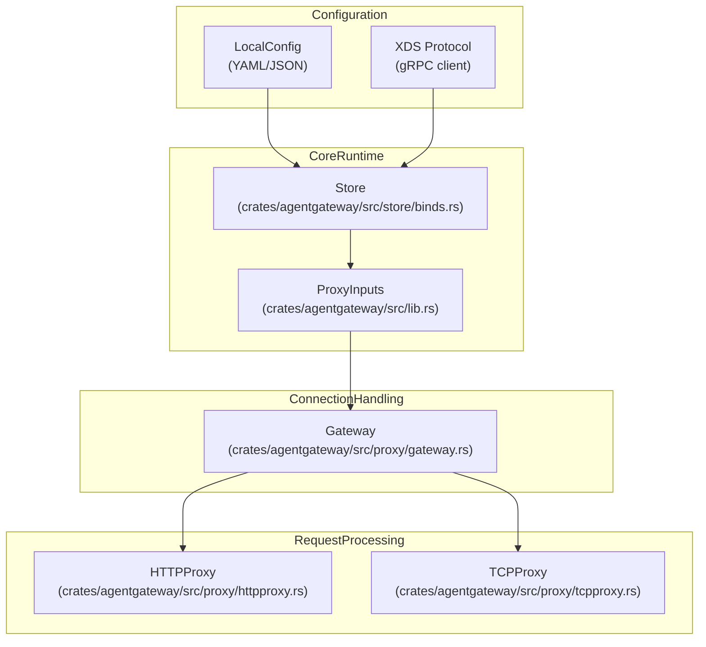
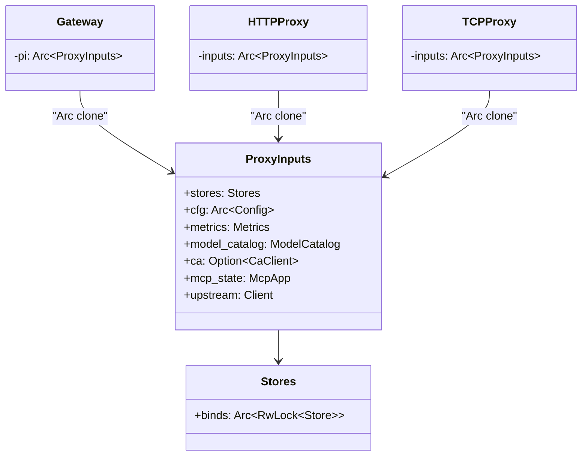
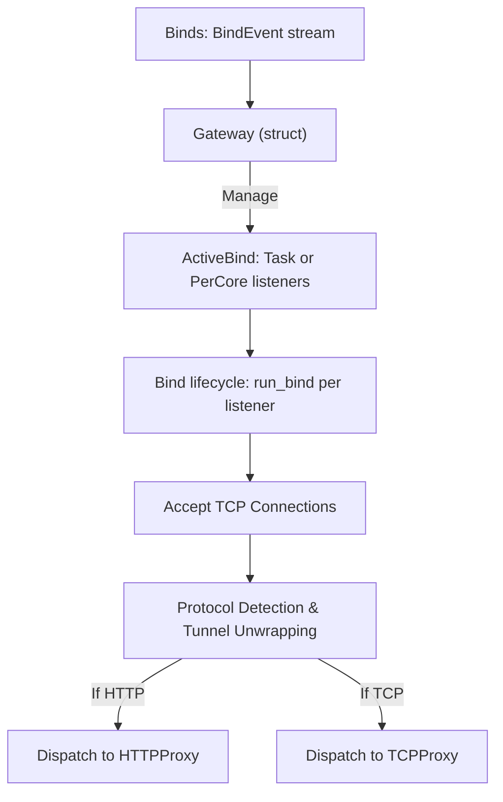
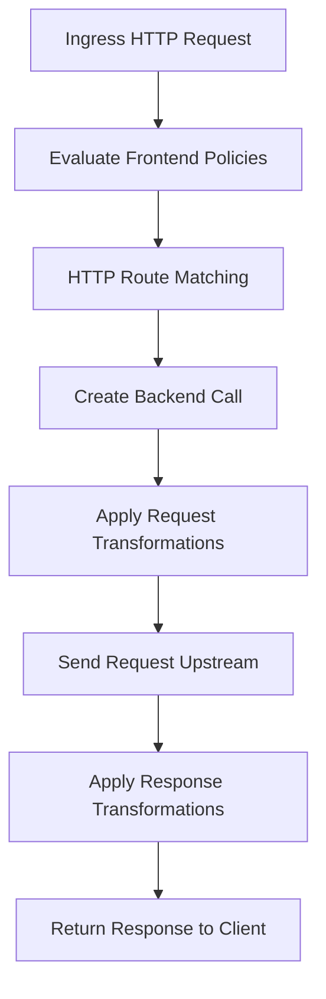
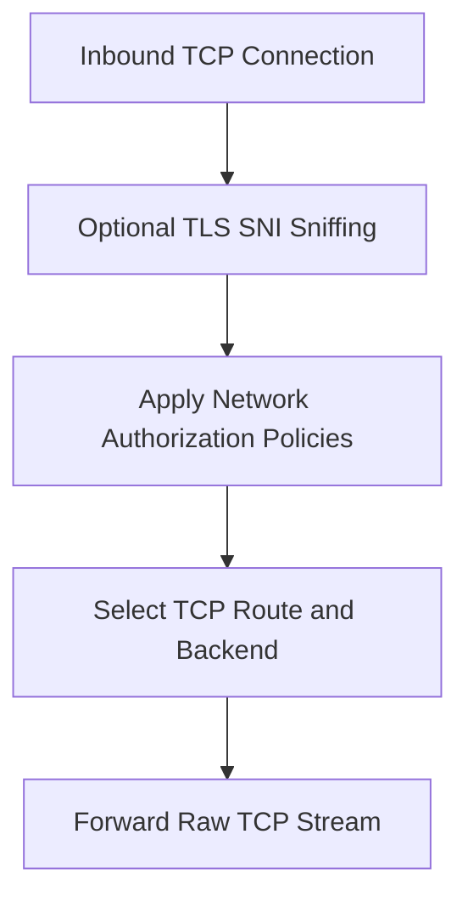
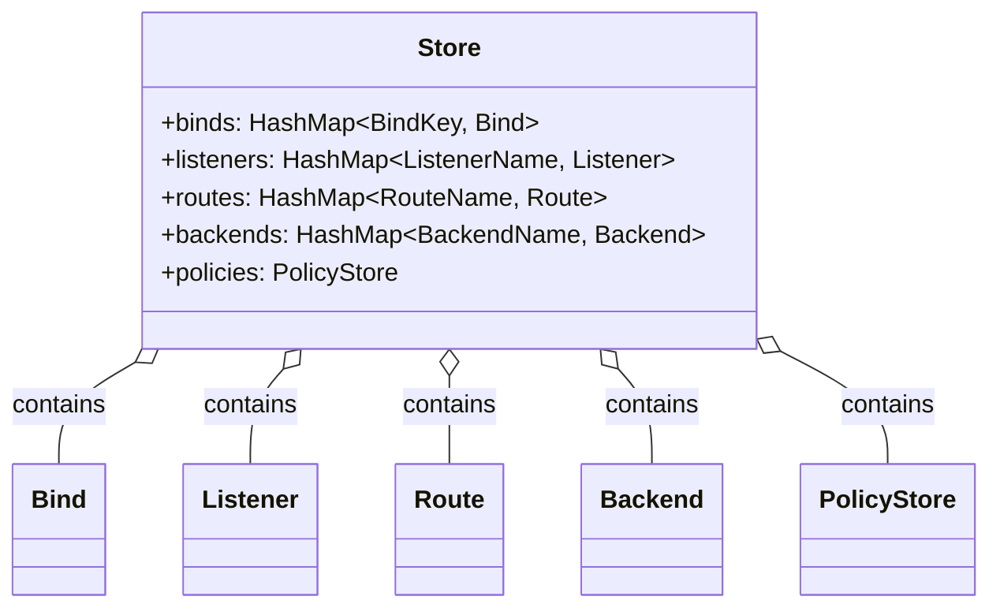
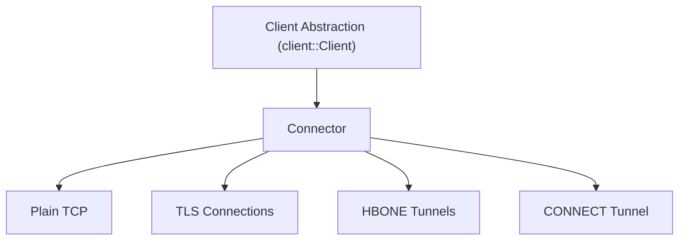
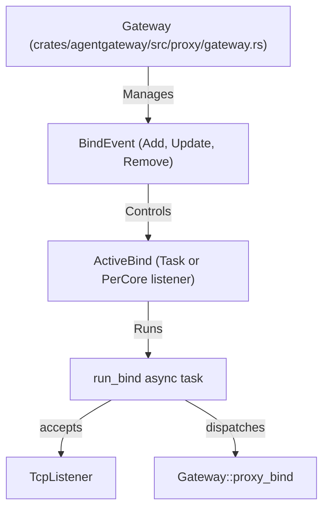
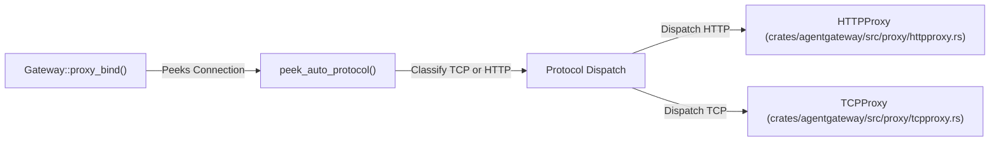

<!-- source: DeepWiki mcp.deepwiki.com · repo agentgateway/agentgateway · page 2 Core Architecture · fetched 2026-10-21 -->

# Core Architecture

Relevant source files

The following files were used as context for generating this wiki page:

- [crates/agentgateway/src/client/mod.rs](crates/agentgateway/src/client/mod.rs)
- [crates/agentgateway/src/proxy/gateway.rs](crates/agentgateway/src/proxy/gateway.rs)
- [crates/agentgateway/src/proxy/gateway_test.rs](crates/agentgateway/src/proxy/gateway_test.rs)
- [crates/agentgateway/src/proxy/tcpproxy.rs](crates/agentgateway/src/proxy/tcpproxy.rs)
- [crates/agentgateway/src/test_helpers/proxymock.rs](crates/agentgateway/src/test_helpers/proxymock.rs)

This page details the technical architecture of the Agentgateway data plane request processing system. The data plane is responsible for accepting TCP connections, detecting transport and bind protocols, applying layered policies, routing requests, and proxying traffic to upstream backends. It operates independently of the control plane (Kubernetes controller), consuming configuration either from local files or via the xDS protocol.

For deep technical details on each subsystem, refer to the child pages linked throughout this document.

Sources: [crates/agentgateway/src/proxy/gateway.rs:134-168](), [crates/agentgateway/src/proxy/httpproxy.rs:376-381]()

---

## Architecture Overview

The Agentgateway data plane is organized into several major subsystems coordinated through shared runtime context. The top-level entry point coordinates configuration stores, connection handlers, and proxy pipelines.

### Data Plane Component Architecture

This diagram shows the flow from configuration sources (local files or dynamic XDS) into the in-memory `Store`, which in turn is accessed by `ProxyInputs` as the shared runtime state. The `Gateway` acts as the connection handling front door, feeding accepted connections into dedicated processing pipelines such as `HTTPProxy` or `TCPProxy`.

Sources: [crates/agentgateway/src/proxy/gateway.rs:134-168](), [crates/agentgateway/src/store/binds.rs:91-113](), [crates/agentgateway/src/lib.rs:20-45]()

---

## Shared Runtime State: ProxyInputs

`ProxyInputs` serves as the centralized shared runtime context holding configuration, metrics, telemetry, and backend clients [crates/agentgateway/src/lib.rs:20-45](). It is created at process startup and passed by `Arc` clone into connection handlers and proxies.

### ProxyInputs Structure

This structure illustrates how `ProxyInputs` aggregates all runtime references shared across the data plane subsystems, enabling cohesive access to configuration, metrics, and clients during request processing.

Sources: [crates/agentgateway/src/lib.rs:20-45](), [crates/agentgateway/src/proxy/gateway.rs:134-168](), [crates/agentgateway/src/store/binds.rs:91-113]()

---

## Major Subsystems

### 2.1 Gateway and Connection Handling

The `Gateway` struct is the core connection manager handling network binds, connection acceptance loops, and multi-layer protocol detection [crates/agentgateway/src/proxy/gateway.rs:134-236](). It processes bind lifecycle events, starting and stopping listeners as configuration changes. 

Each accepted connection is inspected for protocol detection, including tunnel unwrapping (e.g., PROXY protocol, HBONE), and dispatched to appropriate downstream handlers such as the HTTP or TCP proxy pipelines.

`Gateway::run` drives the control loop for bind handling. It manages listener tasks, updates bound listeners, and cleanly removes them on configuration changes. Per-core binding is supported for CPU-affinitized listeners, improving performance for high connection rates.

Sources: [crates/agentgateway/src/proxy/gateway.rs:134-236]()

For detailed technical specifications, see [Gateway and Connection Handling](#2.1).

---

### 2.2 HTTP Request Processing Pipeline

The `HTTPProxy` subsystem manages the full lifecycle of HTTP(S) requests from ingress to backend communication and response transmission [crates/agentgateway/src/proxy/httpproxy.rs:376-381](). 

Key features include policy evaluation, HTTP route matching, backend call construction, request/response transformations (header/body manipulation), telemetry reporting, and error handling.

The HTTP proxy pipeline is tightly integrated with backend client abstractions and transport layers, enabling seamless support for a variety of backend protocols and authentication schemes.

Sources: [crates/agentgateway/src/proxy/httpproxy.rs:376-381]()

For detailed technical specifications, see [HTTP Request Processing Pipeline](#2.2).

---

### 2.3 TCP Proxy

The `TCPProxy` provides transparent layer 4 proxying for non-HTTP traffic [crates/agentgateway/src/proxy/tcpproxy.rs:23-31](). 

It supports TLS SNI sniffing when applicable, network authorization policies, TCP route selection, and transparent forwarding of raw TCP streams. This makes it suitable for generic TCP workloads or non-HTTP application protocols.

`TCPProxy` maintains detailed telemetry and logging contexts for observability and is integrated with the shared runtime stores for live policy and route data.

Sources: [crates/agentgateway/src/proxy/tcpproxy.rs:23-31]()

For detailed technical specifications, see [TCP Proxy](#2.3).

---

### 2.4 Configuration Store

The configuration store subsystem maintains in-memory state representing binds, listeners, routes, backends, and policies [crates/agentgateway/src/store/binds.rs:91-113](). 

It supports dynamic atomic updates via mechanisms like `insert_bind`, policy lookups, and route delegation, enabling live reconfiguration without downtime.

The store feeds configuration data into `ProxyInputs` and is crucial for consistent policy enforcement and routing.

Sources: [crates/agentgateway/src/store/binds.rs:91-113]()

For detailed technical specifications, see [Configuration Store](#2.4).

---

### 2.5 Upstream Client and Transport Layer

The upstream subsystem provides abstractions for backend client connections, supporting multiple transport protocols such as plain TCP, TLS, HBONE tunnels, and CONNECT tunnels [crates/agentgateway/src/client/mod.rs:26-222](). 

It manages connection pooling, DNS resolution, authentication tokens, and protocol negotiation.

Transport variations are encapsulated in types like `Transport` and `ApplicationTransport`, controlling behaviors such as whether DNS resolution is skipped or what headers are injected for HBONE.

Sources: [crates/agentgateway/src/client/mod.rs:26-222]()

For detailed technical specifications, see [Upstream Client and Transport Layer](#2.5).

---

### 2.6 Graceful Shutdown and Drain

The system supports graceful shutdown and drain procedures to ensure clean termination of active connections and tasks, avoiding abrupt disruptions [crates/agentgateway/src/proxy/gateway.rs:165-172]().

The `DrainWatcher` is used throughout to propagate shutdown signals and coordinate task completions.

Sources: [crates/agentgateway/src/proxy/gateway.rs:165-172]()

For detailed technical specifications, see [Graceful Shutdown and Drain](#2.6).

---

### 2.7 Application Lifecycle

Application startup involves initializing configuration (`ProxyInputs`), setting up drains, launching gateway listeners, admin servers, and integrating with control plane components.

The central application structure (`App`) controls lifecycle events, orchestrating startup, runtime, and shutdown flows [crates/agentgateway/src/proxy/gateway.rs:134-168]().

Sources: [crates/agentgateway/src/proxy/gateway.rs:134-168]()

For detailed technical specifications, see [Application Lifecycle](#2.7).

---

# Bridging Natural Language Concepts to Code Entities

### Gateway and Binds Mapping

This diagram clarifies how the `Gateway` struct coordinates the lifecycle of network binds by reacting to `BindEvent`s, spawning listener tasks, accepting TCP connections, and dispatching them for protocol detection and proxying. `ActiveBind` encapsulates listener state management including ability to stop or update binds.

Sources: [crates/agentgateway/src/proxy/gateway.rs:134-236]()

---

### Connection Handling to Proxy Pipelines Mapping

This diagram shows how the `Gateway` performs connection protocol detection using `peek_auto_protocol()`, deciding whether to delegate the connection to the HTTP or TCP proxy pipeline.

Sources: [crates/agentgateway/src/proxy/gateway.rs:134-236](), [crates/agentgateway/src/proxy/tcpproxy.rs:23-31](), [crates/agentgateway/src/proxy/httpproxy.rs:376-381]()

---

By understanding these core components and their interplay, developers and operators can grasp how Agentgateway efficiently handles diverse network protocols with dynamic configuration and rich policy enforcement. Each child page provides deep dives on subsystems, guiding detailed exploration of the implementation.

---

