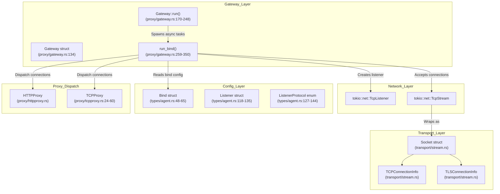
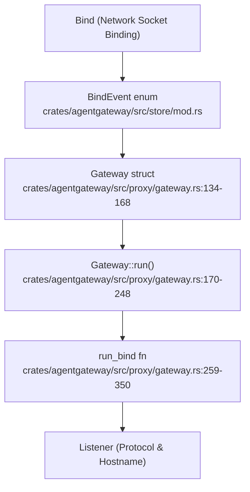

<!-- source: DeepWiki mcp.deepwiki.com · repo agentgateway/agentgateway · page 2.1 Gateway and Connection Handling · fetched 2026-10-21 -->

# Gateway and Connection Handling

<details>
<summary>Relevant source files</summary>

The following files were used as context for generating this wiki page:

- [crates/agentgateway/src/client/mod.rs](crates/agentgateway/src/client/mod.rs)
- [crates/agentgateway/src/proxy/gateway.rs](crates/agentgateway/src/proxy/gateway.rs)
- [crates/agentgateway/src/proxy/gateway_test.rs](crates/agentgateway/src/proxy/gateway_test.rs)
- [crates/agentgateway/src/proxy/tcpproxy.rs](crates/agentgateway/src/proxy/tcpproxy.rs)
- [crates/agentgateway/src/test_helpers/proxymock.rs](crates/agentgateway/src/test_helpers/proxymock.rs)

</details>


This page explains the detailed implementation and flow of Agentgateway's connection handling subsystem. It covers the `Gateway` struct [crates/agentgateway/src/proxy/gateway.rs:134-137](), the lifecycle and management of network `Binds`, connection acceptance, protocol detection, and the dispatch to protocol-specific handlers. We focus on the key entrypoints: `Gateway::run` [crates/agentgateway/src/proxy/gateway.rs:170](), the `run_bind` function managing listener sockets, and the subsequent proxy binding lifecycle.

---

## Architecture Overview

Agentgateway handles inbound network connections via a layered architecture involving:

- **Bind Layer:** Represents network socket bindings (IP:port), managing OS listeners.
- **Listener Layer:** Defines hostname and protocol matching on an individual bind.
- **Proxy Layer:** Protocol-specific request processing components (`HTTPProxy`, `TCPProxy`).

Connections arrive on a bound socket, are accepted, optionally TLS-terminated/protocol-detected, then dispatched to an appropriate proxy.

### Connection Processing Flow

The following diagram maps the general network and runtime entities managing a connection from acceptance to protocol dispatch:



Sources: [crates/agentgateway/src/proxy/gateway.rs:133-350](), [crates/agentgateway/src/proxy/tcpproxy.rs:24-60](), [crates/agentgateway/src/types/agent.rs:48-135]()

---

## Binds and Listeners

### Bind Structure

A **Bind** represents a network socket that Agentgateway listens on. It encapsulates:

| Field             | Type             | Description                                                                                           |
| ----------------- | ---------------- | ------------------------------------------------------------------------------------------------- |
| `key`             | `BindKey`        | Unique bind identifier string                                                                       |
| `address`         | `SocketAddr`     | IP address and port to bind                                                                         |
| `protocol`        | `BindProtocol`   | High-level protocol this bind supports (e.g., `HTTP`, `TCP`, `TLS`)                                |
| `tunnel_protocol` | `TunnelProtocol` | Tunnel encapsulation protocol (e.g., `HBONE`, `Proxy`)                                            |
| `mode`            | `BindMode`       | Mode of bind, typically `Standard` (OS socket listener) or `Internal` (in-process only, no OS socket) |

Binds with `mode == Internal` and port 0 are used for "wildcard fallback" traffic such as for mesh protocol tunneling.

### Listener Structure

Within a bind, zero or more **Listeners** represent finer-grained ingress points distinguished by hostname patterns and protocol:

- Each listener has a unique `key` and friendly name.
- Uses a hostname pattern to match incoming connection SNI or Host header.
- Defines a `ListenerProtocol` which determines protocol capabilities (HTTP, TCP, TLS, HBONE).
- `Listener::matches` method checks hostname matches for incoming requests.

Listeners enable protocol sensitive routing such as HTTP routing, TCP proxying, and TLS termination on a single bind socket.

Sources: [crates/agentgateway/src/types/agent.rs:48-65](), [crates/agentgateway/src/types/agent.rs:118-135]()

---

## Gateway Struct and Lifecycle

### `Gateway` Struct

The `Gateway` struct is the core runtime manager handling bind lifecycle and connection acceptance. It holds:

- `pi: Arc<ProxyInputs>` - shared reference to proxy configuration and dynamic stores.
- `drain: DrainWatcher` - drain/shutdown coordination handle.

```rust
pub struct Gateway {
    pi: Arc<ProxyInputs>,
    drain: drain::DrainWatcher,
}
```

Sources: [crates/agentgateway/src/proxy/gateway.rs:133-138]()

### `Gateway::run`

`Gateway::run` is the main event loop that:

1. Listens for `BindEvent`s (Add, Update, Remove) from the bind store [crates/agentgateway/src/proxy/gateway.rs:174-177]().
2. For new `Add` binds [crates/agentgateway/src/proxy/gateway.rs:181]():
   - Stops any existing active bind acceptors for that key [crates/agentgateway/src/proxy/gateway.rs:195]().
   - Creates a watch channel carrying the current bind config [crates/agentgateway/src/proxy/gateway.rs:198]().
   - Starts acceptor tasks:
     - For `BindListeners::Single`, spawns async Tokio tasks running `run_bind` [crates/agentgateway/src/proxy/gateway.rs:202-208]().
     - For `BindListeners::PerCore` (multi-core), spawns dedicated OS threads pinned to CPU cores, each running a single-thread Tokio runtime executing `run_bind` [crates/agentgateway/src/proxy/gateway.rs:209-233]().
3. For `Update` events, sends new bind config to watch channels without restarting listeners [crates/agentgateway/src/proxy/gateway.rs:182-187]().
4. For `Remove` events, stops active bind acceptor tasks [crates/agentgateway/src/proxy/gateway.rs:188-193]().
5. Tracks active bind acceptors in a hashmap keyed by bind key [crates/agentgateway/src/proxy/gateway.rs:178]().
6. Observes drain shutdown signals to gracefully stop acceptors.

This design allows dynamic reconfiguration of binds without restart, per-core listener scaling, and graceful lifecycle management.

Sources: [crates/agentgateway/src/proxy/gateway.rs:169-248]()

---

## Connection Acceptance: `run_bind`

The core async function `run_bind` is responsible for network socket acceptance on a specific bind listener.

### Setup

- Receives the `Arc<ProxyInputs>`, a drain watcher, a watch receiver for bind config changes, and a `Listener` (with raw TCP listener).
- Converts the listener's `std::net::TcpListener` into async `tokio::net::TcpListener`.
- Sets up a drain cancellation listener.
- Initializes any state needed for protocol detection and metrics.

### Acceptance Loop

A perpetual loop:

1. Awaits TCP connections from the listener.
2. Wraps accepted sockets into `Socket` abstraction [crates/agentgateway/src/transport/stream.rs]().
3. Attaches `TCPConnectionInfo` extension metadata [crates/agentgateway/src/proxy/tcpproxy.rs:36-38]().
4. If PROXY protocol v2 is enabled, parses the PROXY header to extract client info.
5. If the bind or listener protocol is TLS or HBONE:
   - Runs TLS handshake (via rustls or HBONE-specific server).
   - Extracts hostname from TLS SNI extension.
   - Negotiates ALPN protocols (http/1.1, h2, or none).
   - Attaches `TLSConnectionInfo` into socket extensions.
6. Detects transport protocol based on listener configuration and TLS ALPN.
7. Dispatches the connection to protocol handler:
   - HTTP traffic is routed to the hyper-util auto protocol connection handler, which detects HTTP versions and drives `HTTPProxy`.
   - TCP traffic is handed to `TCPProxy` for raw TCP proxying [crates/agentgateway/src/proxy/tcpproxy.rs:24-60]().
8. Supports connection limits, timeouts, and drain cancellation.
9. Handles accept errors with classification to decide on backoff or fatal exit [crates/agentgateway/src/proxy/gateway_test.rs:120-171]().

If the `DrainWatcher` signals shutdown, gracefully exits the accept loop and closes the listener.

Sources: [crates/agentgateway/src/proxy/gateway.rs:259-350](), [crates/agentgateway/src/proxy/gateway_test.rs:120-171]()

---

## Protocol Detection and Dispatch

### Protocol Detection

Protocol dispatch depends on:

- **BindProtocol:** coarse setting of protocol (HTTP, TCP, TLS).
- **ListenerProtocol:** detailed listener type (e.g., HTTP, HTTPS, TCP, TLS, HBONE).
- **TLS handling:** When TLS is used, TLS handshake extracts Server Name Indication (SNI) which will be used for routing.
- **ALPN protocol:** Negotiated application protocol during TLS handshake determines HTTP/1.1 or h2.

The socket may additionally run byte-level peeking to identify non-HTTP TCP traffic and select dispatch appropriately [crates/agentgateway/src/proxy/gateway_test.rs:38-55]().

### Dispatch to Protocol Handlers

- **HTTP/HTTPS:** Using `hyper_util::server::conn::auto::Builder`, an auto protocol detection handler manages HTTP/1 or HTTP/2 dispatch. Incoming requests flow into the HTTP proxy subsystem handling routing, policy, and backend communication.

- **TCP/TLS:** Connections are proxied in `TCPProxy` that implements transparent TCP forwarding, TCP route selection, TLS passthrough or termination, and network-level access control [crates/agentgateway/src/proxy/tcpproxy.rs:33-60]().

- **Tunnel protocols (HBONE, Double HBONE, etc.):** Managed by specialized handlers integrating with mesh networking [crates/agentgateway/src/client/mod.rs:124-143]().

The multiplexing over the `Socket` abstraction enables uniform extension metadata handling, including TLS state, client identity, and telemetry.

Sources: [crates/agentgateway/src/proxy/httpproxy.rs:1-97](), [crates/agentgateway/src/proxy/tcpproxy.rs:24-60](), [crates/agentgateway/src/types/agent.rs:210-230](), [crates/agentgateway/src/client/mod.rs:124-143]()

---

## Connection Metadata and Socket Extensions

Agentgateway uses the `Socket` abstraction to enrich raw TCP connections with contextual metadata through type-safe extensions:

| Extension           | Code Entity             | Description                                       |
|---------------------|-------------------------|-------------------------------------------------|
| TCP Info            | `TCPConnectionInfo`     | Peer/local address, timestamps, TCP socket info |
| TLS Info            | `TLSConnectionInfo`     | TLS session info: SNI hostname, ALPN protocols  |
| Source Context      | `SourceContext`         | Identity metadata for source workload/service   |

This enables fine-grained network policy enforcement, detailed access logging, and telemetry correlation on each connection.

Sources: [crates/agentgateway/src/transport/stream.rs](), [crates/agentgateway/src/proxy/tcpproxy.rs:36-42]()

---

## Graceful Shutdown and Drain Integration

Agentgateway integrates shutdown coordination via the `drain` crate:

- Each acceptor task in `run_bind` listens for a `DrainWatcher` signal [crates/agentgateway/src/proxy/gateway.rs:8]().
- On drain, the listeners stop accepting new connections and gracefully close existing connections.
- `Gateway::run` waits for all acceptor tasks to terminate before fully shutting down [crates/agentgateway/src/proxy/gateway.rs:170-248]().
- This prevents abrupt resets and allows orderly restarts or upgrades.

Sources: [crates/agentgateway/src/proxy/gateway.rs:8](), [crates/agentgateway/src/proxy/gateway.rs:170-256]()

---

# Mapping System Concepts to Code Entities

The diagrams below explicitly bridge natural language terms and code entities to aid navigation and comprehension.

### Diagram: Network Bindings and Listener Management in Code



Sources: [crates/agentgateway/src/proxy/gateway.rs:133-350]()

### Diagram: Connection Lifecycle for a Single Accepted Connection

```mermaid
graph TD
    TcpListener["tokio::net::TcpListener"]
    TcpStream["tokio::net::TcpStream"]
    RunBindFn["run_bind fn<br>crates/agentgateway/src/proxy/gateway.rs:259-350"]
    SocketWrap["Socket struct (wrap)<br>crates/agentgateway/src/transport/stream.rs"]
    TLSHandling["TLS handshake & SNI extraction<br>crates/agentgateway/src/proxy/gateway.rs"]
    DispatchHTTP["HTTPProxy dispatch<br>crates/agentgateway/src/proxy/httpproxy.rs"]
    DispatchTCP["TCPProxy dispatch<br>crates/agentgateway/src/proxy/tcpproxy.rs:33-60"]

    TcpListener -->|accept()| TcpStream
    TcpStream -->|wrap| SocketWrap
    SocketWrap --> TLSHandling
    TLSHandling --> RunBindFn
    RunBindFn --> DispatchHTTP
    RunBindFn --> DispatchTCP
```

Sources: [crates/agentgateway/src/proxy/gateway.rs:259-350](), [crates/agentgateway/src/proxy/httpproxy.rs:1-97](), [crates/agentgateway/src/proxy/tcpproxy.rs:33-60]()

---

# Summary

Agentgateway’s `Gateway` component orchestrates the lifecycle of network bindings (`Binds`) and listeners, reacting dynamically to configuration changes. The main `run` method subscribes to bind store events and spins up asynchronous acceptor loops (`run_bind`), which manage OS listener sockets per bind and per core.

Inbound connections are accepted and wrapped in enhanced `Socket` types with connection metadata, undergo optional TLS termination and protocol detection, then dispatched to appropriate protocol handlers (`HTTPProxy` or `TCPProxy`). The system supports multi-core binding, dynamic config reloads, protocol tunneling (HBONE), and graceful drain/shutdown signaling.

This modular architecture supports diversified protocols, high throughput via per-core listeners, and flexible ingress routing integrated with Agentgateway’s policy and telemetry subsystems.

Sources:  
- [crates/agentgateway/src/proxy/gateway.rs:133-350]()  
- [crates/agentgateway/src/proxy/tcpproxy.rs:24-60]()  
- [crates/agentgateway/src/proxy/httpproxy.rs:1-211]()  
- [crates/agentgateway/src/types/agent.rs:48-135]()  
- [crates/agentgateway/src/transport/stream.rs]()

---

