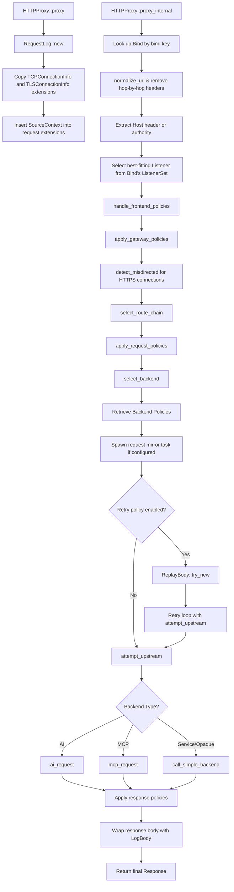
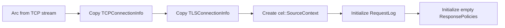
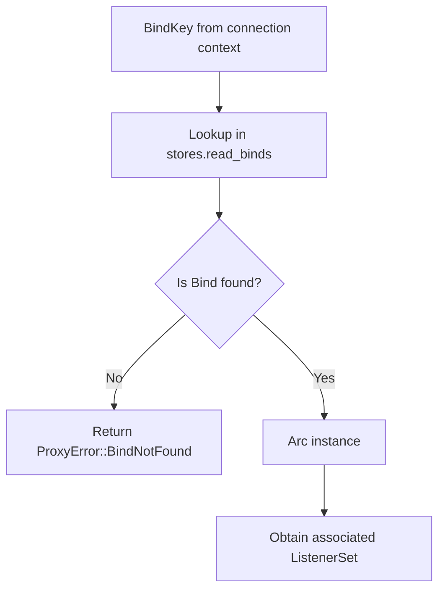
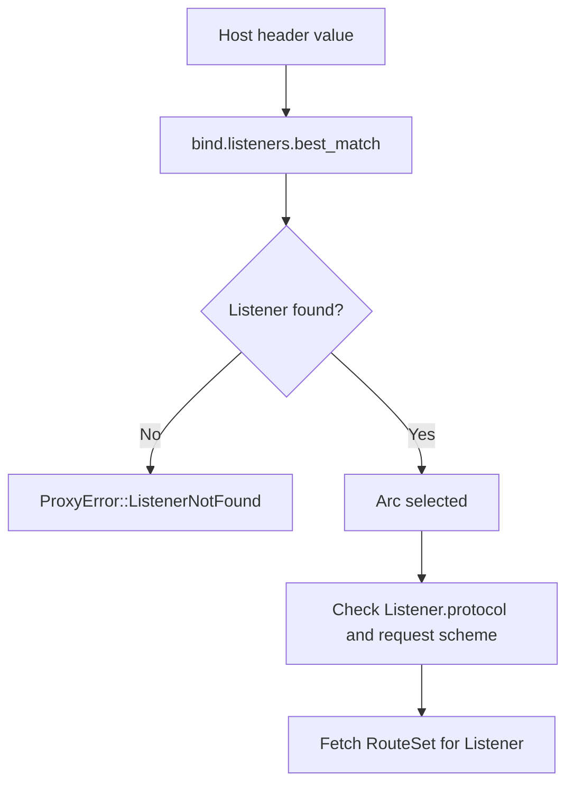
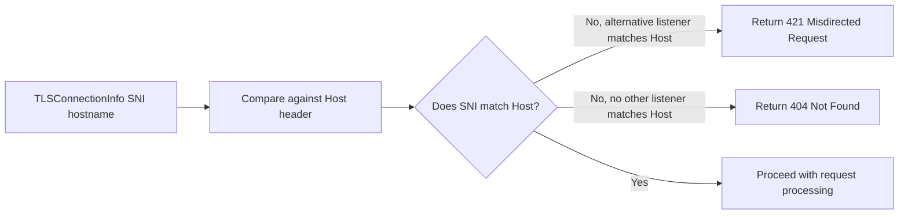
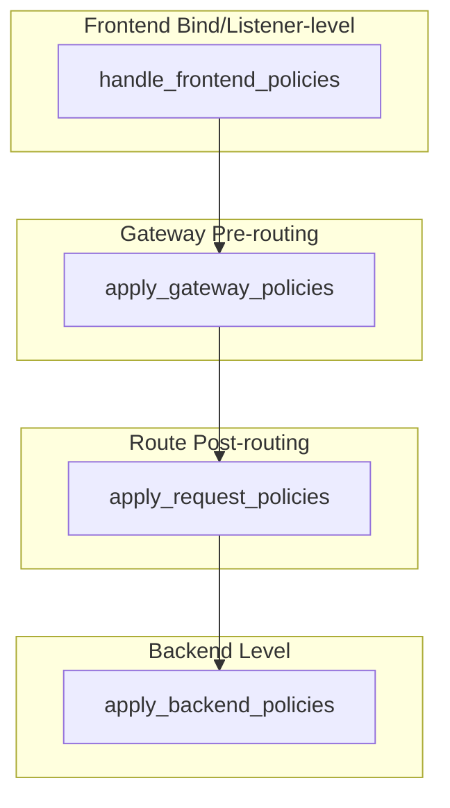
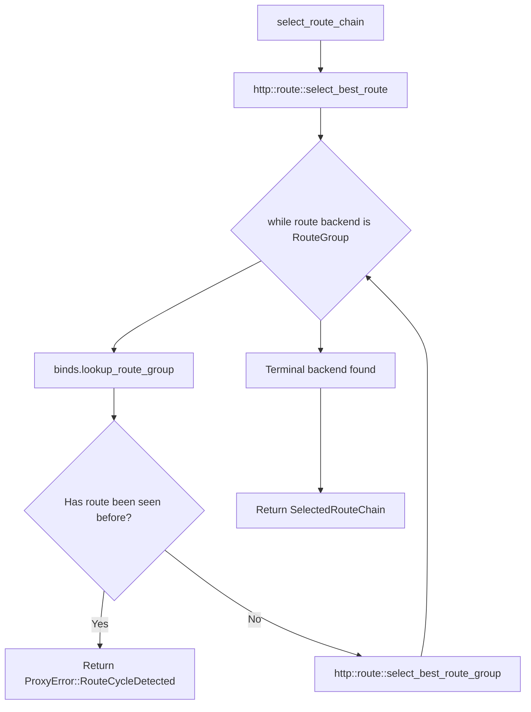
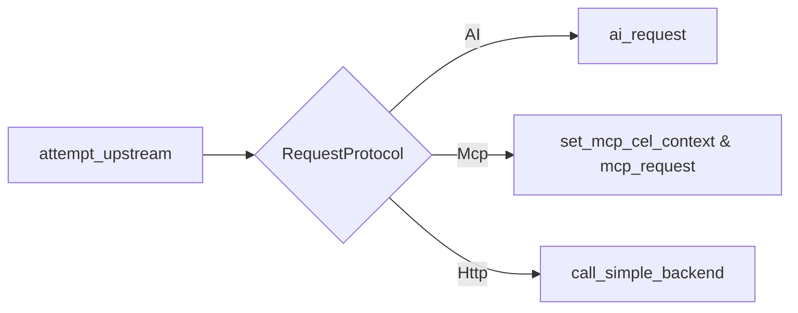
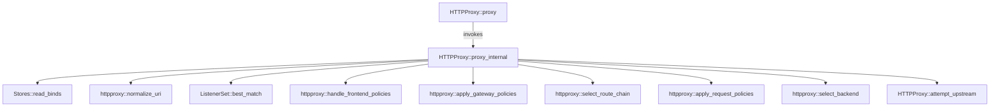
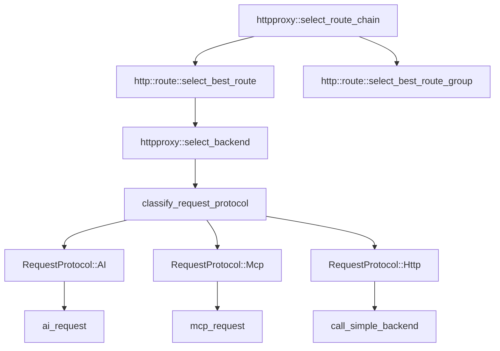

<!-- source: DeepWiki mcp.deepwiki.com · repo agentgateway/agentgateway · page 2.2 HTTP Request Processing Pipeline · fetched 2026-10-21 -->

# HTTP Request Processing Pipeline

Relevant source files

The following files were used as context for generating this wiki page:

- [api/resource.pb.go](api/resource.pb.go)
- [controller/api/v1alpha1/agentgateway/agentgateway_policy_types.go](controller/api/v1alpha1/agentgateway/agentgateway_policy_types.go)
- [controller/api/v1alpha1/agentgateway/zz_generated.deepcopy.go](controller/api/v1alpha1/agentgateway/zz_generated.deepcopy.go)
- [controller/install/helm/agentgateway-crds/templates/agentgateway.dev_agentgatewaybackends.yaml](controller/install/helm/agentgateway-crds/templates/agentgateway.dev_agentgatewaybackends.yaml)
- [controller/install/helm/agentgateway-crds/templates/agentgateway.dev_agentgatewaypolicies.yaml](controller/install/helm/agentgateway-crds/templates/agentgateway.dev_agentgatewaypolicies.yaml)
- [controller/pkg/agentgateway/plugins/backend_policies.go](controller/pkg/agentgateway/plugins/backend_policies.go)
- [controller/pkg/agentgateway/plugins/traffic_plugin.go](controller/pkg/agentgateway/plugins/traffic_plugin.go)
- [crates/agentgateway/src/http/route.rs](crates/agentgateway/src/http/route.rs)
- [crates/agentgateway/src/http/route_test.rs](crates/agentgateway/src/http/route_test.rs)
- [crates/agentgateway/src/proxy/httpproxy.rs](crates/agentgateway/src/proxy/httpproxy.rs)
- [crates/agentgateway/src/store/binds.rs](crates/agentgateway/src/store/binds.rs)
- [crates/agentgateway/src/types/agent.rs](crates/agentgateway/src/types/agent.rs)
- [crates/agentgateway/src/types/agent_xds.rs](crates/agentgateway/src/types/agent_xds.rs)
- [crates/agentgateway/src/types/local.rs](crates/agentgateway/src/types/local.rs)
- [crates/agentgateway/src/types/local_tests.rs](crates/agentgateway/src/types/local_tests.rs)
- [crates/protos/proto/resource.proto](crates/protos/proto/resource.proto)
- [schema/config.json](schema/config.json)
- [schema/config.md](schema/config.md)

This page provides a comprehensive technical overview of the HTTP request lifecycle within Agentgateway's proxy engine. It details the complete flow of an HTTP request from ingress acceptance, through normalization, policy application at various hierarchical levels, routing, backend selection, upstream invocation, response processing, and telemetry logging.

Key covered aspects include:  
- Request normalization and header processing  
- Bind and listener resolution  
- Frontend, gateway, route, and backend policy application phases  
- Route matching and route group delegation  
- Backend selection and weighted sampling  
- Protocol classification (`RequestProtocol::Http`, `RequestProtocol::Mcp`, `RequestProtocol::AI`)  
- Retry wrapping and replay buffering  
- Upstream service invocation including AI, MCP, and simple HTTP backends  
- Telemetry collection with structured request logs and traces  

Sources: `[crates/agentgateway/src/proxy/httpproxy.rs:1-209]()`, `[crates/agentgateway/src/proxy/httpproxy.rs:383-820]()`

---

## Pipeline Overview

The main entry point for HTTP request processing is the `HTTPProxy::proxy()` method. It orchestrates the entire lifecycle by invoking internal helper methods such as `proxy_internal()`, `apply_*_policies()`, and `attempt_upstream()`. 

Title: "HTTP Request Processing Lifecycle"

Sources: `[crates/agentgateway/src/proxy/httpproxy.rs:383-820]()`

---

## Request Reception and Setup

When a new inbound HTTP connection is accepted, metadata contexts are initialized and injected into the HTTP request extensions.

### Connection Context Initialization

Title: "Connection Context Initialization Flow"

- **TCPConnectionInfo**: Captures socket addresses, remote/local IP and port, and connection start time `[crates/agentgateway/src/transport/stream.rs:27-55]()`.
- **TLSConnectionInfo**: Contains TLS session details including negotiated protocols, client and server certificates, and SNI hostname `[crates/agentgateway/src/transport/stream.rs:27-55]()`.
- **SourceContext**: Wraps connection metadata as dynamic variables for CEL expression evaluation in policies.
- **RequestLog::new()**: Bootstraps structured logging for the request.

Sources: `[crates/agentgateway/src/proxy/httpproxy.rs:383-417]()`, `[crates/agentgateway/src/transport/stream.rs:27-55]()`

### Request Normalization

Before further processing, the request URI and headers undergo normalization:

| Function / Helper | Description | Location |
|---|---|---|
| `sensitive_headers()` | Marks headers considered sensitive in logging | `[crates/agentgateway/src/proxy/httpproxy.rs:510-510]()` |
| `normalize_uri()` | Converts request URI to absolute normalized form | `[crates/agentgateway/src/proxy/httpproxy.rs:511-513]()` |
| `hop_by_hop_headers()` | Lists headers that must be removed from forwarding | `[crates/agentgateway/src/proxy/httpproxy.rs:514-514]()` |
| `http::get_host()` | Extracts effective host from request headers/URI | `[crates/agentgateway/src/proxy/httpproxy.rs:516-519]()` |

Sources: `[crates/agentgateway/src/proxy/httpproxy.rs:510-528]()`

---

## Bind and Listener Selection

### Bind Resolution

Incoming connections belong to a `Bind` resource representing the configured listening port and protocol `[crates/agentgateway/src/types/agent.rs:48-56]()`. The proxy uses the bind key derived during connection acceptance to locate the corresponding `Bind`.

Title: "Bind Resolution Flow"

Sources: `[crates/agentgateway/src/proxy/httpproxy.rs:506-508]()`, `[crates/agentgateway/src/store/binds.rs:110-124]()`

### Listener Selection

Within the selected bind, the proxy matches the request's host against available `Listener` objects `[crates/agentgateway/src/types/agent.rs:118-135]()`.

Title: "Listener Selection Flow"

Sources: `[crates/agentgateway/src/proxy/httpproxy.rs:531-557]()`, `[crates/agentgateway/src/types/agent.rs:129-135]()`

### Misdirected Request Detection

For TLS-encrypted requests, the proxy compares the SNI hostname from `TLSConnectionInfo` to the Host header to detect misdirected requests `[crates/agentgateway/src/proxy/httpproxy.rs:586-586]()`:

Title: "Misdirected Request Check"

Sources: `[crates/agentgateway/src/proxy/httpproxy.rs:586-586]`, `[crates/agentgateway/src/proxy/httpproxy.rs:906-950]()`

---

## Policy Application Phases

Agentgateway applies policies across distinct processing phases (`Frontend`, `Gateway`, `Route`, `Backend`).

Title: "Policy Application Phases"

Sources: `[crates/agentgateway/src/store/binds.rs:143-198]()`, `[crates/agentgateway/src/proxy/httpproxy.rs:201-287]()`

---

## Route Matching and Delegation

The proxy resolves routes via `select_route_chain()`, supporting nested route group delegation and cycle detection `[crates/agentgateway/src/proxy/httpproxy.rs:112-153]()`.

Title: "Route Chain Selection Flow"

Sources: `[crates/agentgateway/src/proxy/httpproxy.rs:112-153]()`

---

## Backend Selection and Upstream Invocation

Backends are sampled using weighted random selection via `select_backend()` [crates/agentgateway/src/proxy/httpproxy.rs:60-66](). Incoming requests are classified into `RequestProtocol` categories (`Http`, `Mcp`, or `AI`) using `classify_request_protocol()` [crates/agentgateway/src/proxy/httpproxy.rs:75-98]().

Title: "Backend Dispatch Flow"

Sources: `[crates/agentgateway/src/proxy/httpproxy.rs:60-98]`, `[crates/agentgateway/src/proxy/httpproxy.rs:953-1655]()`

---

## Telemetry Integration

Request execution logs and tracing spans are managed via structured loggers and the `DropOnLog` RAII guard pattern `[crates/agentgateway/src/telemetry/log.rs:49-52]()`.

Sources: `[crates/agentgateway/src/proxy/httpproxy.rs:383-417]`, `[crates/agentgateway/src/telemetry/log.rs:49-52]()`

---

## Code Entity Space Diagrams

### HTTP Request Pipeline Code Mapping

Title: "HTTPProxy Execution Flow to Code Entities"

Sources: `[crates/agentgateway/src/proxy/httpproxy.rs:59-152]()`, `[crates/agentgateway/src/proxy/httpproxy.rs:383-820]()`

### Route and Backend Selection Code Mapping

Title: "Route Chain Selection and Backend Dispatch Code Entities"

Sources: `[crates/agentgateway/src/proxy/httpproxy.rs:60-153]()`, `[crates/agentgateway/src/proxy/httpproxy.rs:953-1655]()`

---

