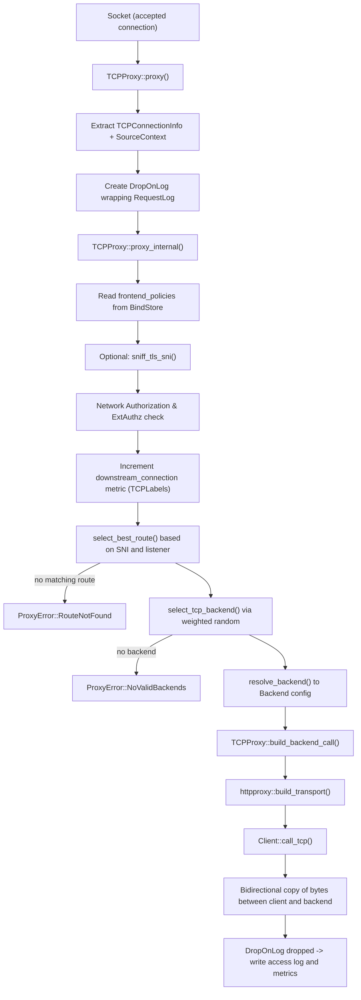
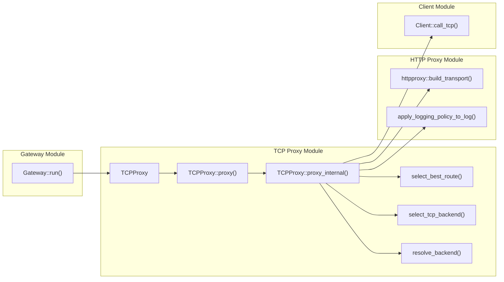

<!-- source: DeepWiki mcp.deepwiki.com · repo agentgateway/agentgateway · page 2.3 TCP Proxy · fetched 2026-10-21 -->

# TCP Proxy

<details>
<summary>Relevant source files</summary>

The following files were used as context for generating this wiki page:

- [crates/agentgateway/src/client/mod.rs](crates/agentgateway/src/client/mod.rs)
- [crates/agentgateway/src/proxy/gateway.rs](crates/agentgateway/src/proxy/gateway.rs)
- [crates/agentgateway/src/proxy/gateway_test.rs](crates/agentgateway/src/proxy/gateway_test.rs)
- [crates/agentgateway/src/proxy/tcpproxy.rs](crates/agentgateway/src/proxy/tcpproxy.rs)
- [crates/agentgateway/src/test_helpers/proxymock.rs](crates/agentgateway/src/test_helpers/proxymock.rs)

</details>


This page details the TCP proxy implementation within `agentgateway`. It focuses on the behavior and internal workings of the `TCPProxy` component responsible for Layer 4 (TCP) connection processing, including SNI-based routing, backend selection, load balancing, and integration with waypoint TCP handling.

This is a leaf-level page covering the full TCP proxy data flow, key functions and structs, policy interactions, and metrics. For HTTP protocol specifics, see page [2.2](). For connection acceptance and dispatch, see page [2.1]().

---

## Overview

The `TCPProxy` module handles Layer 4 proxying for connections that do not require HTTP parsing or manipulation. Such connections typically arise from the following configurations:

| Bind Protocol   | Listener Protocol | Description                        |
|-----------------|-------------------|----------------------------------|
| `tcp`           | `TCP`             | Raw TCP passthrough proxying     |
| `tls`           | `TCP`             | TLS passthrough with SNI routing |

In `TLS` binds with `TCP` listeners, the proxy inspects the TLS ClientHello Server Name Indication (SNI) to perform routing without terminating TLS. The proxy then forwards raw bytes bidirectionally between client and backend.

For these TCP flows, no HTTP requests or responses exist, so `TCPProxy` relies on endpoint metadata and minimal policy enforcement, primarily around network authorization and access logging.

Sources: [crates/agentgateway/src/proxy/tcpproxy.rs:23-30]()

---

## Dispatch from Gateway to TCPProxy

In the gateway’s `run` and bind management loop (`Gateway::run`), connections are accepted on sockets bound to specific `Bind` configurations (`BindProtocol::tcp` or `BindProtocol::tls`). Based on bind and listener protocols, connections are dispatched according to protocol detection:

- For `BindProtocol::tcp` and `Gateway` handling, connections are dispatched for raw TCP proxying.
- For `BindProtocol::tls` and `TCP` listeners, connections are dispatched with TLS SNI sniffing routing (TLS passthrough).
- For HTTP listeners, the HTTP proxy path is taken instead.

The key dispatch and bind lifecycle is managed via `Gateway::run` [crates/agentgateway/src/proxy/gateway.rs:169-233]().

### Gateway to TCP Dispatch Architecture

```mermaid
flowchart TD
    GatewayRun["Gateway::run()"]
    BindListen["ActiveBind task / run_bind"]
    ProtocolDetect["Protocol Detection & Dispatch"]
    TCPProxyStruct["TCPProxy::proxy()"]
    HTTPProxy["HTTPProxy handling"]

    GatewayRun --> BindListen
    BindListen --> ProtocolDetect
    ProtocolDetect -->| "TCP / TLS Passthrough" | TCPProxyStruct
    ProtocolDetect -->| "HTTP / gRPC" | HTTPProxy

    classDef code fill:#f9f9f9,stroke:#333,stroke-width:1px;
    class GatewayRun,BindListen,TCPProxyStruct,HTTPProxy code;
```

Sources: [crates/agentgateway/src/proxy/gateway.rs:169-233](), [crates/agentgateway/src/proxy/tcpproxy.rs:33-63]()

---

## TCP Proxy Data Flow

### High-Level Flow



This diagram highlights `TCPProxy`'s key responsibilities: route and backend selection, backend call construction, transport creation, and connection relaying, augmented with policy logging and metrics.

Sources: [crates/agentgateway/src/proxy/tcpproxy.rs:33-204]()

---

## Key Types and Functions

The following diagram maps critical code entities involved in TCP proxying, illustrating how gateway, tcp proxy, HTTP proxy shared logic, and client interact:



### Notable Structs and Functions

- **`TCPProxy`**: Core struct encapsulating TCP proxy state, bind name, selected listener, and target address [crates/agentgateway/src/proxy/tcpproxy.rs:23-30]().
- **`TCPProxy::proxy()`**: Public async function accepting a TCP socket, sets up logging, metrics, and calls internal proxy handler [crates/agentgateway/src/proxy/tcpproxy.rs:33-63]().
- **`TCPProxy::proxy_internal()`**: Implements main proxy logic—route selection, backend selection, transport and client call [crates/agentgateway/src/proxy/tcpproxy.rs:65-204]().
- **`select_best_route()`**: Finds the best matching TCP route given SNI, hostname, and listener [crates/agentgateway/src/proxy/tcpproxy.rs:165-173]().
- **`select_tcp_backend()`**: Weighted random selection of backend from TCPRoute backends [crates/agentgateway/src/proxy/tcpproxy.rs:184-185]().
- **`resolve_backend()`**: Resolves backend reference to actual backend config from the configuration store [crates/agentgateway/src/proxy/tcpproxy.rs:186]().
- **`Client::call_tcp()`**: Async client call function to create outbound connection and proxy streams [crates/agentgateway/src/client/mod.rs:43-47]().

Sources: [crates/agentgateway/src/proxy/tcpproxy.rs:23-204](), [crates/agentgateway/src/proxy/gateway.rs:169-233](), [crates/agentgateway/src/client/mod.rs:43-47]()

---

## Route Selection and SNI Sniffing

### SNI-based Routing

For binds with TLS passthrough or waypoint TCP traffic, `TCPProxy` supports SNI detection without terminating TLS. The proxy peeks at ClientHello bytes to extract the Server Name Indication (SNI) hostname via `sniff_tls_sni` [crates/agentgateway/src/proxy/tcpproxy.rs:89-96]().

- SNI extraction is performed conditionally only if the connection is from a waypoint and the service port is configured with TLS (`should_sniff` flag checked from `WaypointTLSInfo`) [crates/agentgateway/src/proxy/tcpproxy.rs:88-92]().
- The extracted SNI is used later to match TCP routes configured with hostnames.

### Matching Logic in `select_best_route`

- Given the SNI string (or none), it builds a set of hostname match candidates.
- Routes are matched with a preference order:
  - Exact hostname match.
  - Wildcard prefix match (e.g., `*.example.com`).
  - Catch-all match `"*"`.

| Matching Order         | Behavior                                  |
|-----------------------|-------------------------------------------|
| Exact hostname match   | Match route bound to specific hostname    |
| Wildcard match (`*.`)  | Match route with wildcard hostname         |
| Catch-all (`*`)        | Fallback catch-all route                    |

This enables SNI routing without terminating TLS, an important feature for handling encrypted TCP connections and Waypoint support.

Sources: [crates/agentgateway/src/proxy/tcpproxy.rs:88-173]()

---

## Backend Selection and Load Balancing

`TCPProxy` performs backend selection on the matched TCP route:

- Backends are selected with **weighted random** strategy using weights specified on each `TCPRouteBackend` [crates/agentgateway/src/proxy/tcpproxy.rs:184-185]().
- `select_tcp_backend` selects one backend among candidates randomly influenced by weights.
- The selected backend reference is resolved to its full backend configuration using `resolve_backend`.
- If no valid backend is found, the proxy returns a `ProxyError::NoValidBackends`.

| Selection Step           | Description                          |
|--------------------------|------------------------------------|
| Weighted random selection| Chooses backend based on assigned weights |
| Backend resolution       | Resolves references to backend config |

Sources: [crates/agentgateway/src/proxy/tcpproxy.rs:184-192]()

---

## Transport Building and Bidirectional Copy

After backend call construction:

- Backend policies and tunnel settings are resolved; tunnels may be configured for HBONE, CONNECT, or other protocols [crates/agentgateway/src/proxy/tcpproxy.rs:187-204]().
- The transport layer is created using shared logic (`httpproxy::build_transport`) that applies TLS, HBONE tunnels, or plain TCP transports.
- The proxy establishes the outbound connection through the client abstraction.
- Bidirectional copying of bytes between the inbound client socket and the outbound backend connection is then performed asynchronously.

This creates a transparent proxying data path with minimal overhead and full policy integration.

Sources: [crates/agentgateway/src/proxy/tcpproxy.rs:187-204]()

---

## Policy Application

The `TCPProxy` applies a limited but crucial subset of policies due to the lack of HTTP context:

| Policy Category           | Applied      | Notes                                                      |
|---------------------------|--------------|------------------------------------------------------------|
| Network Authorization     | ✅           | Enforced via `authz.apply()` on the TCP connection context [crates/agentgateway/src/proxy/tcpproxy.rs:117-122]() |
| Network External Authorization (ExtAuthz) | ✅ | Checked asynchronously via `check_network()` call [crates/agentgateway/src/proxy/tcpproxy.rs:123-139]()             |
| Frontend Access Logging   | ✅           | Access logs emitted according to frontend policy [crates/agentgateway/src/proxy/tcpproxy.rs:84-86]()                |
| CEL Expression Logging    | ✅           | Source context registered and evaluated for logging [crates/agentgateway/src/proxy/tcpproxy.rs:43-58]()               |
| Backend TLS               | ✅           | Transport layer configures TLS via backend TLS policies      |
| HTTP-Specific Policies    | ❌           | Not applicable to TCP proxy (no JWT, CORS, rate limits, etc.) |

This selective policy enforcement ensures network security and observability without HTTP protocol overhead.

Sources: [crates/agentgateway/src/proxy/tcpproxy.rs:43-139]()

---

## Logging and Metrics

### Logging via DropOnLog

- `TCPProxy` creates a `RequestLog` instance for each connection with context info.
- It wraps it with a `DropOnLog` guard that triggers automatic log emission when dropped asynchronously [crates/agentgateway/src/proxy/tcpproxy.rs:43-53]().
- Access logs from frontend policies are applied, allowing logging configuration to affect TCP proxy logs [crates/agentgateway/src/proxy/tcpproxy.rs:84-86]().
- This RAII pattern avoids forgetting to emit logs at connection termination.

### Metrics

- TCP proxy-specific metrics are tagged with `TCPLabels` including bind, gateway, listener name, and protocol [crates/agentgateway/src/proxy/tcpproxy.rs:140-149]().
- The metric counter `downstream_connection` is incremented per proxied TCP connection [crates/agentgateway/src/proxy/tcpproxy.rs:150-155]().
- Metrics support observability and usage tracking of TCP proxy flows.

Sources: [crates/agentgateway/src/proxy/tcpproxy.rs:43-63](), [crates/agentgateway/src/proxy/tcpproxy.rs:140-155]()

---

## Summary

The `TCPProxy` subsystem in `agentgateway` provides transparent, protocol-agnostic Layer 4 connection proxying for raw TCP and TLS passthrough scenarios. It performs SNI-based route selection, weighted backend load balancing, and efficient bidirectional byte forwarding while maintaining network-level policy enforcement and observability.

Sources: [crates/agentgateway/src/proxy/tcpproxy.rs:33-204]()

---

