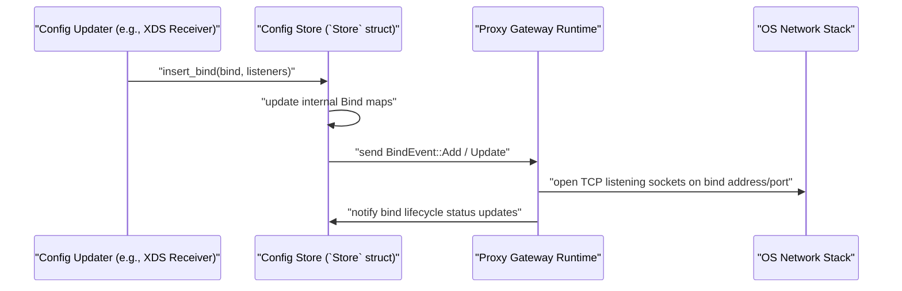
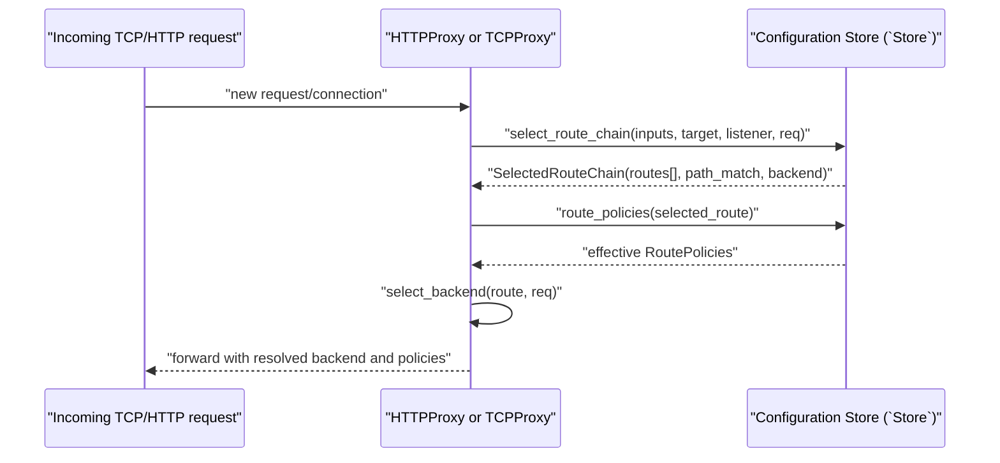

<!-- source: DeepWiki mcp.deepwiki.com · repo agentgateway/agentgateway · page 2.4 Configuration Store · fetched 2026-10-21 -->

# Configuration Store

<details>
<summary>Relevant source files</summary>

The following files were used as context for generating this wiki page:

- [api/resource.pb.go](api/resource.pb.go)
- [controller/api/v1alpha1/agentgateway/agentgateway_policy_types.go](controller/api/v1alpha1/agentgateway/agentgateway_policy_types.go)
- [controller/api/v1alpha1/agentgateway/zz_generated.deepcopy.go](controller/api/v1alpha1/agentgateway/zz_generated.deepcopy.go)
- [controller/install/helm/agentgateway-crds/templates/agentgateway.dev_agentgatewaybackends.yaml](controller/install/helm/agentgateway-crds/templates/agentgateway.dev_agentgatewaybackends.yaml)
- [controller/install/helm/agentgateway-crds/templates/agentgateway.dev_agentgatewaypolicies.yaml](controller/install/helm/agentgateway-crds/templates/agentgateway.dev_agentgatewaypolicies.yaml)
- [controller/pkg/agentgateway/plugins/backend_policies.go](controller/pkg/agentgateway/plugins/backend_policies.go)
- [controller/pkg/agentgateway/plugins/traffic_plugin.go](controller/pkg/agentgateway/plugins/traffic_plugin.go)
- [crates/agentgateway/src/proxy/httpproxy.rs](crates/agentgateway/src/proxy/httpproxy.rs)
- [crates/agentgateway/src/store/binds.rs](crates/agentgateway/src/store/binds.rs)
- [crates/agentgateway/src/types/agent.rs](crates/agentgateway/src/types/agent.rs)
- [crates/agentgateway/src/types/agent_xds.rs](crates/agentgateway/src/types/agent_xds.rs)
- [crates/agentgateway/src/types/local.rs](crates/agentgateway/src/types/local.rs)
- [crates/agentgateway/src/types/local_tests.rs](crates/agentgateway/src/types/local_tests.rs)
- [crates/protos/proto/resource.proto](crates/protos/proto/resource.proto)
- [schema/config.json](schema/config.json)
- [schema/config.md](schema/config.md)

</details>


The Configuration Store is the central in-memory component of **agentgateway** that maintains the full runtime configuration. It holds and indexes all essential gateway resources—including Binds, Listeners, HTTP and TCP Routes, Backends, and Policies—enabling efficient, concurrent lookups required for request processing within the proxy data plane.

---

## Store Architecture

The core store is implemented by the `Store` struct in `crates/agentgateway/src/store/binds.rs`. It operates as a highly concurrent repository of configuration resources, indexed for rapid access by their unique keys or related targets.

### Key Fields in `Store`

| Field                   | Type                                                  | Description                                                                |
|-------------------------|-------------------------------------------------------|----------------------------------------------------------------------------|
| `ipv6_enabled`           | `bool`                                                | Indicates if IPv6 address support is enabled for network operations.       |
| `core_ids`               | `Option<Vec<core_affinity::CoreId>>`                  | Optional list of CPU cores for thread-affine listener socket management.   |
| `dynamic_ca_cert_cache`  | `crate::DynamicCaCertCacheConfig`                      | Dynamic certificate authority cache config for TLS functionality.          |
| `binds`                  | `HashMap<BindKey, Arc<Bind>>`                          | All configured binds, mapped by unique bind keys.                          |
| `resources`              | `HashMap<Strng, ResourceKind>`                         | Mapping of resource keys to their type (Bind, Listener, Route, etc).       |
| `policies_by_key`        | `HashMap<PolicyKey, Arc<TargetedPolicy>>`              | Policies indexed by their unique policy keys.                              |
| `policies_by_target`     | `hashbrown::HashMap<PolicyTarget, BTreeSet<PolicyKey>>`| Reverse index of policies by the target resource they apply to.            |
| `backends`               | `HashMap<BackendKey, Arc<BackendWithPolicies>>`        | Backend definitions indexed by backend keys.                               |
| `model_routes`           | `HashMap<RouteKey, (ListenerKey, agent::ModelRoute)>`  | AI model-specific routes indexed by route keys.                            |
| `model_routers`          | `HashMap<RouteKey, BackendKey>`                         | Maps model router route keys to backend keys for dynamic model routing.    |
| `listeners`              | `HashMap<BindKey, Arc<ListenerSet>>`                    | Set of listeners grouped under each bind.                                 |
| `http_routes`            | `HbHashMap<RouteTarget, Arc<RouteSet>>`                 | HTTP routes indexed by route targets (such as listeners or services).      |
| `tcp_routes`             | `HbHashMap<RouteTarget, Arc<TCPRouteSet>>`              | TCP routes indexed by route targets.                                       |
| `listener_change_tx`     | `tokio::sync::watch::Sender<u64>`                       | Watch sender broadcasting listener state changes.                          |
| `listener_change_rx`     | `tokio::sync::watch::Receiver<u64>`                     | Receiver for listener state change notifications.                          |
| `tx`                     | `tokio::sync::mpsc::UnboundedSender<BindEvent>`         | Channel sender for bind lifecycle events (add/update/remove).              |
| `rx`                     | `Option<tokio::sync::mpsc::UnboundedReceiver<BindEvent>>`| Channel receiver for bind events, typically consumed internally.           |

This layered indexing pattern supports rapid and targeted lookups by resource key or target, which is crucial to minimize latency in network request routing and enforcement of policies at runtime.

### Store Data Relationships Diagram

Title: "Store Data Relationships"

```mermaid
graph TB
  subgraph StoreStructure[""Configuration Store (`Store` struct)""]
    Binds[""binds: HashMap<BindKey, Arc<Bind>>""]
    Listeners[""listeners: HashMap<BindKey, Arc<ListenerSet>>""]
    HttpRoutes[""http_routes: HbHashMap<RouteTarget, Arc<RouteSet>>""]
    TcpRoutes[""tcp_routes: HbHashMap<RouteTarget, Arc<TCPRouteSet>>""]
    PoliciesByKey[""policies_by_key: HashMap<PolicyKey, Arc<TargetedPolicy>>""]
    PoliciesByTarget[""policies_by_target: hashbrown::HashMap<PolicyTarget, BTreeSet<PolicyKey>>""]
    Backends[""backends: HashMap<BackendKey, Arc<BackendWithPolicies>>""]
    Tx[""tx: UnboundedSender<BindEvent>""]
  end

  Binds --> Listeners
  Listeners --> HttpRoutes
  Listeners --> TcpRoutes

  PoliciesByTarget -. "lookup by target" .-> PoliciesByKey
  HttpRoutes -. "targeted by" .-> RouteTarget[""RouteTarget (Listener/Service/RouteGroup)""]
  TcpRoutes -. "targeted by" .-> RouteTarget
  Backends -. "keyed on backend keys" .-> BackendWithPolicies[""BackendWithPolicies""]

  StoreStructure --> Tx
```

Sources:  
[`crates/agentgateway/src/store/binds.rs:110-132`]() [`crates/agentgateway/src/types/agent.rs:28-36`]()

---

## Resource Hierarchy

The configuration model captures the gateway topology and routing logic with a hierarchical set of resource types:

- **Bind**: Represents a network bind controlling a port and protocols on the host.
- **Listener**: Defines listeners assigned to Binds, matching hostname and protocol.
- **Route**: HTTP route definitions specifying matching rules and backend targets.
- **TCPRoute**: Layer 4 TCP routes for direct TCP/TLS routing.
- **Backend**: Upstream service endpoints including AI, MCP, static services, dynamic forward proxies, and cloud specific backends.
- **Policy**: Declarative policies applied at different levels controlling traffic, authentication, retries, logging, etc.

### Resource Relationship Diagram

Title: "Resource Hierarchy and Relationships"

```mermaid
graph TD
    Bind[""Bind struct [agent.rs:48-57]""]
    Listener[""Listener struct [agent.rs:118-127]""]
    HTTPRoute[""Route struct [agent.rs:33]""]
    TCPRoute[""TCPRoute struct [agent.rs:36]""]
    Backend[""Backend enum [agent.rs:28]""]

    FrontendPol[""FrontendPolices struct [binds.rs:160-175]""]
    BackendPol[""BackendPolicy (trait & structs)""]

    Bind --> Listener
    Listener --> HTTPRoute
    Listener --> TCPRoute
    HTTPRoute --> Backend
    TCPRoute --> Backend

    FrontendPol -. "attaches to" .-> Listener
    BackendPol -. "attached to" .-> Backend
```

Resources are defined as rich Rust types with thread-safe shared ownership (`Arc`) for concurrency and snapshot semantics. The `BindSnapshot` type combines a `Bind` with its associated listeners for atomic updates.

Sources:  
[`crates/agentgateway/src/types/agent.rs:48-127`]() [`crates/agentgateway/src/store/binds.rs:160-175`]()

---

## Key Resource Types Explained

| Resource      | Implementation                                      | Description                                                                                         |
|---------------|-----------------------------------------------------|-----------------------------------------------------------------------------------------------------|
| **Bind**      | `Bind` struct [`crates/agentgateway/src/types/agent.rs:48-57`]() | Network bind configuration with address, port, protocol (HTTP/TCP/TLS), tunnel protocol, and mode. |
| **Listener**  | `Listener` struct [`crates/agentgateway/src/types/agent.rs:118-127`]() | Listener details including hostname, protocol, and bind key grouping.                              |
| **Route**     | `Route` struct [`crates/agentgateway/src/types/agent.rs:33`]() | HTTP routing rules with matchers and backend references.                                          |
| **TCPRoute**  | `TCPRoute` struct [`crates/agentgateway/src/types/agent.rs:36`]() | TCP Layer 4 route rules directing traffic to backends.                                            |
| **Backend**   | `Backend` enum [`crates/agentgateway/src/types/agent.rs:28`]() | Backend targets supporting AI, MCP, static, dynamic, and cloud-specific types.                     |
| **FrontendPolicies** | `FrontendPolices` struct [`crates/agentgateway/src/store/binds.rs:160-175`]() | Policies applied on frontends/listeners (TLS, logging, access controls, etc).                      |
| **BackendPolicy**    | Various trait implementations and structs in `binds.rs` | Policies applied on backend connections (auth, retries, timeouts, etc).                          |

Sources:  
[`crates/agentgateway/src/types/agent.rs:48-127`]() [`crates/agentgateway/src/store/binds.rs:160-175`]()

---

## Configuration Modification Functions: `insert_bind` and `insert_policy`

The `Store` supports adding and updating configuration resources dynamically at runtime.

### `insert_bind`

This function inserts or replaces a Bind resource and its associated ListenerSet. For binds with `mode == STANDARD`, the store triggers the creation of appropriate OS TCP listener sockets. For `INTERNAL` mode binds, no OS socket is opened as these are for in-process routing only.

On insert or update, a `BindEvent` (Add/Update) is sent on an internal channel. This notifies the `Gateway` runtime to spawn listeners or remove obsolete ones.

### `insert_policy`

This function inserts or updates a `TargetedPolicy` resource. Policies are tracked by policy key for direct access and additionally reverse-indexed by their target resources such as listeners, routes, or backends, enabling efficient lookup of all policies applying to any given resource.

The store also handles policy inheritance and merging during request processing, ensuring accurate application across hierarchical configurations.

### `route_policies`

`route_policies` is a derived abstraction representing the effective set of policies applying to an HTTP or TCP route at runtime. This is computed by merging all applicable policies from the store, factoring in inheritance, and is critical for routing decisions, retries, and filtering.

Sources:  
[`crates/agentgateway/src/store/binds.rs:118-140`]() [`crates/agentgateway/src/proxy/httpproxy.rs:200-209`]()

---

## The BindStore and BindEvent Lifecycle

The BindStore manages the lifecycle of Binds and their network listeners, coordinating OS-level socket creation and in-memory routing state.

Its responsibilities include:

- Creating OS TCP listeners for binds in `STANDARD` mode.
- Managing logical internal binds (`INTERNAL` mode) without real sockets, enabling internal routing and CONNECT reentry.
- Supporting per-core TCP listeners when core affinity is enabled, optimizing network performance.
- Broadcasting `BindEvent` messages to inform other components of configuration changes.
- Coordinating with the `Gateway` runtime which accepts TCP connections on the active bind sockets.

### BindStore Event Flow Diagram

Title: "BindStore Event Flow"



This event-driven model allows agentgateway to support dynamic and hot reloadable configuration of network bindings with minimal disruption.

Sources:  
[`crates/agentgateway/src/store/binds.rs:116-140`]()

---

## Configuration Lookups During Request Processing

During request handling by HTTP and TCP proxies, the configuration store is queried extensively to resolve routing and policies.

- **Route Chain Selection**: `select_route_chain` walks the route hierarchy, resolving route groups and detecting cycles to provide a full chain of routing decisions [`crates/agentgateway/src/proxy/httpproxy.rs:113-153`].

- **Backend Selection**: A backend is selected from the route backends using weighted round-robin or health-based selection.

- **Policy Application**: Policies relevant to the selected route and backend are retrieved and merged via functions like `route_policies`, informing policy enforcement such as retries, timeouts, authentication.

- **PolicyClient**: An internal abstraction used for fetching and evaluating policies during processing.

### Request Processing Configuration Flow Diagram

Title: "Request Processing Configuration Flow"



This dynamic lookup underpins the proxy’s ability to route requests accurately and apply complex policies in real-time.

Sources:  
[`crates/agentgateway/src/proxy/httpproxy.rs:113-154`]() [`crates/agentgateway/src/proxy/httpproxy.rs:160-240`]()

---

# Summary

The Configuration Store is the authoritative runtime source for agentgateway’s full proxy configuration state. It provides:

- Fast, concurrent in-memory data structures for all resource types.
- Hierarchical, indexed resource representations reflecting the network and routing topology.
- Dynamic configuration insertion and update primitives with lifecycle event broadcasting.
- Support for rich policy merging and inheritance semantics.
- Tight integration with the network listener lifecycle and request processing logic for rapid resolution of routing and policy enforcement.

This architecture is foundational to enabling agentgateway’s flexible, high-performance, and dynamically configurable data plane.

---

# References and Sources

- Store implementation and resource indexing:  
  [`crates/agentgateway/src/store/binds.rs:110-132`]()
- Key resource types and snapshots:  
  [`crates/agentgateway/src/types/agent.rs:48-127`]()
- Bind events and listener lifecycle management:  
  [`crates/agentgateway/src/store/binds.rs:116-140`]()
- HTTP proxy route and backend selection logic:  
  [`crates/agentgateway/src/proxy/httpproxy.rs:113-154`]() [`crates/agentgateway/src/proxy/httpproxy.rs:160-240`]()
- Policy application during requests:  
  [`crates/agentgateway/src/proxy/httpproxy.rs:200-209`]()
- Resource type enums and diagnostics:  
  [`crates/agentgateway/src/types/agent_xds.rs:40-70`]()

---

