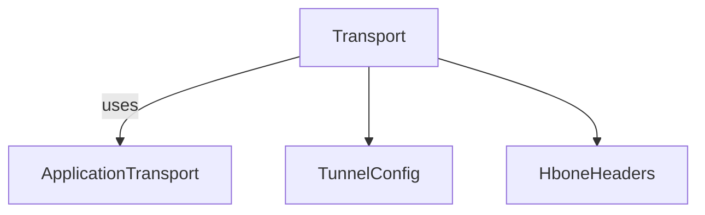
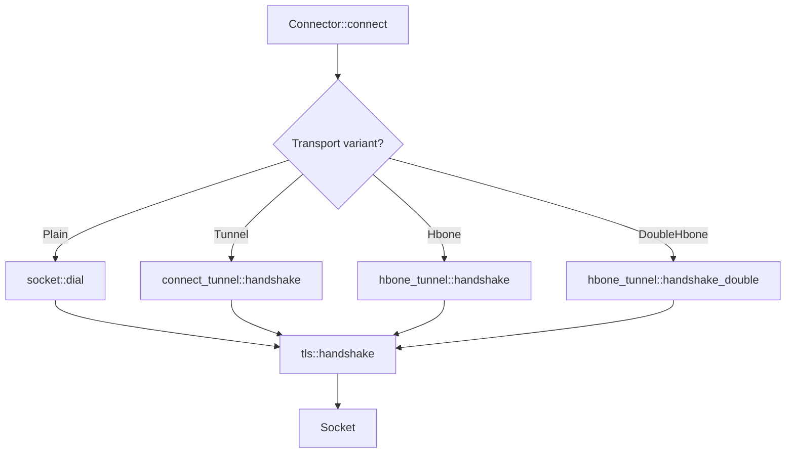

<!-- source: DeepWiki mcp.deepwiki.com · repo agentgateway/agentgateway · page 2.5 Upstream Client and Transport Layer · fetched 2026-10-21 -->

# Upstream Client and Transport Layer

<details>
<summary>Relevant source files</summary>

The following files were used as context for generating this wiki page:

- [crates/agentgateway/src/client/mod.rs](crates/agentgateway/src/client/mod.rs)
- [crates/agentgateway/src/proxy/gateway.rs](crates/agentgateway/src/proxy/gateway.rs)
- [crates/agentgateway/src/proxy/gateway_test.rs](crates/agentgateway/src/proxy/gateway_test.rs)
- [crates/agentgateway/src/proxy/tcpproxy.rs](crates/agentgateway/src/proxy/tcpproxy.rs)
- [crates/agentgateway/src/test_helpers/proxymock.rs](crates/agentgateway/src/test_helpers/proxymock.rs)
- [crates/agentgateway/src/transport/stream.rs](crates/agentgateway/src/transport/stream.rs)

</details>


This page covers the design and implementation details of the outbound connection subsystem of `agentgateway`. It explains how `agentgateway` dials upstream services using various transport methods (`Plain`, `Tunnel`, `Hbone`, `DoubleHbone`, `HboneWaypoint`), how the `Client` abstraction interfaces with connection pooling and DNS resolution, and how the `Connector` constructs and establishes transport-layer connections. The fundamental unified asynchronous I/O abstraction, `Socket`, is also described.

For additional context, inbound connection handling is discussed on page [2.1](), TCP proxy on page [2.3](), TLS details on page [11.2](), and HBONE protocol on page [11.3](). Connection pooling internals can be found on page [11.5]().

---

## Overview

`Agentgateway`'s outbound traffic layer revolves around two primary types defined in the `crates/agentgateway/src/client/mod.rs` file:

| Type       | Role                                                            |
|------------|-----------------------------------------------------------------|
| `Client`   | Public interface for making HTTP and TCP calls to upstreams    |
| `Connector`| Tower-style service responsible for establishing `Socket`s    |

The type `Socket` (defined in `crates/agentgateway/src/transport/stream.rs`) abstracts over various async streams such as TCP, TLS, HBONE tunnels, or Unix sockets, attaching metadata and metrics.

Sources: [crates/agentgateway/src/client/mod.rs:26-29](), [crates/agentgateway/src/transport/stream.rs:1-130]()

---

## Transport Hierarchy

The outbound transport layering in `agentgateway` separates concerns into two levels, modeling how bytes are sent through the pipeline:

- **`ApplicationTransport`**: The protocol used for application data after all tunneling (e.g., plain TCP or TLS).
- **`Transport`**: The outer transport mechanism encapsulating `ApplicationTransport`; includes tunnels and special protocols like HBONE and double HBONE.

### `ApplicationTransport`

```rust
pub enum ApplicationTransport {
    Plaintext,
    Tls(VersionedBackendTLS),
}
```

| Variant    | Description                              |
|------------|------------------------------------------|
| Plaintext  | Plain TCP or Unix socket without TLS    |
| Tls        | TLS connection configured for backend   |

Sources: [crates/agentgateway/src/client/mod.rs:50-72]()

### `Transport`

```rust
pub enum Transport {
    Plain(ApplicationTransport),
    Tunnel(ApplicationTransport, TunnelConfig),
    Hbone(ApplicationTransport, u16, Vec<Identity>, HboneHeaders),
    DoubleHbone {
        gateway_address: SocketAddr,
        gateway_identities: Vec<Identity>,
        waypoint_identities: Vec<Identity>,
        inner: ApplicationTransport,
        headers: HboneHeaders,
    },
    HboneWaypoint {
        waypoint_address: SocketAddr,
        identities: Vec<Identity>,
        inner: ApplicationTransport,
    },
}
```

| Variant        | Mechanism                            | DNS Resolved Locally?                                   |
|----------------|------------------------------------|--------------------------------------------------------|
| Plain          | Direct TCP or TLS                  | Yes                                                    |
| Tunnel         | HTTP CONNECT tunnel                | Yes — resolve proxy address locally                    |
| Hbone          | HBONE mTLS CONNECT (Istio mesh)   | Yes                                                    |
| DoubleHbone    | Nested HBONE via gateway           | No — the network gateway resolves the inner hostname  |
| HboneWaypoint  | HBONE tunnel directly to waypoint  | No — connects directly by IP to waypoint               |

- The method `skip_dns_resolution()` on `Transport` returns `true` if the transport relies on remote resolution (e.g., `Tunnel`, `DoubleHbone`, `HboneWaypoint`) [crates/agentgateway/src/client/mod.rs:168-176]().

Sources: [crates/agentgateway/src/client/mod.rs:123-204]()

### Diagram: Transport Types to Code Entities Mapping


Sources: [crates/agentgateway/src/client/mod.rs:50-202]()

---

## DNS Resolution and Caching

DNS resolution in `agentgateway` is asynchronous, cached, and designed for robustness and performance, implemented via `CachedResolver` in `crates/agentgateway/src/client/dns.rs`.

- Wraps a DNS resolver (`hickory_resolver::TokioResolver`).
- Maintains a `CacheEntry` per hostname storing a `CircularBuffer` of IP addresses for round-robin load distribution.
- Runs a background asynchronous refresh task per hostname using exponential backoff on failures and idle expiration cleanup.

Sources: [crates/agentgateway/src/client/dns.rs:1-197]()

---

## Socket Abstraction

`Socket` abstracts the asynchronous byte stream connection used for upstream communication, implemented in `crates/agentgateway/src/transport/stream.rs`.

### Structure of `Socket`

```rust
pub struct Socket {
    ext: Extension,
    inner: SocketType,
    metrics: Metrics,
}
```

- **`inner`**: Underlying async I/O stream (TCP, TLS, memory duplex stream, etc.) [crates/agentgateway/src/transport/stream.rs:116-120]()
- **`ext`**: Metadata extension bag carrying typed information like `TCPConnectionInfo` and `TLSConnectionInfo` [crates/agentgateway/src/transport/stream.rs:27-61,116-120]()
- **`metrics`**: Tracks byte counts and logging modes [crates/agentgateway/src/transport/stream.rs:75-90,116-120]()

Sources: [crates/agentgateway/src/transport/stream.rs:1-269]()

---

## Connector

`Connector` is a tower service defined in `crates/agentgateway/src/client/mod.rs`, responsible for establishing outbound connections with the appropriate transport layering.

### `Connector::connect()` Dispatch Logic

- For **Plain transport**, it directly dials the backend address via TCP or Unix socket [crates/agentgateway/src/client/mod.rs:251-282]().
- For **Tunnel transport**, it resolves the proxy address, negotiates a CONNECT tunnel through the proxy, and returns a `Socket` [crates/agentgateway/src/client/mod.rs:251-282]().
- For **HBONE transports**, it performs the HTTP/2 CONNECT handshake using the Istio HBONE protocol [crates/agentgateway/src/client/mod.rs:251-282]().
- If TLS is specified at the application layer, a TLS handshake is executed over the established raw or tunnel socket [crates/agentgateway/src/client/mod.rs:251-282]().

Sources: [crates/agentgateway/src/client/mod.rs:251-282](), [crates/agentgateway/src/client/hbone_tunnel.rs:1-234]()

### Diagram: Connector Handshake Flow


Sources: [crates/agentgateway/src/client/mod.rs:251-282](), [crates/agentgateway/src/client/hbone_tunnel.rs:1-234]()

---

## Client Abstraction

The `Client` struct is the main interface exposed for making outbound HTTP and TCP calls to upstream targets.

```rust
pub struct Client {
    client: agent_pool::Client<Connector, PoolKey>,
    connector: Connector,
}
```

- Uses `agent_pool::Client` for connection pooling keyed by `PoolKey` [crates/agentgateway/src/client/mod.rs:26-29]().
- Exposes `Client::call_tcp()` for raw TCP proxying and `Client::call()` for HTTP requests [crates/agentgateway/src/client/mod.rs:26-552]().

Sources: [crates/agentgateway/src/client/mod.rs:26-552](), [crates/agentgateway/src/proxy/httpproxy.rs:20-47]()

---

## References

- `crates/agentgateway/src/client/mod.rs`
- `crates/agentgateway/src/client/dns.rs`
- `crates/agentgateway/src/transport/stream.rs`
- `crates/agentgateway/src/client/hbone_tunnel.rs`
- `crates/agentgateway/src/proxy/httpproxy.rs`
- `crates/agentgateway/src/proxy/tcpproxy.rs`

Sources: [crates/agentgateway/src/client/mod.rs:1-552](), [crates/agentgateway/src/client/dns.rs:1-197](), [crates/agentgateway/src/transport/stream.rs:1-269](), [crates/agentgateway/src/client/hbone_tunnel.rs:1-234](), [crates/agentgateway/src/proxy/httpproxy.rs:1-50](), [crates/agentgateway/src/proxy/tcpproxy.rs:200-240]()

---

