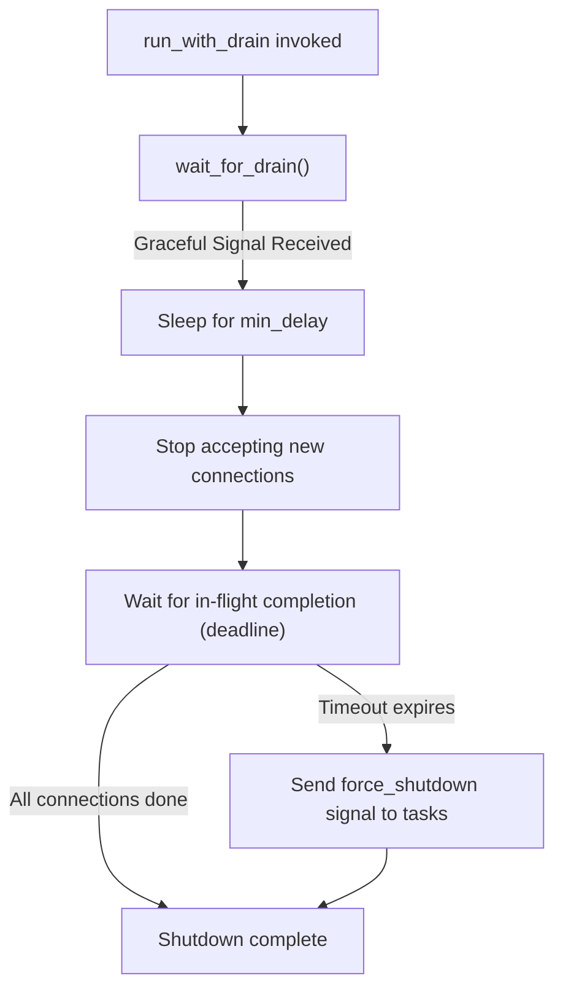

<!-- source: DeepWiki mcp.deepwiki.com · repo agentgateway/agentgateway · page 2.6 Graceful Shutdown and Drain · fetched 2026-10-21 -->

# Graceful Shutdown and Drain

<details>
<summary>Relevant source files</summary>

The following files were used as context for generating this wiki page:

- [crates/agentgateway/src/client/mod.rs](crates/agentgateway/src/client/mod.rs)
- [crates/agentgateway/src/proxy/gateway.rs](crates/agentgateway/src/proxy/gateway.rs)
- [crates/agentgateway/src/proxy/gateway_test.rs](crates/agentgateway/src/proxy/gateway_test.rs)
- [crates/agentgateway/src/proxy/tcpproxy.rs](crates/agentgateway/src/proxy/tcpproxy.rs)
- [crates/agentgateway/src/test_helpers/proxymock.rs](crates/agentgateway/src/test_helpers/proxymock.rs)

</details>


This page documents how `agentgateway` manages connection draining, graceful shutdown procedures, and lifecycle management to ensure clean termination of active requests and connections. It covers the drain channel abstraction (`agent_core::drain`), integration into bind lifecycles, and test validation for correctness.

For the overall application startup and shutdown sequence, see [Application Lifecycle (2.7)](2.7). For how the Gateway accepts and dispatches connections under normal operation, see [Gateway and Connection Handling (2.1)](2.1).

---

## Overview

Agentgateway employs a **drain channel** pattern to coordinate graceful shutdown. Drain is triggered when the process receives termination signals (like `SIGTERM`/`SIGINT`) or an explicit admin shutdown command.

Key steps in drain:

- Signal all components that drain is commencing.
- Continue accepting new connections during a **minimum drain delay** (`connectionMinTerminationDeadline`).
- After the minimum delay, stop accepting new connections.
- Allow existing in-flight connections to complete within a **maximum termination deadline** (`connectionTerminationDeadline`).
- If connections remain open after the deadline, forcefully terminate them via a **force shutdown** signal.

This approach allows for smooth shutdowns with bounded wait times to avoid dropped requests during rolling restarts or deployments.

| Bound          | Config Field                      | Description                                                                                  |
|----------------|---------------------------------|----------------------------------------------------------------------------------------------|
| Min drain time | `connectionMinTerminationDeadline` | Minimum time to accept new connections after drain starts [crates/agentgateway/tests/tests/drain.rs:46-51]() |
| Max drain time | `connectionTerminationDeadline` | Maximum time to wait for in-flight connection completion before force shutdown [crates/agentgateway/tests/tests/drain.rs:46-51]() |

Sources: [crates/agentgateway/tests/tests/drain.rs:46-51]()

---

## Drain Channel Primitives

The drain system is implemented in the `agent_core::drain` module using asynchronous signaling and watch channels.

Key types:

| Type           | Responsibility                                                                                 |
|----------------|--------------------------------------------------------------------------------------------|
| `DrainTrigger` | Owned by the application root; initiates drain by signaling watchers and waits for completion |
| `DrainWatcher` | Cloned and distributed to components; its wait future resolves when drain starts |
| `DrainUpgrader`| Created from `DrainWatcher::into_weak()`, used per connection to hold drain alive until connection finishes |
| `DrainBlocker` (`ReleaseShutdown`) | Keeps a handle to block shutdown closure; dropped when the corresponding task/connection completes |

### Drain Primitives and Code Mapping

```mermaid
flowchart TD
    subgraph CodeSpace ["Code Entity Space"]
        DT["DrainTrigger"]
        DW["DrainWatcher"]
        DU["DrainUpgrader"]
        DS["ReleaseShutdown"]
        GR["Gateway::run"]
        GRB["Gateway::run_bind"]
    end

    DT -->|"signals DrainMode" DW
    DW -->|"cloned into" GR
    GR -->|"passes to" GRB
    GRB -->|"creates per-connection" DU
    DU -->|"yields active" DS
    DS -->|"dropped on close" DT
```

Sources: [crates/agentgateway/src/proxy/gateway.rs:133-167]()

---

## Dual-Phase Shutdown Execution

The shutdown orchestration coordinates graceful shutdown for asynchronous components by managing drain signaling and deadlines.

The shutdown sequence features two phases:

1. **Minimum Delay (`min_delay`)**  
   After the drain signal, the system *continues accepting new connections* for at least the configured minimum delay. This ensures any in-flight clients can still connect momentarily.

2. **Graceful Timeout Phase (`deadline`)**  
   After the minimum delay, new connections are stopped. The system waits for in-flight requests holding on to `DrainWatcher` handles to complete within the deadline remaining. If the deadline expires before all watchers drop their handles, a force-shutdown signal is sent instructing tasks to terminate immediately.

### Flow of Dual-Phase Shutdown



Sources: [crates/agentgateway/src/proxy/gateway.rs:133-167]()

---

## Gateway and Bind Integration with Drain

The `Gateway` struct [crates/agentgateway/src/proxy/gateway.rs:134-137]() manages the lifecycle of listener binds and their accept loops. It integrates tightly with the drain system to enforce graceful shutdown deadlines [crates/agentgateway/src/proxy/gateway.rs:170-233]().

- `Gateway::run` [crates/agentgateway/src/proxy/gateway.rs:170-170]() listens for bind configuration changes and manages `ActiveBind` tasks [crates/agentgateway/src/proxy/gateway.rs:139-145]().
- Each bind acceptance loop is managed by `Gateway::run_bind`. This function awaits drain signals passed as `DrainWatcher` [crates/agentgateway/src/proxy/gateway.rs:136-136]() clones.
- While the drain is signaling but minimum delay has not elapsed, accepts proceed normally.
- After minimum delay, `run_bind` stops accepting new connections.
- For each accepted connection, a `DrainUpgrader` is obtained which holds a `DrainBlocker` for the lifetime of that connection. This prevents premature shutdown.
- When all connections and bind tasks complete, drain is considered finished.

### Gateway Bind Lifecycle and Drain Integration

```mermaid
flowchart LR
    subgraph CodeSpace ["Code Entity Space"]
        GR["Gateway::run"]
        GRB["Gateway::run_bind"]
        AB["ActiveBind"]
        DW["DrainWatcher"]
        DU["DrainUpgrader"]
        DS["ReleaseShutdown"]
    end

    DW -->|"listened to by" GR
    GR -->|"spawns and manages" AB
    AB -->|spawns| GRB
    GRB -->|"enforces min delay, max deadline" GRB
    GRB -->|"creates per-connection" DU
    DU -->|"yields" DS
    DS -->|"held until connection closes" GRB
```

Sources: [crates/agentgateway/src/proxy/gateway.rs:133-233]()

---

## HTTP and TCP Handling in Shutdown

### HTTP Integration

- HTTP request handlers are instrumented to hold a `DrainBlocker` handle while the request is in-flight.
- While draining is active, HTTP connections past the minimum drain period include the `Connection: close` header to instruct clients to not reuse connections.
- The handler completes normally if the request finishes before the maximum drain deadline.
- If the deadline expires, connections are forcibly closed.

### TCP Proxy Integration

- TCP connections are managed by the `TCPProxy` component (`crates/agentgateway/src/proxy/tcpproxy.rs:24-30`).
- TCP connection lifetimes also hold drain blockers, coordinating with the global drain watcher.
- Once the drain signal is received and minimum delay expires, `TCPProxy` stops accepting new connections.
- On forced shutdown, TCP streams are forcibly closed to speed drain termination.

Sources: [crates/agentgateway/src/proxy/tcpproxy.rs:24-30](), [crates/agentgateway/src/proxy/gateway.rs:133-233]()

---

## Drain Test Coverage and Behavior Validation

Extensive test coverage validates shutdown and drain semantics. Key tests include:

| Test Name                                  | Description                                                                                      |
|----------------|------------------------------------------------------------------------------------------------|
| `drain_waits_for_in_flight_request`        | Verifies that drain waits until all HTTP/1 requests complete before shutdown                     |
| `drain_waits_for_in_flight_http2_request`  | Validates that HTTP/2 requests are waited on during drain                                       |
| `drain_cuts_request_past_deadline`          | Confirms requests exceeding max drain deadline are forcibly cut off                             |
| `drain_serves_new_connections_during_minimum` | Confirms new connections are accepted during minimum drain delay                                |
| `drain_deadline_includes_minimum`            | Validates the max drain deadline includes the minimum delay period                             |
| `drain_refuses_new_connections_after_minimum` | Verifies new connections are refused after the minimum drain period                            |

Sources: [crates/agentgateway/src/proxy/gateway_test.rs:1-172]()

---

# Summary

- `agentgateway` provides robust graceful shutdown using asynchronous drain signaling and management.
- The shutdown and drain flow are two-phased with a configurable minimum acceptance delay and a maximum termination deadline.
- Connections hold blocking handles to delay shutdown until each request or connection completes.
- When deadlines expire, forced shutdown signals enable fast termination.
- The `Gateway` [crates/agentgateway/src/proxy/gateway.rs:134-137]() and all binds integrate tightly with this drain system, coordinating accept loops and connection lifecycle.

---

# References

| Subject | File Location |
|---|---|
| Gateway struct and run loop with drain | `crates/agentgateway/src/proxy/gateway.rs:133-233` |
| TCPProxy implementation | `crates/agentgateway/src/proxy/tcpproxy.rs:24-30` |
| Gateway test suite and accept error classification | `crates/agentgateway/src/proxy/gateway_test.rs:1-172` |

Sources: [crates/agentgateway/src/proxy/gateway.rs:133-233](), [crates/agentgateway/src/proxy/tcpproxy.rs:24-30](), [crates/agentgateway/src/proxy/gateway_test.rs:1-172]()

---

