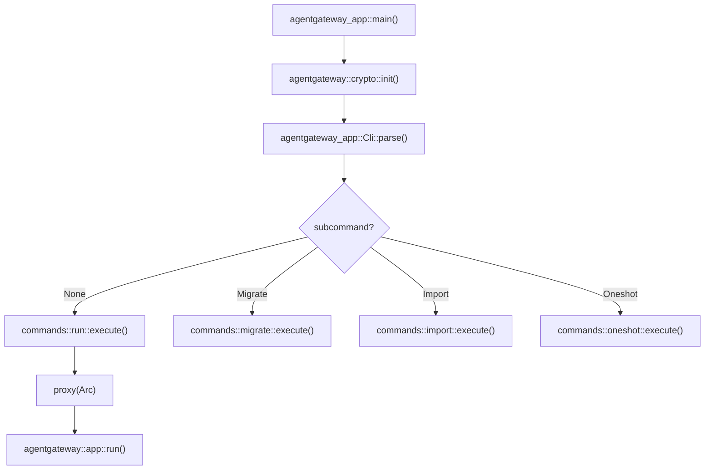
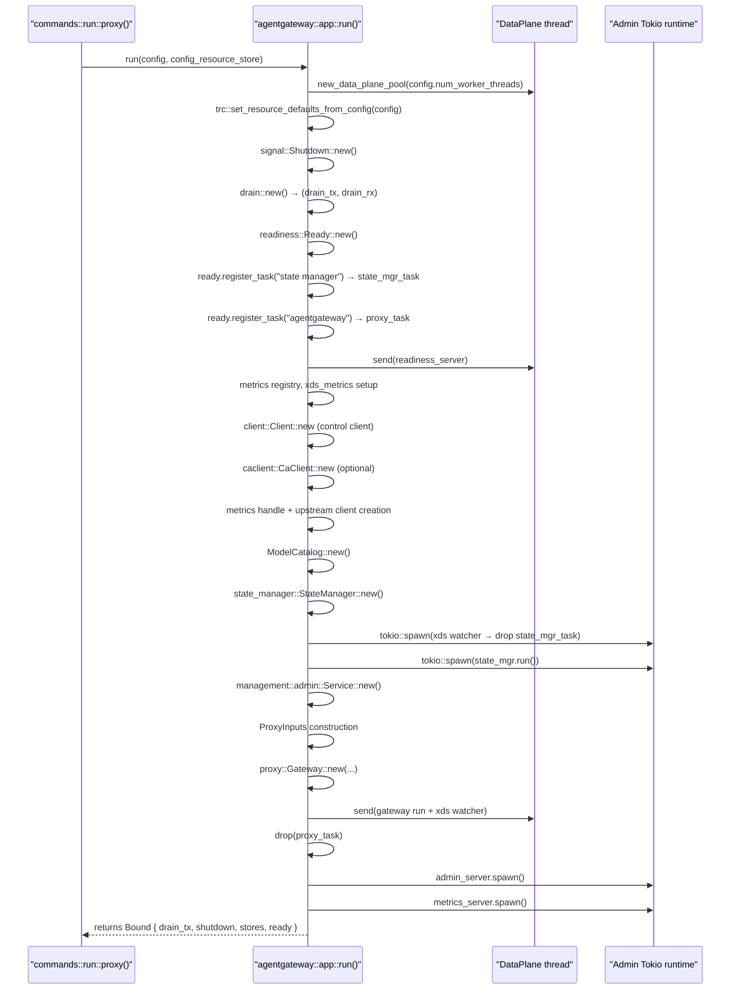
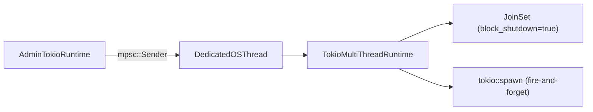
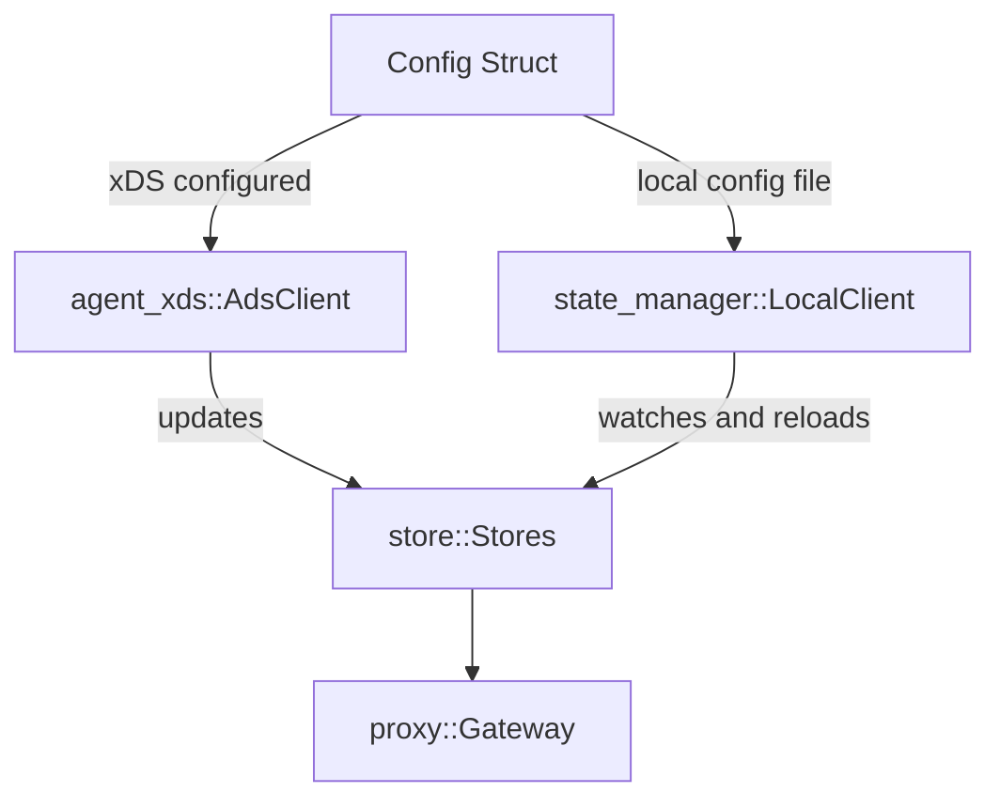

<!-- source: DeepWiki mcp.deepwiki.com · repo agentgateway/agentgateway · page 2.7 Application Lifecycle · fetched 2026-10-21 -->

# Application Lifecycle

<details>
<summary>Relevant source files</summary>

The following files were used as context for generating this wiki page:

- [catalog/model-catalog-overrides.yaml](catalog/model-catalog-overrides.yaml)
- [controller/pkg/cli/catalog/cmd.go](controller/pkg/cli/catalog/cmd.go)
- [controller/pkg/cli/catalog/model_catalog.go](controller/pkg/cli/catalog/model_catalog.go)
- [crates/agentgateway-app/src/main.rs](crates/agentgateway-app/src/main.rs)
- [crates/agentgateway/src/app.rs](crates/agentgateway/src/app.rs)
- [crates/agentgateway/src/config.rs](crates/agentgateway/src/config.rs)
- [crates/agentgateway/src/config_store.rs](crates/agentgateway/src/config_store.rs)
- [crates/agentgateway/src/lib.rs](crates/agentgateway/src/lib.rs)
- [crates/agentgateway/src/llm/catalog/model.rs](crates/agentgateway/src/llm/catalog/model.rs)
- [crates/agentgateway/src/llm/catalog/refresh.rs](crates/agentgateway/src/llm/catalog/refresh.rs)
- [crates/agentgateway/src/management/admin.rs](crates/agentgateway/src/management/admin.rs)
- [crates/agentgateway/src/management/admin_tests.rs](crates/agentgateway/src/management/admin_tests.rs)
- [crates/agentgateway/src/state_manager.rs](crates/agentgateway/src/state_manager.rs)
- [crates/agentgateway/src/ui.rs](crates/agentgateway/src/ui.rs)

</details>


This page details the application startup, initialization, administration servers, and shutdown flow for the `agentgateway` project. It describes the key structs and subsystems involved, focusing on the `app::run` initialization flow, management servers (admin, metrics, readiness), the main entrypoint, and how graceful termination and readiness signaling are handled.

---

## Purpose and Scope

The `agentgateway` application lifecycle covers how the gateway service:

- Initializes configuration, state, and networking subsystems.
- Starts dedicated runtimes for data plane and admin tasks.
- Runs management servers for admin APIs, metrics, and readiness probes.
- Signals when fully operational.
- Responds to shutdown signals with graceful draining.

This centralizes the startup and shutdown mechanisms, coordinating core components like the `app::run` initialization flow in `crates/agentgateway/src/app.rs`, the `StateManager` for configuration synchronization, and proxy execution.

Sources: [crates/agentgateway/src/app.rs:14-209]()

---

## Binary Entry Point and CLI Dispatch

The application’s main entrypoint resides in the binary crate `agentgateway-app` in `crates/agentgateway-app/src/main.rs` [crates/agentgateway-app/src/main.rs:1-2](). This file solely delegates execution to the library run function:

```rust
#[rustfmt::skip]
fn main() -> anyhow::Result<()> { agentgateway_app::run() }
```

The CLI handler parses commands using the `clap` crate, and initializes global crypto and allocation backends before executing the chosen command [crates/agentgateway-app/src/lib.rs:140-163]().

- Crypto initialization by `agentgateway::crypto::init()` ensures cryptographic providers are ready.
- Memory allocator configurations are set per platform.
- The `run` subcommand triggers the main agentgateway execution flow via command module `commands::run::execute()` [crates/agentgateway-app/src/commands/run.rs:12-112]().


*Figure: Mapping Natural Language CLI commands to code entities in CLI and run command implementation.*

Sources: [crates/agentgateway-app/src/main.rs:1-2](), [crates/agentgateway-app/src/lib.rs:140-163](), [crates/agentgateway-app/src/commands/run.rs:12-112]()

---

## `app::run` — Core Application Initialization

Core application startup occurs via the async function `run()` in `crates/agentgateway/src/app.rs` [crates/agentgateway/src/app.rs:14-209](). This function orchestrates system initialization:

- Creates a dedicated OS thread running a Tokio multi-thread runtime for data plane tasks (proxy, readiness server) [crates/agentgateway/src/app.rs:27-58]().
- Configures OpenTelemetry tracing defaults via `trc::set_resource_defaults_from_config()` [crates/agentgateway/src/app.rs:30-30]().
- Sets up graceful shutdown signaling via `signal::Shutdown::new()` [crates/agentgateway/src/app.rs:32-38]().
- Creates drain channels via `drain::new()` for component coordination [crates/agentgateway/src/app.rs:37-38]().
- Initializes readiness tracking with named tasks via `readiness::Ready::new()` [crates/agentgateway/src/app.rs:40-42]().
- Starts the readiness server listening on the data plane runtime via `management::readiness_server::Server::new()` [crates/agentgateway/src/app.rs:44-58]().
- Establishes metrics registries, XDS metrics, and telemetry collectors [crates/agentgateway/src/app.rs:60-66]().
- Creates upstream HTTP clients along with optional CA and SPIFFE clients (`caclient::CaClient`, `spiffe::SpiffeClient`) [crates/agentgateway/src/app.rs:68-87]().
- Loads the model catalog dynamically via `llm::catalog::ModelCatalog::new()` [crates/agentgateway/src/app.rs:106-116]().
- Initializes a `state_manager::StateManager` to synchronize dynamic configuration via xDS or local configuration files [crates/agentgateway/src/app.rs:119-140]().
- Creates the admin server via `management::admin::Service::new()` [crates/agentgateway/src/app.rs:142-154]().
- Bundles a `ProxyInputs` struct aggregating configuration, clients, stores, and metrics for the main proxy gateway [crates/agentgateway/src/app.rs:159-171]().
- Instantiates `proxy::Gateway` and schedules its execution on the data plane runtime [crates/agentgateway/src/app.rs:173-186]().

### Initialization Sequence Diagram


*Figure: Sequence flow connecting initialization functions to worker runtimes.*

Sources: [crates/agentgateway/src/app.rs:14-209]()

---

## Data Plane Thread Pool Architecture

Instead of a single Tokio runtime, `agentgateway` uses a dedicated OS thread hosting a multi-threaded Tokio runtime specifically for data plane work:

- Created by `new_data_plane_pool` passing `config.num_worker_threads` [crates/agentgateway/src/app.rs:27-27]().
- Accepts tasks wrapped as `DataPlaneTask` structs containing a `block_shutdown: bool` flag [crates/agentgateway/src/app.rs:52-58]().
- Tasks with `block_shutdown = true` are tracked in a `JoinSet` [crates/agentgateway/src/app.rs:8-8]().
- Fire-and-forget tasks with `block_shutdown = false` are spawned directly [crates/agentgateway/src/app.rs:53-53]().


*Figure: Relationship between Admin Runtime and Data Plane Runtime thread pools.*

Sources: [crates/agentgateway/src/app.rs:27-58](), [crates/agentgateway/src/app.rs:177-186]()

---

## Readiness Tracking

Readiness state is managed via `readiness::Ready` as a set of named task tokens:

- `ready.register_task("state manager")` holds readiness until configuration state is received [crates/agentgateway/src/app.rs:41-41]().
- `ready.register_task("agentgateway")` is held during proxy initialization and dropped immediately after spawning [crates/agentgateway/src/app.rs:42-42]().

| Task Name          | Token Variable   | Drop Condition                                                 |
|--------------------|------------------|----------------------------------------------------------------|
| `state manager`     | `state_mgr_task` | When the initial XDS configuration snapshot is received       |
| `agentgateway`      | `proxy_task`     | Immediately after the proxy gateway task is spawned            |

Sources: [crates/agentgateway/src/app.rs:32-177](), [crates/core/src/readiness.rs:1-91]()

---

## Management Servers

`agentgateway` runs multiple HTTP servers for management and observability:

| Server Type        | Runtime            | Responsible Struct                       | Main Purpose                                   |
|--------------------|--------------------|----------------------------------------|------------------------------------------------|
| **Readiness**      | Data Plane pool     | `management::readiness_server::Server` | Serve `/healthz/ready` endpoint               |
| **Admin API**      | Admin runtime       | `management::admin::Service`            | Admin APIs, config dump, logging, shutdown     |
| **Metrics**        | Admin runtime       | `management::metrics_server::Server`    | Expose Prometheus metrics                       |

### Readiness Server
Instantiated via `readiness_server::Server::new` and spawned on the data plane runtime [crates/agentgateway/src/app.rs:44-58]().

### Admin Server
Created by `management::admin::Service::new` listening on `config.admin_addr` [crates/agentgateway/src/management/admin.rs:157-157](). Provides configuration inspection, logging control, profiling, and emergency shutdown via `/quitquitquit` [crates/agentgateway/src/management/admin.rs:202-210]().

### Metrics Server
Built via `metrics_server::Server::new` using `config.stats_addr` [crates/agentgateway/src/app.rs:194-196]().

Sources: [crates/agentgateway/src/app.rs:44-202](), [crates/agentgateway/src/management/admin.rs:130-172]()

---

## State Management: `StateManager`

`StateManager` coordinates dynamic configuration loading and xDS synchronization [crates/agentgateway/src/state_manager.rs:16-25]().

- Connects to xDS via `agent_xds::AdsClient` when `xds.address` is configured [crates/agentgateway/src/state_manager.rs:49-81]().
- Watches local files or configuration resources via `LocalClient` when file/database sources are defined [crates/agentgateway/src/state_manager.rs:82-100]().
- Populates runtime `Stores` and triggers readiness notifications upon initial snapshot acquisition [crates/agentgateway/src/state_manager.rs:33-122]().


*Figure: StateManager architecture mapping configuration inputs to runtime stores and code entities.*

Sources: [crates/agentgateway/src/state_manager.rs:33-122](), [crates/agentgateway/src/state_manager.rs:150-210]()

---

## Shutdown and Draining

The `run()` function returns a `Bound` struct containing lifecycle controllers [crates/agentgateway/src/app.rs:17-208](). On termination signals (SIGINT/SIGTERM) or `/quitquitquit`:

- `drain_tx` starts graceful connection and task draining [crates/agentgateway/src/app.rs:37-38]().
- Data plane tasks in `JoinSet` complete execution.
- The `run()` future resolves and the process exits.

Sources: [crates/agentgateway/src/app.rs:32-38](), [crates/agentgateway/src/app.rs:192-208]()

---

## Full Application Lifecycle State Diagram

```mermaid
stateDiagram-v2
  [*] --> Parsing: "CLI parse & run()"
  Parsing --> Init: "app::run() starts"
  Init --> DataPlaneReady: "Data plane & management servers spawn"
  DataPlaneReady --> WaitingXDS: "state_mgr_task held until initial XDS data"
  WaitingXDS --> Ready: "XDS initial state received, drop state_mgr_task"
  Ready --> Serving: "Gateway running, readiness endpoint returns OK"
  Serving --> ShutdownSignal: "Received OS signal or admin shutdown request"
  ShutdownSignal --> Draining: "Trigger drain, wait for DP tasks to finish"
  Draining --> [*]: "Shutdown complete, process exits"
```
*Figure: Overall application lifecycle state machine.*

Sources: [crates/agentgateway/src/app.rs:14-198](), [crates/agentgateway-app/src/lib.rs:134-157]()

---

# Code References

- Binary Entrypoint: [crates/agentgateway-app/src/main.rs:1-2]()
- CLI Dispatch: [crates/agentgateway-app/src/lib.rs:140-163]()
- Core Initialization (`app::run`): [crates/agentgateway/src/app.rs:14-209]()
- Data Plane Thread Pool: [crates/agentgateway/src/app.rs:27-58]()
- Readiness Tracking: [crates/agentgateway/src/app.rs:32-177](), [crates/core/src/readiness.rs:1-91]()
- Management Admin Server: [crates/agentgateway/src/management/admin.rs:130-172]()
- StateManager: [crates/agentgateway/src/state_manager.rs:33-122](), [crates/agentgateway/src/state_manager.rs:150-210]()
- Shutdown Flow: [crates/agentgateway/src/app.rs:192-208]()
- CLI Run Command: [crates/agentgateway-app/src/commands/run.rs:12-112]()

---

