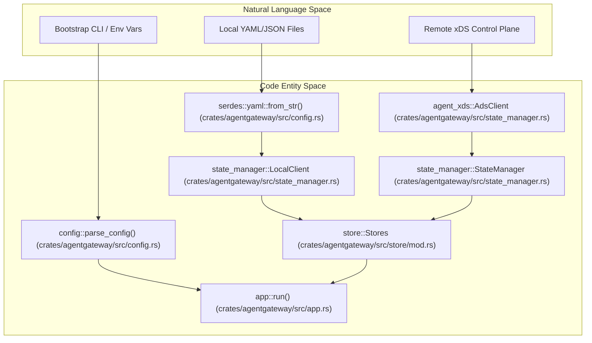

<!-- source: DeepWiki mcp.deepwiki.com · repo agentgateway/agentgateway · page 3 Configuration System · fetched 2026-10-21 -->

# Configuration System

Relevant source files

The following files were used as context for generating this wiki page:

- [catalog/model-catalog-overrides.yaml](catalog/model-catalog-overrides.yaml)
- [controller/pkg/cli/catalog/cmd.go](controller/pkg/cli/catalog/cmd.go)
- [controller/pkg/cli/catalog/model_catalog.go](controller/pkg/cli/catalog/model_catalog.go)
- [crates/agentgateway/src/app.rs](crates/agentgateway/src/app.rs)
- [crates/agentgateway/src/config.rs](crates/agentgateway/src/config.rs)
- [crates/agentgateway/src/config_store.rs](crates/agentgateway/src/config_store.rs)
- [crates/agentgateway/src/lib.rs](crates/agentgateway/src/lib.rs)
- [crates/agentgateway/src/llm/catalog/model.rs](crates/agentgateway/src/llm/catalog/model.rs)
- [crates/agentgateway/src/llm/catalog/refresh.rs](crates/agentgateway/src/llm/catalog/refresh.rs)
- [crates/agentgateway/src/management/admin.rs](crates/agentgateway/src/management/admin.rs)
- [crates/agentgateway/src/management/admin_tests.rs](crates/agentgateway/src/management/admin_tests.rs)
- [crates/agentgateway/src/state_manager.rs](crates/agentgateway/src/state_manager.rs)
- [crates/agentgateway/src/ui.rs](crates/agentgateway/src/ui.rs)

## Purpose and Scope

The Configuration System in AgentGateway provides a comprehensive and unified model for representing, loading, and managing configuration. It supports both static local configuration files in YAML/JSON and dynamic Kubernetes resources via the xDS protocol, seamlessly integrating multiple configuration sources into a normalized in-memory structure used at runtime by all data plane components.

This system facilitates dynamic configuration updates without downtime through state staging and change notification. It handles all core configuration objects including binds, listeners, routes, backends, policies, and specific protocol features such as AI/LLM and MCP.

Additionally, it supports multi-source merging, schema validation, configuration migration for backward compatibility, and environment variable overrides for flexible deployment scenarios, alongside hybrid database-backed configuration storage [crates/agentgateway/src/config_store.rs:156-209]().

For detailed aspects of each sub-topic, refer to the following child pages:

- [Configuration Loading and Sources](#3.1)  
- [Resource Protobuf Schema](#3.2)  
- [Local Configuration Format](#3.3)  
- [Binds and Listeners](#3.4)  
- [Routes, Matching, and Delegation](#3.5)  
- [Backends and Service Discovery](#3.6)  
- [XDS Dynamic Configuration](#3.7)  
- [Environment Variables](#3.8)  
- [Config Store and Database-backed Configuration](#3.9)  

Sources: [crates/agentgateway/src/config_store.rs:156-209]()

---

## Configuration Sources and Loading

AgentGateway accepts configuration from multiple sources that are prioritized and merged to produce the final runtime configuration:

- **Static bootstrap inputs** such as environment variables (e.g. `XDS_ADDRESS`, `LOCAL_XDS_PATH`) and CLI flags provide core global settings and overrides [crates/agentgateway/src/config.rs:52-73]().
- **Local file-based configuration** stored in YAML or JSON files allows static configuration that can be hot-reloaded via file watching mechanisms [crates/agentgateway/src/state_manager.rs:150-210]().
- **Dynamic configuration** streamed via the xDS control plane protocol fetches live Kubernetes-managed resources such as Bind, Listener, Route, and Backend CRs [crates/agentgateway/src/state_manager.rs:49-81]().

On startup, the function `config::parse_config` parses the raw config file content (with shell expansion) using YAML deserialization into a `RawConfig` intermediate structure. Environment variables are merged in, including custom CEL expression registrations for dynamic request attributes and policies [crates/agentgateway/src/config.rs:33-143](). 

For dynamic xDS-driven configuration, the `StateManager` drives the control plane client, either using a `LocalClient` for file or resource change watching, or an `AdsClient` for gRPC xDS streams. Resource updates are staged and merged atomically into in-memory stores (`store::Stores`) used by all runtime components [crates/agentgateway/src/state_manager.rs:34-122]().

Sources: [crates/agentgateway/src/config.rs:33-143](), [crates/agentgateway/src/state_manager.rs:34-122](), [crates/agentgateway/src/state_manager.rs:150-210]()

---

## Architecture Overview of the Configuration System

This diagram bridges the high-level configuration concepts expressed in natural language with their primary code representations:

- Static bootstrap inputs are parsed and merged by `config::parse_config` [crates/agentgateway/src/config.rs:33-143]().
- Local YAML/JSON files are deserialized via `serdes::yaml::from_str` and managed dynamically by `LocalClient` for reloads [crates/agentgateway/src/state_manager.rs:82-100]().
- Remote, Kubernetes-driven xDS configuration is streamed and handled by `agent_xds::AdsClient` wrapped by `StateManager` [crates/agentgateway/src/state_manager.rs:49-81]().
- Both local and dynamic resources populate `store::Stores`, which downstream consumers including the proxy and the app runtime use via `app::run` [crates/agentgateway/src/app.rs:14-209]().

Sources: [crates/agentgateway/src/config.rs:33-143](), [crates/agentgateway/src/state_manager.rs:34-122](), [crates/agentgateway/src/app.rs:14-209]()

---

## Resource Model and Protobuf Schema

AgentGateway represents its core runtime configuration as typed Protocol Buffer resources under the `agentgateway.dev.resource.Resource` definition. These strongly-typed protobuf resources correspond to key configuration entities:

- **Bind**: Defines network listening ports, protocols (HTTP, TCP, tunnels), and associated metadata.
- **Listener**: Specifies hostname matching, frontend protocol details, and TLS configurations attached to Binds.
- **Route (HTTPRoute/GRPCRoute/TCPRoute)**: Specifies routing rules, matchers, and delegation semantics.
- **Backend**: Defines upstream services by static addresses, AI/LLM providers, MCP sessions, AWS backends, and more.
- **Policy**: Traffic policies applied hierarchically at frontend, route, or backend levels.

These protobuf resources embed hierarchical references enabling containment and inheritance semantics. The xDS client dynamically deserializes and watches these proto resources feeding updates into stores [crates/agentgateway/src/state_manager.rs:27-32]().

Sources: [crates/agentgateway/src/state_manager.rs:27-32]()

---

## Local Configuration Format

AgentGateway supports a comprehensive local configuration format in YAML or JSON that captures the entire gateway configuration state. This local format can bootstrap the system or be used standalone without a control plane.

The configuration payload includes bootstrap flags, environment variable overrides, dynamic model cost catalog sources (managed via `Catalog` structs) [crates/agentgateway/src/llm/catalog/model.rs:18-84](), and hybrid storage backends using SQLite or PostgreSQL (`ConfigResourceStore`) [crates/agentgateway/src/config_store.rs:156-209]().

For deeper technical details, see the [Local Configuration Format](#3.3) and [Config Store and Database-backed Configuration](#3.9) child pages.

Sources: [crates/agentgateway/src/llm/catalog/model.rs:18-84](), [crates/agentgateway/src/config_store.rs:156-209]()

---

## Binding and Listener Configuration

Within the configuration model:

- **Binds** are network-level entries defining IP addresses and ports the gateway listens on. They specify the listening protocol family (HTTP, TCP, TLS) and tunnel protocol semantics.
- **Listeners** are logical entities layered above binds, expressing hostname matching rules, frontend protocol types, and TLS settings.

At runtime, the store aggregates binds and listeners, providing efficient maps to route incoming connections to appropriate protocol handlers.

For deeper technical details, see the [Binds and Listeners](#3.4) child page.

Sources: [crates/agentgateway/src/lib.rs:61-62]()

---

## Related Pages

The configuration system is explored in detail across the following linked child pages:

- [Configuration Loading and Sources](#3.1) — Configuration file parsing, environment variable overrides, source priorities, and migration strategies.
- [Resource Protobuf Schema](#3.2) — Detailed protobuf definitions for resource types and generated Go and Rust bindings.
- [Local Configuration Format](#3.3) — Complete JSON/YAML schema, validation rules, and example configurations.
- [Binds and Listeners](#3.4) — Bind definitions, listener configuration, hostname matching semantics, and protocol types.
- [Routes, Matching, and Delegation](#3.5) — Route resource definitions, HTTP/gRPC/TCP matching, and route delegation models.
- [Backends and Service Discovery](#3.6) — Backend types, endpoint resolution, load balancing, and health check configuration.
- [XDS Dynamic Configuration](#3.7) — xDS client protocol handling, resource staging, incremental dynamic updates without downtime.
- [Environment Variables](#3.8) — Reference for environment variables affecting controller behavior and runtime configuration.
- [Config Store and Database-backed Configuration](#3.9) — Hybrid config store modes, persistence in databases, and UI/API editing capabilities.

Sources: [crates/agentgateway/src/config.rs:33-143](), [crates/agentgateway/src/state_manager.rs:34-122](), [crates/agentgateway/src/app.rs:14-209]()

---

