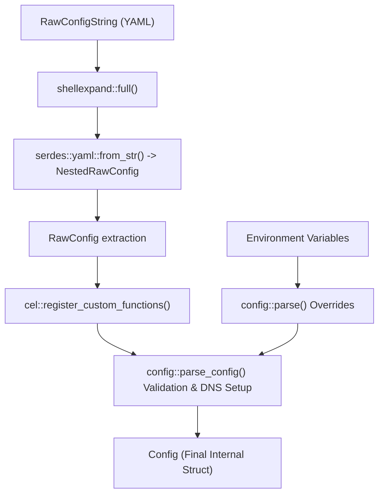
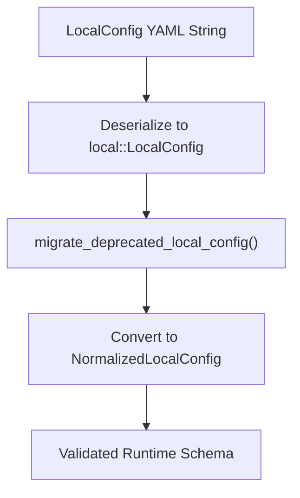
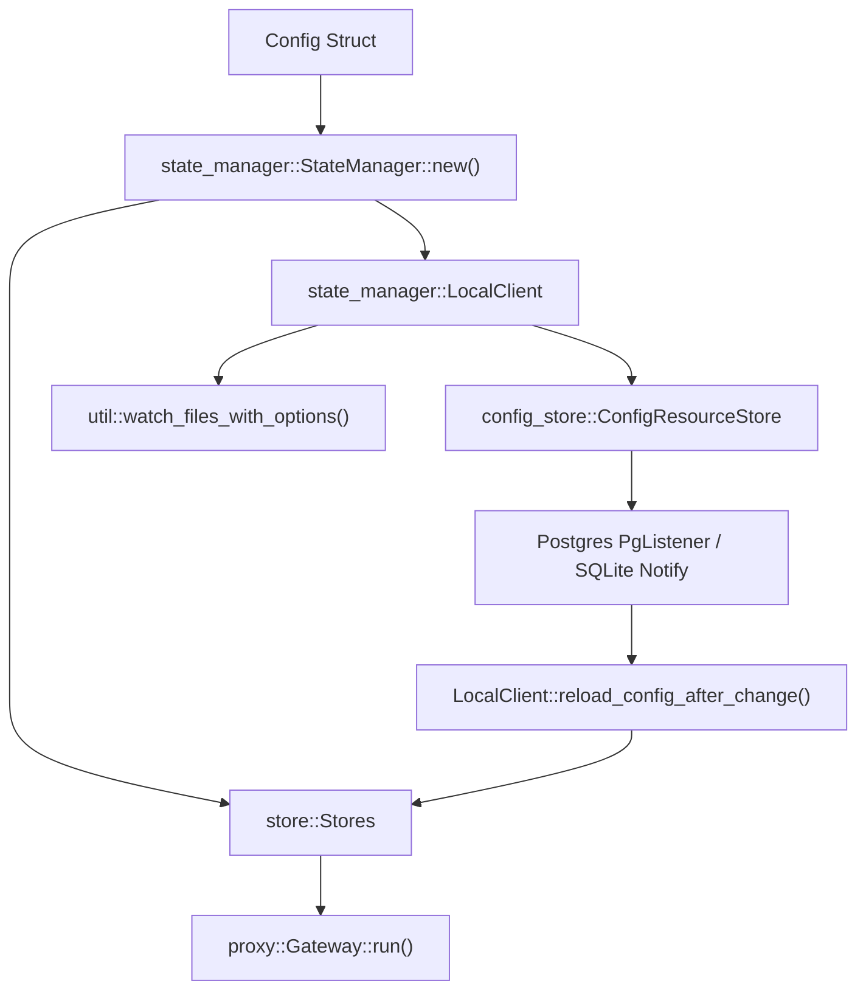

<!-- source: DeepWiki mcp.deepwiki.com · repo agentgateway/agentgateway · page 3.1 Configuration Loading and Sources · fetched 2026-10-21 -->

# Configuration Loading and Sources

Relevant source files

The following files were used as context for generating this wiki page:

- [catalog/model-catalog-overrides.yaml](catalog/model-catalog-overrides.yaml)
- [controller/pkg/cli/catalog/cmd.go](controller/pkg/cli/catalog/cmd.go)
- [controller/pkg/cli/catalog/model_catalog.go](controller/pkg/cli/catalog/model_catalog.go)
- [crates/agentgateway/src/app.rs](crates/agentgateway/src/app.rs)
- [crates/agentgateway/src/config.rs](crates/agentgateway/src/config.rs)
- [crates/agentgateway/src/config_store.rs](crates/agentgateway/src/config_store.rs)
- [crates/agentgateway/src/lib.rs](crates/agentgateway/src/lib.rs)
- [crates/agentgateway/src/llm/catalog/model.rs](crates/agentgateway/src/llm/catalog/model.rs)
- [crates/agentgateway/src/llm/catalog/refresh.rs](crates/agentgateway/src/llm/catalog/refresh.rs)
- [crates/agentgateway/src/management/admin.rs](crates/agentgateway/src/management/admin.rs)
- [crates/agentgateway/src/management/admin_tests.rs](crates/agentgateway/src/management/admin_tests.rs)
- [crates/agentgateway/src/state_manager.rs](crates/agentgateway/src/state_manager.rs)
- [crates/agentgateway/src/ui.rs](crates/agentgateway/src/ui.rs)

This page details the loading and parsing of configuration in AgentGateway, covering how configurations are ingested from static files, environment variable overrides, dynamic xDS sources, and database-backed configuration stores. It explains the key functions and data flow transforming user-provided configuration into an internally validated runtime representation, and describes how configuration changes trigger runtime hot-reloads via `state_manager::StateManager` [crates/agentgateway/src/state_manager.rs:33-122]() and `LocalClient` [crates/agentgateway/src/state_manager.rs:124-148]().

See also related pages for dynamic xDS configuration [3.7 XDS Dynamic Configuration]() and the local config schema [3.3 Local Configuration Format]().

---

## Configuration Sources and Priority

AgentGateway supports layered configuration inputs with well-defined override semantics. Configuration values may flow from static files, environment variables, xDS control planes, or hybrid database-backed stores.

| Configuration Source           | Format / Location                              | Priority Level    | Typical Use Case                             |
|-------------------------------|-----------------------------------------------|-------------------|----------------------------------------------|
| **Static Configuration File** | YAML/JSON (e.g., `config.yaml`)               | Base              | Local or single-node static deployments       |
| **Environment Variables**      | OS environment variables (e.g., `IPV6_ENABLED`) | Overrides static   | Runtime tuning, container orchestration      |
| **xDS Control Plane**          | Dynamic gRPC/Protobuf streaming updates        | Overrides all     | Kubernetes control plane or dynamic live reloads |
| **Hybrid Config Store**        | SQLite / PostgreSQL database tables            | Database Layer    | Web UI management, dynamic config persistence |

Environment variables take precedence over corresponding fields in static configuration files. The xDS mechanism and hybrid database-backed `ConfigResourceStore` [crates/agentgateway/src/config_store.rs:17-21]() allow dynamic configuration updates that override static settings at runtime.

### Common Environment Variables and Config Field Mappings

| Env Variable        | Config Field                | Description                                  |
|---------------------|-----------------------------|----------------------------------------------|
| `IPV6_ENABLED`       | `enableIpv6`                | Enable IPv6 listener binding and DNS lookup [crates/agentgateway/src/config.rs:52-54]() |
| `DNS_LOOKUP_FAMILY`  | `dns.lookupFamily`          | DNS resolver lookup IP family preference [crates/agentgateway/src/lib.rs:92-108]() |
| `DNS_EDNS0`          | `dns.edns0`                 | Enable EDNS0 in DNS resolver [crates/agentgateway/src/lib.rs:135-148]() |
| `XDS_ADDRESS`        | `xdsAddress`                | Control plane address for dynamic config [crates/agentgateway/src/config.rs:96-97]() |
| `XDS_AUTH_TOKEN`     | `xdsAuthToken`              | Token file path for authenticating xDS [crates/agentgateway/src/config.rs:114-134]() |
| `CA_ADDRESS`         | `caAddress`                 | Certificate Authority endpoint [crates/agentgateway/src/config.rs:166-167]() |
| `CA_AUTH_TOKEN`      | `caAuthToken`               | Token file path for CA communication [crates/agentgateway/src/config.rs:178-190]() |
| `TRUST_DOMAIN`       | `trustDomain`               | SPIFFE trust domain for mTLS and identities [crates/agentgateway/src/config.rs:169-171]() |

Sources: [crates/agentgateway/src/config.rs:33-190](), [crates/agentgateway/src/lib.rs:64-193]()

---

## Configuration Loading Pipeline

The core entry point for parsing configuration is `config::parse_config` [crates/agentgateway/src/config.rs:33-36](). It accepts a configuration string and returns an instantiated, validated `Config` struct holding all runtime settings.

### Key Stages in `parse_config`

1. **Shell-style Variable Expansion:**  
   The raw YAML string replaces language server headers and expands shell variables via `shellexpand::full` [crates/agentgateway/src/config.rs:38-39]().

2. **Deserialization to Intermediate Structs:**  
   The expanded content is parsed into `NestedRawConfig` [crates/agentgateway/src/lib.rs:64-70]() and extracted into an optional `RawConfig` [crates/agentgateway/src/lib.rs:150-193]().

3. **Custom CEL Functions Registration:**  
   Custom CEL functions defined under `custom_functions` are registered to the CEL execution engine via `cel::register_custom_functions` [crates/agentgateway/src/config.rs:41-42]().

4. **Environment Variable Overrides:**  
   The helper function `parse<T>()` reads environment variables (such as `IPV6_ENABLED`, `CLUSTER_ID`, `XDS_ADDRESS`, `CA_ADDRESS`, etc.) to override static configuration fields [crates/agentgateway/src/config.rs:52-190]().

5. **DNS Resolver Configuration:**  
   System DNS settings are fetched using `hickory_resolver::system_conf::read_system_conf()` and resolved via `resolve_dns_config` with IP family preferences and EDNS0 options applied [crates/agentgateway/src/config.rs:82-91]().

6. **xDS and CA Subsystem Setup:**  
   xDS addresses, auth tokens, root CAs (`RootCert::File` or `RootCert::Default`), and SPIFFE/CA settings are configured [crates/agentgateway/src/config.rs:95-190]().

### `parse_config` Data Flow Diagram

Sources: [crates/agentgateway/src/config.rs:33-190](), [crates/agentgateway/src/lib.rs:64-193]()

---

## Local Configuration Normalization and Deprecated Config Migration

Local configuration files defining binds, listeners, routes, backends, and policies go through a separate normalization pipeline [crates/agentgateway/src/types/local.rs]():

- **Deserialization:** Raw YAML strings parse into `local::LocalConfig` representations.
- **Migration of Deprecated Fields:** Deprecated configuration structures are migrated in-place to modern equivalents (e.g., standardizing legacy top-level logging and tracing configuration into frontend policy subsections, normalizing request attributes).
- **Normalized Representation:** Conversion into `NormalizedLocalConfig`, performing structural schema validation and logical reference resolving.

### Normalization Pipeline Diagram

Sources: [crates/agentgateway/src/types/local.rs:78-188]()

---

## Integration with StateManager and Hot-Reloading

Once parsed, the configuration drives `state_manager::StateManager` [crates/agentgateway/src/state_manager.rs:33-122](), which maintains in-memory `store::Stores` [crates/agentgateway/src/store.rs]():

- **Static / File Watcher (`LocalClient`):** When `xds.local_config` points to a file, `state_manager::LocalClient` watches the file path [crates/agentgateway/src/state_manager.rs:141-143]() using file system notifications (`util::watch_files_with_options`) [crates/agentgateway/src/state_manager.rs:155-157]() and resource channel subscribers [crates/agentgateway/src/state_manager.rs:162-166]().
- **Dynamic xDS Client:** When `xds.address` is configured, `agent_xds::AdsClient` connects over gRPC to stream dynamic configuration updates [crates/agentgateway/src/state_manager.rs:49-81]() without requiring gateway restarts.
- **Hybrid Config Store:** In hybrid mode (`ConfigStoreMode::Hybrid`), a database-backed `ConfigResourceStore` [crates/agentgateway/src/config_store.rs:17-21]() persists resource updates from the Web UI or management APIs, pushing reload signals over database channels (Postgres `PgListener` or SQLite change notifications) [crates/agentgateway/src/config_store.rs:167-208]() to `LocalClient` [crates/agentgateway/src/state_manager.rs:193-204]().

### StateManager and Reload Flow Diagram

Sources: [crates/agentgateway/src/state_manager.rs:33-210](), [crates/agentgateway/src/config_store.rs:167-208](), [crates/agentgateway/src/app.rs:14-186]()

---

# References

- `crates/agentgateway/src/config.rs:33-190`
- `crates/agentgateway/src/lib.rs:64-193`
- `crates/agentgateway/src/types/local.rs:78-188`
- `crates/agentgateway/src/state_manager.rs:33-210`
- `crates/agentgateway/src/config_store.rs:17-21,167-208`
- `crates/agentgateway/src/app.rs:14-186`

---

