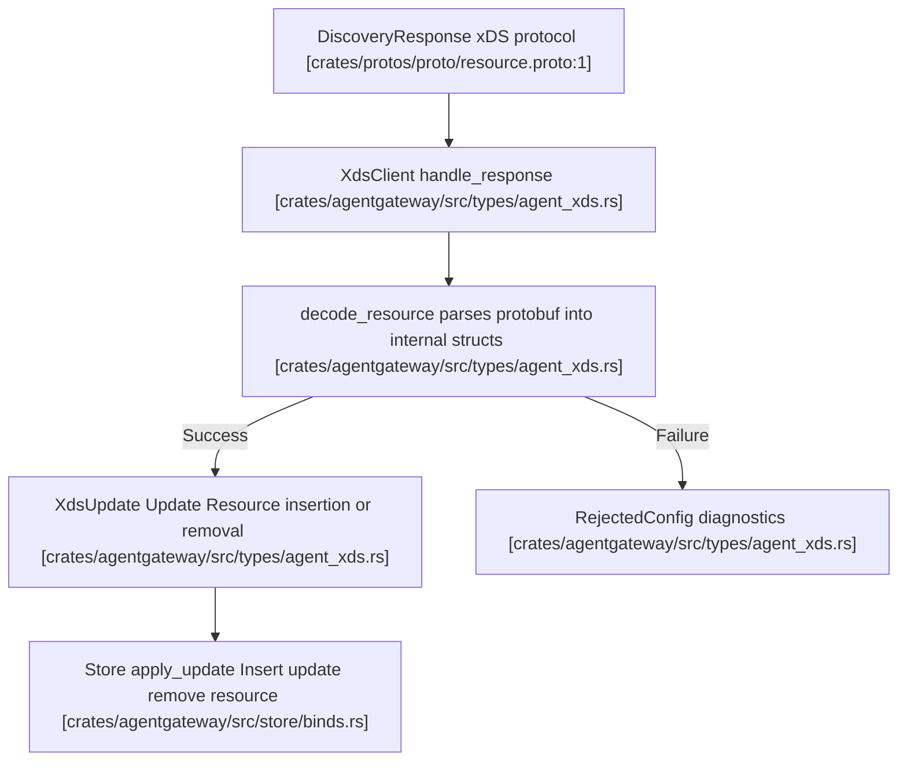

<!-- source: DeepWiki mcp.deepwiki.com · repo agentgateway/agentgateway · page 3.2 Resource Protobuf Schema · fetched 2026-10-21 -->

# Resource Protobuf Schema

<details>
<summary>Relevant source files</summary>

The following files were used as context for generating this wiki page:

- [api/resource.pb.go](api/resource.pb.go)
- [api/resource_json.gen.go](api/resource_json.gen.go)
- [controller/api/v1alpha1/agentgateway/agentgateway_policy_types.go](controller/api/v1alpha1/agentgateway/agentgateway_policy_types.go)
- [controller/api/v1alpha1/agentgateway/zz_generated.deepcopy.go](controller/api/v1alpha1/agentgateway/zz_generated.deepcopy.go)
- [controller/install/helm/agentgateway-crds/templates/agentgateway.dev_agentgatewaybackends.yaml](controller/install/helm/agentgateway-crds/templates/agentgateway.dev_agentgatewaybackends.yaml)
- [controller/install/helm/agentgateway-crds/templates/agentgateway.dev_agentgatewaypolicies.yaml](controller/install/helm/agentgateway-crds/templates/agentgateway.dev_agentgatewaypolicies.yaml)
- [controller/pkg/agentgateway/plugins/backend_policies.go](controller/pkg/agentgateway/plugins/backend_policies.go)
- [controller/pkg/agentgateway/plugins/traffic_plugin.go](controller/pkg/agentgateway/plugins/traffic_plugin.go)
- [crates/agentgateway/src/proxy/httpproxy.rs](crates/agentgateway/src/proxy/httpproxy.rs)
- [crates/agentgateway/src/store/binds.rs](crates/agentgateway/src/store/binds.rs)
- [crates/agentgateway/src/types/agent.rs](crates/agentgateway/src/types/agent.rs)
- [crates/agentgateway/src/types/agent_xds.rs](crates/agentgateway/src/types/agent_xds.rs)
- [crates/agentgateway/src/types/local.rs](crates/agentgateway/src/types/local.rs)
- [crates/agentgateway/src/types/local_tests.rs](crates/agentgateway/src/types/local_tests.rs)
- [crates/protos/proto/resource.proto](crates/protos/proto/resource.proto)
- [schema/config.json](schema/config.json)
- [schema/config.md](schema/config.md)

</details>


This page documents the `resource.proto` schema: the message definitions used as the wire format for agentgateway's configuration resources, and how the generated Go and Rust types from that file are used at runtime. The schema covers `Bind`, `Listener`, `Route`, `Backend`, and `Policy` messages along with all their supporting types.

For how these resources are loaded and delivered at runtime via XDS, see Configuration Loading and Sources (3.1) and XDS Dynamic Configuration (3.7). For the human-authored local config format that is ultimately converted into these structures, see Local Configuration Format (3.3).

---

## File Location and Package Identity

The Protobuf schema is defined at:

```
crates/protos/proto/resource.proto
```
[[crates/protos/proto/resource.proto:1-10]]()

- Proto package name: `agentgateway.dev.resource`
- Go package for generated bindings: `github.com/agentgateway/agentgateway/go/api;api` [[crates/protos/proto/resource.proto:3-9]]()
- Rust generated bindings reside under `crate::types::proto::agent`
- Generated Go protobuf file is located at:

```
api/resource.pb.go
```
[[api/resource.pb.go:1-25]]()

- Additionally, a JSON shim for Kubernetes compatibility is generated at:

```
api/resource_json.gen.go
```
[[api/resource_json.gen.go:1-20]]()

Sources: [[crates/protos/proto/resource.proto:1-10]](), [[api/resource.pb.go:1-25]](), [[api/resource_json.gen.go:1-20]]()

---

## Message Hierarchy

The central message is the top-level `Resource` envelope, which uses a `oneof kind` to encapsulate specific resource types:

- `Bind`
- `Listener`
- `Route`
- `Backend`
- `Policy`
- Plus TCP routes, workload, service, route groups, and model routes.

This hierarchy models the agentgateway configuration resource structure.

```mermaid
graph TD
    R["Resource [crates/protos/proto/resource.proto:11]"] --> B["Bind [crates/protos/proto/resource.proto:27]"]
    R --> L["Listener [crates/protos/proto/resource.proto:86]"]
    R --> RT["Route [crates/protos/proto/resource.proto:99]"]
    R --> TCPRT["TCPRoute [crates/protos/proto/resource.proto:128]"]
    R --> BK["Backend [crates/protos/proto/resource.proto:181]"]
    R --> PL["Policy [crates/protos/proto/resource.proto:156]"]
    R --> WL["istio.workload.Workload [crates/protos/proto/resource.proto:19]"]
    R --> SVC["istio.workload.Service [crates/protos/proto/resource.proto:21]"]
    R --> RG["RouteGroup [crates/protos/proto/resource.proto:122]"]
    R --> MR["ModelRoute [crates/protos/proto/resource.proto:23]"]

    L --> LN["ListenerName [crates/protos/proto/resource.proto:67]"]
    L --> TLS["TLSConfig [crates/protos/proto/resource.proto:230]"]

    RT --> RN["RouteName [crates/protos/proto/resource.proto:60]"]
    RT --> RM["RouteMatch [crates/protos/proto/resource.proto:117]"]

    BK --> ST["StaticBackend [crates/protos/proto/resource.proto:187]"]
    BK --> AI["AIBackend [crates/protos/proto/resource.proto:188]"]
    BK --> MCP["MCPBackend [crates/protos/proto/resource.proto:189]"]
    BK --> DFP["DynamicForwardProxy [crates/protos/proto/resource.proto:190]"]
    BK --> AWS["AwsBackend [crates/protos/proto/resource.proto:191]"]
    BK --> GB["GuardrailBackend [crates/protos/proto/resource.proto:209]"]
```



Sources: [[crates/protos/proto/resource.proto:11-206]]()

---

## Top-Level Resource Envelope

- The `Resource` message wraps all resource types in a unified protobuf message for streaming via xDS [[crates/protos/proto/resource.proto:11-25]]().
- Each resource has a unique string `key` identifier for indexing and cross-referencing.
- This enables versioned and atomic update sets delivered via xDS in the data plane.

Sources: [[crates/protos/proto/resource.proto:11-25]]()

---

## Core Resource Messages

### Bind

`Bind` represents a network port binding that agentgateway listens on.

| Field             | Type                    | Description                                                        |
|-------------------|-------------------------|--------------------------------------------------------------------|
| `key`             | `string`                | Unique bind identifier                                             |
| `port`            | `uint32`                | TCP port number for the bind                                       |
| `protocol`        | `Bind.Protocol` enum    | Base protocol: `HTTP`, `TCP`, or `TLS`                            |
| `tunnel_protocol` | `Bind.TunnelProtocol` enum | Tunnel transport wrapping the base protocol (e.g., HBONE, PROXY) |
| `mode`            | `Bind.Mode` enum        | Socket binding mode: `STANDARD` (active listener) or `INTERNAL` (in-process only) |

- Bind protocol defines how the connection is processed at the base transport layer.
- Tunnel protocol defines overlay encodings (e.g., PROXY protocol, HBONE waypoint encapsulation).
- The `INTERNAL` mode bind with port 0 serves as a wildcard fallback for in-process routing.
  
Sources: [[crates/protos/proto/resource.proto:27-58]](), [[api/resource.pb.go:149-247]]()

---

### Listener

Defines logical ingress routes within a Bind, including hostname and TLS termination.

| Field      | Type            | Description                              |
|------------|-----------------|----------------------------------------|
| `key`      | `string`        | Unique listener key                     |
| `bind_key` | `string`        | Parent Bind key                        |
| `name`     | `ListenerName`  | Structured resource name                |
| `hostname` | `string`        | Hostname or SNI matching pattern       |
| `protocol` | `Protocol`      | Protocol type at listener layer        |
| `tls`      | `TLSConfig`     | TLS termination and mTLS policy details|

- `ListenerName` includes gateway, namespace, and listener-set metadata.
- TLS config embeds certificates, trust roots, and client certificate validation flags.

Sources: [[crates/protos/proto/resource.proto:86-97]]()

---

### Route

Routes describe HTTP/GRPC matching rules and backend targets.

| Field           | Type                        | Description                                   |
|-----------------|-----------------------------|-----------------------------------------------|
| `key`           | `string`                    | Unique route key                              |
| `listener_key`  | `string`                    | Parent listener or route group key           |
| `hostnames`     | `repeated string`           | Hostname match list                           |
| `matches`       | `repeated RouteMatch`       | Path, header, and other match conditions      |
| `backends`      | `repeated RouteBackend`     | Weighted backend targets                       |
| `traffic_policies` | `repeated TrafficPolicySpec` | Attached traffic policies                     |
| `service_key`   | `istio.workload.NamespacedHostname` | Optional Kubernetes service target          |
| `service_port`  | `uint32`                    | Optional Kubernetes service port scope       |
| `route_group_key` | `optional string`           | Optional containment inside a route group    |

- Supports direct routing and Kubernetes service targets.
- Supports delegation via route groups.

Sources: [[crates/protos/proto/resource.proto:99-120]]()

---

### Backend

Represents upstream destination endpoints and protocols:

| Variant               | Description                                           |
|-----------------------|-------------------------------------------------------|
| `StaticBackend`       | Fixed endpoints with health checks                    |
| `AIBackend`           | AI model provider abstraction                         |
| `MCPBackend`          | Model Context Protocol backend relay                  |
| `DynamicForwardProxy` | Dynamic on-demand backend resolution                  |
| `AwsBackend`          | AWS-specific backends like Bedrock and AgentCore     |
| `GuardrailBackend`    | AI safety guardrail integrations                       |
| `ModelRouterBackend`  | Virtual routers for AI model traffic                   |

- Inline `BackendPolicySpec` can attach policies directly to backends.
- AI and MCP backends enable specialized traffic handling for LLM and protocol relays.

Sources: [[crates/protos/proto/resource.proto:181-197]](), [[crates/protos/proto/resource.proto:209-222]]()

---

### Policy

Policies control traffic, backend configuration, and frontend behavior.

| Field               | Description                                                   |
|---------------------|---------------------------------------------------------------|
| `key`               | Unique string identifier for the policy                      |
| `name`              | Typed resource name for the policy                            |
| `target`            | The resource targeted by the policy (Bind, Listener, Route, Backend) |
| `inheritance`       | Merge model (`DEFAULT`, `OVERRIDE`) controlling policy precedence |
| `creation_timestamp`| Kubernetes timestamp for conflict resolution                 |
| `kind`              | One of: `TrafficPolicySpec`, `BackendPolicySpec`, `FrontendPolicySpec`, or `ConditionalPolicies` |

- Policies may be conditional with CEL expressions as conditions.
- The inheritance controls merging of overlapping policies on the same targets.

Sources: [[crates/protos/proto/resource.proto:156-180]]()

---

## Kubernetes to Protobuf Translation Pipeline

The Kubernetes CRDs for configuration are defined in Go and translate into the protobuf messages delivered to the data plane.

```mermaid
graph LR
    subgraph "Kubernetes Space Go Entities"
        CRD_POLICY["AgentgatewayPolicy [controller/api/v1alpha1/agentgateway/agentgateway_policy_types.go:29]"]
        CRD_BACKEND["AgentgatewayBackend [controller/install/helm/agentgateway-crds/templates/agentgateway.dev_agentgatewaybackends.yaml:16]"]
    end

    subgraph "Translation Layer Go Controller"
        PLUGIN["TranslateAgentgatewayPolicy [controller/pkg/agentgateway/plugins/traffic_plugin.go:112]"]
        BACKEND_TRANS["TranslateInlineBackendPolicy [controller/pkg/agentgateway/plugins/backend_policies.go:120]"]
        BE_AGW["translateBackendPolicyToAgw [controller/pkg/agentgateway/plugins/backend_policies.go:136]"]
    end

    subgraph "Protobuf Resources Generated Go Types"
        PB_POLICY["api.Policy [crates/protos/proto/resource.proto:156]"]
        PB_BACKEND["api.Backend [crates/protos/proto/resource.proto:181]"]
        PB_RESOURCE["api.Resource [crates/protos/proto/resource.proto:11]"]
    end

    CRD_POLICY -->|translated by| PLUGIN
    CRD_BACKEND -->|translated by| BACKEND_TRANS
    BACKEND_TRANS -->|calls| BE_AGW
    PLUGIN -->|produces| PB_POLICY
    BE_AGW -->|produces| PB_POLICY
    PB_POLICY -->|wrapped in| PB_RESOURCE
    PB_BACKEND -->|wrapped in| PB_RESOURCE
```



- The Go-based controller validates and converts the Kubernetes CRD objects into canonical protobuf resource messages.
- The controller then publishes these to the xDS control plane stream consumed by the agentgateway dataplane.

Sources: [[controller/api/v1alpha1/agentgateway/agentgateway_policy_types.go:29-45]](), [[controller/install/helm/agentgateway-crds/templates/agentgateway.dev_agentgatewaybackends.yaml:16-22]](), [[controller/pkg/agentgateway/plugins/traffic_plugin.go:112-118]](), [[controller/pkg/agentgateway/plugins/backend_policies.go:120-136]](), [[crates/protos/proto/resource.proto:11-181]]()

---

## TLS and Authentication-related Messages

- The `TLSConfig` embedded within `Listener` defines TLS termination settings.
- It includes certificates, client certificate requirements, trust roots, and allowed cipher suites.
- `GuardrailBackend` messages support AI backend integrations for safety and guardrail enforcement APIs.
- These messages embed complex extensions for AI policy enforcement invisible at the routing layer, but critical for prompt guard policies.

Sources: [[crates/protos/proto/resource.proto:209-222]]()

---

## Data Plane XDS Update Flow

The Rust data plane receives dynamic configuration updates encoded in these protobuf messages over xDS streams.



- The `DiscoveryResponse` embeds multiple `Resource` protobuf messages.
- `XdsClient` performs validation and parsing, producing internal Rust representations for each resource kind.
- Successful updates trigger `XdsUpdate` events to insert, modify, or remove resources in the configuration store.
- The `Store` manages lifecycle of binds and listeners, including socket binding and resource reference resolution.

Sources: [[crates/protos/proto/resource.proto:1-10]](), [[crates/agentgateway/src/types/agent_xds.rs:1-100]](), [[crates/agentgateway/src/store/binds.rs:1-50]]()

---

## Protocol Enum Definitions

Several protocol enums govern interpretation of transports at different layers.

| Enum Type             | Proto Location                  | Description                                                    |
|-----------------------|--------------------------------|----------------------------------------------------------------|
| `Protocol`            | [api/resource.pb.go:27-56]      | General resource-level protocols (`UNKNOWN`, `HTTP`, `HTTPS`, `TLS`, `TCP`, `HBONE`) |
| `Bind_Protocol`       | [api/resource.pb.go:149-191]    | Base bind-level protocols (`HTTP`, `TCP`, `TLS`)               |
| `Bind_TunnelProtocol` | [api/resource.pb.go:199-247]    | Tunnel protocol overlay (`DIRECT`, `PROXY`, `HBONE_WAYPOINT`, `CONNECT`, etc.) |

- These enums guide the proxy in parsing and multiplexing connections and tunnels.
- The distinction between Bind protocol and Tunnel protocol enables flexible transport layering.

Sources: [[api/resource.pb.go:27-252]](), [[crates/protos/proto/resource.proto:31-43]]()

---

## Summary

The `resource.proto` protobuf schema defines the core configuration resource types used by Agentgateway's dynamic control plane:

- **Bind**: Network port bindings with protocol and tunnel encapsulation.
- **Listener**: Logical listeners scoped to binds with hostname filtering and TLS configuration.
- **Route**: HTTP/GRPC routing rules with multiplexing, matching, and backend references.
- **Backend**: Upstream backends supporting static sets, AI providers, MCP, AWS, and guardrails.
- **Policy**: Fine-grained traffic, frontend, and backend policies with inheritance and conditional logic.

Generated Go and Rust protobuf bindings serve as the canonical contract between the Kubernetes controller, the control plane, and the Rust data plane proxy.

This schema is the foundation for uniform, versioned, and incremental resource management enabling agentgateway's flexibility as a data plane for Agentic AI connectivity.

Sources: [[crates/protos/proto/resource.proto:1-231]](), [[api/resource.pb.go:1-252]]()

---

