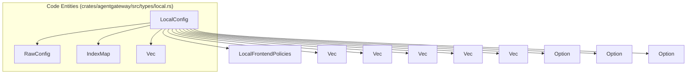
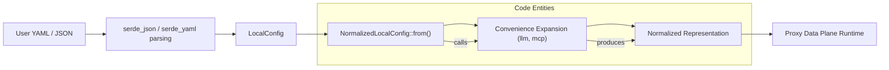
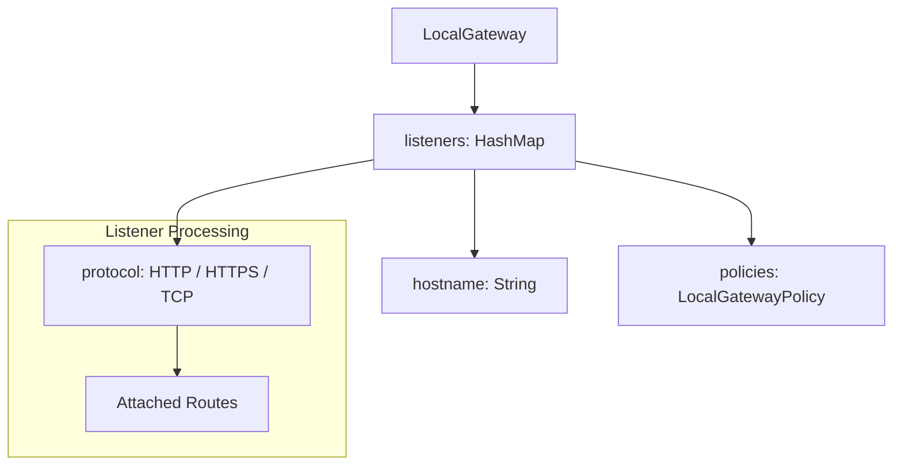

<!-- source: DeepWiki mcp.deepwiki.com · repo agentgateway/agentgateway · page 3.3 Local Configuration Format · fetched 2026-10-21 -->

# Local Configuration Format

<details>
<summary>Relevant source files</summary>

The following files were used as context for generating this wiki page:

- [crates/agentgateway/src/llm/model_router.rs](crates/agentgateway/src/llm/model_router.rs)
- [crates/agentgateway/src/types/loadbalancer.rs](crates/agentgateway/src/types/loadbalancer.rs)
- [crates/agentgateway/src/types/local_tests/basic_config.yaml](crates/agentgateway/src/types/local_tests/basic_config.yaml)
- [crates/agentgateway/src/types/local_tests/basic_normalized.snap](crates/agentgateway/src/types/local_tests/basic_normalized.snap)
- [crates/agentgateway/src/types/local_tests/llm_normalized.snap](crates/agentgateway/src/types/local_tests/llm_normalized.snap)
- [crates/agentgateway/src/types/local_tests/llm_simple_config.yaml](crates/agentgateway/src/types/local_tests/llm_simple_config.yaml)
- [crates/agentgateway/src/types/local_tests/llm_simple_normalized.snap](crates/agentgateway/src/types/local_tests/llm_simple_normalized.snap)
- [crates/agentgateway/src/types/local_tests/mcp_normalized.snap](crates/agentgateway/src/types/local_tests/mcp_normalized.snap)
- [crates/agentgateway/src/types/local_tests/mcp_simple_config.yaml](crates/agentgateway/src/types/local_tests/mcp_simple_config.yaml)
- [crates/agentgateway/src/types/local_tests/mcp_simple_normalized.snap](crates/agentgateway/src/types/local_tests/mcp_simple_normalized.snap)
- [crates/xtask/src/schema.rs](crates/xtask/src/schema.rs)
- [tools/schema-to-md.sh](tools/schema-to-md.sh)
- [tools/schema_paths.jq](tools/schema_paths.jq)

</details>


The Local Configuration Format is a JSON or YAML schema used for configuring AgentGateway in standalone or containerized deployments. It serves as a comprehensive, file-based alternative to Kubernetes Gateway API resources, enabling full expression of gateway configuration—including bindings, listeners, routes, backends, and policies—in a single hierarchical document validated against a JSON schema.

At runtime, configuration files placed or passed to the gateway are parsed, validated, and transformed into a normalized internal representation (`NormalizedLocalConfig`) by normalization routines [crates/agentgateway/src/types/local.rs:78-105](). This normalization expands simplified convenience top-level sections (such as `llm` and `mcp`) into explicit routing rules, listeners, and specialized backends.

---

## Top-Level Schema Structure and Generation

The root of the local configuration is the `LocalConfig` object, defined in Rust and serialized to JSON Schema via `schemars` during xtask generation steps [crates/xtask/src/schema.rs:27-34](). The generated schemas reside in the `schema/` directory, with `config.json` defining the primary configuration contract and `cel.json` defining the expression language context schema [crates/xtask/src/schema.rs:35-42]().

### Visual Schema Hierarchy (Natural Language to Code Space)



Sources: [crates/xtask/src/schema.rs:27-58](), [crates/agentgateway/src/types/local.rs:78-105]()

---

## Normalization and Data Flow

User-facing YAML or JSON configurations undergo an asynchronous normalization pipeline. The raw `LocalConfig` struct is ingested and processed into a normalized internal form, resolving shortcuts like top-level `llm` models and generating explicit listeners and route handlers.

### Normalization Pipeline Data Flow



Sources: [crates/agentgateway/src/types/local.rs:78-105](), [crates/agentgateway/src/types/local_tests/llm_simple_normalized.snap:1-33]()

---

## Core Sections Reference

### RawConfig: Global Runtime Settings

The `config` section specifies global server behavior, telemetry targets, administrative sockets, and cryptographic keys:

| Field | Description |
|---|---|
| `adminAddr` | Socket address for the administrative and debug interface (e.g., `127.0.0.1:8090`). |
| `statsAddr` | Socket address for Prometheus metrics scraping. |
| `readinessAddr` | Network address for readiness probes. |
| `xdsAddress` | Remote xDS control plane address for dynamic updates. |
| `session.key` | Secret AES-256-GCM key used for encrypting session cookies. |
| `modelCatalog` | List of model pricing and cost catalogs. |
| `tracing` | OpenTelemetry tracing collector endpoints and parameters. |

Sources: [schema/config.json:125-181]()

### Gateways, Binds, and Listeners

Gateways and binds manage the socket ingress layer. While `binds` provides low-level port socket mappings (deprecated in favor of `gateways`), `gateways` defines rich entrypoints supporting protocol detection, TLS termination, and traffic handling policies.



Sources: [crates/agentgateway/src/types/agent.rs:48-135](), [schema/config.json:18-24]()

### Model Routing and AI Subsystems

For AI and LLM gateways, the local configuration format supports specialized declarations. Models defined under `llm` or virtual model groups are compiled into `ModelRoute` and `ModelRouter` structs [crates/agentgateway/src/llm/model_router.rs:19-35](). 

Key functions in `model_router.rs` handle automatic endpoint classification:
- `serving_route_matches()`: Generates implicit route matches for standard LLM inference endpoints (`/v1/chat/completions`, `/v1/messages`, etc.) [crates/agentgateway/src/llm/model_router.rs:131-145]().
- `classify_route(path)`: Identifies the target `RouteType` for incoming requests based on path signatures [crates/agentgateway/src/llm/model_router.rs:147-159]().

Sources: [crates/agentgateway/src/llm/model_router.rs:19-159](), [crates/agentgateway/src/types/local_tests/llm_simple_normalized.snap:110-157]()

---

## Example Local Configurations

### Simple LLM Gateway Configuration

The following example demonstrates a local configuration featuring LLM model declarations, JWT authentication, rate limiting, and prompt guard policies.

```yaml
frontendPolicies:
  accessLog:
    add:
      user: request.headers["user-agent"]

llm:
  policies:
    guardrails:
      request:
      - regex:
          action: reject
          rules:
          - builtin: email
        rejection:
          status: 400
    cors:
      allowOrigins:
        - http://localhost:15000
    localRateLimit:
    - type: tokens
      fillInterval: 1s
      tokensPerFill: 10
      maxTokens: 100
    jwtAuth:
      issuer: agentgateway.dev
      audiences: [test.agentgateway.dev]
      jwks: '{"keys":[]}'
    authorization:
      rules:
      - 'jwt.email.endsWith("@example.com")'
  models:
  - name: claude-3-haiku
    provider: anthropic
    params:
      model: claude-haiku-4-5-20251001
      apiKey: "sk-123"
      baseUrl: https://anthropic.internal/v1
      tokenize: true
  - name: llama-3.1-8b-instant
    provider: groq
```

Sources: [crates/agentgateway/src/types/local_tests/llm_simple_config.yaml:1-85](), [crates/agentgateway/src/types/local_tests/llm_simple_normalized.snap:1-110]()

---

### MCP Gateway Configuration

Configures a Model Context Protocol (MCP) gateway exposing upstream stdio transport servers like `@modelcontextprotocol/server-everything`.

```yaml
config:
  mcp:
    sessionTtl: 8m
frontendPolicies:
  accessLog:
    add:
      user: request.headers['user-agent']
binds:
- port: 3000
  listeners:
  - routes:
    - policies:
        cors:
          allowOrigins:
            - "*"
          allowHeaders:
            - mcp-protocol-version
            - content-type
            - cache-control
      backends:
      - mcp:
          targets:
          - name: everything
            stdio:
              cmd: npx
              args: ["@modelcontextprotocol/server-everything"]
```

Sources: [crates/agentgateway/src/types/local_tests/basic_config.yaml:1-27](), [crates/agentgateway/src/types/local_tests/basic_normalized.snap:1-56]()

---

