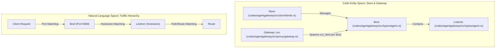
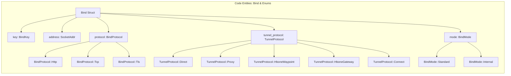
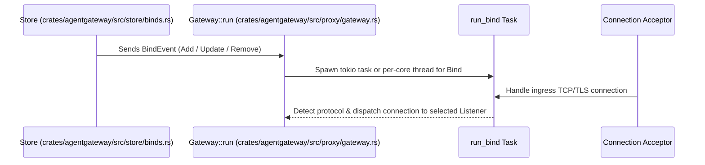
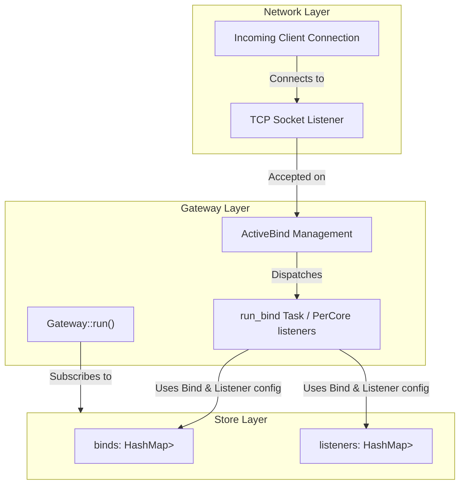

<!-- source: DeepWiki mcp.deepwiki.com · repo agentgateway/agentgateway · page 3.4 Binds and Listeners · fetched 2026-10-21 -->

# Binds and Listeners

<details>
<summary>Relevant source files</summary>

The following files were used as context for generating this wiki page:

- [crates/agentgateway/src/types/frontend.rs](crates/agentgateway/src/types/frontend.rs)

</details>


This page details the technical implementation of **Bind** and **Listener** configuration resources within AgentGateway, governing how network sockets accept connections, route by protocol, and match hostnames. For the routing mechanics following listener selection, see [Routes, Matching, and Delegation](3.5). For backend targets, see [Backends and Service Discovery](3.6).

---

## Architecture Overview

Connection handling in the data plane is structured across three hierarchical layers:

- **Bind**: Defines the network socket (IP:port) where AgentGateway listens.
- **Listener**: Matches hostnames and protocols on incoming connections accepted on a Bind.
- **Route**: Matches request paths and headers for deeper routing.

This hierarchy ensures efficient demultiplexing of traffic, starting from the socket-level, through protocol and hostname matching.



*Figure 1: Bridging natural language traffic hierarchy to core code entities.*

Sources:  
[crates/agentgateway/src/types/agent.rs:47-56]()  
[crates/agentgateway/src/types/agent.rs:117-134]()  
[crates/agentgateway/src/store/binds.rs:94-142]()  
[crates/agentgateway/src/proxy/gateway.rs:164-236]()

---

## Bind Resource Structure

The **Bind** resource defines a network socket where AgentGateway accepts inbound connections. It binds to a specific IP and port and declares the protocol semantics for this socket.

### Bind Structure and Enums

- The **Bind** struct includes these key fields:

| Field            | Type           | Description                                                                                  |
|------------------|----------------|----------------------------------------------------------------------------------------------|
| `key`            | `BindKey`      | Unique identifier for the bind.                                                             |
| `address`        | `SocketAddr`   | The IP and port where connections are accepted.                                             |
| `protocol`       | `BindProtocol` | Transport-level protocol kind (`Http`, `Tcp`, `Tls`).                                       |
| `tunnel_protocol`| `TunnelProtocol` | Outer tunneling protocol for inbound traffic (`Direct`, `Proxy`, `HboneWaypoint`, `HboneGateway`, `Connect`). |
| `mode`           | `BindMode`     | Indicates `standard` (OS socket) vs `internal` (in-process only) binding mode.               |

- Special internal bind with port `0` serves as a wildcard fallback to handle unmatched `CONNECT` tunnel re-entries.

- The `BindProtocol` enum defines socket-level protocol:

  - `Http`: HTTP traffic.
  - `Tcp`: Raw TCP forwarding.
  - `Tls`: TLS termination.

- The `TunnelProtocol` enum describes outer tunnel wrapping layers:

  - `Direct`: no tunnel encapsulation.
  - `Proxy`: PROXY protocol v1 or v2 wrapping.
  - `HboneWaypoint`: HBONE tunnel via a waypoint proxy.
  - `HboneGateway`: HBONE tunnel within gateway components.
  - `Connect`: explicit CONNECT tunnel handling.

- `BindMode` distinguishes:

  - `Standard`: classical OS socket bind.
  - `Internal`: in-process bind, invisible externally.



*Figure 2: Bind struct and associated enums.*

Sources:  
[crates/agentgateway/src/types/agent.rs:47-64]()  
[crates/agentgateway/src/proxy/gateway.rs:33-35]()

---

## Listener Configuration and Hostname Matching

A **Listener** attaches to an active `Bind` and implements protocol-specific logic based on incoming connection attributes such as hostname and protocol type.

### Listener Struct Highlights

- `key`: a unique `ListenerKey` identifying this listener.
- `name`: a `ListenerName` for user-friendly identification and internal use.
- `hostname`: string hostname or wildcard pattern to match on.
- `protocol`: `ListenerProtocol` enum indicating the network protocol (e.g., HTTP, HTTPS, TLS, TCP, HBONE).

### Hostname Matching Behavior

Listeners match inbound requests by hostname using the method:

```rust
pub fn matches(&self, hostname: &str) -> bool {
    self.hostname == hostname
        || self.hostname.is_empty()
        || (self.hostname.starts_with("*") && hostname.ends_with(&self.hostname[1..]))
}
```

- Exact hostname: Listener's `hostname` equals the incoming hostname.
- Catch-all: empty `hostname` matches any hostname.
- Wildcard suffix: Listeners starting with `*` match hostnames ending with the remainder (suffix).

This scheme enables layered matching rules to direct incoming requests precisely.

Sources:  
[crates/agentgateway/src/types/agent.rs:117-134]()

---

## Gateway Connection Lifecycle

The **Gateway** struct coordinates bind acceptance loops and manages active listeners for incoming connections.

- It subscribes to `BindEvent`s emitted by the Store, signaling additions, updates, or removals of binds.
- On bind addition, `Gateway::run` spawns workers (async Tokio tasks) to accept connections:
  - For simple cases, one async task runs `run_bind` for the bind.
  - For per-core bindings, each CPU core gets a pinned thread with its listener.
- Bind tasks keep watch channels of config updates, allowing live config changes without restarting acceptor tasks.



*Figure 3: Gateway event loop managing binds and connection acceptance.*

Sources:  
[crates/agentgateway/src/proxy/gateway.rs:164-236]()  
[crates/agentgateway/src/store/binds.rs:94-142]()

---

## Store Integration for Binds and Listeners

The **Store** subsystem manages all configured Binds and ListenerSets in a concurrency-safe way.

- Maintains a map of binds: `HashMap<BindKey, Arc<Bind>>`.
- Maintains a map of listeners attached by bind: `HashMap<BindKey, Arc<ListenerSet>>`.
- `BindListeners` enum indicates how listeners are stored for each bind:
  - `Single`: a single standard listener socket.
  - `PerCore`: per-CPU-core socket listeners mapped by core ID.
- `BindEvent` variants negotiate lifecycle:
  - `Add(Bind, ListenerSet)` signals a new bind and its listeners.
  - `Update(Bind)` updates an existing bind.
  - `Remove(BindKey)` removes a bind and stops acceptance.

The gateway subscribes to these events to spawn or stop socket acceptors dynamically, adjusting to configuration changes without downtime.

Sources:  
[crates/agentgateway/src/store/binds.rs:94-142]()

---

## Protocol Types and Frontend Categories

Within binds and listeners, protocol types define the expected traffic type and frontend behavior. Frontend configurations are managed via structs defined in `crates/agentgateway/src/types/frontend.rs`, including `HTTP`, `TLS`, and `TCP`.

| Type               | Description                                                             |
|--------------------|-------------------------------------------------------------------------|
| `BindProtocol`      | Transport-level socket protocol: `Http`, `Tcp`, or `Tls`.              |
| `ListenerProtocol`  | More detailed listener protocol: HTTP/HTTPS, TCP, HBONE, etc.          |
| `Frontend Types`    | Configurations like HTTP param tuning, TLS settings, or TCP keepalives.|

- The `HTTP` struct [crates/agentgateway/src/types/frontend.rs:49-103]() configures body buffer limits (`max_buffer_size`), HTTP/1 headers and idle timeouts (`http1_idle_timeout`, `http1_header_case`), HTTP/2 flow control windows and keepalive parameters, as well as `max_connection_duration` and `max_concurrent_requests`.
- The `TLS` struct [crates/agentgateway/src/types/frontend.rs:129-152]() controls handshake timeouts (`handshake_timeout`), ALPN protocols, minimum and maximum TLS versions via `TLSVersion`, cipher suites, and key exchange groups.
- The `TCP` struct [crates/agentgateway/src/types/frontend.rs:169-177]() specifies keepalive configurations and connection limits (`max_connections`).
- The `ProxyVersion` enum [crates/agentgateway/src/types/frontend.rs:181-199]() manages PROXY protocol parsing options (`V1`, `V2`, `All`).

Sources:  
[crates/agentgateway/src/types/frontend.rs:49-199]()  
[crates/agentgateway/src/types/agent.rs:117-134]()  
[crates/agentgateway/src/proxy/gateway.rs:180-210]()

---

## Summary of Bind and Listener Constructs

| Concept            | Code Entity                                        | Role                                                       |
|--------------------|---------------------------------------------------|------------------------------------------------------------|
| **Bind**           | `Bind`, `BindKey` [crates/agentgateway/src/types/agent.rs:48]() | Network socket binding, including address, protocol, tunnel encapsulation.  |
| **BindProtocol**   | `BindProtocol` [crates/agentgateway/src/types/agent.rs:51]()      | Protocol type at socket layer (HTTP, TCP, TLS).             |
| **TunnelProtocol** | `TunnelProtocol` [crates/agentgateway/src/types/agent.rs:52]()    | Outer tunnel protocol wrapping inbound traffic.             |
| **Listener**       | `Listener`, `ListenerKey` [crates/agentgateway/src/types/agent.rs:119]() | Protocol handler and hostname matcher attached to a Bind.    |
| **Hostname Match** | `Listener::matches()` [crates/agentgateway/src/types/agent.rs:130]() | Exact, catch-all, and wildcard suffix hostname matching.    |
| **Gateway Loop**   | `Gateway::run()` [crates/agentgateway/src/proxy/gateway.rs:169]() | Async loops managing bind acceptance and dispatch.           |
| **Store State**    | `Store` [crates/agentgateway/src/store/binds.rs:94]()             | Holds thread-safe state of binds and listeners.             |

Sources:  
[crates/agentgateway/src/types/agent.rs:47-134]()  
[crates/agentgateway/src/proxy/gateway.rs:164-236]()  
[crates/agentgateway/src/store/binds.rs:94-142]()

---

## Summary Diagram: Bind and Listener Component Interaction



*Figure 4: Interaction between store-maintained binds/listeners and the gateway's active acceptors.*

Sources:  
[crates/agentgateway/src/proxy/gateway.rs:164-236]()  
[crates/agentgateway/src/store/binds.rs:94-142]()  
[crates/agentgateway/src/types/agent.rs:47-134]()

---

## Summary

Agents configured with Binds and Listeners enable AgentGateway to:

- Bind to specified IP:port addresses with well-defined protocols and optional tunnel encapsulation.
- Accept and classify inbound connections by protocol and hostname matching.
- Spawn per-bind, and optionally per-core, workers for high-performance connection acceptance.
- Dynamically update bind and listener state through watch channels and event subscription without restarts.

This subsystem forms the foundation of the gateway's ingress data plane and prepares requests for downstream route matching and backend selection.

Sources:  
[crates/agentgateway/src/proxy/gateway.rs:164-236]()  
[crates/agentgateway/src/store/binds.rs:94-142]()  

---

## Glossary

| Term              | Meaning                                                     |
|-------------------|-------------------------------------------------------------|
| **Bind**          | A network socket binding (IP:port and protocol) managed by AgentGateway. |
| **Listener**      | Protocol handler and hostname matcher attached to a Bind.   |
| **BindProtocol**  | Protocol type at bind level (HTTP, TCP, TLS).               |
| **TunnelProtocol**| Tunnel encapsulation protocol wrapping inbound connections. |
| **ActiveBind**    | Runtime structure managing active accept tasks or per-core listeners. |

Sources:  
[crates/agentgateway/src/types/agent.rs:47-134]()  
[crates/agentgateway/src/store/binds.rs:94-142]()

---

